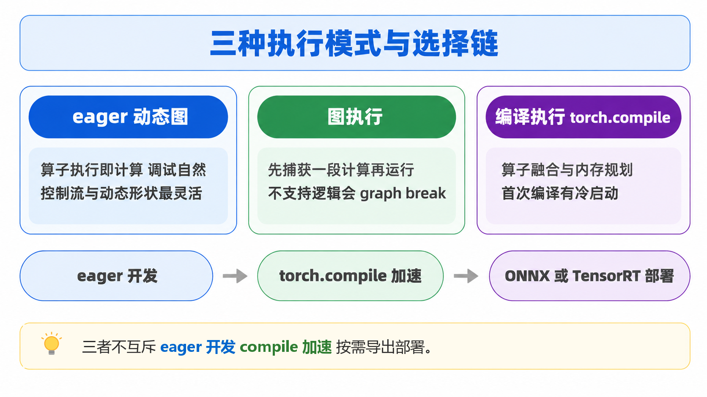
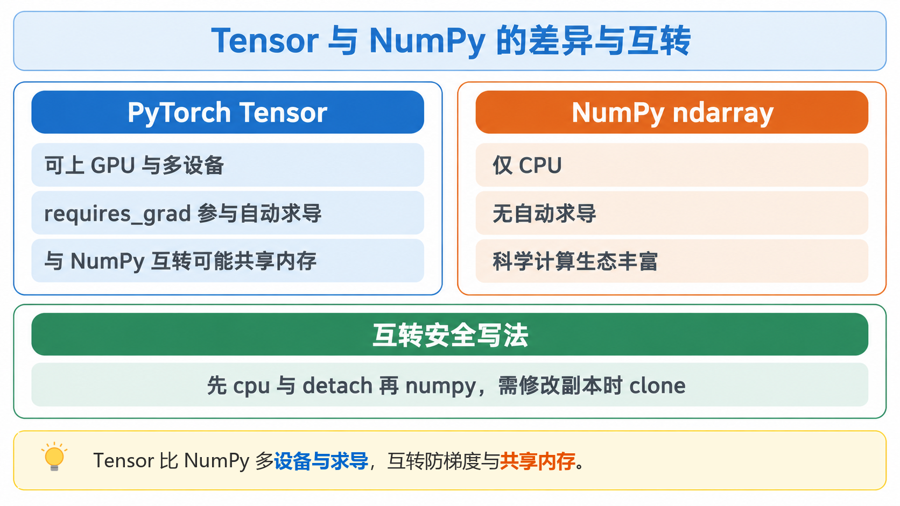
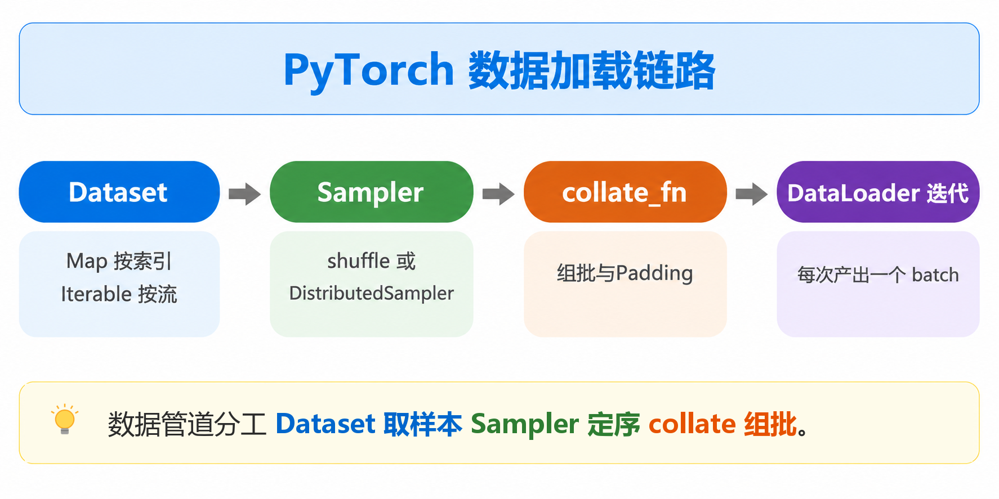
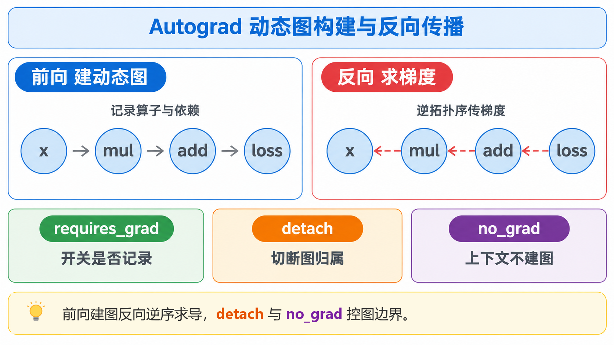
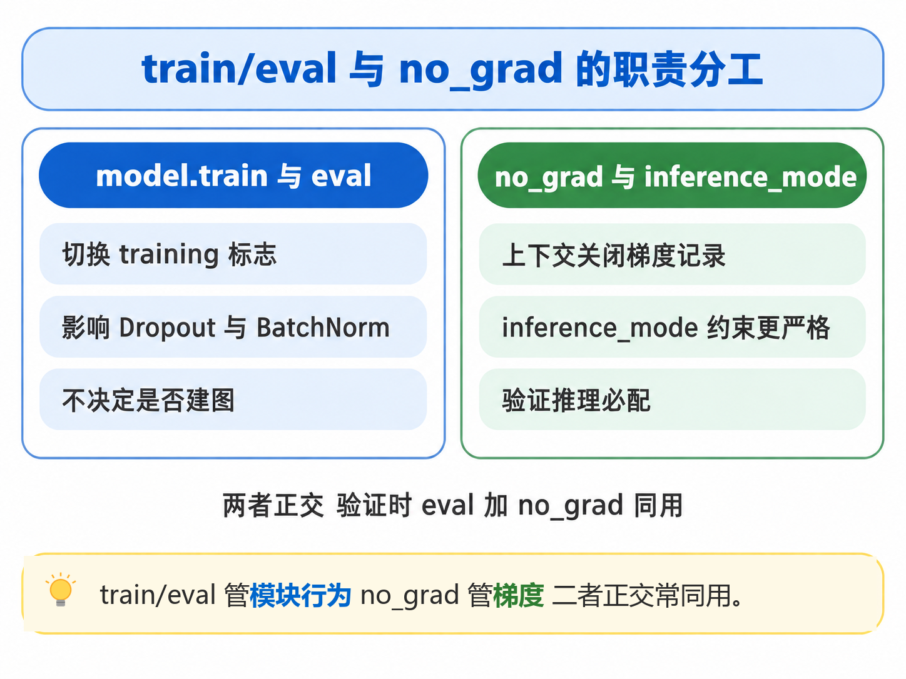
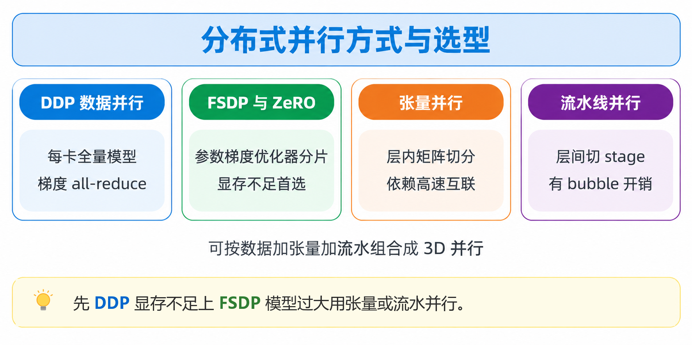
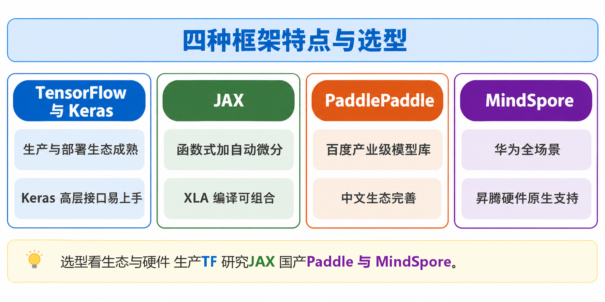
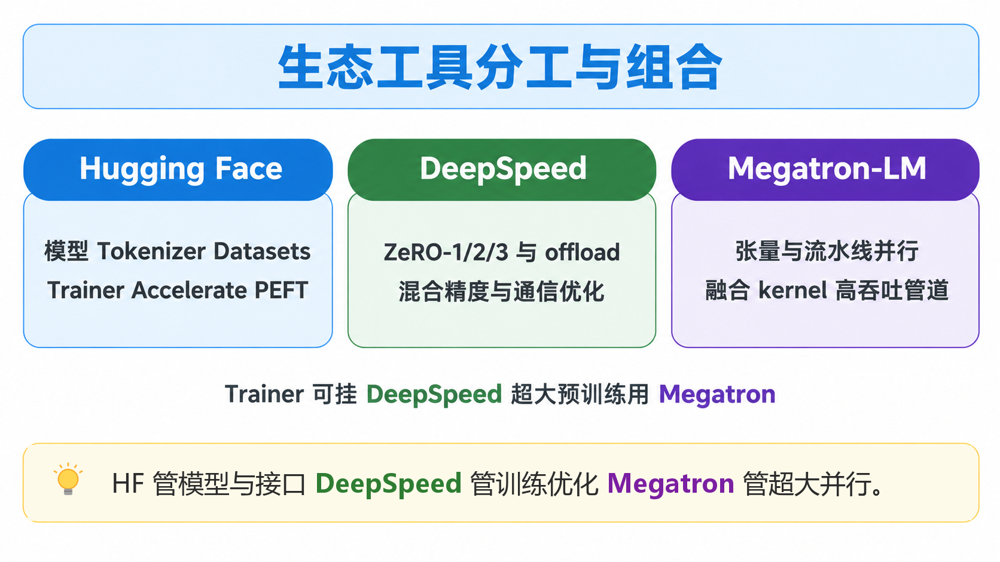

# 目录

## 1.5 深度学习框架与工具

本章面向深度学习算法工程师面试，先讲清 PyTorch 的执行模型、Tensor、数据管道、自动求导、训练/评估模式和分布式训练，再补齐 TensorFlow/Keras、JAX、PaddlePaddle、MindSpore 等框架，以及 Hugging Face、DeepSpeed、Megatron-LM等生态工具。

[1. PyTorch 核心底层与工程常用知识点汇总](#p5-1)

- [面试问题：动态图、图执行与编译执行有什么区别？PyTorch 中应如何选择 eager、torch.compile 与模型导出？](#p5-1-1)
- [面试问题：PyTorch Tensor 的核心特性有哪些？它与 NumPy 数组的本质差异和互转注意事项是什么？](#p5-1-2)
- [面试问题：PyTorch 的数据加载链路是什么？Dataset、DataLoader、Sampler 与 collate_fn 如何分工？](#p5-1-3)
- [面试问题：Autograd 如何构建动态计算图并完成反向传播？requires_grad、detach、no_grad 有什么区别？](#p5-1-4)
- [面试问题：model.train()、model.eval()、torch.no_grad() 和 torch.inference_mode() 有什么区别？](#p5-1-5)
- [面试问题：PyTorch 分布式训练有哪些并行方式？DDP、FSDP/ZeRO、张量并行和流水线并行如何选？](#p5-1-6)

[2. PyTorch 以外的深度学习框架与生态工具概览](#p5-2)

- [面试问题：TensorFlow/Keras、JAX、PaddlePaddle 与 MindSpore 分别有什么特点，如何选择？](#p5-2-1)
- [面试问题：Hugging Face、DeepSpeed 与 Megatron-LM 分别解决什么问题，如何配合使用？](#p5-2-2)

<h1 id="p5-1">1. PyTorch 核心底层与工程常用知识点汇总</h1>

<h2 id="p5-1-1">面试问题：动态图、图执行与编译执行有什么区别？PyTorch 中应如何选择 eager、torch.compile 与模型导出？</h2>

**难度评分：⭐⭐⭐（3/5）| 考察频率：⭐⭐⭐⭐⭐（5/5）** 

动态图就是 eager 模式，Python 执行到哪个算子就当场算哪个，和写普通 Python 脚本一样。图执行是先把一段计算过程整体捕获下来，再交给图运行时统一跑。编译执行更进一步，在捕获计算图的基础上做算子融合、内存规划和硬件特化优化。三者不是非此即彼的框架标签，现代 PyTorch 的典型工作流是 eager 模式下开发调试，模型稳定后用 torch.compile 加速训练或推理，最后按需导出到 ONNX 或 TensorRT 做生产部署。

两者最直观的差异体现在六个方面。执行时机上，eager 是来一个算子算一个，图执行和编译执行是先把整个计算路径录下来再统一调度。控制流上，eager 里写任意 Python if/for 都能跑，数据相关的分支判断最自然；图执行只能捕获能识别的控制流，遇到不支持的 Python 逻辑就会产生 graph break，要么回退到 eager 执行，要么触发重新编译。输入形状上，eager 天然支持变长序列和动态分支，图执行虽然也能处理动态形状，但会增加 guard 判断和重编译成本。调试上，eager 可以直接用 pdb 打断点看中间 tensor，图执行要结合编译日志和 profiler 才能定位问题，排查成本高很多。性能上，eager 逐个调度算子，Python 层调度和 kernel launch 的开销叠加起来不小；图执行和编译执行能融合相邻算子、消除中间 tensor 的读写、统一规划显存，直接调用硬件专用内核。启动和部署上，eager 没有编译冷启动，起来就能跑；编译执行首次要花时间编译，但导出的图或引擎更方便接入 C++ 推理服务。

图执行这个概念本身也分层次。最基础的 Tracing 追踪只记录一次样例输入走过的算子路径，数据相关的控制流很容易被错误固化。再往上是 Symbolic 或 AOT capture，符号捕获会保留更多图结构和输入约束信息。最上层的 Compilation 编译是把捕获到的图交给 Inductor、XLA 或 TensorRT 这类后端，生成硬件上优化后的代码或引擎。

实际选的时候，研究阶段、快速迭代、写复杂 Python 逻辑或者自定义算子，优先用 eager，先把正确性跑通。模型结构稳定了想提升吞吐，就上 torch.compile，它本质是捕获可编译区域加后端编译的混合方案，不会把整个 Python 程序强行变成一张静态图。需要跨语言部署、跨进程调用，或者要在固定硬件上做推理加速，就用 torch.export 导出 ONNX 或 TensorRT 引擎，导出这一步是部署边界，一定要验证算子覆盖、动态维度和数值一致性。

工程落地时要注意，torch.compile 遇到不支持的代码会 graph break，输入形状变了或者控制流走了新分支会触发重编译。评估效果不能只看单次运行时间，要盯编译耗时、稳态吞吐、显存占用、P50/P99 延迟和回退次数。做推理服务的话，预热和编译缓存要纳入发布流程，不能让用户第一次请求就等编译。

还有几个常见误区要澄清。PyTorch 不是只有动态图，2.x 之后已经有完整的图捕获和编译能力；TensorFlow 2 也不是只有静态图，eager 模式同样是默认。ONNX 只是模型交换格式，本身不执行计算，真正跑模型的是 ONNX Runtime 或 TensorRT 这类运行时。另外图执行不一定更快，小模型、动态输入频繁或者 graph break 很多的时候，编译开销可能把优化收益全吃掉，必须实际跑基准测试验证。

eager、图执行与编译执行三种模式的区别与选择链如图5-1所示：

  

图5-1 三种执行模式与选择链

<h2 id="p5-1-2">面试问题：PyTorch Tensor 的核心特性有哪些？它与 NumPy 数组的本质差异和互转注意事项是什么？</h2>

**难度评分：⭐⭐⭐（3/5）| 考察频率：⭐⭐⭐⭐⭐（5/5）** 

Tensor 是带有形状、步长、数据类型、设备、存储布局和自动求导信息的多维数组抽象，NumPy 的 ndarray 主要面向 CPU 数值计算。二者接口很像，可以互操作，但设备位置、数据类型、梯度追踪和内存共享关系必须搞清楚，否则很容易出 bug。

Tensor 在底层把 shape 和 stride 一起管理，shape 描述各维度大小，stride 描述每个维度步进多少个元素，所以 view、reshape、转置和切片操作很多时候只是在改步长，生成共享底层存储的视图，并不会真正复制数据。每个 Tensor 通过 .device 标识自己在 CPU、CUDA 还是其他加速器上，需要移动设备就调 .to()，参与同一个算子的 Tensor 必须在兼容设备上。数据类型覆盖 float32、float16、bfloat16、float64、整数和布尔等，做混合精度训练时要特别留意累加精度和算子对低精度类型的支持情况。设置了 requires_grad=True 的 Tensor 参与运算时，Autograd 会自动记录计算路径，反向传播时直接算梯度。广播和向量化操作遵循 NumPy 的规则，内置线性代数、索引、散射、稀疏和量化相关算子。存储层面多个 Tensor 可能指向同一块底层 storage，原地操作会同时影响所有别名，还可能破坏反向传播需要保存的中间激活值。生态上 Tensor 是 nn.Module、优化器、AMP、DDP/FSDP 这些组件的标准数据载体，但分布式通信能力来自这些组件本身，不是 Tensor 自带的。

和 NumPy 放在一起对比，差异就更清楚了。Tensor 能跑在 CPU、CUDA 和各种加速器上，NumPy 基本只在 CPU 上跑。Tensor 原生集成了 Autograd，可以构建计算图做反向传播，NumPy 没有这套机制。Tensor 从一开始就是为模型训练设计的，和 nn.Module、优化器、混合精度、分布式训练整套打通，NumPy 只能做数值计算，训练流程要自己从零搭。CUDA 上的算子通常是异步执行的，要精确计时必须先做同步，NumPy 在 CPU 上运算则是同步的。内存层面 Tensor 可以和 NumPy 数组零拷贝互转，但有前提条件。

实际互转的时候，torch.from_numpy 创建的 CPU Tensor 和原 NumPy 数组是共享内存的，改一个另一个也跟着变，前提是数组在 CPU 上、数据类型受支持、内存布局合适。反过来把 Tensor 转 NumPy 时，要求 Tensor 在 CPU 上且没有追踪梯度，不满足条件就先 detach() 再 .cpu()，必要时加 .copy() 做内存隔离。torch.as_tensor 会尽量复用输入的内存，torch.tensor 则明确创建副本，两者行为不一样。读到只读 NumPy 数组的时候，不要通过共享内存的 Tensor 去原地修改它。两边的 dtype 推断规则也不完全一致，比如 Python 整数传进 Tensor 默认是 int64，送进模型前最好显式指定 .to(dtype=..., device=...)。另外 view 操作要求步长兼容，不确定 Tensor 是否连续时用 reshape 更稳妥，或者先调 contiguous() 再 view，这一步可能会触发数据复制。

Tensor 与 NumPy 的本质差异及互转安全要点如图5-2所示：

  

图5-2 Tensor 与 NumPy 的差异与互转

<h2 id="p5-1-3">面试问题：PyTorch 的数据加载链路是什么？Dataset、DataLoader、Sampler 与 collate_fn 如何分工？</h2>

**难度评分：⭐⭐⭐（3/5）| 考察频率：⭐⭐⭐⭐⭐（5/5）** 

PyTorch的数据加载链路由Dataset、Sampler、DataLoader与collate_fn四个核心组件协同完成：Dataset负责定义单个样本的读取与预处理逻辑，分为支持按索引随机访问的Map-style Dataset和适配流式、超大规模数据的IterableDataset两类；Sampler负责生成样本索引的选取规则与遍历顺序；DataLoader作为整体调度器，承担批次组织、多进程读取管理、数据预取与内存优化等工作；collate_fn则负责将取出的单个样本拼接组装成统一的batch。完整的迭代流程是Sampler产生索引序列，由worker进程调用Dataset读取样本，再经collate_fn拼接为批次，后续可配合锁页内存等优化送入模型训练；工程实践中需根据数据形态选择对应Dataset，合理设置num_workers、pin_memory等参数，分布式训练优先使用DistributedSampler并通过set_epoch保证各epoch打乱顺序不同，排查问题时可先以单worker验证链路正确性再逐步扩容。

Dataset、Sampler、collate_fn 与 DataLoader 的数据加载链路分工如图5-3所示：

  

图5-3 PyTorch 数据加载链路

<h2 id="p5-1-4">面试问题：Autograd 如何构建动态计算图并完成反向传播？requires_grad、detach、no_grad 有什么区别？</h2>

**难度评分：⭐⭐⭐⭐（4/5）| 考察频率：⭐⭐⭐⭐⭐（5/5）** 

PyTorch的Autograd通过动态构建有向无环计算图完成自动微分：每次前向传播都会实时生成一张全新的计算图，其中设置了`requires_grad=True`的叶子张量是梯度追踪的起点，每一步运算产生的中间张量都会携带`grad_fn`，指向对应的反向函数并保存反向传播所需的依赖信息；调用`backward()`后，Autograd从输出张量出发沿计算图逆向遍历，依据链式法则逐层计算局部梯度，并将最终梯度累加至叶子张量的`.grad`属性中，默认反向传播结束后会释放整张计算图。三者的核心区别在于：`requires_grad`是张量的固有属性，决定该张量是否参与梯度追踪，常用于冻结模型骨干参数；`detach()`会返回一个与原张量共享数据存储但脱离当前计算图的张量，彻底阻断梯度反传路径；`torch.no_grad()`是上下文管理器，仅作用于其包裹的代码段，禁用该范围内的计算图记录，不会改变张量本身的属性与模型的训练/评估状态，而`inference_mode`是比`no_grad()`更极致的推理优化模式，性能开销更低，但生成的张量无法再接入后续梯度计算。
 
Autograd 前向建图与反向求梯度及三个控图操作如图5-4所示：

  

图5-4 Autograd 动态图构建与反向传播

<h2 id="p5-1-5">面试问题：model.train()、model.eval()、torch.no_grad() 和 torch.inference_mode() 有什么区别？</h2>

**难度评分：⭐⭐⭐（3/5）| 考察频率：⭐⭐⭐⭐⭐（5/5）** 

model.train() 和 model.eval() 控制的是模型内部有训练/推理两种行为的层怎么跑，torch.no_grad() 和 torch.inference_mode() 控制的是梯度要不要记录，这两类 API 经常配合使用但作用完全不重叠。

model.train() 把模型切换到训练模式。这个模式下 Dropout 层会按设定的概率随机失活神经元，BatchNorm 用当前 batch 的均值和方差做归一化，同时在线更新滑动平均统计量。model.eval() 把模型切换到评估模式，Dropout 层直接关闭，所有神经元都参与计算，BatchNorm 不再用当前 batch 的统计量，而是用训练阶段累积的滑动均值和方差做归一化，保证推理结果和 batch size 无关。要注意 model.eval() 只是改了层的前向行为，本身不会关掉梯度计算，如果不额外套 no_grad，中间激活仍然会被 Autograd 记录下来，显存照样占用，速度也上不去。

torch.no_grad() 是上下文管理器，进入这个区域后 Autograd 不再记录梯度计算图，前向传播的中间结果不会保存反向传播需要的中间变量，显存占用下降、速度也更快。但张量本身的版本计数器和视图跟踪机制还在正常工作，所以在 no_grad 区域里创建的张量不能再做反向传播，不过一些需要版本信息的操作比如视图修改仍然是允许的。

torch.inference_mode() 是从 PyTorch 1.9 开始提供的更彻底的推理模式。它比 no_grad 更激进，连张量的版本计数器和视图跟踪都直接关掉了，显存节省更多、速度更快。代价是在这个模式下创建的张量连视图操作都不允许做，因为系统不再跟踪版本信息，一旦做了视图修改就没法保证数据一致性。日常推理、部署、生成任务用 inference_mode 最合适，性能最好；如果后续还要对张量做视图操作或者保存中间结果做调试，用 no_grad 更稳妥。

实际用法上，验证或推理阶段通常是 model.eval() 外面套一层 torch.inference_mode() 或者 torch.no_grad()，两个一起用：eval 保证 Dropout 和 BN 的行为符合推理预期，inference_mode 关掉梯度计算省显存。训练阶段用 model.train()，不需要额外套 no_grad，因为训练本来就要算梯度。

model.train/eval 与 no_grad/inference_mode 的职责分工如图5-5所示：

  

图5-5 train/eval 与 no_grad 的职责分工

<h2 id="p5-1-6">面试问题：PyTorch 分布式训练有哪些并行方式？DDP、FSDP/ZeRO、张量并行和流水线并行如何选？</h2>

**难度评分：⭐⭐⭐⭐（4/5）| 考察频率：⭐⭐⭐⭐⭐（5/5）** 

PyTorch 分布式训练从数据到模型有好几层并行方式，从轻到重分别是数据并行、参数分片、张量并行和流水线并行，实际大模型训练往往是几种组合起来用。

数据并行是最基础的方式，每卡都存完整模型，各自跑不同的 batch，最后同步梯度。最早的实现是 nn.DataParallel，单进程多线程，每次前向临时复制模型、切分输入，最后在主卡汇总梯度。代码写起来简单，但有主卡聚合瓶颈、Python GIL 锁和模型复制开销，也不支持多节点，生产环境基本不用。现在主流是 DDP，一卡对应一个进程，每个进程持有完整模型和优化器，在本地 batch 上前向反向计算，反向过程中通过通信后端做梯度 AllReduce，各进程同步完成后独立执行参数更新。启动用 torchrun 指定每台机器几张卡，每个 epoch 调用 sampler.set_epoch(epoch) 保证数据不重复，GPU 通信优先用 NCCL 后端，多节点部署要正确配置 rendezvous 地址和网络带宽。

当模型和优化器状态单卡放不下的时候，就要做参数分片。FSDP 把模型参数、梯度和优化器状态都分片到各卡，前向和反向需要哪部分参数时就 all-gather 拉过来，用完立刻释放或者重新分片，显著降低单卡显存占用。DeepSpeed ZeRO 是类似的分片方案，ZeRO-1 只分片优化器状态，ZeRO-2 再分片梯度，ZeRO-3 连模型参数也一起分片，还支持把状态 offload 到 CPU 甚至 NVMe。FSDP 和 ZeRO 核心思想差不多，具体选哪个看团队的技术栈和运维习惯，不要两个分片封装叠在一起用，会重复通信。

模型并行解决的是单层网络本身就装不进一张卡的问题。张量并行把线性层、注意力投影这些矩阵按列或者按行切分到多卡，协同完成一层的计算，通信非常频繁，要求卡间高速互联，适合单层或者单个 Transformer block 就很大的模型。流水线并行按层把模型切成多个 stage，输入再拆成 micro-batch 依次流过各个 stage，能提升大模型的可训练性，但会有 pipeline bubble、stage 间负载不均和调度复杂度的问题，PyTorch 新版提供了 torch.distributed.pipelining 模块，Megatron-LM、DeepSpeed 这些第三方框架也有成熟实现。

实际选型的时候，单卡放得下模型、只是想多卡提吞吐，直接用 DDP，代价是每卡都存完整模型，不省显存。模型参数可以分层加载但优化器状态占满显存，用 ZeRO-1/2 或者 FSDP，代价是 collective 通信和配置复杂度上升。完整模型参数本身单卡放不下，用 FSDP/ZeRO-3，必要时叠加张量并行和流水线并行，代价是 all-gather 通信、检查点管理和调度都更复杂。超长序列或者千亿级超大模型，直接上张量并行加流水线并行加数据并行的三维方案，必要时加序列并行，对网络拓扑、micro-batch 大小和负载均衡都很敏感。

工程上还要注意几个点。全局 batch size 等于每卡 batch 乘以 GPU 数再乘以梯度累积步数，学习率要不要线性放大要结合优化器类型、训练总步数、warmup 策略和验证集结果综合判断，不能机械地按卡数相乘。另外要检查随机种子一致性、梯度同步配置、混合精度设置、checkpoint 保存格式、故障恢复机制，以及通信和计算重叠优化。

DDP、FSDP/ZeRO、张量并行与流水线并行四种分布式并行方式与选型如图5-6所示：

  

图5-6 分布式并行方式与选型

<h1 id="p5-2">2. PyTorch 以外的深度学习框架与生态工具概览</h1>

<h2 id="p5-2-1">面试问题：TensorFlow/Keras、JAX、PaddlePaddle 与 MindSpore 分别有什么特点，如何选择？</h2>

**难度评分：⭐⭐⭐（3/5）| 考察频率：⭐⭐⭐⭐（4/5）** 

TensorFlow/Keras、JAX、PaddlePaddle、MindSpore四款深度学习框架各有明确的技术侧重与生态定位，选型核心是匹配硬件底座、业务场景与团队技术栈，而非单纯以动态图/静态图作为唯一评判标准。

TensorFlow搭配Keras的核心优势是成熟完整的工业级生产链路：tf.data高性能数据管道、tf.distribute分布式方案、SavedModel标准格式，叠加TFLite端侧部署、TF Serving线上服务，形成从训练到部署的全流程闭环；Keras则提供简洁的高层API，大幅降低建模门槛。它最适合企业级生产落地、移动端与边缘端部署，以及已有TensorFlow技术沉淀的团队；需要注意eager调试模式与tf.function静态图模式切换时，容易出现重编译、算子不兼容、函数签名不匹配等问题。

JAX是典型的函数式数组计算框架，核心亮点是基于XLA的编译加速与灵活的原子化变换：原生支持jit即时编译、grad自动微分、vmap自动向量化、pmap多设备并行等能力，可自由组合实现极致性能，在TPU硬件上表现尤为突出，适合科学计算、大规模分布式预训练与前沿算法研究。但它严格遵循函数式编程约束，要求代码无副作用、显式管理随机数种子与状态，同时训练生态的封装完整性弱于PyTorch。

PaddlePaddle主打动静统一的开发体验，动态图开发灵活高效，静态图部署性能优异，同时配套了丰富的产业级套件与完善的中文生态，在国内CV、OCR、NLP等垂直场景的落地方案成熟，深度适配国产硬件与产业平台，适合工业级项目快速落地。从PyTorch向其迁移时，需要重点核对算子实现差异、权重格式、数据管道逻辑以及第三方库的覆盖程度。

MindSpore主打面向图编译与自动并行能力，深度适配昇腾等国产算力硬件，针对全场景AI训练与推理做了专项优化，主要适用于基于国产算力的企业级训练与推理部署场景。选型前需要确认目标硬件的适配版本、算子支持丰富度以及社区组件是否满足项目需求。

具体选型建议遵循四层判断逻辑：一是先锚定硬件底座与目标部署后端，明确算力类型与对应的推理引擎；二是核对核心能力匹配度，包括关键算子支持、混合精度与量化能力、分布式训练方案以及检查点机制；三是用真实业务模型做小规模基准测试，验证收敛速度、训练吞吐、显存占用、编译耗时、推理P99延迟以及故障恢复能力；四是评估团队维护成本与生态复用价值，若已有大量PyTorch或HuggingFace代码资产，需充分衡量迁移收益是否能覆盖代码转换与效果验证的成本。

整体而言，快速搭建高层模型可以优先选择Keras；如果需要对训练循环、并行策略、显存优化做精细控制，更推荐使用PyTorch、JAX或者TensorFlow底层API；国产算力场景下则优先评估PaddlePaddle与MindSpore。

TensorFlow/Keras、JAX、PaddlePaddle 与 MindSpore 四种框架的特点与选型如图5-7所示：

  

图5-7 四种框架特点与选型

<h2 id="p5-2-2">面试问题：Hugging Face、DeepSpeed 与 Megatron-LM 分别解决什么问题，如何配合使用？</h2>

**难度评分：⭐⭐⭐⭐（4/5）| 考察频率：⭐⭐⭐⭐⭐（5/5）** 

Hugging Face、DeepSpeed与Megatron-LM在大模型训练体系中定位互补，分别解决模型生态复用、分布式系统效率、超大规模模型并行训练三类核心问题。

Hugging Face是通用的模型开发基座：Transformers库提供标准化的预训练模型、Tokenizer与Trainer训练接口，搭配Datasets、PEFT、Accelerate等组件，覆盖数据处理、参数高效微调、多卡分布式启动全链路，核心价值是大幅降低模型复用与工程落地的门槛。

DeepSpeed聚焦训练侧的显存与效率优化：核心能力是ZeRO系列显存分片技术，同时支持CPU/NVMe参数卸载、混合精度训练、梯度累积、Checkpoint优化等特性，既可封装原生PyTorch模型，也能无缝对接Hugging Face的Trainer与Accelerate，主要解决大模型微调的显存瓶颈与分布式训练的系统效率问题。

Megatron-LM是Transformer超大模型预训练的专用高性能框架：深度实现了张量并行、流水线并行、序列并行等细粒度模型并行策略，融合定制化高性能算子与高吞吐数据管道，对模型定义、数据格式、Checkpoint格式有更强的约束，主打百亿千亿级模型预训练的极致吞吐。

三者的配合按训练场景分层适配：
中小模型微调以Hugging Face全栈生态为主，单机多卡搭配DDP即可满足需求；大模型全参数微调基于Transformers的模型实现，接入DeepSpeed ZeRO-3显存分片，结合BF16混合精度、梯度检查点压缩显存开销；超大模型预训练以Megatron-LM为核心实现模型并行，搭配DeepSpeed（或Megatron-DeepSpeed）提供ZeRO优化与系统级增强，数据和Tokenizer可复用Hugging Face生态资产并做格式转换；推理阶段则将训练好的权重导出到vLLM、TensorRT-LLM等专用推理引擎，不会直接沿用训练框架承载线上流量。

Hugging Face、DeepSpeed 与 Megatron-LM 生态工具的分工与组合如图5-8所示：

  

图5-8 生态工具分工与组合

