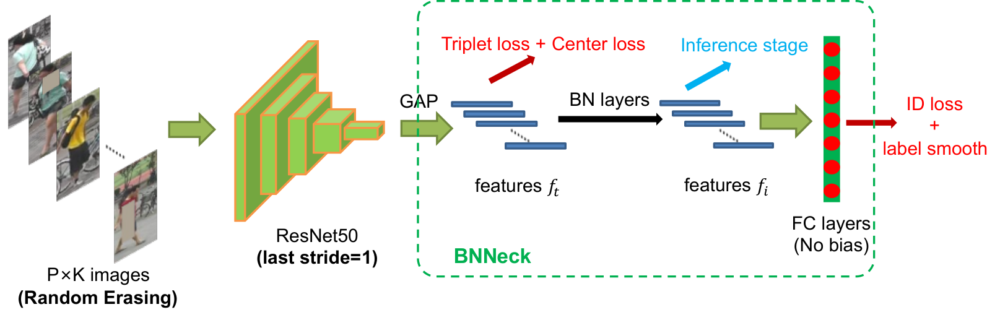
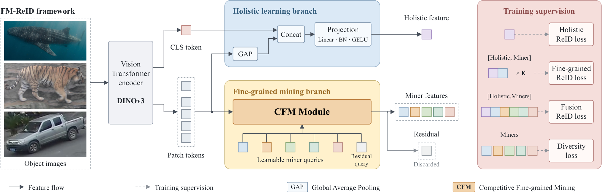

# 目录

[1. 身份检索任务与度量学习](#q-101)
  - [面试问题：ReID 解决什么问题，与分类、人脸识别和目标跟踪有什么区别？](#q-001)
  - [面试问题：从原始图像到身份检索结果，一套 ReID 系统包含哪些环节？](#q-002)
  - [面试问题：ReID 的 embedding 怎样比较，余弦与欧氏距离什么时候等价？](#q-003)
  - [面试问题：身份分类损失与 Triplet Loss 各自约束什么，为什么常一起使用？](#q-004)
  - [面试问题：P×K 采样、batch-hard 和困难样本挖掘怎样影响 ReID 训练？](#q-005)
  - [面试问题：BNNeck 怎样连接分类与度量学习，训练和检索使用哪一层特征？](#q-006)

[2. 局部线索、遮挡与时序表示](#q-102)
  - [面试问题：全局特征为什么会丢失身份细节，局部表示应怎样选择和对齐？](#q-007)
  - [面试问题：OSNet、TransReID 与视觉预训练骨干分别带来什么，怎样公平比较？](#q-008)
  - [面试问题：遮挡和局部 ReID 为什么不能只靠更强的全局向量解决？](#q-009)
  - [面试问题：视频 ReID 怎样聚合多帧，为什么帧数增加也可能降低识别质量？](#q-010)

[3. 领域变化与跨模态身份线索](#q-103)
  - [面试问题：无监督领域适应 ReID 怎样生成伪标签，又怎样避免错误自我强化？](#q-011)
  - [面试问题：领域泛化、目标域适应与测试时适应的使用条件有什么不同？](#q-012)
  - [面试问题：换衣 ReID 怎样减少服装捷径，为什么去掉衣服信息也不等于保住身份？](#q-013)
  - [面试问题：可见光—红外 ReID 的模态差距怎样建模，评测时要固定哪些条件？](#q-014)
  - [面试问题：CLIP 类视觉语言模型怎样用于 ReID，图像检索与文本找人有何区别？](#q-015)

[4. 检索评价、部署与按需复核](#q-104)
  - [面试问题：CMC、Rank-k、mAP 与 mINP 分别衡量什么，评测协议怎样影响结论？](#q-016)
  - [面试问题：k-reciprocal 重排序与近似最近邻索引解决什么不同问题？](#q-017)
  - [面试问题：开放集合检索怎样拒绝无匹配查询，为什么图库越大阈值越难选？](#q-018)
  - [面试问题：ReID 上线后怎样管理特征版本、图库更新与跟踪接口？](#q-019)
  - [面试问题：视觉语言模型怎样复核检索难例，如何判断一次额外调用是否值得？](#q-020)

---

<h1 id="q-101">1. 身份检索任务与度量学习</h1>

<h2 id="q-001">面试问题：ReID 解决什么问题，与分类、人脸识别和目标跟踪有什么区别？</h2>

**难度评分：⭐⭐ (2/5)  |  考察频率：⭐⭐⭐⭐⭐ (5/5)**

ReID（Re-identification，重识别）研究的是：**同一个实例在不同图像、摄像头或时间里再次出现时，怎样把它找回来**。行人 ReID 最常见，也有车辆、动物等对象的重识别。给定一张查询图像 query，系统在候选图库 gallery 中排序，找出可能属于同一身份的图像。这里的“身份”首先指数据集或系统内部的实例编号，不自动对应姓名等现实身份信息。

例如，一个人从入口摄像头走到走廊，视角从正面变成背面，光照和背景也改变了。系统需要保留能够区分这个人的线索，同时减少摄像头、姿态和背景的影响。难点在于：同一人的两张图可能差别很大，不同人的两张图反而可能非常相似。

ReID 与相邻任务的区别，可以从输出与使用条件理解。

<div align="center">

| 任务 | 通常学习或输出什么 | 与 ReID 的关系 |
|---|---|---|
| 普通图像分类 | 在固定类别中预测标签 | ReID 可以用训练身份做分类监督，但测试身份通常与训练身份不重合 |
| 人脸识别 | 从脸部区域提取身份表示，做验证或检索 | 与 ReID 共享度量学习思想；行人 ReID 还依赖全身线索，不要求人脸始终可见 |
| 单摄像头多目标跟踪 | 把连续帧检测关联成轨迹 | ReID 提供外观相似度，跟踪还要使用运动、时间和轨迹状态 |
| 跨摄像头 ReID | 按实例相似度排序候选 | 可缺少连续运动观测；时间、相机拓扑是可选辅助条件 |

</div>

训练阶段有一千个身份，测试阶段换成另一百个身份，仍然可以用学到的特征检索。这解释了为什么最终保留的是 embedding（用于比较的特征向量），训练时的身份分类器通常被丢弃。但“测试身份未见过”不意味着“任何新环境都能泛化”：同一套服装、相似相机和固定时间跨度，仍可能构成很强的隐含条件。

回答这类问题时，还应先说明协议：是同衣还是换衣、图像还是视频、可见光还是红外、图库中是否保证存在正确匹配。这些条件改变了可用证据，不能把一种设置下的高 Rank-1 直接解释成通用身份识别能力。

<h2 id="q-002">面试问题：从原始图像到身份检索结果，一套 ReID 系统包含哪些环节？</h2>

**难度评分：⭐⭐⭐ (3/5)  |  考察频率：⭐⭐⭐⭐⭐ (5/5)**

一套 ReID 系统可以分成**候选获取、身份表示、检索决策**三段。神经网络只负责其中一部分，输入裁剪和图库管理同样决定最终质量。

1. **检测并记录来源。** 从图像或视频中找出行人框，同时保留摄像头、时间戳、帧号和检测置信度。检测框里混入第二个人、截掉背包或只剩半身，会直接改变后面的身份证据。
2. **裁剪与预处理。** 按训练约定执行颜色通道转换、缩放、填充和归一化。行人图常使用长宽不相等的输入；改变到正方形可能使身体比例失真。需要记录采用拉伸还是等比例填充。
3. **提取 embedding。** 同一套编码器处理 query 和 gallery，得到固定维度向量。按训练与评价设置选择 BN 前后特征、是否做 L2 归一化、是否融合局部或多帧特征。
4. **建立与查询索引。** 小图库可精确计算所有距离；大图库可用近似最近邻索引缩小候选，再精排。相机和时间条件可以帮助过滤，但必须避免把实际可行的跨摄像头路径提前删掉。
5. **排序、拒识与回溯。** 输出候选及其来源。是否接受第一名，应由经验证的阈值、质量条件和业务规则决定；无匹配时需要允许返回“未找到可靠候选”。

假设一个人的正确照片已经被裁掉头肩和随身物品，而错误候选恰好保留了相似服装。此时换更大的检索网络未必有效。应先用真值框与预测框分别评估：若真值框明显更好，主要问题在候选质量；若两者都差，再检查表示、训练域和图库协议。

端到端评估还要同时看**可被找回的比例和找回后的排序质量**。正确实例根本没有被检测进图库，后续重排序无法补救；近似索引把正确项漏掉，也不应把全部责任归给 embedding。可以分别记录检测覆盖、精确检索指标、索引 Recall@K、拒识表现和端到端延迟，逐段定位损失。

工程上应把预处理版本、模型权重版本和特征版本绑定保存。两张图片经过不同编码器得到的向量，即使维度相同，也未必处于可直接比较的坐标系中。

<h2 id="q-003">面试问题：ReID 的 embedding 怎样比较，余弦与欧氏距离什么时候等价？</h2>

**难度评分：⭐⭐⭐ (3/5)  |  考察频率：⭐⭐⭐⭐⭐ (5/5)**

embedding 把图像映射为向量，距离函数决定这些向量怎样排序。设两张图的特征为 $`u,v\in\mathbb{R}^d`$，余弦相似度为：

```math
s(u,v)=\frac{u^\top v}{\lVert u\rVert_2\lVert v\rVert_2}.
```

它衡量方向是否接近，数值越大越相似；常用的余弦距离为 $`1-s`$。欧氏距离则比较向量在各维上的绝对差异，同时受到方向与长度影响。

若先把两个**非零**向量都做 L2 归一化，记为 $`\hat u,\hat v`$，有：

```math
\lVert \hat u-\hat v\rVert_2^2
=2-2\hat u^\top\hat v
=2(1-s(u,v)).
```

因此，在相同候选集合中，归一化向量的余弦相似度降序、欧氏距离升序和平方欧氏距离升序，给出的排序相同。**排序相同不代表数值阈值相同**：余弦相似度大于 0.8，对应平方欧氏距离小于 0.4，而非欧氏距离小于 0.4。

一个简单例子是 $`u=(1,0)`$、$`v=(2,0)`$。二者余弦相似度为 1，原始欧氏距离却为 1；归一化之后才完全重合。若模型把图像质量或其他信息编码进向量长度，归一化会去掉这部分信息，因此是否归一化应与训练设计和验证结果一致。

实际部署常在归一化后用内积做快速检索，但需要检查三个细节：索引配置使用的是内积还是距离；数据库与查询是否执行相同归一化；量化和近似搜索是否改变了原来的排序。对零向量或数值异常要单独处理，不能仅凭加入一个极小数便把无效特征当成有效身份证据。

余弦分数也不是“同一人的概率”。把 0.9 直接解释成 90% 可信度，没有概率校准依据；分数的可接受范围还会随模型、摄像头和图库规模变化。

<h2 id="q-004">面试问题：身份分类损失与 Triplet Loss 各自约束什么，为什么常一起使用？</h2>

**难度评分：⭐⭐⭐ (3/5)  |  考察频率：⭐⭐⭐⭐⭐ (5/5)**

身份分类损失让特征能够区分训练身份，Triplet Loss 直接约束样本之间的相对距离。两者经常联合使用，因为检索既需要形成清楚的身份边界，也需要让边界内外的距离有意义。

设特征为 $`f`$，真实训练身份为 $`y`$，分类器第 $`j`$ 类权重和偏置为 $`w_j,b_j`$，交叉熵可写成：

```math
\mathcal L_{\mathrm{ID}}
=-\log\frac{\exp(w_y^\top f+b_y)}
{\sum_{j=1}^{C}\exp(w_j^\top f+b_j)}.
```

这里 $`C`$ 是训练身份数。分类器为各身份建立可分的方向或区域，但仅靠正确分类，并不保证任意同身份图像都彼此很近。分类器还可能依赖服装、背景等训练集捷径。

Triplet Loss 使用一个锚点 $`a`$、同身份正样本 $`p`$ 和不同身份负样本 $`n`$：

```math
\mathcal L_{\mathrm{tri}}
=\max\{0,\ d(f_a,f_p)-d(f_a,f_n)+m\}.
```

$`d`$ 是明确选定的距离，$`m>0`$ 是间隔。假设使用欧氏距离，正样本距离为 0.7、负样本距离为 0.5、间隔为 0.3，损失为 0.5；若负样本距离增到 1.2，损失变为 0。它要求负样本相对更远，并不要求所有正样本压成同一个点。

联合目标常写成 $`\mathcal L=\mathcal L_{\mathrm{ID}}+\lambda\mathcal L_{\mathrm{tri}}`$，其中 $`\lambda`$ 调节两种监督的影响。分类提供较稳定的身份级监督，Triplet 则通过样本关系改善检索空间。BNNeck 等结构进一步让两类损失作用在不同位置，缓和直接施加在同一特征上的冲突。

这种互补并非无条件。Triplet 的效果依赖批内正负样本，错误身份标签会被当成困难样本反复强化；分类损失也不能自动解决换衣和跨域问题。还应说明距离是否平方、特征是否归一化、采用固定 margin 还是 soft-margin。这些设置改变了梯度尺度，不能直接照搬另一份代码的间隔数值。

<h2 id="q-005">面试问题：P×K 采样、batch-hard 和困难样本挖掘怎样影响 ReID 训练？</h2>

**难度评分：⭐⭐⭐⭐ (4/5)  |  考察频率：⭐⭐⭐⭐⭐ (5/5)**

P×K 采样每个 batch 先选 $`P`$ 个身份，再为每个身份选 $`K`$ 张图，总样本数为 $`B=PK`$。它让每个锚点在批内有同身份正样本，也有其他身份负样本，是批内度量学习能够成立的前提之一。

例如 $`P=16,K=4`$ 时，batch 有 64 张图。一个锚点通常有 3 个正样本和 60 个负样本。若身份只有不足 4 张图，实现可能重复抽样；此时样本数量虽然凑齐了，身份变化并没有增加。优先跨相机、跨时间或跨服装抽取同身份样本，往往比复制相邻帧更有价值。

batch-hard 为每个锚点选择最远正样本和最近负样本：

```math
\begin{aligned}
d_a^+&=\max_{p:\,y_p=y_a,\ p\ne a}d(f_a,f_p),\\
d_a^-&=\min_{n:\,y_n\ne y_a}d(f_a,f_n),\\
\mathcal L_{\mathrm{BH}}
&=\frac1B\sum_a\max(0,d_a^+-d_a^-+m).
\end{aligned}
```

“最难”只针对当前 batch，不是整个训练集。固定 batch 大小时，增大 $`P`$ 会增加负身份多样性，增大 $`K`$ 则更容易看到同一身份的姿态与相机变化，两者不能同时无限增加。

困难挖掘最容易出的问题是**把标注错误当成学习重点**。如果两张同一人的图被误标成不同身份，它们距离很近，会反复成为最难负样本，模型被迫把它们推开。严重遮挡、框中混入他人和域外图也可能长期占据最大损失。

因此，训练初期可用较温和的采样或 soft-margin，结合数据清洗、损失分布和可视化检查，再决定是否强化难例。半困难挖掘也要明确选择条件，不能把所有难例都丢掉。分布式训练中，还要区分“每张 GPU 的本地 batch”和“跨卡聚合后的样本池”；它们决定实际可参与挖掘的正负样本数，并影响通信和显存开销。

<h2 id="q-006">面试问题：BNNeck 怎样连接分类与度量学习，训练和检索使用哪一层特征？</h2>

**难度评分：⭐⭐⭐ (3/5)  |  考察频率：⭐⭐⭐⭐ (4/5)**

BNNeck 在全局特征和身份分类器之间加一层 Batch Normalization，让度量监督与分类监督使用相关但不同的特征。经典 strong baseline 的主要路径是：

**骨干网络与全局池化 → BN 前特征 → BN → BN 后特征 → 身份分类器**。Triplet Loss 作用于 BN 前特征，身份分类损失作用于 BN 后特征。

<div align="center"></div>

<div align="center">

图中 Center Loss、标签平滑等属于整套训练配方的附加项；BNNeck 的主要作用是区分两处特征及其监督。来源：[Bag of Tricks and A Strong Baseline，图 2(b)](https://arxiv.org/abs/1903.07071)。

</div>

这样安排是因为两类目标的几何偏好不同。Triplet 直接约束样本距离，分类则通过权重与决策边界区分身份。让分类分支先经过 BN，能够调整各维的统计尺度，减少两种目标直接争用同一输出空间的问题。**两条损失仍然通过计算图影响共享骨干**，并没有把梯度完全隔离。

对某个特征维度，BN 的训练期形式为：

```math
z_j=\gamma_j\frac{f_j-\mu_{B,j}}
{\sqrt{\sigma_{B,j}^2+\epsilon}}+\beta_j.
```

$`\mu_{B,j},\sigma_{B,j}^2`$ 是该维批内均值和方差，$`\gamma_j,\beta_j`$ 是仿射参数；具体实现可以固定其中部分参数。BN 是**按维度处理批统计量**，L2 归一化则是**按样本处理向量长度**，两者不能混为一谈。BN 也不保证输出严格服从高斯分布或落在单位球面上。

原始 BNNeck baseline 在检索时使用 BN 后特征，并配合余弦距离；训练身份分类器此时不再参与检索。其他实现可能使用 BN 前特征或拼接特征，因此复现实验要检查实际 forward 分支与配置，而不能只看模型名。

训练和推理的 BN 行为也不同：常规推理使用累计均值与方差，而非当前查询 batch 的统计量。如果忘记切到 eval 模式，同一张 query 可能因为一起送入网络的其他图像不同而改变特征，图库与查询将难以保持一致。小 batch、相机分布失衡及跨域变化也会影响统计量；冻结 BN 或替换归一化方式应通过验证集比较，不能当成通用增益。

<h1 id="q-102">2. 局部线索、遮挡与时序表示</h1>

<h2 id="q-007">面试问题：全局特征为什么会丢失身份细节，局部表示应怎样选择和对齐？</h2>

**难度评分：⭐⭐⭐⭐ (4/5)  |  考察频率：⭐⭐⭐⭐ (4/5)**

全局池化把整张图压成一个向量，计算与存储都方便，但面积很小的身份线索可能被平均掉。两个人都穿深色外套，鞋面标记或背包挂件却不同；车辆整体型号相同，局部贴纸和灯组细节不同。局部表示希望把这些差异保留下来。

局部特征有三类常见组织方式。**固定条带**按高度分块，PCB 是典型例子，结构简单，但检测框偏移或姿态改变会导致“同一条带对应不同身体部位”。**姿态或分割引导**按语义区域对齐，但依赖额外模型，关键点在遮挡下也可能错位。**可学习查询或注意力聚合**让模型寻找有区分力的区域，灵活性更高，却需要防止多个分支都盯住同一片背景。

2026 年的 FM-ReID 提供了一个具体实例：用 DINOv3 的 CLS 与 patch 平均池化特征形成全局表示，再从密集 patch tokens 中提取多组细粒度特征。它没有预先把图像切成固定身体部位，而是让若干 mining queries 与一个 residual query 竞争每个 token。

<div align="center"></div>

<div align="center">

全局分支提供整体语境，细粒度分支补充局部线索；右侧区分各路训练监督，残余查询仍参与竞争。来源：[FM-ReID，图 2](https://arxiv.org/abs/2609.36560)。

</div>

理解这一机制要分清两次归一化。设有 $`K`$ 个挖掘查询，额外的残余查询记为 0，$`s_{kn}`$ 表示第 $`k`$ 个查询对第 $`n`$ 个 token 的匹配分数。省略多头下标，其主要选择步骤为：

```math
\begin{aligned}
a_{kn}&=\frac{\exp(s_{kn})}{\sum_{j=0}^{K}\exp(s_{jn})},\\
\tilde a_{kn}&=\max\left(0,a_{kn}-\frac1{K+1}\right),\\
w_{kn}&=\frac{\tilde a_{kn}}{\sum_t\tilde a_{kt}+\epsilon},
\qquad k=1,\ldots,K.
\end{aligned}
```

第一次 softmax **沿查询维度竞争同一个 token**；第二次把超过均匀先验的权重保留下来，再**沿 token 维度聚合每个查询的证据**。一个 token 可以同时被多个查询保留，各组支持区域也可以不同大小；没有超过先验的挖掘分配时，该 token 不进入任何局部聚合。它不是把所有像素强制分成互不重叠的几块。

残余输出不进入最终检索向量，也不接受直接的身份监督，但残余查询仍能通过竞争获得间接梯度。整体网络包括 DINOv3 在内进行训练，不能理解成“冻结基础模型后随手增加几个查询”。局部与全局特征还需要身份监督和适当融合，否则增加分支只会增加参数与存储。

判断这种改进是否有效，应比较**同一骨干、同一训练配置**下的全局池化与局部分支，并检查实际关注区域。FM-ReID 的可视化中，部分查询也关注周边结构，注意力热图不能证明它已经发现了纯粹的身份部件。论文在人员、车辆和动物数据上分别训练和评价，尚未验证未见对象类别的直接迁移。可迁移的经验是：强预训练提供了丰富局部信息，检索系统仍需设计选择、对齐和融合方式，并承担更长描述子的检索成本。

<h2 id="q-008">面试问题：OSNet、TransReID 与视觉预训练骨干分别带来什么，怎样公平比较？</h2>

**难度评分：⭐⭐⭐⭐ (4/5)  |  考察频率：⭐⭐⭐⭐ (4/5)**

选择 ReID 骨干应同时回答三个问题：**感受范围怎样组织、预训练带来了什么、部署付出多少成本**。单看 CNN 或 Transformer 标签，无法预测最终结果。

**OSNet 关注多尺度外观线索。** 它在轻量卷积结构中组合不同感受范围的特征流，再通过统一的通道门控自适应融合。较小范围有利于纹理细节，较大范围有利于身体结构与上下文；不同图像所需的尺度权重可以不同。它的价值在于用较紧凑的模型同时表示多种尺度，适合将算力和延迟作为主要约束的场景。轻量模型仍可能受训练域限制，多尺度不自动等于跨域鲁棒。

**TransReID 将全局交互与局部学习结合。** Transformer 让 patch 之间直接交换信息；Jigsaw Patch Module 对已有 patch embeddings 做平移、打乱和分组，再学习局部表示，与全局分支并行。这里处理的是经过编码的特征序列，不能简单描述成“把输入图片随机打碎”。Side Information Embedding 还可以引入相机或视角编号，以学习这些变化与身份表示的关系，但必须有相应元信息和明确的未知相机处理方式。

**更强的视觉预训练改变了起点。** DINO 系列等自监督视觉模型可提供密集语义和局部对应线索，CLIP 类模型则引入图文对齐。它们在大规模数据上形成的表示可能降低下游学习难度，但预训练偏好未必与实例身份完全一致：能够把“穿红衣的人”聚在一起，不代表能区分两个都穿红衣的人。

公平比较时，应固定或披露输入分辨率、patch stride、预训练数据、是否使用相机标签、训练轮数、增强、损失和检索后处理。更小的 patch stride 会增加 token 数，也增加注意力开销；增加局部分支会扩大最终 embedding。若只报告网络 FLOPs，却不报告描述子长度、图库内存和端到端检索延迟，部署成本仍不完整。

一个实际选择顺序是：先建立可复现的紧凑全局 baseline，确认领域与裁剪问题，再比较更强骨干和局部结构各自带来的增益。通过消融把“预训练更强”与“新增模块更有效”分开，才能判断复杂度是否值得保留。

<h2 id="q-009">面试问题：遮挡和局部 ReID 为什么不能只靠更强的全局向量解决？</h2>

**难度评分：⭐⭐⭐⭐ (4/5)  |  考察频率：⭐⭐⭐⭐ (4/5)**

遮挡 ReID 的输入中可能包含目标、遮挡物和其他人；partial ReID 则可能只观测到目标的一部分。二者都面临**可比较证据不完整**的问题，但并非相同的裁剪分布。

全局向量会把看见的内容混合起来。查询只有上半身，图库包含完整身体，若直接平均所有区域，query 的肩部可能被迫与 gallery 的裤子和鞋子共同比较。遮挡物面积更大时，模型还可能把栏杆或前景行人的衣服当成主要特征。增加网络容量无法恢复图像里从未观测到的身份细节。

常用思路是先估计哪些部位可见，再在对应的可见区域之间计算相似度。一个简化的匹配形式为：

```math
s(q,g)=
\frac{\sum_j v_{qj}v_{gj}\,s_j(q,g)}
{\sum_j v_{qj}v_{gj}+\epsilon}.
```

$`s_j`$ 是第 $`j`$ 个对应部位的相似度，$`v_{qj},v_{gj}`$ 表示该部位的可见性或可靠性。这个公式成立的关键是“对应部位”已经对齐，不能只因为两张图都有第 3 个 token，就认为它们代表同一个身体区域。

例如，query 的腿部被车辆遮住，而 gallery 的上半身清晰，可以主要比较肩部、头部和背包。若两张图的可靠可见区域几乎不重合，分母很小，合理结果应是证据不足，而非强行输出高置信匹配。姿态、人体解析或可学习局部对应可以帮助对齐，但其估计误差应纳入置信度。

随机擦除和人工遮挡能改善训练覆盖，却需要避免让遮挡纹理本身成为身份标签。评价时要区分真实遮挡与合成遮挡、真实检测框与手工裁剪，并单独观察遮挡程度不同的子集。看模型是否在复杂输入上降低了错误自信，比只看总体平均分更有诊断价值。

<h2 id="q-010">面试问题：视频 ReID 怎样聚合多帧，为什么帧数增加也可能降低识别质量？</h2>

**难度评分：⭐⭐⭐ (3/5)  |  考察频率：⭐⭐⭐⭐ (4/5)**

视频 ReID 将同一条短轨迹中的多帧证据汇总成身份表示。多帧的价值主要来自视角、姿态和清晰度的互补，而非简单增加图片数量。

最简单的做法是对帧特征平均池化，再归一化；更一般的加权聚合为：

```math
z=\mathrm{Normalize}\left(\sum_{t=1}^{T}\alpha_t f_t\right),
\qquad
\alpha_t\ge0,\quad\sum_t\alpha_t=1.
```

$`f_t`$ 是第 $`t`$ 帧特征，$`\alpha_t`$ 可来自清晰度、遮挡程度或学习到的权重。帧特征是否先归一化需要固定；否则向量范数较大的帧会隐式获得更多影响，不能只看显式的 $`\alpha_t`$。

如果一段轨迹中有正面、侧面和背面，平均或注意力聚合可以汇集互补信息。若 100 帧几乎相同，新增帧的收益很小；若后 20 帧因 ID switch 混入另一人，聚合反而会把两个身份拉到一起。学习型注意力也可能偏爱清晰但错误的那个人，清晰度不等于身份正确性。

时序建模进一步利用顺序、动态和跨帧对应，可能帮助识别步态等线索。它应与无序平均池化做对照：若打乱帧顺序后表现几乎不变，收益可能主要来自多帧外观覆盖，不能全部解释成“学到了运动”。

在线系统还需控制更新污染。可以保留若干高质量且视角互补的代表帧，对突变片段分段处理，再决定是否更新身份模板。指数滑动平均能平滑噪声，也会持续吸收错误关联；一次污染可能影响后面很长时间。

报告视频指标时，应写明使用帧数、采样方式、是否能够看到未来帧、每条轨迹是否只含一个身份，以及计算的是单帧编码还是整段端到端延迟。离线整段聚合的成绩不能直接作为实时流式性能。

<h1 id="q-103">3. 领域变化与跨模态身份线索</h1>

<h2 id="q-011">面试问题：无监督领域适应 ReID 怎样生成伪标签，又怎样避免错误自我强化？</h2>

**难度评分：⭐⭐⭐⭐ (4/5)  |  考察频率：⭐⭐⭐⭐ (4/5)**

无监督领域适应 ReID 通常有带身份标签的源域数据，以及没有身份标签的目标域训练图像。源域模型进入新摄像头环境后，背景、色彩、分辨率和人员分布改变，直接检索可能明显退化；适应过程希望利用目标域结构修正表示。

常见循环是：先提取目标域特征，再聚类生成伪身份，用这些伪标签训练模型，随后重新提取特征与聚类。聚类把“当前模型认为相似”转成监督信号，但相似本身并不能证明同一身份。因此，这个循环既可能改善表示，也可能把初始错误不断放大。

两类错误尤其关键。**错误合并**把不同人聚到同一簇，训练会进一步拉近他们；**错误拆分**把同一人的不同相机照片分到不同簇，训练又会把它们推开。只看簇内紧凑程度不足以识别问题，因为背景相似也能形成很紧的簇。

MMT（Mutual Mean-Teaching）结合离线聚类的硬伪标签和在线教师产生的软目标。两个网络互相提供监督，教师使用参数的指数移动平均，以减弱单步预测波动。一个一般形式为：

```math
\bar\theta_t=\beta\bar\theta_{t-1}+(1-\beta)\theta_t,
\qquad 0\le\beta<1.
```

这里 $`\bar\theta`$ 是教师参数，$`\theta`$ 是学生参数。时间平均可以稳定目标，却不能把持续存在的系统偏差自动平均掉；两个网络也可能学到相同捷径。

SpCL 则通过混合记忆组织源域身份、目标域可靠簇和未聚类实例，并用自步策略逐渐纳入可靠样本。它提醒我们：离群点中既有坏样本，也有尚未被正确聚合的困难身份，不能简单全部删除。簇的可靠性和稳定性应成为训练条件，而非默认真值。

工程上需要跟踪聚类规模分布、跨相机覆盖、伪标签变化率和抽样人工核验结果；必要时保留不确定样本的较弱监督。目标域训练集与评测 query/gallery 的使用范围也必须披露：若适应时已经访问测试图像，这属于特定的传导设置，不能与完全未接触目标测试数据的模型直接比较。

<h2 id="q-012">面试问题：领域泛化、目标域适应与测试时适应的使用条件有什么不同？</h2>

**难度评分：⭐⭐⭐⭐ (4/5)  |  考察频率：⭐⭐⭐ (3/5)**

领域泛化、目标域适应与测试时适应，首先区别在于**什么时候能看到目标数据、允许更新哪些状态**。名称相近，不代表实验条件相同。

<div align="center">

| 设置 | 训练或部署时能用什么 | 需要回答的关键问题 |
|---|---|---|
| 领域泛化 DG | 使用一个或多个源域训练，开发阶段不使用目标域数据 | 到未知相机环境后，固定模型能否保持区分能力 |
| 目标域适应 DA | 可访问目标域训练数据；无监督 DA 不用其身份标签 | 怎样利用目标分布，同时控制伪标签错误 |
| 测试时适应 TTA | 在测试输入到达后，按规定更新统计量、参数或记忆 | 更新是否因果、是否稳定、是否污染后续查询 |

</div>

例如，模型部署到一座从未采集过的新园区，直接运行属于泛化评价；提前收集该园区的无标签视频做聚类训练，属于目标域适应；上线后随着视频流不断调整 BN 统计或某些参数，则进入测试时适应。测试时使用整批未来图像与只使用已到达图像，信息条件也不同。

领域泛化可以通过多域训练、适当风格增强和更强预训练减少对单一相机风格的依赖，但不能覆盖所有未知变化。无监督适应能利用新域结构，同时会引入伪标签风险。TTA 更贴近环境变化，却增加了顺序依赖：某个短时间段恰好都是相似服装的人，模型可能错误地把这段偏置当成全局分布。

ReID 还有一个特殊限制：**图库向量可能在更新前已经计算好**。若只更新 query 编码器，gallery 仍使用旧空间，相似度的意义可能改变。需要同时考虑图库重编码、冻结共享表示、兼容性约束或按版本检索，而不能只在单批测试图上观察损失下降。

评价时应明确可见数据、更新频率、是否回看历史、是否使用未来帧、是否在每个场景重置、是否允许源域数据，以及适应成本。没有这些条件，“无需目标标签”仍然可能对应完全不同的可用信息和部署代价。

<h2 id="q-013">面试问题：换衣 ReID 怎样减少服装捷径，为什么去掉衣服信息也不等于保住身份？</h2>

**难度评分：⭐⭐⭐⭐ (4/5)  |  考察频率：⭐⭐⭐ (3/5)**

同衣 ReID 中，服装往往同时具备稳定、显著、容易学习三个优点；当检索跨度变长，衣服发生变化，这条捷径就会失效。换衣 ReID 希望减少对特定服装的依赖，更多利用脸部、发型、身体结构和动态等线索，但这些线索也有各自的可见性与稳定性限制。

例如，同一人白天穿西装、晚上换运动服，而另一个人穿着相似西装。只强化衣服纹理的模型容易把相似服装排到第一。直接遮掉所有衣服区域也未必更好，因为身体轮廓、姿态和部分形状信息同时被删除了，剩余的低清头部可能不足以判断身份。

CAL（Clothes-based Adversarial Loss）提供了一种有约束的抑制方式。训练时定义“某一身份的某套衣服”为细粒度服装类别；不同人即使穿相同款式，也不共享这个服装类编号。训练分两步：

1. 更新服装分类器，让它识别当前特征对应的服装类别。
2. 固定服装分类器，更新骨干和身份分支，使同一身份的不同服装类别被作为多个正类处理，同时保留不同身份之间的区分。

关键在于**只弱化同一身份内部的服装差异**。如果让模型对所有人的所有服装类别都无法区分，由于服装类本身包含身份划分，也会破坏身份证据。CAL 因而不能简化成“反转一个全局服装分类损失”。

其他路线还可以加入人体形状、姿态、步态或人脸信息，但融合前要检查各模态是否可靠。厚外套会改变轮廓，携带物会改变步态，远距离和背面没有可用人脸。所谓服装无关特征，是学习目标和相对性质，不是已经得到完全不受衣服影响的真实身份编码。

评测应将同衣与换衣子集分开，并固定时间跨度、服装标注、相机条件和是否使用额外姿态或视频信息。换衣集上的提升若伴随同衣集大幅退化，应结合实际业务分布决定是否接受，而不能只报告最有利的一项。

<h2 id="q-014">面试问题：可见光—红外 ReID 的模态差距怎样建模，评测时要固定哪些条件？</h2>

**难度评分：⭐⭐⭐⭐ (4/5)  |  考察频率：⭐⭐⭐ (3/5)**

可见光—红外 ReID 需要把不同成像方式下的同一人关联起来。白天可见光图像中的颜色与纹理，在红外图像中可能不再成立；红外传感器与光谱条件不同，近红外反射成像和热红外成像也不能全部解释为同一种“体温图”。

一种常见结构是**模态专属浅层 + 共享深层**。浅层分别处理两种成像分布，深层学习可比较的身份表示，再结合身份分类与跨模态度量约束。全部共享参数可能难以适应低层统计差异；完全分开的网络又需要额外约束，才能让两种输出处于一致空间。

训练采样也应包含同一身份的可见光与红外样本，使模型真正接触跨模态正对。若一个 batch 的同身份正样本都来自同一模态，模型可能把模态当成捷径，仍能降低部分训练损失。分布对齐也要关注身份条件：只让两种模态的总体分布相近，可能把不同身份混在一起。

图像翻译、特征对齐和中间表示可以减小模态差距，但生成图像里新增的纹理不等于真实观测。跨模态检索更适合强调可靠的结构与局部证据，而不是假设翻译模型恢复了不可见的颜色信息。

SYSU-MM01、RegDB 等基准有不同协议。比较结果至少需要固定查询与图库的模态方向、相机范围、single-shot 或 multi-shot、随机划分与抽样次数，以及是否采用重排序。SYSU-MM01 的 all-search 和 indoor-search 使用的图库范围不同；RegDB 的 visible-to-infrared 与 infrared-to-visible 也应分别标注。不同协议的 Rank-1 不能直接排成一张“模型强弱榜”。

上线时还要重新检查拒识阈值。某个分数在可见光—可见光条件下可靠，并不意味着在可见光—红外条件下具有相同错误率。模态方向、画面质量和传感器变化都应进入验证集设计。

<h2 id="q-015">面试问题：CLIP 类视觉语言模型怎样用于 ReID，图像检索与文本找人有何区别？</h2>

**难度评分：⭐⭐⭐⭐ (4/5)  |  考察频率：⭐⭐⭐ (3/5)**

视觉语言预训练可以为 ReID 提供更好的视觉初始化，也可以通过文本侧监督改善身份表示。但要区分两个任务：**以图找图的身份检索**，以及**输入自然语言描述来找人**。使用了 CLIP，不代表系统已经具备后一种能力。

CLIP-ReID 面对的训练标签通常是身份编号，缺少“穿蓝外套、背黑包”等具体文本描述。它为每个训练身份学习一组文本 token，通过两阶段训练利用 CLIP 的图文空间：

1. 固定图像与文本编码器，仅优化身份专属的可学习 token，让生成的文本特征与对应身份图像对齐。
2. 固定这些 token 和文本编码器，用身份分类、度量学习及图像—文本监督更新图像编码器。

这些 token 是连续参数，不要求变成人能读懂的句子。它们在训练中充当身份相关的文本侧参照，帮助图像表示形成更好的区分。测试通常仍以图像 embedding 做 query—gallery 检索，不能把训练身份 token 当成测试新身份的现成名字。

真正的文本找人需要处理自由描述与图像之间的匹配。查询“穿红外套、背黑色背包的人”可能对应多个实例，颜色和物品属性也可能随时间改变。数据需要描述与图像的可靠对应，评价需要处理一段文本是否有多个合法匹配，并与基于图像的 ReID 分开报告。

还要注意语义与身份的差别：图文模型擅长聚合共享语义，而实例检索常要求在共享语义之内继续区分。若微调只强化“红衣、背包、男性”等粗粒度属性，检索可能更符合描述，却更容易混淆外观相近的不同人。对文本能力的评价应使用未见身份和未见描述组合，并检查文本侧与视觉侧在微调后的对齐是否保留。

因此，选择 CLIP 类方案前应先确定文本的职责：仅作为训练监督、作为线上查询入口，还是作为候选复核依据。职责不同，训练数据、运行路径和评价指标都会不同。

<h1 id="q-104">4. 检索评价、部署与按需复核</h1>

<h2 id="q-016">面试问题：CMC、Rank-k、mAP 与 mINP 分别衡量什么，评测协议怎样影响结论？</h2>

**难度评分：⭐⭐⭐ (3/5)  |  考察频率：⭐⭐⭐⭐⭐ (5/5)**

ReID 评价首先要知道：**是只需找到一个正确候选，还是希望把同一身份的所有相关图像都排到前面**。CMC、mAP 与 mINP 分别从不同位置观察排序质量。

**CMC 与 Rank-k** 关注第一个正确匹配。对一个 query，若前 $`k`$ 名中至少有一个正确项，Rank-k 记为 1，否则记为 0；对有效 query 取平均便得到对应的 CMC 值。Rank-1 是其中第一位，不能描述其他正确照片被排得多靠后。

**AP 与 mAP** 关注所有正确项的位置。假设某 query 的有效图库有 $`N`$ 项，其中 $`R`$ 项相关，$`\mathrm{rel}(k)`$ 表示第 $`k`$ 项是否相关，$`P(k)`$ 是前 $`k`$ 项的精确率：

```math
\begin{aligned}
\mathrm{AP}&=\frac1R\sum_{k=1}^{N}P(k)\,\mathrm{rel}(k),\\
\mathrm{mAP}&=\frac1Q\sum_{q=1}^{Q}\mathrm{AP}_q.
\end{aligned}
```

$`Q`$ 是纳入平均的 query 数。ReID 的 mAP 按身份相关图像的排序计算，与目标检测中需要 IoU 匹配和类别聚合的 AP 协议不同。

**INP 与 mINP** 进一步关注最难找回的那个正确项。若最后一个正确项位于 $`r_{\max}`$：

```math
\mathrm{INP}=\frac{R}{r_{\max}},
\qquad
\mathrm{mINP}=\frac1Q\sum_q\mathrm{INP}_q.
```

比如三个正确项在第 2、5、10 位，那么 Rank-1 为 0，Rank-5 为 1，AP 为 $`(1/2+2/5+3/10)/3=0.4`$，INP 为 $`3/10=0.3`$。这个例子说明，“前五能找到一个”与“全部正确图像都容易找全”是两种不同能力。

数值成立的前提是已经按协议过滤无效项。常见 Market-1501 实现会排除**与 query 同身份且同摄像头**的图库项，不能误写成“删除该摄像头下的所有人”。过滤后没有正确匹配的 query，闭集评估代码通常跳过；这种处理不等于系统能够拒绝未知身份，开放集合要另设评价。

比较论文或模型时，还要固定数据划分、单查询或多查询、同衣或换衣、图库大小、额外训练数据、是否用相机元信息、是否重排序与多模型集成。最好同时保留无后处理结果和完整系统结果，并在相同 query 上分析改善与退化，避免平均分掩盖特定相机或困难群体的问题。

<h2 id="q-017">面试问题：k-reciprocal 重排序与近似最近邻索引解决什么不同问题？</h2>

**难度评分：⭐⭐⭐⭐ (4/5)  |  考察频率：⭐⭐⭐⭐ (4/5)**

k-reciprocal 重排序利用邻域关系改善排名；近似最近邻索引则用较少计算寻找候选。前者改变相似度判断，后者近似执行检索，两者可以组合，但不能当成同一项“加速优化”。

假设 $`g`$ 是 query $`q`$ 的前 $`k`$ 个近邻之一，而 $`q`$ 也在 $`g`$ 的前 $`k`$ 个近邻中，这种互相认可的关系称为 k-reciprocal。只依靠一条单向距离容易受异常点影响；互惠邻居及其共享邻域提供了额外上下文。

典型方法扩展可靠邻域，把每张图的邻域编码成非负向量 $`v`$，再比较加权 Jaccard 距离：

```math
d_J(q,g)=
1-\frac{\sum_j\min(v_{qj},v_{gj})}
{\sum_j\max(v_{qj},v_{gj})}.
```

最后按权重将 $`d_J`$ 与原始特征距离结合。若两个样本不只彼此接近，还共享一批互惠近邻，重排序可能把它们排得更靠前。它不需要真实身份标签，但需要有意义的初始邻域；若背景相同的错误身份已经聚成一团，也可能强化错误。

代价在于需要图库之间的关系。许多经典实现构造 query 与 gallery 的两两距离矩阵，数据规模增长后，内存和计算容易接近平方增长；图库频繁更新时，邻域信息还会变旧。只在小候选集上局部重排可以减少成本，却不再与全图库重排序完全等价，评价时应注明。

近似最近邻方法则通过图索引、倒排或量化等结构减少搜索量。它们可能漏掉精确距离下本应进入前列的项，因此需测量索引 Recall@K，并与精确检索对照。向量压缩还会引入近似误差，应检查是否影响难例的细微排序。

一个可行的大图库流程是：先用索引召回较宽候选，再计算更准确的距离或进行局部复核。候选池的覆盖决定了后续方法的上限；正确项未被召回时，无论重排序多复杂都找不回来。完整延迟应包含索引查询、特征读取和重排，而非只报告一次向量内积耗时。

<h2 id="q-018">面试问题：开放集合检索怎样拒绝无匹配查询，为什么图库越大阈值越难选？</h2>

**难度评分：⭐⭐⭐⭐ (4/5)  |  考察频率：⭐⭐⭐⭐ (4/5)**

开放集合检索允许 query 身份不在图库中。普通排序器仍会返回第一名，因此必须额外判断“这次是否存在可靠匹配”。这与“测试身份没出现在训练集”是两个层次：后者仍可能保证图库里有该身份，前者不保证。

最直接的方法是对最高相似度设阈值，并结合候选间隔、图像质量或多帧一致性。阈值应在包含**有匹配与无匹配查询**的验证集上选择，按可接受误识率衡量正确检出率。只用闭集 Rank-1 调阈值，无法估计陌生查询被错误接受的风险。

图库增大后，偶然出现一个高分错误候选的机会也会增加。作一个仅用于解释的简化假设：每个非匹配项独立地以概率 $`p`$ 超过阈值，图库有 $`N`$ 个非匹配项，那么至少出现一次误触发的概率为：

```math
P_{\mathrm{false}}=1-(1-p)^N.
```

即使单对误触发率为 $`10^{-5}`$，在 $`N=10^5`$ 的独立假设下，至少一次误触发的概率也约为 63.2%。真实图库里同身份多帧、同相机和相似服装之间有相关性，不能直接套这个数值；它说明的是**单对阈值无法直接代表整库查询错误率**。

前两名分数差也需要谨慎解释。如果第一、第二张图属于同一登记身份，小分差并不表示两个身份难以区分。应先明确按图像还是按已登记身份聚合，再设计间隔规则。单独提高阈值虽能减少误接受，也可能让低清、背面和跨模态的正确查询更容易被拒绝。

部署评估应覆盖实际图库规模、身份重复数量、相机与时间条件，并同时报告误接受、正确识别和拒识比例。若系统允许人工复核，可以设置高置信接受、待复核、低置信拒绝三段，但分段边界仍需用真实分布验证。距离分数本身不提供概率保证。

<h2 id="q-019">面试问题：ReID 上线后怎样管理特征版本、图库更新与跟踪接口？</h2>

**难度评分：⭐⭐⭐⭐ (4/5)  |  考察频率：⭐⭐⭐⭐ (4/5)**

ReID 上线后，最容易被低估的是**同一份图库需要长期维持可比较性**。模型升级、预处理变动、图像质量变化和错误轨迹更新，都会改变向量的含义。

每个特征至少应关联模型版本、预处理版本、归一化与距离配置，以及源图像或轨迹的可回溯标识。模型从 512 维换成另一套 512 维，输出维度虽然相同，特征轴可能已经旋转或重新组织，旧图库不能默认直接使用。

图库迁移常有三种安排。**统一重编码**最直接，但需要读取原图并承担计算和索引重建成本；**双版本并行**让查询分别进入旧、新模型，再按各自校准结果处理，迁移期成本更高；**学习兼容映射或兼容表示**可降低重建压力，但必须验证新旧组合下的检索质量，不能只验证新模型对新图库。

图库更新也要避免单向积累错误。视频跟踪输出的一条 tracklet 可能包含 ID switch，如果直接把整条轨迹都加入某身份，后续匹配就会受到污染。可保留有来源的多视角代表样本，限制近重复帧数量，对低置信关联延迟更新，并支持撤销错误模板。无限增加同一视角照片并不等于增加独立证据。

与跟踪器衔接时，ReID 主要提供**候选之间的外观代价**。运动门控、帧间时间、轨迹状态和未匹配处理由关联系统共同决定。一个相似度很高的候选若在时间和空间上不可能到达，也不能直接接成同一轨迹；反过来，外观暂时变差时，连续运动证据可能仍有价值。局部轨迹 ID 与跨摄像头登记身份应分别管理，具体关联机制可结合 [目标跟踪章节](目标跟踪高频知识点.md#q-006) 阅读。

上线检查应包含精确检索与近似索引的一致性、图库刷新延迟、空图库与异常向量、模型回滚，以及不同相机的错误分布。新增模型只有在完整链路上带来稳定收益，才值得替换已有版本。

<h2 id="q-020">面试问题：视觉语言模型怎样复核检索难例，如何判断一次额外调用是否值得？</h2>

**难度评分：⭐⭐⭐⭐ (4/5)  |  考察频率：⭐⭐⭐ (3/5)**

视觉语言模型可以在候选池较小时比较更丰富的局部线索，作为检索难例的复核器。它的作用范围由候选召回限定：query 对应的身份没有进入候选池，再强的复核模型也无法从池外找回正确项。

2026 年的 VLM-as-a-Judge for Person Re-Identification 给出了按需调用的实例。它先让两个冻结的换衣 ReID 专家——SapiensID 与 DIFFER——分别检索：

1. 若两个专家的第一名对应**同一登记身份**，保留预先指定专家的排序。
2. 若第一名身份不一致，将两边 top-k 候选取并集并去重，连同 query 交给 VLM 重排序。
3. 将复核后的头部结果与选定专家的剩余排序衔接，形成完整列表。

这里有一个重要前提：**图库的身份分组在推理时已知，query 的身份未知**。两个第一名可以是同一身份的不同照片，不能把论文的门控条件改写成“同一张图才算一致”；未标身份的图库也不能未经额外设计就照搬这种身份级门控。

门控希望把昂贵计算集中到专家意见不一致的部分。若两路检索总成本为 $`C_{\mathrm{retr}}`$，进入复核的比例为 $`p`$，每次复核成本为 $`C_{\mathrm{judge}}`$，平均计算成本可粗略写成：

```math
\mathbb E[C]\approx C_{\mathrm{retr}}
+p\,C_{\mathrm{judge}}.
```

实际延迟还受队列、批处理、候选图片数量、分辨率和输出长度影响；两个专家意见一致也可能同时出错。因此，门控本身要评价“漏掉了多少值得复核的错误”，不能只看节省了多少次调用。

这篇论文的实验基于跨七个月、七个摄像头采集的 CHIRLA，只有 22 个身份，并保留较高分辨率的人脸等线索。作者报告门控减少了部分调用，但 mAP 存在代价；复核模型对候选顺序敏感，也出现按表观性别等粗属性错误重排的案例。这些结果支持一种有条件的工程方案，尚不足以证明通用 VLM 在任意低清、大图库 ReID 上都优于专用模型。

实际验收应至少比较单专家、简单融合、无 VLM 的重排序和按需复核，固定候选预算，报告召回覆盖、纠正数、改错数、拒识、无效输出和尾部延迟。需要把输出约束成合法候选编号的排列，处理重复、遗漏与超时；模型写出一段流畅解释，并不能替代身份匹配证据。只有复核收益能稳定覆盖额外成本，这一环节才值得保留。

---

## 参考资料

基础训练与表示：

- [In Defense of the Triplet Loss for Person Re-Identification](https://arxiv.org/abs/1703.07737)；[官方实现](https://github.com/VisualComputingInstitute/triplet-reid)：P×K 采样、批内难例挖掘与度量学习。
- [Bag of Tricks and A Strong Baseline for Deep Person Re-identification](https://arxiv.org/abs/1903.07071)；[官方实现](https://github.com/michuanhaohao/reid-strong-baseline)：BNNeck、训练配方及评测代码。
- [Beyond Part Models: Person Retrieval with Refined Part Pooling (and A Strong Convolutional Baseline)](https://arxiv.org/abs/1711.09349)：局部划分与部位一致性。
- [Omni-Scale Feature Learning for Person Re-Identification](https://arxiv.org/abs/1905.00953)：OSNet 的多尺度特征聚合。
- [TransReID: Transformer-based Object Re-Identification](https://arxiv.org/abs/2102.04378)：JPM、相机和视角侧信息。
- [FastReID: A Pytorch Toolbox for General Instance Re-identification](https://arxiv.org/abs/2006.02631)：可复现训练、评测与部署配置。

领域变化与跨模态：

- [Mutual Mean-Teaching: Pseudo Label Refinery for Unsupervised Domain Adaptation on Person Re-identification](https://arxiv.org/abs/2001.01526)：硬伪标签、软目标和互教师学习。
- [Self-paced Contrastive Learning with Hybrid Memory for Domain Adaptive Object Re-ID](https://arxiv.org/abs/2006.02713)：可靠聚类与未聚类实例。
- [Clothes-Changing Person Re-identification with RGB Modality Only](https://arxiv.org/abs/2204.06890)；[官方代码](https://github.com/guxinqian/Simple-CCReID)：CAL 与同身份服装差异。
- [Deep Learning for Person Re-identification: A Survey and Outlook](https://arxiv.org/abs/2001.04193)；[可见光—红外 AGW 实现](https://github.com/mangye16/Cross-Modal-Re-ID-baseline)：任务协议、跨模态基线与 mINP。
- [CLIP-ReID: Exploiting Vision-Language Model for Image Re-Identification without Concrete Text Labels](https://arxiv.org/abs/2211.13977)：身份专属文本 token 与两阶段训练。

检索与近期机制实例：

- [Re-ranking Person Re-identification with k-reciprocal Encoding](https://arxiv.org/abs/1701.08398)：互惠邻域与 Jaccard 距离。
- [FM-ReID: Selective Competitive Token Routing for Object Re-Identification](https://arxiv.org/abs/2609.36560)：查询竞争、局部证据选择及其成本边界。
- [VLM-as-a-Judge for Person Re-Identification](https://arxiv.org/abs/2611.03027)；[官方实现](https://github.com/bdager/JudgeReID)：专家分歧门控与候选复核。

近期机制依据截至 2026-11-26 的公开版本。训练域、图库协议和运行成本是结论成立的条件，论文中某个设置的收益不等于所有检索场景的普遍收益。
