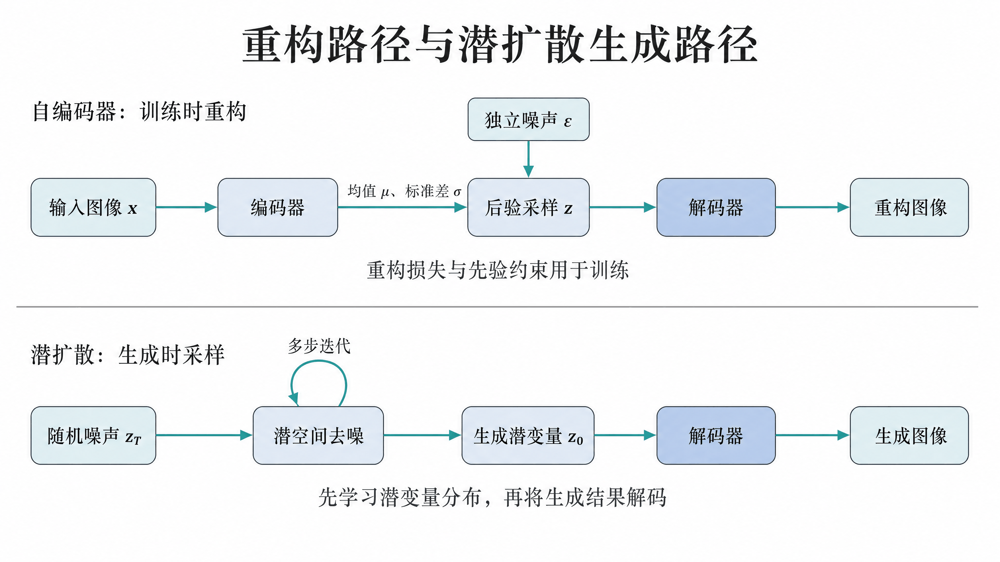

# 目录

[1. AE、VAE 与 VQ-VAE 如何构建视觉潜空间？](#q-001)
  - [面试问题：AE、VAE 和 VQ-VAE 的目标分别是什么？](#q-002)
  - [面试问题：自编码器 AE 的基本结构和训练流程是什么？](#q-003)
  - [面试问题：AE 为什么不能直接作为稳定的生成模型？](#q-004)
  - [面试问题：VQ-VAE 如何训练离散码本，怎样判断和缓解码本坍缩？](#q-201)

[2. VAE 如何在连续潜空间中实现生成？](#q-005)
  - [面试问题：VAE 的 ELBO 损失由哪些部分组成？](#q-006)
  - [面试问题：什么是重参数化技巧，为什么 VAE 必须使用它？](#q-007)
  - [面试问题：VAE 生成的图像为什么容易模糊？如何缓解？](#q-008)

[3. 为什么 Stable Diffusion 等系统需要 VAE？](#q-009)
  - [面试问题：Diffusion Model 和 VAE 中的重参数化分别如何使用？](#q-010)
  - [面试问题：视觉 tokenizer 的重构质量为什么不等于生成质量？](#q-011)
  - [面试问题：表示自编码器 RAE 如何连接视觉预训练与图像生成，采用时有哪些条件？](#q-202)

---

<h1 id="q-001">1. AE、VAE 与 VQ-VAE 如何构建视觉潜空间？</h1>

<h2 id="q-002">面试问题：AE、VAE 和 VQ-VAE 的目标分别是什么？</h2>

**难度评分：⭐⭐⭐ (3/5)  |  考察频率：⭐⭐⭐⭐⭐ (5/5)**

AE、VAE和VQ-VAE都学习“图像如何表示、表示如何还原”，但对潜变量的约束不同。判断一个系统是否能生成新图像，还要继续追问：**从哪里取得一个合理的潜变量？** 仅有编码器和解码器，并没有回答这个问题。

普通AE使用确定性编码器，将输入x映射为z，再由解码器重构。它直接优化重构误差，适合压缩、去噪和特征学习。即使编码网络是连续函数，训练样本的编码也可能只集中在潜空间很小的区域；在其他位置随意取点，解码器未必见过这种输入。

VAE建立带潜变量的概率模型：先从先验p(z)采样，再由条件分布p(x|z)生成数据。训练时另用q(z|x)近似难以计算的真实后验，通过重构项和分布约束一起学习。常见高斯VAE的编码器输出均值与方差，潜变量在训练中具有随机性；实际图像系统也常输出解码分布的均值作为结果。

VQ-VAE把每个位置的连续特征映射到有限码本中的一个向量，图像因而可以表示为离散索引网格。量化限制了表示的取值，却没有学会这些索引在不同位置应如何组合。原始工作还在训练好的索引上学习自回归先验，生成时先采样索引，再查码本并解码。

<div align="center">

| 模型 | 编码结果 | 主要训练约束 | 生成新样本还依赖什么 |
| --- | --- | --- | --- |
| 普通AE | 确定性连续特征 | 重构、可选的去噪或稀疏约束 | 额外的潜变量分布模型或明确的采样机制 |
| 常见VAE | 连续近似后验的分布参数 | 预期重构似然与KL项 | 已定义的先验与训练好的条件解码器 |
| VQ-VAE | 离散索引及其码本向量 | 重构、码本与承诺约束 | 能描述索引相关性的先验模型 |

</div>

例如将产品图片交给序列模型生成，离散索引便于使用分类式预测；需要在连续空间做扩散、编辑或插值时，连续latent通常更直接。二者都需要检查细字、边缘和颜色能否保存。码本、随机采样和较好的重构各自解决一个局部问题，完整生成能力来自表示与分布模型的配合。

<h2 id="q-003">面试问题：自编码器 AE 的基本结构和训练流程是什么？</h2>

**难度评分：⭐⭐ (2/5)  |  考察频率：⭐⭐⭐⭐ (4/5)**

AE的训练目标，是让一张图经过编码与解码后保留需要的信息。编码器f、解码器g及重构损失可写为：

```math
z=f_\phi(x),\qquad \hat{x}=g_\theta(z),\qquad
\mathcal L_{\mathrm{AE}}=d(x,\hat{x}).
```

φ、θ分别是两部分网络的参数，d衡量输入与重构的差异。训练时取一批图像，前向得到latent和重构结果，再把误差反传到两部分网络。去噪AE会将扰动后的图像送入编码器，但仍以干净图像为重构目标，不能把这种训练与单纯复制输入混为一谈。

以一个教学配置为例，256×256×3图像经过8倍空间下采样得到32×32×4的latent。元素数量从196,608降到4,096，减少48倍；这里没有计入数据类型、码本、网络权重和熵编码开销，不能直接称为文件压缩48倍。编码器常由带步长卷积或patch操作逐步聚合信息，解码器通过上采样和可学习变换恢复输出网格。

瓶颈应与任务需要匹配。压缩太强，金额末位、细线或小缺陷可能丢失；容量很大且没有约束，模型又可能学成接近恒等的复制路径，得到漂亮重构却没有有用的抽象表示。跨过瓶颈的高分辨率skip connection也会改变信息通路，因此讨论“latent保存了多少信息”时，要检查解码器是否还读取了其他特征。

损失决定模型优先保留什么。像素损失关注逐点误差，感知损失比较特征，对抗损失鼓励结果符合真实图像分布。后两者可能使视觉效果更好，但也可能生成与原图不一致的纹理。训练后应同时检查重构误差、重要区域、不同输入域和实际运行成本；用于文档或测量任务时，内容正确性通常比“看上去清晰”更重要。

<h2 id="q-004">面试问题：AE 为什么不能直接作为稳定的生成模型？</h2>

**难度评分：⭐⭐⭐ (3/5)  |  考察频率：⭐⭐⭐⭐ (4/5)**

普通AE没有定义一个方便采样的潜变量先验。训练只要求解码器在编码器实际输出的区域还原图像，并未要求它在整个潜空间都产生合理结果。因此，“能重构训练图”不足以推出“输入标准高斯噪声就能生成图”。

可以把训练图像的编码分布记为聚合分布q(z)。假设这些编码主要分布在几个弯曲的狭窄区域，而标准高斯在其他区域也分配大量概率。随机采样就可能进入解码器缺少训练支持的位置。问题是**采样分布与训练分布不匹配**，不必把它描述成编码函数在数学上不连续。两个真实编码的直线插值同样可能穿过低密度区域，平滑插值图不能作为全空间生成可靠的证明。

补齐生成能力的一条路线，是先训练AE，再固定表示，在q(z)上学习扩散、流或自回归模型。生成时从这个新模型获得latent，再送给解码器。另一条路线是在表示训练中加入明确的概率约束，例如VAE对每个样本后验与先验的KL正则。离散化的VQ-VAE仍需要学习索引组合分布，不能仅靠码本随机选词。

这也解释了为什么潜扩散系统即使使用“VAE”，仍会训练一个强大的潜空间生成器。为了保留重构细节，图像tokenizer常只施加较弱的KL约束；真实聚合后验并不因此精确等于标准高斯。扩散模型学习的是这些实际编码及其条件关系，而不是假定KL已经替它完成全部分布建模。

工程上可以分别做两项检查：输入真实编码时能否重构，输入生成编码时能否稳定解码。前者差，应先排查表示容量和解码器；前者好而后者差，则要检查生成分布、归一化、采样误差和解码器对偏离训练区域的容忍度。把两种失败混在一起，会导致盲目增加解码器参数或反复更换采样器。

<h2 id="q-201">面试问题：VQ-VAE 如何训练离散码本，怎样判断和缓解码本坍缩？</h2>

**难度评分：⭐⭐⭐⭐ (4/5)  |  考察频率：⭐⭐⭐⭐ (4/5)**

VQ-VAE用最近邻查表把连续特征变为离散索引。设一个位置的编码为zₑ，码本包含K个D维向量e₁到eK，则：

```math
k^*=\arg\min_k\|z_e-e_k\|_2^2,\qquad z_q=e_{k^*}.
```

解码器看到的是选中的码本向量zq，存储或生成时可以使用整数索引k。若图像有N个位置，每个索引用固定长度编码，理论索引开销约为N·log₂K比特；实际还要考虑取整、熵编码、码本与元数据，不能据此直接报告压缩文件大小。

最近邻选择是离散操作，对编码器不能直接使用通常的连续梯度。常见实现采用straight-through估计：前向使用量化值，反向近似把解码器输入的梯度传给编码器。可以写为zₑ＋sg(zq－zₑ)，其中sg在前向保持值、反向阻断梯度。这是有偏的梯度近似，不是证明argmin本身可微。

原始训练目标可按最小化形式理解为：

```math
\mathcal L=d(x,\hat{x})
+\|\mathrm{sg}(z_e)-e_{k^*}\|_2^2
+\beta\|z_e-\mathrm{sg}(e_{k^*})\|_2^2.
```

重构项训练解码器，并通过近似梯度训练编码器；第二项让码本向编码结果靠近；第三项称为承诺损失，约束编码器不要不断远离已选向量。部分实现用指数滑动平均更新码本，梯度路径和超参数应按具体代码说明。

**码本坍缩**指大量条目长期不被使用，表示容量集中到少数索引。初始化不合适、编码特征尺度变化、更新速度不匹配或数据分布偏斜都可能促成它。可检查每个码的使用率、使用分布熵、最近邻距离和重构质量，再选择数据驱动初始化、重置闲置条目、调整更新或归一化。码本困惑度可衡量分布是否集中，但使用率越高并不自动意味着语义和生成质量越好。

码本坍缩还应与VAE后验坍缩区分：前者关注离散词表利用，后者关注解码器是否利用潜变量信息。最后，离散token也不天然等于语义词汇；一个码可能编码纹理、颜色或混合特征，仍要通过下游任务检验其作用。

<h1 id="q-005">2. VAE 如何在连续潜空间中实现生成？</h1>

<h2 id="q-006">面试问题：VAE 的 ELBO 损失由哪些部分组成？</h2>

**难度评分：⭐⭐⭐⭐ (4/5)  |  考察频率：⭐⭐⭐⭐⭐ (5/5)**

VAE要最大化数据的边缘对数似然log pθ(x)，但直接对所有潜变量积分通常很难。于是引入编码器给出的近似后验qφ(z|x)，将目标分解为：

```math
\log p_\theta(x)
=\mathcal E(x)
+D_{\mathrm{KL}}\!\left(q_\phi(z\mid x)\,\Vert\,p_\theta(z\mid x)\right),
```

```math
\mathcal E(x)
=\mathbb E_{q_\phi(z\mid x)}[\log p_\theta(x\mid z)]
-D_{\mathrm{KL}}\!\left(q_\phi(z\mid x)\,\Vert\,p(z)\right).
```

第二个式子的E就是ELBO。第一个式子中KL非负，因此E不高于真实对数似然；当近似后验等于真实后验时，这个差距为零。注意两个KL的对象不同：推导中的差距对照真实后验，训练目标中的正则对照预先选择的先验。

实际训练通常最小化负ELBO。负的预期对数似然负责重构，KL项限制编码携带信息的方式。若解码分布是假设固定方差的独立高斯，重构项在常数与比例系数之外对应MSE；若输出分布不同，就不能统一说成L2。常见先验为标准高斯，后验为对角高斯，此时KL有解析形式：

```math
D_{\mathrm{KL}}\!\left(\mathcal N(\mu,\mathrm{diag}\sigma^2)\,
\Vert\,\mathcal N(0,I)\right)
=\frac12\sum_j\left(\mu_j^2+\sigma_j^2-1-\log\sigma_j^2\right).
```

例如某维μ＝0、σ²＝1，该维KL为0；均值偏离0或方差偏离1都会增加约束成本。这体现出一种信息取舍：为了重构不同输入，编码需要产生差异；为了接近共同先验，差异又不能无限扩大。

若把KL前系数改成β，就得到加权的β-VAE类目标。**标准负ELBO对应β＝1**；任意β下不能不加区分地沿用同一个似然下界解释。β过大可能使模型牺牲输入信息，强解码器还可能学会忽略z，即后验坍缩。判断时应同时看每维KL、重构与生成，而不是只要求总KL越小越好。重构项按像素求和还是取平均也会改变有效权重，调β前必须统一损失口径。

<h2 id="q-007">面试问题：什么是重参数化技巧，为什么 VAE 必须使用它？</h2>

**难度评分：⭐⭐⭐⭐ (4/5)  |  考察频率：⭐⭐⭐⭐⭐ (5/5)**

高斯VAE通常使用重参数化来估计编码器梯度，但“必须使用”过于绝对。也存在score-function等梯度估计方式；重参数化的优势是在可用条件下建立低方差、便于自动微分的路径。

问题出在采样分布本身依赖编码器参数。训练需要对qφ(z|x)下的预期重构误差求导，不能把已经抽到的z当作与φ无关的常数，否则重构信号就无法正确更新编码器。对对角高斯，可以先采与网络参数无关的标准噪声，再确定性地变换：

```math
\epsilon\sim\mathcal N(0,I),\qquad
z=\mu_\phi(x)+\sigma_\phi(x)\odot\epsilon.
```

固定一次抽到的ε后，z对μ的导数为1，对σ的导数为ε，所以重构损失可以沿z回传。对满足相应可微和可交换条件的期望，这形成pathwise梯度估计。随机性仍在，每次训练会抽到不同噪声；被改写的是随机样本对参数的依赖方式。

网络常输出logvar＝log σ²，再计算σ＝exp(0.5·logvar)。这里的0.5不能漏掉，标准差与方差也不能互换。另一种实现可以直接预测无约束数，再用softplus构造正标准差或方差，但必须明确构造的是哪一个量，不能对logvar随意替换运算。必要的数值截断会改变可表示的分布范围，应记录并监控。

例如μ＝2、σ＝0.5、一次噪声ε＝－1，则z＝1.5；反向时模型能够知道调整μ或σ会怎样改变这次重构。训练通常用少量蒙特卡洛样本估计期望，样本更多降低估计波动却增加成本。

这套高斯公式不能原样套到离散码本索引。离散变量可能使用连续松弛或straight-through近似，估计性质也不同。推理重构时使用后验均值可以减少随机波动，但不等于从模型先验生成；接口必须与后续训练所用latent分布保持一致。

<h2 id="q-008">面试问题：VAE 生成的图像为什么容易模糊？如何缓解？</h2>

**难度评分：⭐⭐⭐ (3/5)  |  考察频率：⭐⭐⭐⭐ (4/5)**

VAE的模糊常来自输出分布、信息瓶颈和训练权衡共同作用，不能只归因于“加了随机噪声”。先区分重构图模糊和先验采样图模糊：前者说明编码—解码通路已有问题，后者还可能包含先验与实际编码分布不匹配。

在固定方差高斯解码器下，最小化预期像素平方误差会使输出均值趋近于给定z的条件均值。如果z已经不能区分一条细边缘究竟在左还是右，两个合理结果被平均后就会变软。这不是说所有L2训练必然模糊，而是多种细节共享相近表示时，均值预测容易出现平滑。将MSE改为L1会改变最优统计量，却不能自动补回丢失的信息。

另一个来源是瓶颈太紧。过强空间下采样、过少通道或较强KL约束，可能让编码器优先保存物体轮廓，舍弃高频纹理。即使解码器很强，也无法唯一推断原图中已被压掉的字符末位。它可以根据先验生成一个看似合理的细节，但“清晰”与“还原正确”需要分开验收。

缓解时可按问题逐项处理：容量不足就调整空间压缩率、通道或分层表示；像素平均过强可加入感知或对抗约束；解码伪影则检查上采样算子、训练分辨率和损失配比。感知损失的特征网络也可能忽略文字差别，对抗损失可能制造细纹，不能只用主观观感选择最优配置。提高解码器能力还可能改变后验坍缩风险，需要同步观察潜变量利用情况。

潜扩散模型可以学习更好的latent分布，但它的最终输出仍要经过同一解码器，不能保证恢复tokenizer从真实输入中丢掉的细节。需要精细修复时，可以增加像素域或更高分辨率的生成阶段，同时承担额外成本与内容偏移风险。

一个实用诊断顺序是：先比较真实图的重构与原图，检查边缘、小字和颜色；再固定tokenizer比较不同生成器；最后单独测解码器对轻微latent扰动的稳定性。这样才能区分容量、建模和解码问题，避免把所有模糊都交给采样步数解决。

<h1 id="q-009">3. 为什么 Stable Diffusion 等系统需要 VAE？</h1>

<h2 id="q-010">面试问题：Diffusion Model 和 VAE 中的重参数化分别如何使用？</h2>

**难度评分：⭐⭐⭐⭐ (4/5)  |  考察频率：⭐⭐⭐⭐ (4/5)**

VAE和扩散模型都可以把随机变量写成“确定性变换＋独立噪声”，但训练目的不同。VAE重参数化服务于**后验采样的梯度估计**；标准扩散前向公式主要用于**直接构造任意时间步的训练输入**。

在VAE中，编码器输出qφ(z|x)的参数，通过z＝μ＋σ⊙ε得到样本，再由重构损失更新编码器。这里μ和σ依赖需要学习的φ，因此必须妥善处理采样分布对参数的依赖。

在常见离散时间高斯扩散中，令αₜ＝1－βₜ，累计系数为各步α的乘积，则：

```math
x_t=\sqrt{\bar\alpha_t}\,x_0
+\sqrt{1-\bar\alpha_t}\,\epsilon,
\qquad \bar\alpha_t=\prod_{s=1}^t\alpha_s,
\qquad \epsilon\sim\mathcal N(0,I).
```

x₀是干净样本，βₜ规定每一步加噪强度。闭式关系使训练时可以随机选t，直接生成xₜ，无须真的逐步模拟前面所有加噪过程。噪声ε同时可作为预测目标；也可选择其他等价或相关参数化，但需要同步调整损失权重和反推关系。这里的xₜ不是VAE的近似后验样本。

<div align="center">



</div>

图依据VAE与LDM的机制重新绘制。上方展示带后验采样的自编码器重构路径，下方展示典型潜扩散的生成路径。箭头表示数据流，省略损失回传与条件输入；下方解码器复用已经训练好的模块。

潜扩散把图像先编码成z₀，再在z₀上构造带噪latent并训练去噪网络。常见两阶段方案固定编码器，所以扩散损失通常不需要穿过VAE采样去更新它。生成时从噪声出发，经反向过程获得生成latent，再解码成像素。联合训练或端到端微调是另外的设置，不能由“都可重参数化”推断所有组件默认联合优化。

工程接口还包括latent的缩放、平移、通道数和后验采样方式。训练时使用某个缩放后的latent，解码前却漏掉逆变换，可能出现严重色偏和失真。应保存这些参数并做编码—解码回环检查；换一个同名“VAE”也不能假定接口天然兼容。

<h2 id="q-011">面试问题：视觉 tokenizer 的重构质量为什么不等于生成质量？</h2>

**难度评分：⭐⭐⭐⭐ (4/5)  |  考察频率：⭐⭐⭐⭐ (4/5)**

重构质量测量的是解码器处理真实编码的能力，生成质量还取决于生成器能否学到编码分布，以及解码器怎样响应采样误差。一个tokenizer可以保留很多细节，却对latent中某些方向的微小偏差非常敏感；这时高PSNR并不能保证生成图稳定。

可以用一个局部近似理解。设真实编码为z，生成或数值误差为δ，解码器为D，在可微且扰动足够小时：

```math
D(z+\delta)-D(z)\approx J_D(z)\delta,
\qquad
\|D(z+\delta)-D(z)\|_2^2
\approx\delta^\top J_D(z)^\top J_D(z)\delta.
```

JD是解码器对输入的雅可比矩阵。即使两种latent误差的欧氏长度相同，沿高敏感方向的误差也可能造成更明显的像素变化。例如一个方向主要改变背景亮度，另一个方向影响字符边缘，两者不能仅按latent MSE判断业务影响。这是局部解释，大扰动或复杂感知指标不应直接套用该近似作定量预测。

2026年11月修订的《Rethinking the Reconstruction–Generation Gap in Representation Autoencoders》通过固定信息内容、更换解码器或改变扩散坐标来分析这种接口错配。它说明多层特征融合后的生成退化，部分可以通过提高解码容错、让生成坐标考虑解码敏感性来缓解。主要证据是特定引导方案下的ImageNet-256类别条件生成，尚不能推断所有文生图或视频tokenizer都具有相同最优解。

评估时应保留三个互补层次：

<div align="center">

| 层次 | 重点检查 | 单独使用时遗漏什么 |
| --- | --- | --- |
| 重构 | PSNR/SSIM、感知距离、文字边缘、颜色 | 不反映生成模型能否学到latent分布 |
| 表示与接口 | token数、通道尺度、语义信息、扰动敏感性、跨域变化 | 单个表示分数不能替代完整生成 |
| 下游生成 | 相同预算下的收敛、样本分布、条件遵循、编辑一致性和成本 | 一个总指标可能掩盖关键内容错误 |

</div>

比较tokenizer时，应控制或明确生成器容量、训练计算量、采样步数、引导和评价数据。token更多或通道更宽可能提高信息容量，也可能改变模型成本；固定训练步数不等于公平预算。对于发票、设计图等任务，还应直接测文字或几何一致性，不能用FID取代内容验收。

<h2 id="q-202">面试问题：表示自编码器 RAE 如何连接视觉预训练与图像生成，采用时有哪些条件？</h2>

**难度评分：⭐⭐⭐⭐ (4/5)  |  考察频率：⭐⭐⭐ (3/5)**

表示自编码器RAE将预训练视觉编码器与可训练像素解码器组合，尝试同时使用较强的语义表示和可还原的视觉信息。它改变了tokenizer的起点：编码器先通过自监督或图文学习获得表征，再为这些特征训练解码器；随后另训生成模型来学习特征分布。

原始《Diffusion Transformers with Representation Autoencoders》采用冻结的DINO、SigLIP或MAE类编码器，保留有空间位置的patch特征，配合ViT解码器训练重构。冻结意味着重构梯度不再任意改写预训练表征，但也意味着编码器已经舍弃的信息不能靠解码器唯一恢复。CLS汇聚向量通常不足以替代完整patch网格。

这些特征的通道往往比传统图像VAE宽得多。更强语义不等于更容易直接接入已有DiT：输入投影、主干宽度、噪声尺度和输出维度都要匹配。token数决定注意力交互规模，通道宽度影响投影、前馈和存储，两个维度需要分别计算。所谓“latent”也不保证总元素数量一定比像素少。

该工作针对这种高维表示调整了去噪网络的宽度和噪声方案，并研究在标准主干后加入较浅、较宽的去噪头。另一个关键步骤是解码训练中的latent噪声增强：让解码器接触真实编码附近的扰动，提高对生成误差的容忍度。其消融显示，重构指标可以略降而生成指标改善，直接说明两者并不完全同向；宽头在低维VAE上也未呈现同样收益，不能当作通用提分模块。

这一方向值得学习的机制是把**表示信息、生成难度和解码稳定性**分开设计。它与在VAE训练中加入特征对齐损失不同：前者直接使用冻结表征作为编码接口，后者通常仍训练一个压缩编码器，只用外部特征提供约束。

采用时应先在目标域检查重构和特征是否合适，再适配生成器并控制预算。官方代码提供两阶段训练与权重，使实验可核查；原论文的主要结果仍是ImageNet类别条件生成，不能据此宣布其已替代所有生产VAE。高分辨率、文字、连续视频和特定设备上的优势，都需要对应数据与完整系统验证。

---

## 高频速记

- AE重构不自动提供采样分布；VQ码本限制取值，仍需学习索引组合的先验。
- 标准ELBO的KL系数为1；加权目标、损失归约方式和概率解释应分清。
- 高斯重参数化建立可微采样路径，logvar转标准差需要exp(0.5·logvar)；它不是所有分布唯一可用的梯度方法。
- 模糊要分清像素条件均值、表示容量、先验匹配与解码器问题；清晰纹理未必是真实细节。
- 潜扩散学习实际latent分布，缩放、后验采样和解码接口必须一致。
- 重构、语义表示、生成质量和解码容错各有评价边界；RAE使这些接口的独立设计更加重要。

## 参考资料

- Kingma and Welling, [Auto-Encoding Variational Bayes](https://arxiv.org/abs/1312.6114).
- van den Oord et al., [Neural Discrete Representation Learning](https://arxiv.org/abs/1711.00937).
- Rombach et al., [High-Resolution Image Synthesis with Latent Diffusion Models](https://arxiv.org/abs/2112.10752).
- [Reconstruction vs. Generation: Taming Optimization Dilemma in Latent Diffusion Models](https://arxiv.org/abs/2501.01423).
- Zheng et al., [Diffusion Transformers with Representation Autoencoders](https://arxiv.org/abs/2510.11690)；[官方实现](https://github.com/bytetriper/RAE).
- Du et al., [Rethinking the Reconstruction–Generation Gap in Representation Autoencoders](https://arxiv.org/abs/2609.31620v4)，2026-11-18修订版；本文引用其接口几何分析，保留ImageNet-256与特定引导方案的实验边界。
