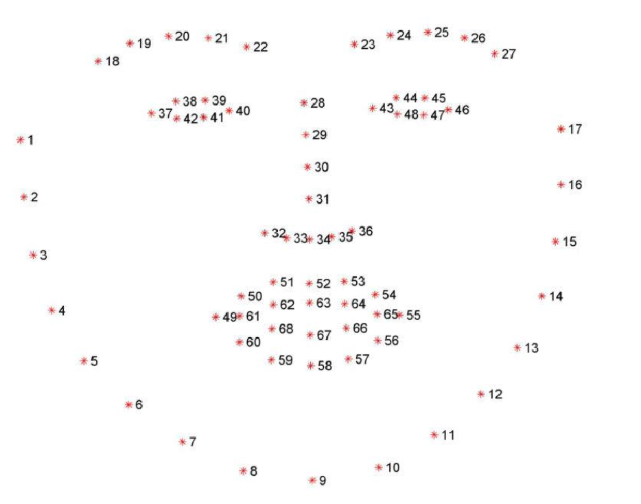

# 目录

[1. 人脸识别的判别学习基础](#q-001)
  - [面试问题：为什么传统 Softmax 不足以解决人脸识别？](#q-002)
  - [面试问题：分类能力和判别能力有什么区别？](#q-003)
  - [面试问题：L-Softmax、SphereFace、CosFace 和 ArcFace 如何逐步引入间隔？](#q-004)
  - [面试问题：CurricularFace 和 AdaFace 为什么要根据样本难度或图像质量自适应？](#q-005)
  - [面试问题：人脸训练数据中的重复、错标和合成样本分别怎样影响身份表示？](#q-202)

[2. 人脸任务与识别系统工程](#q-006)
  - [面试问题：AI 领域的人脸主流任务如何分类？](#q-007)
  - [面试问题：InsightFace 系列技术解决了什么问题？](#q-008)
  - [面试问题：一个工业级人脸识别系统的完整 pipeline 是什么？](#q-009)
  - [面试问题：1:1、1:N、N:N、静态识别和动态识别有什么区别？](#q-010)
  - [面试问题：影响人脸图像质量的因素有哪些，如何做质量门控？](#q-011)
  - [面试问题：人脸 embedding 的相似度如何计算和校准？](#q-012)
  - [面试问题：多照片与视频人脸怎样构建身份模板，在线更新如何避免错误自我强化？](#q-201)

[3. 人脸分析：关键点、解析与属性](#q-013)
  - [面试问题：什么是人脸关键点检测，它如何服务于对齐和表情驱动？](#q-014)
  - [面试问题：什么是人脸解析（Face Parsing）？](#q-015)
  - [面试问题：人脸属性分析如何建模，哪些属性不应直接作为业务结论？](#q-016)
  - [面试问题：人脸美颜技术的原理和工程边界是什么？](#q-017)

[4. 人脸身份建模与 AIGC 编辑](#q-018)
  - [面试问题：为什么 ArcFace 在人脸识别和 AIGC 身份保持中长期高频？](#q-019)
  - [面试问题：ArcFace embedding 如何作为生成模型的身份损失？](#q-020)
  - [面试问题：AIGC 数字人、换脸和肖像编辑如何保持身份一致？](#q-021)
  - [面试问题：InstantID、IP-Adapter FaceID、PhotoMaker 的共同思想是什么？](#q-022)

[5. 人脸安全、评估与 Agent 边界](#q-023)
  - [面试问题：活体检测和 DeepFake 检测有什么区别？](#q-024)
  - [面试问题：伪造检测为什么难以跨生成器泛化，怎样减少模型对伪线索的依赖？](#q-203)
  - [面试问题：AI Agent 调用人脸模型时有哪些安全风险？](#q-025)
  - [面试问题：人脸模型和 AIGC 身份保持常用哪些评估指标？](#q-026)

---

<h1 id="q-001">1. 人脸识别的判别学习基础</h1>

<h2 id="q-002">面试问题：为什么传统 Softmax 不足以解决人脸识别？</h2>

**难度评分：⭐⭐⭐ (3/5)  |  考察频率：⭐⭐⭐⭐⭐ (5/5)**

**普通 Softmax 能训练出有用的人脸特征，但训练身份分类正确，并不等于陌生身份之间的比较可靠**。理解这个差别，要把训练和部署分开。

训练集假设有一万个身份，识别网络先把人脸编码为向量 $`f(x)`$，分类头再为这一万个身份计算 logit。最小化交叉熵，会让正确身份的分数相对其他身份更高。这里的监督依赖身份标签，普通 Softmax 只是最后的概率归一化运算。实际所说的“Softmax 损失”，通常指这一整套分类交叉熵目标。

部署时，新用户通常不在这一万个训练身份中，原分类头也没有这个人的类别。系统会保留特征网络，把注册照和待验证照片映射到同一个空间，再比较两个向量。注册新用户一般只需新增模板，不必为此重训一万个类别的分类头。这就是**以闭集分类监督学习表示，以开放身份比较使用表示**。

问题出在普通分类目标的约束不够直接。设同一个人在白天和夜间的照片分别位于分类边界内的两个位置，只要都分对，损失就可以很小；两张照片之间的距离却未必足够近。特征范数、分类权重范数和偏置，也可能参与提高训练分数。最终使用归一化余弦相似度时，这些训练优势并不都能转移过去。

ArcFace、CosFace 等方法通过归一化和间隔约束，让训练更贴近部署时的角度比较。但它们仍不能取消开放集验证：训练、校准和测试应按身份划分；根据目标误识率选择阈值；遇到质量差或库外身份时允许拒识。**损失函数改善表示，阈值和评估协议决定系统怎样承担错误。**

<h2 id="q-003">面试问题：分类能力和判别能力有什么区别？</h2>

**难度评分：⭐⭐⭐ (3/5)  |  考察频率：⭐⭐⭐⭐ (4/5)**

分类能力通常衡量“能否把样本分到正确类别”，判别表示能力则关心“表示空间能否支持稳定的同类聚合和异类区分”。两者相关，但评价对象不同。人脸分类准确率看固定训练身份的类别预测，开放集验证看两个未见身份样本的相似度能否作出可靠判断。

可以把每个身份想成一团有形状的数据。同一人的正脸、侧脸、戴眼镜和跨年龄照片形成类内变化，不同身份之间也可能有外观相似。理想表示会保留稳定身份信息，减少姿态、光照、背景等干扰；普通分类只要求这些数据落在正确决策区域，并不直接控制整团数据的形状。

“最小类间距离大于最大类内距离”可以用来描述理想状态，**不能当作真实人脸数据的必然性质，也不是 ArcFace 的全局保证**。严重遮挡、同卵双胞胎、标签噪声和信息不足都会造成分布重叠。强行把所有困难样本压到同一点，可能放大错标影响，或抹掉对其他任务有用的变化。

训练时可用分类间隔、对比学习、Triplet 或中心约束塑造空间，但要理解各自的作用。Triplet 直接比较锚点、同身份和异身份样本，依赖采样；分类间隔通过与类别权重的角度关系施加约束，更易利用大批身份。它们都不能只凭损失下降判断效果。

工程上应观察两种分布：同身份相似度和异身份相似度。平均距离拉开后，异身份分布最右侧仍可能留下少量高分错误；低 FAR 场景恰恰由这条尾部决定。一个模型提高了平均分类准确率，却使低清人脸的误识尾部变厚，未必适合身份核验。评估因此要同时看目标工作点、质量切片和错误案例。

<h2 id="q-004">面试问题：L-Softmax、SphereFace、CosFace 和 ArcFace 如何逐步引入间隔？</h2>

**难度评分：⭐⭐⭐⭐ (4/5)  |  考察频率：⭐⭐⭐⭐⭐ (5/5)**

这几种方法都通过压低真实类别的训练 logit，提高“分对”所需的判别条件。区别在于**在哪个量上施加间隔，以及有没有消除范数和偏置对分类分数的影响**。

先看普通线性分类头。第 $`j`$ 类 logit 可写为 $`W_j^{\mathsf T}f+b_j=\lVert W_j\rVert\lVert f\rVert\cos\theta_j+b_j`$，其中 $`\theta_j`$ 是特征与类别权重的夹角。类别权重可理解为训练中学习的判别方向，并不严格等于该类特征的算术均值。

<div align="center">

| 方法 | 真实类 logit 的核心形式 | 关键区别 |
| --- | --- | --- |
| L-Softmax | 将余弦角度项改为乘性角度函数，基本区间内为 $`\cos(m\theta_y)`$ | 用乘性角度条件收紧边界；保留特征和权重范数，完整定义需要分段延拓 |
| SphereFace / A-Softmax | $`\lVert f\rVert\psi(\theta_y)`$ | 归一化分类权重、去掉偏置，再使用乘性角度函数；原始形式并未像 ArcFace 一样把特征范数固定为常数 |
| CosFace | $`s(\cos\theta_y-m)`$ | 特征和权重归一化，在余弦值上减去固定间隔 |
| ArcFace | $`s\cos(\theta_y+m)`$ | 特征和权重归一化，在角度上加入固定间隔 |

</div>

表中 $`y`$ 为真实身份，$`m`$ 为间隔，$`s`$ 为归一化后重新引入的尺度。CosFace 和 ArcFace 的非真实类别仍使用 $`s\cos\theta_j`$。若去掉尺度，余弦只有有限取值范围，在大量类别中难以得到足够尖锐的分类分布；$`s`$ 还会影响梯度强度，不能随便省略。

CosFace 的固定余弦差，在不同角度处对应的角度差不同；ArcFace 的固定角度差，在单位超球面上具有直接的弧长解释。以 $`\theta_y=60^\circ`$ 为例，CosFace 取 $`m=0.2`$ 时真实类余弦从 0.5 降到 0.3；ArcFace 若加 $`0.2`$ 弧度，得到约 0.318。两种 margin 的数值不能直接视为同一强度。

实现还要处理角度范围。直接把 $`\cos(m\theta)`$ 用到整个 $`[0,\pi]`$ 会破坏所需单调关系，所以乘性方法需要分段函数；ArcFace 的 $`\theta+m`$ 超过有效单调区间时，也需要明确回退或裁剪策略，并防止开方、反余弦的数值误差。部署时通常丢弃这些训练头，只保留 embedding，不能把训练 margin 当作线上识别阈值。

<h2 id="q-005">面试问题：CurricularFace 和 AdaFace 为什么要根据样本难度或图像质量自适应？</h2>

**难度评分：⭐⭐⭐⭐ (4/5)  |  考察频率：⭐⭐⭐⭐ (4/5)**

难样本至少有两种来源：一张清晰侧脸包含可靠身份信息，只是模型暂时不会识别；另一张严重模糊或错标的照片，可能根本没有足够信息。若训练把两者同等放大，就会把模型容量消耗在噪声上。CurricularFace 和 AdaFace 分别从**学习阶段**与**质量相关的梯度分配**处理这个问题。

**CurricularFace 调整困难负类的竞争强度**。它以带角度 margin 的真实类分数作为参照，将分数高于该参照的非真实类视为困难负类。设某负类余弦为 $`c_j`$，典型调制将它改为 $`c_j(t+c_j)`$，而容易负类仍保留原值。$`t`$ 由批次真实类余弦的移动平均更新。随着模型对正确身份的对齐程度提高，困难负类的影响随之变化。这不是简单“给困难图片乘一个权重”，而是改变同一张图片内部不同竞争类别的 logit。

这种课程设计使模型早期较多学习可分结构，后期进一步处理容易混淆的身份。但 $`t`$ 不是严格单调的时钟，某个负类的调制结果也不能脱离当前余弦值讨论；错标仍可能反复成为困难负类，课程损失不会自动纠正标签。

**AdaFace 把归一化前的特征范数作为训练质量代理**。它使用批次统计的移动估计，对范数标准化、缩放并裁剪，得到质量相关量 $`q`$，计算该量时阻断梯度。在忽略数值裁剪的简化写法中，真实类 logit 为：

```math
z_y=s\left[\cos(\theta_y-mq)-m(q+1)\right],\qquad q\in[-1,1].
```

角度项和加性项共同改变决策条件与梯度。因此，“高质量就加更大角度 margin”并不准确：当 $`q`$ 增大时，角度位移与加性惩罚同时变化。其目标是让高质量样本中的困难样本更有学习价值，并减轻低质量、过难样本的不良影响。

范数只是特定训练体系下与质量相关的信号，不是跨网络、跨摄像头统一校准的质量分数；已经 L2 归一化的向量范数恒为 1，也不能再这样使用。工程验证应分别统计清晰难例、模糊样本和疑似错标的收益，而不是只看整体准确率上涨。

<h2 id="q-202">面试问题：人脸训练数据中的重复、错标和合成样本分别怎样影响身份表示？</h2>

**难度评分：⭐⭐⭐⭐ (4/5)  |  考察频率：⭐⭐⭐ (3/5)**

身份表示训练要求“同一标签的照片属于同一人，不同标签确实代表不同人”。数据缺陷会直接改变这个监督关系，并非都能靠更多数据或更强损失抵消。

**重复样本改变有效权重**。同一照片、连续视频的近重复帧、同一拍摄条件的大量副本，会让某些身份与姿态占据更多训练机会，却没有带来相应信息。如果重复跨越训练和测试，还会形成泄漏。去重应区分完全重复、近重复和真实的跨姿态样本，不能把看起来相近的不同身份直接删除或合并。

**身份标签错误改变学习方向**。同一人被拆成两个标签，会被分类损失推开；不同人被合到一个标签，会被错误拉近；多人图若裁到了错误脸，则图像质量很好也可能提供完全错误的身份监督。可以用图像哈希、特征邻域、身份内部聚类和人工复核定位问题，但识别模型本身有偏差，相似度只能作为审查线索，不能循环证明标签正确。

2026 年的 *Different Defects, Different Effects* 在 MS1MV3 上按缺陷类型进行控制实验，使用 IResNet-50 与 ArcFace，比较重复移除、拆分身份合并、无效内容过滤以及匹配规模的随机移除。结果支持一个实用判断：清理什么比删了多少更重要；部分针对性清理改善训练效率，扩大过滤范围却不一定继续受益。该结论来自特定数据、骨干和训练设置，不能推出所有数据都应按同一个比例删减。

**合成数据还多了一层身份语义**。若每个合成身份的样本只在同一背景或同一生成器纹理下出现，网络可能通过这些线索分人；若“换姿态”同时改变了身份，标签一致性就被破坏。生成得逼真只是视觉质量，训练还需要身份稳定性、类间多样性和采集域覆盖。

验证合成数据应比较真实数据基线、同预算的真实数据增强、真实与合成混合训练，并在独立真实身份上测试。生成参考、训练与测试身份的重叠要单独排查，尤其不能用同一个识别器既筛选所有合成样本，又作为唯一评价器。数据治理的目标是提高有效身份信息，而不是单纯扩大图片数量。

<h1 id="q-006">2. 人脸任务与识别系统工程</h1>

<h2 id="q-007">面试问题：AI 领域的人脸主流任务如何分类？</h2>

**难度评分：⭐⭐ (2/5)  |  考察频率：⭐⭐⭐⭐⭐ (5/5)**

人脸相关模型可以按输出所表达的信息来分类。这样更容易判断训练标签、模块接口和评价方法，也能避免把不同能力统称为“人脸识别”。

<div align="center">

| 任务层次 | 典型输出 | 解决的问题 |
| --- | --- | --- |
| 定位与跟踪 | 人脸框、置信度、轨迹编号 | 脸在哪里，连续画面中是不是同一个目标 |
| 身份比较 | 身份 embedding、相似度、候选名单 | 两个样本是否同一人，库中是否有匹配身份 |
| 结构与几何 | 关键点、头姿、3D 网格、部件 mask | 脸的部件在哪里，几何和姿态怎样变化 |
| 属性与状态 | 眼镜、眼睛开合、年龄估计、表情动作 | 图像中可见的属性或行为线索是什么 |
| 生成与编辑 | 条件化人像、换脸结果、驱动视频 | 在约束身份或姿态的同时合成新内容 |
| 质量与攻击检测 | 清晰度、可用性、攻击分数 | 输入是否足够可靠，采集或内容是否异常 |

</div>

这些任务对表示的要求可能相反。身份识别希望表情和光照变化尽量不改变向量；表情驱动恰好需要保留动作变化；伪造检测可能依赖识别网络主动忽略的微弱纹理。共享 backbone 能节约计算，但不意味着一个 embedding 天然适合所有任务。

以视频通行为例，检测给出脸的位置，跟踪将同一段轨迹的帧关联起来，质量模块选择可用帧，识别网络完成模板比较，业务规则决定是否接受。轨迹编号只表示本段视频内的关联，不自动对应真实身份。再如人像编辑，关键点和解析控制空间区域，身份特征约束“像谁”，生成模型负责画面，三者不能互相替代。

评估也要跟着任务走：漏脸先看检测召回，眼角抖动先看关键点时序误差，身份混淆再看低误识率下的验证性能。把整条链路压成一个“人脸准确率”，会让排障和模型选型都失去依据。

<h2 id="q-008">面试问题：InsightFace 系列技术解决了什么问题？</h2>

**难度评分：⭐⭐⭐ (3/5)  |  考察频率：⭐⭐⭐⭐ (4/5)**

InsightFace 是围绕二维、三维人脸分析构建的开源项目与模型生态，包含识别训练方法、检测器、预训练模型和推理接口。**ArcFace 是损失函数，识别 backbone 是特征网络，InsightFace 是组织这些能力的项目，它们不是三个可以直接并列的单模型。**

一个典型的 `FaceAnalysis` 工作流，会先运行人脸检测，获得框和关键点；随后按识别模型的模板对齐、裁剪人脸，再输出身份向量。某些模型包还带有关键点或属性模块，但能力取决于具体包及启用项。RetinaFace、SCRFD 等检测路线可以出现在生态中，不能把其中某一种硬写成所有包的固定检测器。

识别网络通常用带 margin 的分类目标训练，推理阶段只返回特征。业务层再负责注册模板、检索、拒识、权限与日志。示例代码能输出一个向量，距离完整的身份核验系统仍有数据采集、阈值校准和业务状态管理等工作。

部署中最常见的坑集中在接口。相同尺寸的人脸输入，若 RGB/BGR 顺序、归一化范围、五点模板、裁剪插值或模型版本不同，得到的向量就可能不可比。ONNX Runtime 的 execution provider 也要实际检查，否则配置了 GPU 名称却回落到 CPU，会产生完全不同的延迟。计时应包含检测、对齐和数据传输，而不仅是识别网络前向。

它在 AIGC 中常被用来提供身份条件或身份相似度评价，但这些使用方式需要生成端额外的投影、条件注入或损失设计。代码许可证、训练数据条件和预训练权重授权也应分开核对，仓库代码可用不等于所有模型权重都具有同样的商业授权。

<h2 id="q-009">面试问题：一个工业级人脸识别系统的完整 pipeline 是什么？</h2>

**难度评分：⭐⭐⭐⭐ (4/5)  |  考察频率：⭐⭐⭐⭐⭐ (5/5)**

完整链路首先要区分**注册**和**查询**。注册负责建立可信身份与模板之间的关联，查询负责比较当前输入与已有模板。若注册时就把照片挂到了错误账户，再强的识别网络也会稳定地产生错误业务结果。

注册一般经过采集与质量检查、必要的采集攻击检测、人脸定位与对齐、特征提取，再将模板与身份标识、模型版本、采集条件绑定。查询侧则可概括为：

```text
采集图像或视频
  → 检测人脸；视频中建立短时轨迹
  → 检查质量，定位关键点并按模板对齐
  → 提取和归一化身份特征；必要时聚合多个可用帧
  → 指定模板比较，或在身份库中检索并精排
  → 结合阈值、库外拒识与业务状态作出决策
  → 返回结果、分数、质量、版本和失败原因
```

质量检查并非只能放在一个位置。人脸尺寸可以在检测后判断，对齐后的裁剪完整性要在裁剪后检查，识别可用性分数可能依赖特征网络。采集攻击检测也可能与这些模块并行，最终汇入决策，而非固定放在“已经确认身份”之后补做。

系统应区分“没有检测到脸”“画面不足以比较”“候选分数不足”和“疑似攻击”。这些结果对应不同处理：重新采集、等待清晰帧、返回未知身份或结束认证。把它们都压成 `false`，上层既无法正确交互，也难以统计真正的故障原因。

检索系统还要注意召回与验证的接口。近似向量索引先给候选，再用约定的精确分数重排；候选漏召回时，后续阈值再好也无济于事。模型升级则涉及整个模板库：新旧 embedding 通常不在同一坐标系中，不能直接混比。要选择重建模板、双版本过渡，或使用经过专门验证的兼容映射，同时重做阈值与索引验收。

端到端验收应记录从采集到决策的延迟、失败采集率和业务误受/误拒。离线裁好的人脸识别高分，只证明链路中一段较好，无法覆盖线上检测、对齐、模板污染和决策策略的问题。

<h2 id="q-010">面试问题：1:1、1:N、N:N、静态识别和动态识别有什么区别？</h2>

**难度评分：⭐⭐⭐ (3/5)  |  考察频率：⭐⭐⭐⭐⭐ (5/5)**

这里混合了两个分类维度：`1:1`、`1:N` 描述比较关系，静态与动态描述采集方式。动态视频也可以做 1:1 验证，受控自拍同样可以发起 1:N 检索。

<div align="center">

| 形式 | 具体问题 | 最容易忽略的条件 |
| --- | --- | --- |
| 1:1 验证 | 当前样本是否属于声称的身份 | 声称身份对应的模板是否可信，工作阈值是否满足要求 |
| 1:N 识别 | 库中哪一个身份与查询匹配，或者都不匹配 | 闭集已知“必在库中”与开集允许库外身份，是不同协议 |
| M 个查询对 N 个库身份 | 对多人或多帧批量执行检索 | 需要去重、轨迹聚合，并明确一次查询或一次事件的误报口径 |
| 全库两两比较 | 查找重复注册或构建相似关系 | 无向不重复配对约为 $`N(N-1)/2`$，规模与阈值问题不同 |

</div>

“N:N”在业务资料里并没有唯一严格含义：可能指多人同时对底库检索，也可能指两组样本匹配，或者全体两两比较。面试和方案中应先写出查询集合、底库集合及输出形式，不能把它直接定义成“视频里有多个人”。若要求两组目标一一对应，还会涉及匹配约束；普通独立检索并不会自动满足一一对应。

静态采集通常便于约束距离、光线和姿态，但不天然高质量；动态采集会增加运动模糊、轨迹关联和时序延迟问题，也提供了挑选好帧的机会。十张相邻视频帧高度相似，不能简单当作十次独立身份确认。

库规模还会改变错误机会。假设库外查询与每个模板误匹配概率都为 $`p`$，且比较相互独立，则至少发生一次误匹配的概率为 $`1-(1-p)^N`$；在 $`Np`$ 很小时约为 $`Np`$。现实中比较相关、身份模板数不均，这个式子只能解释趋势，部署应直接按真实库规模评估 FPIR。Rank-1 很高也不代表开集安全，因为它可能根本没有测试库外身份。

<h2 id="q-011">面试问题：影响人脸图像质量的因素有哪些，如何做质量门控？</h2>

**难度评分：⭐⭐⭐ (3/5)  |  考察频率：⭐⭐⭐⭐ (4/5)**

人脸质量应理解为**当前图像对目标识别任务是否足够可用**。画面好看、分辨率大、检测置信度高，都不单独等于身份信息充分。一张磨皮后很干净的照片可能损失纹理，一张清晰侧脸可能仍缺少当前模型依赖的可见区域。

可以先检查可解释的采集因素：脸框像素大小、双眼间距、曝光、失焦或运动模糊、遮挡比例、姿态、裁剪完整性、关键点稳定程度。再用经过目标域验证的识别质量模型补充整体判断。检测分数只表示检测器认为“这里像一张脸”的程度，识别质量分数则应与后续比较误差建立联系，两者不能互换。

门控需要明确动作。若脸太小，提示靠近或选择更清楚的帧；若逆光，调整采集而不是持续重试同一张图；若部分遮挡但仍可用，可以进入更严格的比较流程。视频中可在有限时间窗内按质量、姿态和时间间隔选帧，避免一直等待理想帧而使业务延迟失控。

阈值越严格，留下的样本通常越容易识别，但被挡掉的用户也越多。因此应报告**拒绝比例与剩余样本错误率的关系**，同时计算包含失败采集在内的端到端成功率。不能把难样本先过滤掉，再只对剩下的数据宣布准确率提升。测试还应覆盖设备、年龄跨度、肤色、光照和遮挡等实际切片，检查是否某些用户承担了过高的重新采集成本。

增强也不是无条件收益。去噪和超分辨率可能恢复可用线索，也可能生成并不存在的细节。若增强进入识别链路，要在同一业务协议下比较原图与增强图，确认误识尾部没有恶化。对安全核验，更稳妥的解决方式经常是改善采集，而不是让生成模型替缺失信息作决定。

<h2 id="q-012">面试问题：人脸 embedding 的相似度如何计算和校准？</h2>

**难度评分：⭐⭐⭐⭐ (4/5)  |  考察频率：⭐⭐⭐⭐⭐ (5/5)**

常见做法是将特征 $`f(x)`$ 做 L2 归一化，得到 $`u=f(x)/\lVert f(x)\rVert_2`$，再计算点积。需要先检查特征是否有限、范数是否有效；不能把提取失败的零向量直接送去比较。

```math
s(u,v)=u^{\mathsf T}v,\qquad
\lVert u-v\rVert_2^2=2-2s(u,v).
```

因此，对单位向量，余弦相似度、平方欧氏距离和欧氏距离给出相同排序，但阈值数值不同。例如余弦 0.6 对应平方距离 0.8、距离约 0.894。未归一化时这个关系不成立，直接使用欧氏距离还会混入范数变化。汉明距离适用于另行设计的二值表示，不能直接套给普通浮点 embedding。

**分数本身没有统一身份概率含义**。同一个 0.6，在不同模型、输入处理、质量和身份库下含义都可能不同。阈值校准的一般步骤是：

1. 按身份、采集会话等划分训练、校准和测试，避免同一段视频的近重复帧跨集合泄漏。
2. 在校准集构造符合业务的同身份与异身份比较，按目标误匹配率选择阈值。
3. 锁定阈值，在独立测试集报告误匹配、误拒绝、置信区间及质量切片。
4. 若是开集 1:N，按实际检索与聚合策略直接测 FPIR、TPIR，不能只复用 1:1 负对统计。

低误识率需要足够证据。若有 $`n`$ 次独立且代表性充分的异身份试验，观察到零次错误，误识概率的单侧 95% 上界约为 $`3/n`$。一万次零错误，只能给出约 $`3\times10^{-4}`$ 的上界，支撑不了“低于百万分之一”。大量复用同一身份或相邻帧组成的配对彼此相关，名义配对数也不能当作同样多的独立试验；可按身份或会话做分组重采样，并说明统计假设。

若业务确实需要概率，可在代表性校准数据上另学映射，并检查可靠性曲线。但类别先验与线上分布变化会改变概率解释。阈值选择、概率校准、近似检索召回是三个独立问题，都应随模型版本、预处理和业务条件变化重新验证。

<h2 id="q-201">面试问题：多照片与视频人脸怎样构建身份模板，在线更新如何避免错误自我强化？</h2>

**难度评分：⭐⭐⭐⭐ (4/5)  |  考察频率：⭐⭐⭐ (3/5)**

单张注册照只覆盖一种姿态和光照。多模板的价值是补充身份在不同条件下的外观，而不是把同一张照片复制很多次。视频则提供了更多候选帧，同时带来重复、模糊和轨迹串人的风险。

最简单的聚合方式是对单位 embedding 加权求和，再归一化：

```math
u_{\mathrm{template}}=
\frac{\sum_{i=1}^{K}w_i u_i}{\left\lVert\sum_{i=1}^{K}w_i u_i\right\rVert_2},
\qquad w_i\geq0.
```

权重可根据经验证的识别质量设置。先按轨迹和身份一致性剔除异常，再限制近重复帧的贡献；若加权和范数太小，也应视为异常而不是强行归一化。均值模板便于存储和检索，但可能把差异较大的正脸与侧脸压成一个不够典型的方向。另一种方案是保留少量具有姿态多样性的模板，分别比较后聚合分数。

多模板取最大分数能提高召回，也会增加异身份偶然高分的机会。模板较多的人可能天然更容易被匹配，因此必须在同一模板数量与聚合策略下校准阈值。质量加权、分组模板、均值或 Top-k 聚合，都要用真实查询分布选择，不能只优化注册照的自相似度。

在线更新尤其要防止错误自我强化：系统把一次误识当作真身份，将错误向量写入该身份模板；下一次类似错误又更容易通过，最终整组模板漂移。合理的设计会保留不可覆盖的初始注册模板，将后续样本放入有容量上限的候选缓冲；要求更严格的更新条件、可靠的跨帧支持或额外身份验证；为新增模板记录来源、版本和可撤销关系。**允许通过一次查询，不自动等于允许永久改变身份库。**

2026 年的 Gallery Self-Evolution 展示了冻结编码器、对新样本去重、保留注册模板并用 FIFO 限制容量的路线。可借鉴的是“通过模板管理适应外观”的系统思路。其姿态分析包含 embedding 空间扰动，无法还原真实侧脸自遮挡与成像噪声，不能据此承诺线上误识率。

验证在线更新必须按时间回放：先注册，只利用当时已出现的信息更新，再评估未来查询；另外注入少量错误关联，观察污染是否扩散。若先把测试序列全部加入模板，再回头评价这些帧，结果就混入了未来信息。

<h1 id="q-013">3. 人脸分析：关键点、解析与属性</h1>

<h2 id="q-014">面试问题：什么是人脸关键点检测，它如何服务于对齐和表情驱动？</h2>

**难度评分：⭐⭐⭐ (3/5)  |  考察频率：⭐⭐⭐⭐⭐ (5/5)**

人脸关键点检测为眼角、鼻尖、嘴角、眉毛和轮廓等位置输出坐标，有的模型还预测可见性、置信度或三维坐标。不同点集服务于不同任务：五点常用于快速对齐，68 点或 106 点提供更细的部件形状，稠密网格则适合几何重建与渲染。点数更多不自动意味着定位更准，标注定义与目标域同样重要。

直接坐标回归输出一串位置数值，结构紧凑，但需要网络学习稳定的坐标表示；热力图方法为每个点预测空间分布，再通过峰值或 soft-argmax 得到坐标，容易保留位置不确定性，却增加空间计算和量化误差。遮挡点的处理必须与标注协议一致：可以预测其几何位置，但不能把“推断出的隐藏点”当成清晰可见的测量证据。

对齐通常估计二维相似变换，将输入关键点 $`p_i`$ 映射到固定模板点 $`q_i`$：

```math
\begin{aligned}
&\min_{a,R,t}\sum_i w_i\lVert aRp_i+t-q_i\rVert_2^2,\\
&R^{\mathsf T}R=I,\qquad \det(R)=1.
\end{aligned}
```

$`a`$ 为统一缩放，$`R`$ 为平面旋转，$`t`$ 为平移，$`w_i`$ 可用于降低不可靠点的影响。随后用逆向采样得到固定尺寸的人脸裁剪。它主要消除平移、尺度和面内旋转，**不能凭二维变换恢复大侧脸中不可见的另一半面孔**。需要正脸化时，还会涉及三维几何或生成模型，并引入额外误差。

<div align="center">

<a href="imgs/classic-deep-20261126/source_face_landmarks_68.png"></a>

图：一种常见的 68 点布局，图内从 1 开始编号；代码库可能从 0 开始，106 点及稠密网格另有定义，索引不能直接混用。

</div>

表情驱动还要把头部整体运动与局部表情分开。直接把嘴角的像素位移映射到嘴部动作，会混入头部转动、相机运动和人物尺度差异；通常先做坐标归一化或拟合头姿，再提取表情系数或局部形变。视频平滑能抑制抖动，但过强会拖慢眨眼和口型响应。评价除了平均点误差，还应看遮挡、大姿态、动态抖动与时延。

<h2 id="q-015">面试问题：什么是人脸解析（Face Parsing）？</h2>

**难度评分：⭐⭐⭐ (3/5)  |  考察频率：⭐⭐⭐⭐ (4/5)**

Face Parsing 将人脸及周边区域划分为皮肤、眉毛、眼睛、嘴唇、头发等语义类别，输出与图像坐标对应的像素标签或概率。它提供“哪些像素属于哪种部件”，关键点提供少量几何位置，身份 embedding 提供整体身份表示，三种输出承担不同职责。

典型网络用编码器提取多尺度特征，再通过解码器恢复空间分辨率。每个像素输出类别 logit，单标签设置下经 Softmax 得到类别概率，最终可取 argmax 得到硬 mask。训练以像素交叉熵为基础，必要时加入类别权重、Dice 或边界损失，缓解嘴唇、眉毛等细小类别容易被大面积背景淹没的问题。权重并非越大越好，否则会把标注边界噪声一并放大。

解析通常在检测后的人脸区域运行。若先裁剪、缩放或对齐，输出 mask 必须用对应逆变换映射回原图。标签图适合最近邻插值；概率图可以连续插值后重新归一化或再取标签。把硬类别编号当普通 RGB 图做平滑插值，会制造不存在的类别值，这是常见接口错误。

在虚拟化妆中，嘴唇 mask 决定颜色修改范围；美颜用皮肤 mask 排除眼睛、头发和背景；换脸融合则结合脸部区域和遮挡关系。语义 mask 并不等于精细透明度：发丝、半透明眼镜和边缘混合像素可能需要抠图或 alpha 估计。对同一张图反复腐蚀、膨胀虽能修补局部边界，也可能损失薄小结构。

因此 mIoU 只是起点，还要看各类别 IoU、边界误差和视频稳定性。若嘴唇边缘每帧上下跳动，即使整体 mIoU 较高，妆容仍会闪烁。工程上应把遮挡、侧脸、浓妆和不同肤色作为专项切片，并保留低置信区域的回退策略。

<h2 id="q-016">面试问题：人脸属性分析如何建模，哪些属性不应直接作为业务结论？</h2>

**难度评分：⭐⭐⭐ (3/5)  |  考察频率：⭐⭐⭐ (3/5)**

属性分析把人脸映射为分类、回归或时序输出。戴眼镜、眼睛开合可以作为分类任务，头姿可用角度或旋转表示回归，年龄可以做回归、年龄段分类或有序分布预测。任务定义先决定标签含义，再决定损失，不能看到一个连续数值就默认它是精确测量。

多任务网络通常共享 backbone，接多个任务头。问题在于训练样本未必同时具备所有标签：缺失标签应通过 loss mask 排除，不能默认为负例；不同任务的量纲和梯度规模也不同，需要平衡权重，检查是否一个高频属性压制了其他任务。若标签含噪，分布式年龄预测或不确定性估计有时比单点输出更适合表达证据。

还应区分**图像中可见的状态**和**人的内在状态**。识别到嘴角上扬，可以描述可见表情；据此断言当事人快乐、诚实或具有某种能力，已经超出了图像证据。外表年龄不等于准确出生年龄，表观性别标签也不等于个人的性别认同。模型输出应沿用训练标签的定义和范围，不能由上层文案随意放大。

以驾驶员闭眼检测为例，单帧闭眼可能只是正常眨眼；疲劳判断需要持续时间、眨眼频率、头姿、视线等时序线索，还要识别遮挡和跟踪失败。评价应以事件级漏报、误报和报警延迟为主，不能把逐帧分类准确率直接当作疲劳识别效果。

在 AIGC 编辑中，属性模型适合核查“是否戴眼镜”“头是否转向左侧”等可观察要求，但要注意风格迁移导致的域偏移。对涉及人的重要判断，应返回清晰的任务定义、有效输入范围及不确定结果，避免让一个标签承担训练时从未验证过的业务含义。

<h2 id="q-017">面试问题：人脸美颜技术的原理和工程边界是什么？</h2>

**难度评分：⭐⭐⭐⭐ (4/5)  |  考察频率：⭐⭐⭐ (3/5)**

美颜的难点是把用户希望改变的部分与需要保留的部分分开：皮肤可更平整，眼睛与头发纹理不能一起模糊；脸部比例可以调整，背景直线不应被拖弯；单帧好看，视频还要稳定。

一般流程包含定位、区域解析、几何变形、局部外观处理与融合。关键点负责五官位置，Face Parsing 提供皮肤、头发、嘴唇等 mask。瘦脸、大眼等效果构造局部位移场，可以用径向变形、薄板样条或网格变形，再对目标像素进行逆向采样，减少前向搬运像素留下的空洞。

位移场要在作用区域外逐渐衰减，并限制折叠和不合理拉伸。若只移动下颌点却没有约束周围区域，背景门框可能被一起弯曲；若左右脸的遮挡关系判断错，大侧脸会出现五官挤压。更复杂的三维方法能显式考虑姿态，但增加拟合、渲染和遮挡处理成本。

皮肤处理则需要在去除局部瑕疵与保留细节之间折中。双边滤波、引导滤波等方法利用边缘信息减少跨边缘混合，再与原始纹理按强度融合。颜色调整应限定区域并处理色彩空间，唇妆还要考虑明暗、牙齿和张嘴状态。边界羽化或梯度域融合可以减轻接缝，却无法自动纠正错分的 mask。

视频中，关键点、mask 和效果参数都可能抖动。时序滤波可减少闪烁，但跟踪切换、快速转头和遮挡重现时要重置或降低历史权重，否则会出现拖影。比较方案时应同时报告几何稳定性、纹理保真、身份变化和端到端延迟。

生成式增强能够处理复杂妆容或低清修复，也可能重画痣、眼型、牙齿等身份细节。对于希望保留真实外观的场景，应限制生成范围，保留原始输入和效果强度，并用身份、局部结构与人工视觉共同评估，不能只追求“更清晰”的主观印象。

<h1 id="q-018">4. 人脸身份建模与 AIGC 编辑</h1>

<h2 id="q-019">面试问题：为什么 ArcFace 在人脸识别和 AIGC 身份保持中长期高频？</h2>

**难度评分：⭐⭐⭐⭐ (4/5)  |  考察频率：⭐⭐⭐⭐⭐ (5/5)**

ArcFace 的长期价值在于把训练时的身份分类，和推理时的角度比较联系起来。它的实现简洁、几何解释明确，适合作为识别表示的基线，也使身份 embedding 能被生成模型和评价流程重复使用。

设训练有 $`C`$ 个身份，网络特征和分类权重均做 L2 归一化，二者点积为 $`\cos\theta_j`$。对真实身份 $`y`$，增加角度 margin $`m`$ 后，单样本损失为：

```math
L=-\log\frac{\exp\left[s\cos(\theta_y+m)\right]}
{\exp\left[s\cos(\theta_y+m)\right]+\sum_{j\ne y}^{C}\exp\left[s\cos\theta_j\right]}.
```

这里 $`m`$ 以弧度计，$`s`$ 控制 logit 尺度。若想获得同样的真实类概率，模型必须把特征方向进一步拉近真实类权重，或使竞争类别更远。它因而鼓励类内紧凑和类间分离，但不保证所有样本、所有未知身份都能严格分开。完整实现还需处理超出角度单调区间的情况，见[间隔损失比较](#q-004)。

推理阶段不再给某个类别增加 margin，也不必保留训练身份的分类头；直接提取归一化 embedding 比较即可。训练中 $`m=0.5`$ 并不意味着线上阈值设成 0.5。前者塑造空间，后者根据部署错误成本选择接受区域。

在 AIGC 中，这种空间可用来衡量生成脸和参考脸是否保留相似身份，或者构造身份条件。但一个用 ArcFace 训练的网络，并非通用“身份真值测量仪”。训练域以真实照片为主时，对插画、大姿态和局部生成瑕疵的响应可能与人类不同；若生成器又直接优化同一个网络，评价分数还可能被迎合。

因此应区分方法名、权重与用途：同为 ArcFace 训练，数据、backbone 和预处理不同也会得到不同的性能及阈值。生成任务最好使用独立识别器、结构指标和人工比较交叉评价，观察提高身份分数是否损害表情、自然度或文本可控性。

<h2 id="q-020">面试问题：ArcFace embedding 如何作为生成模型的身份损失？</h2>

**难度评分：⭐⭐⭐⭐ (4/5)  |  考察频率：⭐⭐⭐⭐ (4/5)**

先固定一个经过训练的人脸识别网络 $`f`$，将参考图和生成图按约定预处理映射为单位向量 $`u_r`$、$`u_g`$，常用身份损失为：

```math
L_{\mathrm{id}}=1-u_r^{\mathsf T}u_g,\qquad
L=L_{\mathrm{base}}+\lambda_{\mathrm{id}}L_{\mathrm{id}}+\sum_k\lambda_kL_k.
```

$`L_{\mathrm{base}}`$ 可以是扩散、重建或其他生成目标，其他项可约束感知质量、姿态、分割区域或时间连续性。身份项提供的信号是“生成结果在识别空间中向参考身份靠近”，它没有直接规定背景、衣服、嘴型和表情该怎样变化。

实现中最容易出错的是冻结与求导。**固定识别器参数，仍要保留从生成图经过识别器回到生成器的梯度**。参考分支通常可以缓存或放在 `no_grad` 中；若把生成分支也整体包进 `no_grad`，身份分数虽然能打印出来，却不会训练生成器。把生成图转成 NumPy、保存后重新读取，同样会断开计算图。

检测与裁剪也会影响梯度。框选择、阈值和离散关键点定位通常不可微，可以在不求导的路径获得稳定裁剪参数，再用可微采样处理生成图；但这并不等于梯度穿过了检测器。若人脸检测失败，要记录失败并采用明确策略，不能把它当作高身份一致性或直接从统计中悄悄删去。

对于扩散训练，识别器通常需要较接近自然图像的输入。把高噪声潜变量直接送进识别器没有明确意义，可在合适时间步对预测的干净图像解码后计算，但增加解码和识别开销，预测误差也会影响梯度。权重应通过身份、画质、编辑能力的共同验证选择。

若身份项过强，生成器可能复制参考姿态、压制表情，甚至找到识别器喜欢但人眼不自然的纹理。最终验收宜使用与训练监督不同的识别器，并检查姿态、表情和风格切片。身份损失是一种可学习约束，不能单独证明输出既自然又忠实。

<h2 id="q-021">面试问题：AIGC 数字人、换脸和肖像编辑如何保持身份一致？</h2>

**难度评分：⭐⭐⭐⭐ (4/5)  |  考察频率：⭐⭐⭐⭐ (4/5)**

身份一致性要求生成结果在姿态、表情、光照或服饰变化后，仍保留稳定的人物特征。困难在于参考图同时携带身份和拍摄条件，驱动图也同时携带动作和另一人的身份；若这些信息没有分开，模型会出现参考姿态复制、驱动者身份泄漏或人物混合。

可以按约束的对象组织方法：

<div align="center">

| 约束对象 | 常见信息与注入方式 | 主要解决的问题 |
| --- | --- | --- |
| 全局身份 | 识别 embedding、多参考视觉 token、身份损失 | 约束稳定身份信息 |
| 几何与动作 | 关键点、头姿、3DMM 表情系数、稠密运动 | 指定表情与朝向，降低动作和身份混合 |
| 编辑范围 | 解析 mask、遮挡图、局部注意力 | 限制修改区域，保留非目标部分 |
| 外观融合 | 色彩、光照、边缘与纹理约束 | 减轻贴脸、错光和边界断裂 |
| 时间连续性 | 跨帧条件、运动估计、时序注意力与损失 | 减少身份漂移和细节闪烁 |

</div>

这些约束之间存在张力。关键点太稠密，可能把驱动者脸型一并带入；身份条件太强，可能压制目标表情；时序约束太强，可能把上一帧错误拖到后续。多参考图也要选得合理：多个姿态和光照能补充信息，多张近重复自拍主要增加冗余；误混入另一人时，模型可能生成折中的脸。

训练中的自重建尤其容易藏住问题。若身份参考和驱动图来自同一个人，模型可以通过驱动分支偷偷恢复身份，在重建测试上表现很好。应加入跨身份驱动测试，分别改变身份参考、动作和光照，检查每个条件是否只影响预期因素。条件遮挡、信息瓶颈和适当的数据构造，可以降低泄漏，但仍需实证验证。

视频评估不能只对每帧与参考图的相似度求平均。一段视频可能大部分帧正常，却在转头时突然换脸；应检查低分尾部、连续失败长度、跟踪断裂、时序抖动和检测失败率，并结合人眼判断自然度。具体音视频驱动与实时数字人系统可继续阅读[AI 数字人基础](../AI数字人基础/readme.md)，本章重点是身份表示和条件控制。

<h2 id="q-022">面试问题：InstantID、IP-Adapter FaceID、PhotoMaker 的共同思想是什么？</h2>

**难度评分：⭐⭐⭐⭐ (4/5)  |  考察频率：⭐⭐⭐⭐ (4/5)**

三者的共同方向是预先训练能够理解参考人物的条件模块，让新用户在推理时提交照片，即可进行个性化生成，通常不需要再为这个用户单独训练完整模型。**“用户使用时免微调”不等于这些适配模块从未训练。**

**InstantID 将身份语义与粗空间约束配合使用**。它通过人脸识别编码器提取 ID embedding，用投影与解耦 cross-attention 将身份条件接入生成模型；另用 IdentityNet 提供空间控制。原始设计使用五个人脸关键点，而非完整稠密表情图；IdentityNet 的条件注意力使用身份特征，底层文生图路径继续负责文本控制。采用较弱空间约束，是为了给位置和朝向提供支撑，同时减少对脸型、嘴型的过度锁定。

**IP-Adapter FaceID 用身份特征替换普通图像提示中的一部分表示职责**。基础版本以人脸识别 embedding 作为主要身份输入，并配合 LoRA 改善一致性；FaceID Plus 引入 CLIP 图像特征补充视觉结构，PlusV2 进一步提供相关控制。不同版本的附加模块和训练方式不完全相同，不能把基础版“需要 LoRA”的描述套给整个家族。识别特征强调身份，CLIP 特征能补充外观，也可能带入姿态、背景或风格。

**原始 PhotoMaker 使用堆叠的图文融合身份表示**。它以经过任务训练的 CLIP 图像编码器及投影提取多张参考图的表示，再分别与文本中人物类别词位置的特征通过 MLP 融合。多个融合表示沿序列长度方向堆叠，替换原文本中的人物类别词表示，借助扩散模型的 cross-attention 使用多图信息。它并非简单“提取 ArcFace 向量，再接一个 adapter”，后续版本也应与原始方案分开描述。

比较时需要同时固定参考图、文本、姿态任务、推理预算和基础模型。单参考更方便，多参考可覆盖更多外观但也增加条件冲突；全局 embedding 紧凑，却可能丢失局部细节；更丰富的图像 token 带来细节，也更容易复制非身份属性。应评估身份相似度、文本遵循、姿态多样性、画质与失败比例，而不是只挑一张最像的样图。

这些方法最值得保留的共同机制，是把个体信息放进可复用的条件接口，让生成模型学习“怎样使用参考”。这种接口思想也适用于物体、服装和产品定制，但人脸识别器的特征与阈值不能不经验证地迁移到其他对象。

<h1 id="q-023">5. 人脸安全、评估与 Agent 边界</h1>

<h2 id="q-024">面试问题：活体检测和 DeepFake 检测有什么区别？</h2>

**难度评分：⭐⭐⭐ (3/5)  |  考察频率：⭐⭐⭐⭐ (4/5)**

活体检测通常对应生物识别中的呈现攻击检测（PAD），关注采集端是否出现用于干扰身份核验的伪装材料或行为；DeepFake 检测关注内容是否经过生成、换脸、重演等处理。**两者检查的是不同环节，真实视频也能成为呈现攻击工具。**

例如，把某人的真实录像放在屏幕上对着摄像头播放，内容可能从未被篡改，却是回放攻击；把换脸视频直接注入虚拟摄像头，内容存在篡改，但输入已绕过真实相机采集，不能只依赖针对纸张、屏幕反光的 PAD。物理呈现、数字注入和生成篡改需要分别定义测试条件。

PAD 可以利用 RGB 纹理、屏幕摩尔纹、深度、红外响应或交互动作。多传感器提供更多物理证据，却依赖传感器质量与融合；眨眼、转头等挑战可以增加攻击成本，但录制或生成内容也可能复现动作。rPPG 尝试从肤色微小变化中估计生理信号，同样受压缩、光照和运动影响，不应被描述成无条件可靠的“真人证明”。

DeepFake 检测则可能观察融合边界、解码纹理、局部几何、时序一致性或音画关系。某种检测器学会了换脸接缝，不代表能识别整帧生成；水印或可信采集签名能补充来源证据，但没有水印不等于伪造，有合法来源也不保证所有语义都真实。

评价 PAD 时，应按攻击类型报告 APCER（攻击被当作真实的比例）和 BPCER（真实被当作攻击的比例），并测试未见攻击材料、设备与环境。评价伪造检测要按未见生成器和后处理切分。最终认证系统还需保护采集和模板传输链路；无论某个模型分数多高，都不能补回已经被绕过的输入环节。

<h2 id="q-203">面试问题：伪造检测为什么难以跨生成器泛化，怎样减少模型对伪线索的依赖？</h2>

**难度评分：⭐⭐⭐⭐ (4/5)  |  考察频率：⭐⭐⭐ (3/5)**

伪造检测容易学到训练集中“真实与伪造恰好不同”的线索，却未必学到可迁移的生成痕迹。若真实图来自高清相机，伪造图都经过二次压缩，模型可能只学会区分压缩；若所有换脸都有边界接缝，整帧生成没有接缝时就会失效。

改进首先要控制不相关差异。尽可能让真实与伪造样本来自相同内容、采用一致的人脸裁剪和后处理，把分辨率、编码和增强策略配平；训练、验证和测试按原始视频、身份及生成器划分，避免相邻帧或同源内容泄漏。然后再让训练覆盖不同伪造机制，而非只增加同一种生成器的数量。

2026 年的 TwinD 提供了一个具体例子。它构造两种与真实帧成对的伪样本：一类用自编码器重建图，再将随机区域换回真实像素，用来学习解码留下的痕迹；另一类将同一帧的变换副本通过 blob 区域混合回原图，用来学习融合痕迹。真实与伪样本采用相同增强，使训练尽量聚焦于操纵差异。两种机制覆盖的失败模式互补，解释了为何只盯换脸边界容易漏掉整脸合成。

这类训练仍不能保证识别所有未来生成器。TwinD 的论文评价包含多个数据集、单模型与多次训练权重平均的区别，视频结果也来自帧分数聚合；不能把其榜单分数当作任意视频的真实概率。新解码器、强压缩、局部编辑或不同裁剪分布，都可能改变有效证据。

验收应至少包括未见生成器、未见来源数据、后处理强度和真实困难负例，并锁定阈值后报告工作点，而不只报 AUC。还可检查同一真实图在重新编码、锐化、超分辨率后是否突然被判为伪造。来源签名、水印与可信采集可以提供额外信息，但视觉检测器需要保留不确定结果；证据不足时不应硬编一种生成方式。

<h2 id="q-025">面试问题：AI Agent 调用人脸模型时有哪些安全风险？</h2>

**难度评分：⭐⭐⭐⭐ (4/5)  |  考察频率：⭐⭐⭐ (3/5)**

Agent 会把模型结果继续用于检索、更新记录或调用业务工具，因此主要风险是**一个有条件的相似度判断，被自动扩展为确定身份和操作权限**。例如工具返回“候选 A，分数 0.63”，Agent 却写成“已确认 A 本人”，随后更新 A 的账户，就跨越了模型原本没有承诺的边界。

人脸工具应返回结构化事实：任务类型、模型与模板版本、分数定义、阈值策略、质量是否合格、候选集合和拒识原因。若没有做概率校准，就返回 similarity，而不是随意命名为 `probability`；若输入不满足条件，就明确返回“无法判断”，不让语言模型补出身份结论。

还要将信息读取与状态修改分开。查询候选可以是一种权限，写入注册模板、合并身份、扩大检索范围和删除记录是另外的权限。授权应由工具或业务服务校验，不能仅靠提示词告诉 Agent “请谨慎”。对模板更新，应保存来源和版本，能撤销错误写入，避免一次错误沿长期记忆传播。

自动化会放大重复尝试的机会：单次误受概率很低，也可能在大量查询、候选组合或循环重试中积累。需要以完整会话或业务事件统计错误，并限制同一失败结果触发无限搜索。质量失败时换一个提示词继续问模型，不会凭空增加图像证据。

最后，embedding 仍承载身份关联信息，不能因其不是原图就视为匿名数据。工具应按用户授权的范围访问模板和图像，日志中避免无必要复制敏感输入；重要身份操作采用业务已有的独立核验或人工处理。这里的核心是把模型不确定性、授权和状态变更落实到接口，使 Agent 的文字判断无法绕开它们。

<h2 id="q-026">面试问题：人脸模型和 AIGC 身份保持常用哪些评估指标？</h2>

**难度评分：⭐⭐⭐⭐ (4/5)  |  考察频率：⭐⭐⭐⭐⭐ (5/5)**

先明确输出与错误单位，再选指标。检测的一个框、识别的一对图像、检索的一次查询和认证的一次事件，不是同一个统计单位。任务指标和端到端指标应同时报告。

<div align="center">

| 任务 | 常用指标 | 必须说明的协议 |
| --- | --- | --- |
| 人脸检测 | Precision、Recall、AP | IoU 匹配规则、小脸/遮挡划分、漏检处理 |
| 关键点 | NME、失败率、时序抖动 | 归一化尺度、可见点集合、侧脸中不可见点的定义 |
| 人脸解析 | mIoU、逐类 IoU、边界分数 | 类别集合、忽略区域、小部件与边界评价 |
| 属性与状态 | F1、MAE、校准误差、事件召回 | 标签定义、类别不均衡、时序事件与逐帧差异 |
| 1:1 验证 | FMR/FNMR、TAR@FAR、ROC、EER | 配对构成、阈值选择集、低错误率置信区间 |
| 1:N 识别 | 闭集 Rank-k；开集 TPIR@FPIR | 库规模、库外比例、模板数量、候选排名条件 |
| 多相关项检索 | mAP、Recall@K | 每个查询有多少相关模板，是否按身份去重 |
| 呈现攻击检测 | APCER、BPCER，必要时 ACER | 未见材料、设备与攻击类型，工作阈值 |
| AIGC 身份保持 | 身份相似度、检测成功率、失败尾部 | 评价识别器、姿态/风格、自然度与编辑任务 |

</div>

1:1 中 FMR 是异身份比较被误判为匹配的比例，FNMR 是同身份比较被误判为不匹配的比例。FAR、FRR 常用于描述接受与拒绝，有些资料将其与前两者混用，有些则按完整交易定义，因此报告必须说明分母。TAR 通常表示真接受率；EER 是两类错误相等的工作点，便于概括，却往往不是实际安全要求下的工作点。

开集 1:N 的 FPIR 看“不在库中的查询有多少被返回为库内身份”，TPIR 看库内查询正确识别的比例，并需要给出允许的排名。它们不能由单次向量比较的 FMR 直接替代。mAP 更适合存在多个相关结果的排序任务，不能把它与身份核验的通过率混为一谈。

关键点 NME 通常先计算预测点与标注点的平均距离，再除以双眼距离、脸框尺度等归一化量。不同归一化定义的数值不能直接比较，大侧脸还可能使双眼距离不稳定。解析同样不能用背景主导的像素准确率掩盖眼睛、嘴唇错误。

生成评估应保留检测失败样本，避免只在“检测得到的脸”上计算高相似度。视频要报告低分帧比例和连续失败长度，并加入自然度、口型或表情任务指标。最终还需观察采集失败、人工复核率、延迟与成本；所有高分都应能对应到明确的样本、协议和错误案例。

---

## 参考资料

- [SphereFace: Deep Hypersphere Embedding for Face Recognition](https://arxiv.org/abs/1704.08063)：权重归一化与乘性角度间隔。
- [CosFace: Large Margin Cosine Loss for Deep Face Recognition](https://arxiv.org/abs/1801.09414) 与 [ArcFace: Additive Angular Margin Loss for Deep Face Recognition](https://arxiv.org/abs/1801.07698)：余弦和角度间隔。
- [CurricularFace 官方实现](https://github.com/HuangYG123/CurricularFace/blob/master/head/metrics.py)、[AdaFace 论文](https://arxiv.org/abs/2204.00964)及[官方实现](https://github.com/mk-minchul/AdaFace/blob/master/head.py)：困难负类与质量相关的 margin 调制。
- [InsightFace](https://github.com/deepinsight/insightface)：检测、对齐、识别与模型部署接口。
- [InstantID](https://arxiv.org/abs/2401.07519)、[IP-Adapter FaceID](https://huggingface.co/h94/IP-Adapter-FaceID)、[PhotoMaker](https://arxiv.org/abs/2312.04461)：身份条件化生成的不同表示与注入方式。
- [NIST FRTE 1:1](https://pages.nist.gov/frvt/html/frvt11.html)、[FRTE 1:N](https://pages.nist.gov/frvt/html/frvt1N.html)、[FATE PAD](https://pages.nist.gov/frvt/html/frvt_pad.html)：验证、识别与呈现攻击的评价范围。
- [Different Defects, Different Effects](https://arxiv.org/abs/2610.28766)、[Gallery Self-Evolution](https://arxiv.org/abs/2611.11391)、[TwinD](https://arxiv.org/abs/2611.25935)：截至 2026 年 11 月 26 日用于讨论数据缺陷、模板更新和伪造检测泛化的研究案例；实验结论以各自协议为限。
