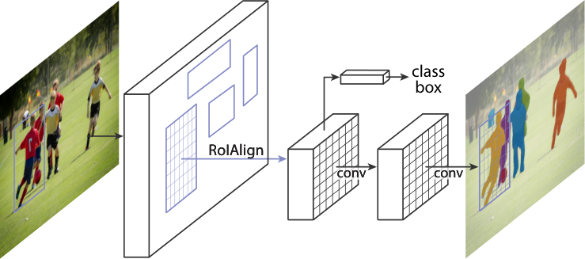
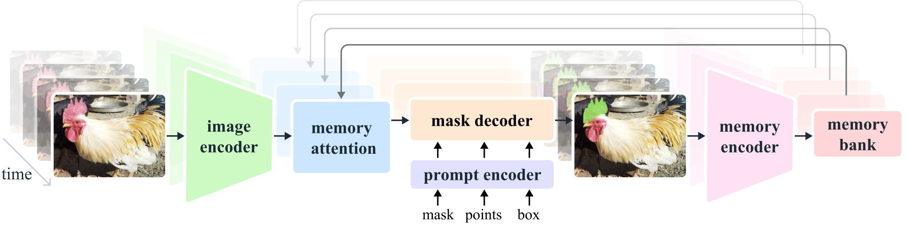

# 目录

[1. 图像分割和检测、分类有什么本质区别？](#q-001)
  - [面试问题：语义分割、实例分割、全景分割有什么区别？](#q-002)
  - [面试问题：FCN 为什么是深度学习图像分割的关键起点？](#q-003)
  - [面试问题：反卷积、上采样和跳连在分割中分别有什么作用？](#q-004)

[2. U-Net、SegNet、PSPNet、DeepLab 如何解决分割问题？](#q-005)
  - [面试问题：U-Net 为什么在医学影像和 AIGC 控制中长期高频？](#q-006)
  - [面试问题：SegNet 的池化索引上采样有什么特点？](#q-007)
  - [面试问题：PSPNet 和 DeepLab 如何建模多尺度上下文？](#q-008)
  - [面试问题：空洞卷积和 ASPP 的核心作用是什么？](#q-009)

[3. 从 Mask R-CNN 到 Mask2Former 的分割范式如何演进？](#q-010)
  - [面试问题：Mask R-CNN 如何从检测扩展到实例分割？](#q-011)
  - [面试问题：全景分割为什么要同时处理 thing 和 stuff？](#q-012)
  - [面试问题：Mask2Former 为什么能统一语义、实例和全景分割？](#q-013)

[4. SAM 为什么成为 AIGC 时代的经典视觉基础模型？](#q-014)
  - [面试问题：SAM 的 image encoder、prompt encoder、mask decoder 分别做什么？](#q-015)
  - [面试问题：SAM 2 相比 SAM 的关键改进是什么？](#q-016)
  - [面试问题：SEEM、SAM、Grounding DINO 如何组合成开放世界视觉工具链？](#q-017)
  - [面试问题：概念提示分割与几何提示分割有什么区别，SAM 3 如何组织识别、定位与跟踪？](#q-201)
  - [面试问题：如何利用视觉示例做上下文分割，它与文本提示和微调有什么区别？](#q-202)
  - [面试问题：SAM 支持哪些 prompt，点、框和 mask 如何进入模型？](#q-021)
  - [面试问题：SAM 如何生成多个候选 mask 并判断 mask 质量？](#q-022)
  - [面试问题：SAM 系列如何轻量化并适配实时业务？](#q-023)
  - [面试问题：分割模型应该怎样评价，IoU、Dice、AP、边界与视频指标各回答什么问题？](#q-203)

[5. 图像分割如何服务生成、编辑、视频和数据工程？](#q-018)
  - [面试问题：分割模型如何用于 ControlNet、图像编辑和视频编辑？](#q-019)
  - [面试问题：为什么分割 mask 不等于精细抠图，透明边缘和毛发应如何处理？](#q-204)
  - [面试问题：分割模型在自动标注、数据清洗和多模态 Agent 中有什么用？](#q-020)

---

<h1 id="q-001">1. 图像分割和检测、分类有什么本质区别？</h1>

<h2 id="q-002">面试问题：语义分割、实例分割、全景分割有什么区别？</h2>

**难度评分：⭐⭐ (2/5)  |  考察频率：⭐⭐⭐⭐⭐ (5/5)**

分类回答整张图“有什么”，检测进一步给出目标的大致位置，分割则要求把判断落实到像素区域。分割内部还要区分：我们需要的是类别、对象身份，还是一张无冲突的完整场景图？

**语义分割给每个有效像素分配类别。** 两个人即使挨在一起，也都属于person，输出不负责说明哪部分属于甲、哪部分属于乙。常见结果是H×W的类别图，也可以保留H×W×C的类别概率用于后续决策。

**实例分割为每个对象输出独立mask。** 两个人会形成两个实例，附带各自的类别和置信度。不同预测mask可能重叠，需要按任务规则处理；常见实例分割只覆盖需要计数的对象，并不自动给所有背景像素分类。

**全景分割统一像素类别与对象归属。** 在有效标注区域内，一个像素最终只有一个分配：thing类还带实例ID，stuff类按区域语义表达。void或ignore区域的规则由数据集定义，不能把“每个像素都必须有普通类别”当成所有协议的硬性要求。

<div align="center">

| 同一画面：两辆车停在道路上 | 语义分割 | 实例分割 | 全景分割 |
| --- | --- | --- | --- |
| 两辆车 | 都是car | car-1、car-2各有mask | car类别＋两个实例ID |
| 道路 | road | 通常不输出该stuff区域 | road区域 |
| 实例mask冲突 | 没有实例这一维度 | 可产生重叠预测 | 输出时需消解为唯一像素归属 |

</div>

thing通常指可数对象，stuff通常指按材质或背景区域描述的内容，但具体划分属于标注契约。例如“树”可以按单棵实例标，也可把树林定义成一个语义区域。先统一这种定义，才能训练和评测一致。

编辑“左边那辆车”需要实例定位；把所有道路换材质更接近语义区域选择；重排整个场景则可能需要全景结构。更细的输出也不自动解决透明度、遮挡后完整形状或对象关系，这些属于另外的任务。

<h2 id="q-003">面试问题：FCN 为什么是深度学习图像分割的关键起点？</h2>

**难度评分：⭐⭐⭐ (3/5)  |  考察频率：⭐⭐⭐⭐⭐ (5/5)**

FCN的关键贡献，是把分类网络的空间特征转成可端到端训练的密集预测。一个图像分类器最终把整幅图汇总为类别；FCN保留特征网格，在每个位置产生类别分数，再将低分辨率预测映射回输入空间。

原始FCN将分类网络中的全连接运算改写成卷积形式。对于相应的固定输入形状，全连接权重可以重排为覆盖特征区域的卷积核；应用在更大特征图上时，同一组权重滑动产生多个空间输出。最后的1×1分类卷积把通道映射为类别数C，因此粗分数图可以写成H/s×W/s×C，s是输出步幅。

如果s＝32，输入中一条几像素宽的线，可能已经难以在粗网格中定位。直接把分数图插值放大，只增加输出采样点，并没有重新获得失去的边界信息。FCN-16s、FCN-8s进一步融合较浅、较高分辨率层的预测；原始做法主要是对齐后的分数图相加，要与U-Net的特征拼接区分。

训练使用像素标注，损失可以从所有有效像素回传到骨干，避免把每个小窗口作为完全独立样本重复运行分类器。图像大小仍受显存、网络步幅、填充和最小尺寸等约束，因此“全卷积”应理解为不再被固定长度分类头锁死，而不是任意形状都无条件可用。

FCN留下了密集预测的基本接口：空间特征、逐位置输出、跨尺度融合、像素监督。后来的U-Net、DeepLab与查询式分割各自解决细节、上下文或对象组织问题，不宜把所有模型都描述为对某一份FCN代码的直接改装。

实际使用中，应先检查输出网格能否分辨任务中的最小目标，再讨论网络更深或头部更复杂是否有价值。缺陷在输入与下采样过程中已经消失，单纯增加最后的上采样倍率通常无济于事。

<h2 id="q-004">面试问题：反卷积、上采样和跳连在分割中分别有什么作用？</h2>

**难度评分：⭐⭐⭐ (3/5)  |  考察频率：⭐⭐⭐⭐ (4/5)**

上采样改变空间网格，跳连补充可用于恢复细节的信息，两者承担不同职责。“反卷积”在分割网络中通常指转置卷积，应明确它不是一般意义上求原卷积的逆。

最近邻和双线性插值按固定规则扩大特征图，前者复制邻近值，后者组合附近四点，通常不含可学习参数。转置卷积则使用可学习核，把输入位置的贡献散布并累加到输出网格；它对应某个卷积线性算子的转置，原卷积有信息损失时，并不存在因此自动恢复输入的保证。

一维尺寸关系可写为：

```math
H_{\mathrm{out}}=(H_{\mathrm{in}}-1)s-2p+d(k-1)+o+1.
```

s为步长，p为padding，d为dilation，k为核尺寸，o为output padding。二维情况分别应用于两个轴。output padding用于消除输出形状歧义，不是承诺给输出边缘补入有意义的新像素。

<div align="center">

| 操作 | 提供的信息 | 典型风险 |
| --- | --- | --- |
| 固定插值 | 已有特征在新网格上的估计 | 细节无法凭空补回，坐标约定不一致会错位 |
| 转置卷积 | 学习如何分配和融合输出响应 | 重叠不均或训练因素可能产生棋盘伪影 |
| 带索引unpooling | 池化时保存的最大响应位置 | 只恢复稀疏位置，不恢复丢弃的全部值 |
| skip connection | 编码端较高分辨率特征 | 显存增加，也可能带回噪声或无关纹理 |

</div>

例如把16×16特征放大为32×32，插值只能重新组合已有数值；同时接入编码端32×32的边缘特征，解码器才获得新的定位依据。相加要求通道相容，拼接增加通道数后通常还要卷积融合，不能把两种skip写成同一操作。

分割部署常见的错误还包括坐标偏移：插值的align_corners约定、裁剪、补边、转置卷积形状都应统一。离散类别标签缩放通常使用最近邻，避免混出不存在的类别；连续logits或概率可以插值后再做分类。对图像编辑，这类一两个像素的偏差就可能表现为漏边或背景残留。

<h1 id="q-005">2. U-Net、SegNet、PSPNet、DeepLab 如何解决分割问题？</h1>

<h2 id="q-006">面试问题：U-Net 为什么在医学影像和 AIGC 控制中长期高频？</h2>

**难度评分：⭐⭐⭐ (3/5)  |  考察频率：⭐⭐⭐⭐⭐ (5/5)**

U-Net把下采样获得的语义与编码端保留的空间细节结合起来。左侧逐步降低分辨率、扩大上下文，右侧逐级上采样；对应尺度的编码特征经过对齐后与解码特征拼接，再由卷积融合。连接两侧的信息通道，是其在密集任务中长期有用的部分。

<div align="center">


</div>

图展示经典U-Net的收缩与扩张路径，白色特征块表示复制后参与拼接的编码特征。原始有效卷积设计存在裁剪，输入与输出空间尺寸并不完全相同；现代same-padding版本应按实际实现核对。

举例说，医学图像中的一个小病灶既需要局部边缘，也需要周围组织结构判断。深层特征提供较大范围的语义，浅层特征帮助找回边界位置。只使用浅层纹理容易受噪声影响，只使用很粗的深层网格又可能漏掉细小结构；解码端学习二者怎样组合。

U-Net在有限标注场景中的价值与结构偏置、数据增强、采样和训练方案共同有关。原论文强调弹性形变等增强，但不能推出“任何小数据集上U-Net都会很好”。医学任务还需按病人、机构或设备划分数据，避免同一病例的相邻切片跨训练与测试集产生泄漏。

在扩散系统中，U形结构可以用作去噪骨干，但输入变成带噪图像或latent，还需要时间条件，并可能通过cross-attention注入文本。分割U-Net输出类别或mask，扩散U-Net输出噪声、速度等目标；二者共享多尺度结构思想，权重与训练任务并不相同。ControlNet也应按其具体控制分支与冻结主干解释，不能仅凭外形相似认定机制相同。

高分辨率skip需要保存较大的激活，尤其3D体数据可能迅速耗尽显存。工程上应一起选择切块尺寸、通道、下采样层数和融合方式，并检查切块边缘与全局上下文的取舍。保留细节有成本，强行压缩到极小瓶颈也有代价。

<h2 id="q-007">面试问题：SegNet 的池化索引上采样有什么特点？</h2>

**难度评分：⭐⭐ (2/5)  |  考察频率：⭐⭐⭐ (3/5)**

SegNet在编码端最大池化时保留“最大值来自哪里”，解码端利用这些索引把特征放回相应位置。它传递的是位置线索，没有像U-Net那样直接拼接整张高分辨率编码特征。

考虑一个2×2窗口，数值为第一行1、7，第二行2、3。最大池化得到7，并记录右上角的位置。假设解码端当前值为5，unpooling会把5放在对应的右上位置，其余位置置零。它不会恢复成原来的1、7、2、3；后续卷积需要将这个稀疏图融合为更密集的特征。

这一机制把“扩大空间尺寸”与“学习填充什么内容”分开。索引提供由编码过程得到的位置依据，卷积学习局部结构和类别信息。多个层级重复后，逐步恢复分辨率，最后对像素分类。解码通道和相应池化索引的形状必须兼容，不能把任意层的索引直接接过来。

保存索引通常比保存完整浮点特征图更紧凑，但需要明确比较对象和实现。2×2窗口的位置理论上只需2比特，框架实际可能用更宽的整数类型；训练还要保存其他激活和梯度，所以“整个SegNet必然比任何U-Net省显存”并不成立。应在相同分辨率、通道与训练模式下实测峰值内存。

对于道路等较大区域，位置索引可以提供有用边界线索；对于毛发、细管或密集小目标，仅保留最大位置可能不足，因为其他响应已经被丢弃。它的长期启发是：编码与解码之间可以只传特定信息，而不必传全部特征；节省多少、损失多少，需要与任务精度共同评价。

<h2 id="q-008">面试问题：PSPNet 和 DeepLab 如何建模多尺度上下文？</h2>

**难度评分：⭐⭐⭐⭐ (4/5)  |  考察频率：⭐⭐⭐⭐ (4/5)**

PSPNet和DeepLab都让像素预测看到更大范围，但组织上下文的方式不同。PSPNet把特征按不同网格汇总再广播回来；DeepLab的一条核心路线是在保持较密输出网格的同时，用不同采样间隔的卷积获取多尺度信息。

PSPNet的金字塔池化模块通常将输入特征分别池化到1×1、2×2、3×3、6×6网格，经过通道变换，再插值回原特征大小并拼接。1×1分支携带整图概况，较细网格保留区域差异。例如一个局部纹理既可能是道路也可能是屋顶，整图的场景布局能提供额外判断依据。池化也会抹平细节，不能替代精细定位分支。

DeepLab系列的空洞卷积调整采样间隔，ASPP将不同间隔的分支并联。在常见DeepLabv3设计中，还结合1×1分支与图像级池化。多分支提供不同上下文尺度，再融合为任务特征；所谓“扩大感受野”是结构上的覆盖范围，并不保证每个覆盖点都有同等贡献。

DeepLabv1结合空洞卷积与稠密CRF，v2引入ASPP，v3进一步研究并行/串行空洞模块与训练配置，v3+加入更明确的解码端来融合较浅特征、改善边界。CRF不是所有DeepLab版本的必需推理步骤，v3+也不应简化为只在末端插值。

<div align="center">


</div>

图比较空间金字塔、编码器—解码器及其结合的思路，来自DeepLabv3+论文的结构示意；它不是包含全部算子参数的实现图。

选择时要观察目标尺度和算力。全局池化可能给小目标引入背景偏置，过大的空洞率在小特征图上可能主要采到padding；保持更高分辨率又会增加激活和计算。城市街景、显微图和文档不应机械套用同一组尺度参数，最好分别检验大区域、稀有小目标和边界误差。

<h2 id="q-009">面试问题：空洞卷积和 ASPP 的核心作用是什么？</h2>

**难度评分：⭐⭐⭐ (3/5)  |  考察频率：⭐⭐⭐⭐⭐ (5/5)**

空洞卷积通过拉开卷积核采样点的间隔，扩大单层感受野。核本身仍只有原来的可学习元素，所谓“空洞”表示不采样中间位置，不是额外加入一圈需要训练的零权重。

对核边长k、空洞率r，单轴有效覆盖宽度为：

```math
k_{\mathrm{eff}}=k+(k-1)(r-1)=1+(k-1)r.
```

3×3卷积在r＝1时覆盖3×3，在r＝2时覆盖5×5，在r＝3时覆盖7×7，但每个输出通道组合的采样位置仍是9个。相同输入输出通道和输出网格下，参数与主要乘加数没有因为覆盖宽度增加而变成25或49个采样点。

分割中常用空洞卷积替换部分下采样，以保留更密的特征图。但这时计算量未必保持不变：若某阶段输出步幅从16改为8，特征图面积约增加4倍，该阶段的计算和激活也会增加。需要区分“改变空洞率本身”与“同时取消下采样”两种操作。

ASPP并联多个不同rate的分支，相当于让同一位置同时读取若干尺度的上下文，再合并表示。例如一个分支关注车轮附近，另一个分支观察更大车身区域。分支数量、通道与rate都会影响成本，使用哪组rate还要结合输出步幅理解，不能脱离图像坐标只比较数字。

连续多层采用不合适的固定间隔，可能使采样形成格状盲区；小目标恰好落在间隔中时尤其容易受损。多尺度组合、适当的rate安排与局部细节融合可以缓解，但仍需用实际边界和小目标测试验证。把覆盖范围画大，并不等于被跳过的位置已经获得完整信息。

<h1 id="q-010">3. 从 Mask R-CNN 到 Mask2Former 的分割范式如何演进？</h1>

<h2 id="q-011">面试问题：Mask R-CNN 如何从检测扩展到实例分割？</h2>

**难度评分：⭐⭐⭐ (3/5)  |  考察频率：⭐⭐⭐⭐⭐ (5/5)**

Mask R-CNN在两阶段检测器中加入一个与分类、框回归并行的mask分支：先产生候选区域，再为每个区域预测类别、位置和像素形状。实例身份来自不同候选对象，mask负责描述该对象内部哪些像素属于前景。

<div align="center">



</div>

图取自《Mask R-CNN》图1，展示共享视觉特征、区域对齐以及检测和mask分支。具体头部通道与输出尺寸随骨干和实现变化。

关键是RoIAlign的坐标对齐。RoI Pooling通常需要对区域边界或分桶位置量化，这种取整对分类影响可能有限，却会破坏精细mask与原图的对应。RoIAlign保留连续坐标，在采样位置通过附近特征的双线性插值取值，再进行区域汇聚；它减少量化误差，但不会让低分辨率特征凭空恢复所有像素细节。

原始mask head为每个RoI预测K个类别对应的二值mask。训练正样本时，使用真实类别的那一个通道计算逐像素二元损失，其他类别通道不在该样本上直接竞争；分类分支独立决定类别。这样将“是什么”与“哪里属于它”解耦，要与逐像素K类Softmax的语义分割区别开。

例如两个重叠的人分别得到RoI，各自的mask head判断本对象在区域内的轮廓。推理时，根据预测类别取相应mask，将它映射回图像坐标；检测后处理与阈值仍会影响最终实例集合。原始常见小尺寸mask输出在映射到大物体或细边缘时可能受限，边界质量并不只由RoIAlign决定。

训练通常组合分类、框回归与mask损失，但只有获得合适正样本的区域才提供对应mask监督。若候选阶段漏掉一个小目标，mask分支无从补救。因此排查漏检时应分别测候选召回、分类定位与区域mask质量，不能把所有失败都归因于分割头。

<h2 id="q-012">面试问题：全景分割为什么要同时处理 thing 和 stuff？</h2>

**难度评分：⭐⭐⭐ (3/5)  |  考察频率：⭐⭐⭐ (3/5)**

全景分割希望输出一张同时适合场景理解和对象操作的像素图。thing对象需要独立身份，stuff区域需要覆盖剩余环境；只做其中一类，会给完整系统留下信息缺口。

自动驾驶里，三辆车分别向哪里移动属于实例问题，道路、人行道和天空覆盖哪里属于语义问题。全景输出把这些标签放在同一张图中，在有效区域为每个像素给出唯一归属。void、crowd与不可判定区域应按数据协议处理，不能在训练时当背景、评测时又当漏检。

早期组合方案可以把实例分割结果与语义分割结果融合：先处理thing之间的重叠，再把剩余区域分配给stuff。这个过程会引入置信度、面积和覆盖顺序等选择；查询式统一模型则让不同区域在同一个预测集合中学习，但输出仍需要满足任务的互斥规则。统一架构没有取消标注冲突。

常用PQ同时衡量匹配区域的形状和识别结果。对于同类别区域，按协议得到匹配集合TP、未匹配预测FP和未匹配真实区域FN后：

```math
\mathrm{PQ}
=\frac{\sum_{(p,g)\in\mathrm{TP}}\mathrm{IoU}(p,g)}
{|\mathrm{TP}|+\tfrac12|\mathrm{FP}|+\tfrac12|\mathrm{FN}|}.
```

在标准全景设置中，匹配常使用IoU大于0.5；应同时遵守ignore/crowd处理。PQ可拆为匹配区域的平均IoU（SQ）与识别质量（RQ）的乘积。重复报出一辆车或完全漏掉一辆车，都会通过FP/FN受到惩罚；已匹配对象的边界不准则降低IoU。

一个总PQ仍可能掩盖thing与stuff的差异，应分别报告两类以及关键稀有类别。对编辑或机器人来说，还要验证目标ID与实际操作对象的一致性；整图分割分数高，并不保证“只修改第二辆车”就一定选对。

<h2 id="q-013">面试问题：Mask2Former 为什么能统一语义、实例和全景分割？</h2>

**难度评分：⭐⭐⭐⭐ (4/5)  |  考察频率：⭐⭐⭐ (3/5)**

Mask2Former把三类分割都表述为一组“类别＋二值mask”的预测。模型先产生像素特征，再用多个可学习query读取这些特征，每个query输出一个类别分布和一个空间mask。语义、实例与全景任务主要在监督组织和结果组合方式上不同。

例如实例标注中，同类的两辆车对应两个目标mask；语义任务中，同类别的区域可以合并为一个监督mask。训练通过集合匹配，把预测query分配给真实mask，未匹配query学习无对象类别；匹配代价和训练损失结合分类、mask重叠与逐点误差。query序号并不预先等于某个固定类别。

其masked attention使用上一层预测的mask，限制下一层query主要读取候选区域内的图像特征。实现中把预测mask缩放到当前特征网格并二值化，在区域外加入很大的负注意力偏置，使其Softmax权重被抑制。这里的mask来自模型的中间预测，不是推理时预先获得的真值，也不是随机遮挡图像做MAE训练。

这种设计让query更集中地细化对象，同时利用多尺度像素特征：不同解码层轮流读取不同分辨率，兼顾局部细节与成本。区域预测错误仍可能限制后续信息读取，因此多层更新、多尺度特征和实现中的异常mask处理很重要，不能说masked attention保证只关注正确对象。

最终输出按任务转换。语义分割可以把各query的类别概率与mask概率组合成逐像素类别分数；实例分割保留对象列表及置信度；全景分割还要处理像素归属与stuff合并。**统一的是建模框架，监督、权重和后处理未必完全相同**，也不意味着一个未适配检查点在所有数据集上都最优。

原论文还用采样点计算匹配与mask损失来节省训练内存。采样点监督不表示推理只输出这些点；最终仍需得到密集mask。长期有用的理解是：先定义输出集合与监督粒度，再选择注意力读取方式和计算预算。

<h1 id="q-014">4. SAM 为什么成为 AIGC 时代的经典视觉基础模型？</h1>

<h2 id="q-015">面试问题：SAM 的 image encoder、prompt encoder、mask decoder 分别做什么？</h2>

**难度评分：⭐⭐⭐⭐ (4/5)  |  考察频率：⭐⭐⭐⭐⭐ (5/5)**

SAM把一次成本较高的图像编码，与多次相对轻量的提示响应分开。用户在同一张图上反复点选、补背景点或调整框时，可以复用图像表示，再由提示编码器和mask解码器产生新结果。这种计算划分使交互式分割更容易成为通用工具。

图像编码器把经过统一缩放和补边的输入转为较低分辨率的空间特征。原始SAM主要采用经MAE预训练的ViT骨干，并通过相应位置与窗口设计处理图像。特征保留空间网格，不能用整图一个CLS向量替代，否则提示坐标将失去可查询的局部接口。

提示编码器把点、框和已有mask转成条件表示。点和框变为少量带位置与类型信息的稀疏token；mask经过卷积降采样，作为与图像网格相容的稠密特征。前景点表示期望包含的位置，背景点表示排除位置，它们不是两张额外的RGB图。

mask解码器让提示token、输出token与图像特征通过双向交互交换信息，再上采样图像特征，用mask token产生的权重形成空间预测，并同时估计mask质量。这个接口输出区域，不自动给区域分配开放词汇类别；要从“红色杯子”开始定位，原始公开SAM常与文本检测或其他语言视觉模块组合。

例如标注一张零件照片，第一次加载运行图像编码器，随后每次点击只需更新提示和解码。换了裁剪、输入尺寸或图像内容，原缓存就可能失效；缓存键至少应绑定图像及预处理配置。对于视频，不同帧具有不同视觉内容，不能把同一张图的缓存机制直接当作跳过所有新帧编码的理由。

SAM擅长在提示约束下给出候选区域，但“Segment Anything”是任务目标，不是对任意领域和细节的保证。小目标、透明物、专业影像或边界定义模糊时，仍需适配、补充提示与独立评价。

<h2 id="q-016">面试问题：SAM 2 相比 SAM 的关键改进是什么？</h2>

**难度评分：⭐⭐⭐⭐ (4/5)  |  考察频率：⭐⭐⭐⭐ (4/5)**

SAM 2把提示分割扩展到视频，关键在于让当前帧的判断读取过去的对象信息。连续帧中的目标会移动、遮挡和变形，单帧分割没有自动保留身份的机制；SAM 2通过记忆特征与交互修正，形成一段具有持续对象含义的masklet。

<div align="center">



</div>

图取自《SAM 2: Segment Anything in Images and Videos》图3。图中记忆编码器实际还读取当前帧图像特征，原图为突出主线省略了这条输入；回到memory attention的线表示供后续帧读取的历史信息。

处理一帧时，图像编码器先提取该帧特征，memory attention再查询历史空间记忆和对象指针。提示编码器接收当前的点、框或mask，解码器结合已经读取记忆的特征产生当前mask及相关分数。随后记忆编码器融合当前图像特征与mask，生成供后续帧读取的记忆。这里保存的是可供匹配的表示，不只是上一帧的二值图片。

记忆库保留有限的近期帧和提示帧信息；对象指针是较紧凑的语义向量，补充空间记忆。用户在后续帧发现错误时可以再加提示，离线交互还可能重新传播受修正影响的片段。记忆减少重复交互，却也可能传播错误：把背景当成目标写入后，后续帧会受到影响。

SAM 2增加对象是否在当前帧可见的判断，使遮挡或离开画面时可以不强行输出目标。它也使用层级图像特征帮助解码细节。原始多对象推理共享每帧图像编码，但对象记忆与相关解码仍分开处理，所以目标数量会影响计算与显存。

必须区分标准机制与业务加速策略：SAM 2通常仍编码每个待处理帧；抽关键帧、跳帧、光流传播或重新检测属于另行设计的组合。长遮挡、镜头切换、外观相似对象和快速细线运动仍是难点。评价视频编辑时，要检查跨帧身份、边界闪烁和纠错成本，不能只报告第一帧IoU。

<h2 id="q-017">面试问题：SEEM、SAM、Grounding DINO 如何组合成开放世界视觉工具链？</h2>

**难度评分：⭐⭐⭐⭐ (4/5)  |  考察频率：⭐⭐⭐⭐ (4/5)**

开放词汇视觉工具链需要依次解决目标含义、空间定位和精细轮廓。Grounding DINO、SAM与SEEM提供不同接口，可以按任务组合或替代部分模块，不应把三个模型固定串成每次都必须执行的流水线。

一种常见组合是：用户说“找出红色杯子”，文本条件检测器将描述与图像特征对齐，给出候选框及相关分数；SAM以这些框为提示，输出区域mask；后续再进行编辑、计数或标注。检测负责发现符合概念的对象，分割负责细化轮廓。检测漏掉的杯子不会因为后接SAM自然出现，错误框也可能得到一个边界很漂亮但对象错误的mask。

SEEM研究把文本、点、框、涂画等多种提示映射到可交互的分割表示，可以承担其中的多模态提示分割环节。它与“文本检测器＋几何提示SAM”是不同的组织方式。选择统一模型还是组合系统，需要比较目标域、提示支持、调用成本和错误可诊断性。

复杂指令还需要解析。例如“把最左边两辆车中的右边那辆改成蓝色”包含集合、排序与选择关系，不能简单把整句当作普通类别名。多模态模型或规则层可以先形成候选集合，再根据几何关系选择；如果输入里没有符合对象，应允许返回空结果。LLM的语言解释正确，并不证明像素定位也正确。

工程接口要携带原图尺寸、裁剪变换、候选ID、类别说明、mask坐标与来源版本。框采用归一化中心坐标还是像素xyxy，需要明确转换；分割分数与检测分数含义不同，简单相乘也不自动得到校准后的正确概率。

开放词汇表示可以接收新的文本描述，实际能力仍受训练概念、领域和视觉分辨率限制。应分别测发现率、概念匹配、mask形状与最终任务结果，并用无目标的负样本检验误报；只展示几个成功编辑案例不足以说明工具链可靠。

<h2 id="q-201">面试问题：概念提示分割与几何提示分割有什么区别，SAM 3 如何组织识别、定位与跟踪？</h2>

**难度评分：⭐⭐⭐⭐ (4/5)  |  考察频率：⭐⭐⭐ (3/5)**

几何提示通常指定“这个位置的对象”，概念提示则希望找出“所有符合这个描述或例子的对象”。两者都可能输入一个框，但框的用途不同：前者约束一个实例的范围，后者可以提供一类对象的视觉示例，再寻找其他相似实例。

SAM 3将这一任务明确为Promptable Concept Segmentation。输入可以是短名词短语、正负视觉示例或组合，输出匹配概念的实例集合，在视频中还要保持对象身份。例如圈出一只杯子作为正例，可以继续寻找其他符合概念的杯子；点中一只杯子进行单对象分割则不要求发现全图其他杯子。

其图像检测部分让图像特征与文本、示例特征融合，再用对象query预测框、mask和分数。一个独立的presence token判断“图中是否存在该概念”，对象query则聚焦候选定位；最终候选分数组合两部分信号。这种拆分让全局存在性与局部定位有各自监督，有助于处理“画面里没有这种对象”的负例，但分数仍需要在目标域校准。

视频部分组合概念检测与记忆跟踪：检测器发现新对象，跟踪器延续已有masklet，再按匹配规则更新身份。两者共享视觉骨干而保留不同职责，因为检测希望找到同类的所有实例，跟踪却必须持续区分它们。拥挤、长遮挡与相似目标仍可能造成误关联。

概念边界也要一致。文本要求“鱼”，示例却只标鱼尾，会给模型冲突监督；“漂亮”“像上次那种”等描述也可能没有明确可见定义。SAM 3基础模型主要面向短概念提示，复杂指代、计数关系与多步推理通常需要额外系统；不能将其与SAM 3 Agent等组合的能力混为一谈。

这类能力的长期意义，是把区域选择从固定类别扩展到可交互的概念定义。评价时既要看每个mask是否准确，也要检查同类对象是否找全、无目标时能否拒识。官方代码与权重入口可以支持验证，领域外专业术语和细粒度边界仍需实测。

<h2 id="q-202">面试问题：如何利用视觉示例做上下文分割，它与文本提示和微调有什么区别？</h2>

**难度评分：⭐⭐⭐⭐ (4/5)  |  考察频率：⭐⭐⭐ (3/5)**

有些分割目标很难用一句文字准确说明，例如某种显微形态、表面缺陷或零件内部的指定部位。视觉示例可以直接提供“图像＋目标mask”，让模型依据示例与待处理图像的对应关系决定分割内容。

一个基本机制是从示例mask内部汇总特征形成类别原型，再与查询图像的区域或像素特征比较。若一个概念有多个示例，可以汇总不同姿态和外观；背景与其他类别也要有明确处理，否则每个候选都可能被硬归到某个示例类。特征相似只能提供线索，最终边界还依赖分割解码器。

2026年11月的SAYD研究采用一种分工：先从查询图像产生与提示无关的候选mask，再用示例mask汇总的原型给这些候选分类。这样加入多个示例时，不必为每个提示完整重做mask生成；同时也暴露一个边界——候选阶段从未提出的细长或不规则区域，后续原型分类很难补回来。

这里的in-context表示推理时根据输入示例改变任务，不等于给一次示例就完成了参数微调，也不表示基础模型未经训练。SAYD使用多个公开分割数据集训练，再研究跨域泛化；其论文在科学图像上仍存在明显域差距，单原型对复杂概念的覆盖也有限。新研究展示了可行机制，实际科研或工业部署仍需独立验收。

选示例时，应包含目标变化而不是只挑最容易的一张，并保持标签粒度一致：想分整个细胞就不要把部分示例只标细胞核。评测应把示例集、验证集和测试集隔离，报告示例数量、选择规则、跨患者或跨设备结果，避免反复挑选最适合测试图的示例后称作稳定泛化。

文字与视觉提示可以互补。文字适合快速命名常见概念，视觉示例适合传递难以语言化的外观和边界。是否采用哪一种，应由目标定义、标注成本、领域差异与实际误差决定，不能仅凭“零样本”或“上下文学习”的标签选型。

<h2 id="q-021">面试问题：SAM 支持哪些 prompt，点、框和 mask 如何进入模型？</h2>

**难度评分：⭐⭐⭐ (3/5)  |  考察频率：⭐⭐⭐⭐⭐ (5/5)**

原始SAM公开实现主要支持前景/背景点、框和低分辨率mask提示。点与框作为稀疏token输入，mask作为稠密空间特征输入。原论文还研究过文本提示的概念实验，但不能据此认为标准发布接口默认具备任意文本到mask能力。

点包含二维坐标与类型标签。官方实现将坐标移动到像素中心，通过基于随机傅里叶特征的位置编码表示位置，再叠加前景或背景类型嵌入。框则用两个角点表示，并为两个角分别使用类型嵌入。坐标不是普通语言token，也不是先画到图上再由图像编码器猜测其含义。

最容易出错的是坐标变换。原图先按比例缩放、再补边，提示必须转换到同一输入坐标系。公开Predictor封装通常接受原图像素坐标并执行变换；直接调用更底层模块时，应自行满足其坐标契约。不能把归一化到0—1的点与像素坐标混用，也不能在裁剪后仍传整图坐标。

mask提示经过卷积降采样后与图像embedding相加。交互修正时，上一轮的低分辨率mask logits比阈值化后的0/1图保留更多不确定信息；官方迭代设计会利用这种连续信号。把全尺寸PNG二值图直接当作要求特定网格和数值范围的mask张量，可能形状正确却语义错误。

例如用户选中杯子后补一个背景点，排除旁边的把手阴影，系统应保留图像编码，重新编码新增点，并让解码器结合已有mask作修正。若裁剪区域发生变化，就应更新图像与提示变换，不能沿用旧embedding。

提示越具体，歧义通常越小，但冲突提示仍可能使输出不稳定。应保留可视化叠加、撤销和候选选择能力，检查mask是否满足目标范围，而不只是接受模型返回成功。

<h2 id="q-022">面试问题：SAM 如何生成多个候选 mask 并判断 mask 质量？</h2>

**难度评分：⭐⭐⭐⭐ (4/5)  |  考察频率：⭐⭐⭐⭐ (4/5)**

一个点可能同时落在“车轮”“整辆车”和“车队”中的有效区域，单一标注并不总能消除这种粒度歧义。SAM通过多个mask输出token产生候选，让模型有机会分别表达不同合理解释，再用质量预测进行排序。

原始SAM的多mask模式常返回3个候选，训练时对候选计算与真值的分割损失，并主要从最优匹配候选回传，使不同解释不必被强行平均成一个模糊mask。实现还保留适合较明确多提示情形的单mask输出路径，因此“无论接口如何总会输出三个”并不准确。

质量头预测的是mask与目标真值的IoU相关质量，属于模型估计。它不直接回答“这是不是用户想选的那个对象”，也不是无条件校准的正确概率。比如整辆车的轮廓很好，而用户实际只想选车轮，高质量分不能替代意图判断。

自动mask生成还会使用稳定性等筛选。稳定性常通过略微改变二值化阈值，观察得到的mask是否仍相似来衡量；它与预测IoU是两种不同信号。一个稳定的错误大区域也可能得高分，所以阈值稳定并不证明语义正确。

实际应结合目标范围、连通区域、尺寸与来源提示做校验。自动标注可在独立复核集上选择阈值，分别抽查高分接受、低分拒绝和边界样本，避免只检查模型认为容易的部分。编辑则可以把多个候选叠加在原图，让用户或上游逻辑选择，并检查背景是否被误纳入。

羽化、填洞和去小区域属于后处理，必须按内容定义使用。杯柄中间的孔洞可能是真实背景，细线可能是重要目标，统一“清理干净”反而会破坏语义。分数用于减少候选和安排复核，最终接受条件应来自任务。

<h2 id="q-023">面试问题：SAM 系列如何轻量化并适配实时业务？</h2>

**难度评分：⭐⭐⭐⭐ (4/5)  |  考察频率：⭐⭐⭐⭐ (4/5)**

SAM系统的优化要区分首次加载、多次交互和连续视频三种开销。单张静态图首次编码可能最重，缓存后每次点击主要运行提示与mask解码；视频需要处理新帧，还要维护对象记忆，目标数多时不一定仍由图像编码主导。

可先用端到端分解测量：图像读取与缩放、视觉编码、提示处理、mask解码、后处理、设备传输与前端显示。平均模型耗时不等于用户可感知的点击延迟，应同时记录冷启动、热缓存与p95。异步GPU计时需要同步或事件计时，否则可能只量到任务提交时间。

较小编码器、蒸馏、量化与算子优化可降低成本，但必须在相同输入协议下比较边界和小目标。降低分辨率常使细线和文字附近边缘先受损；可以先粗定位再局部精修，但裁剪会减少上下文，局部结果也需要映射回原坐标。缓存收益依赖同图重复使用，频繁换图时命中率可能很低。

视频中的跳帧、关键帧重检和光流传播是可选系统策略，不是SAM 2自动省略每帧编码的保证。要检查跳帧期间的快速运动、遮挡后身份与累计漂移。记忆数量、对象数及处理时长也会影响显存与响应。

当前一个有价值的工程例子是2026年3月发布的SAM 3.1 Object Multiplex：它将多个对象分组并共享部分记忆计算，减少逐对象独立执行的冗余，还配合批处理、编译和同步优化。官方约7倍加速对应单H100、128对象等特定条件，发布表的不同数据集结果也并非全部上升。可迁移的经验是检查对象间可共享的计算，不能把该倍数写成所有SAM视频任务的承诺。

最终选型应在目标设备与真实视频上同时给出质量、吞吐、交互延迟和内存。轻量化损失若集中在业务最重要的少数目标，即使平均IoU接近也可能不可接受。

<h2 id="q-203">面试问题：分割模型应该怎样评价，IoU、Dice、AP、边界与视频指标各回答什么问题？</h2>

**难度评分：⭐⭐⭐ (3/5)  |  考察频率：⭐⭐⭐⭐⭐ (5/5)**

分割评价首先要与输出粒度一致。语义mask主要检查像素类别，实例任务还检查对象有没有被发现、是否重复，全景任务再要求整图互斥归属；交互与视频系统则多出提示成本和时间一致性。

对二值预测区域P与真值G，常用重叠指标为：

```math
\mathrm{IoU}=\frac{|P\cap G|}{|P\cup G|},\qquad
\mathrm{Dice}=\frac{2|P\cap G|}{|P|+|G|}.
```

在同一非空二值集合上，Dice＝2IoU/(1＋IoU)，所以两者不能当作两个完全独立的质量维度。对多类别先分别计算再平均，非线性关系不再能直接用于“平均Dice与平均IoU”的互换。空mask、ignore标签和按图还是按全数据累计，都需要固定协议。

语义分割常用mIoU，并报告关键类别；pixel accuracy容易被大面积背景主导。实例分割的mask AP需要结合分数排序和实例匹配，在不同mask IoU阈值下评价发现与形状质量，不能拿检测框AP替代。全景PQ又把匹配区域的重叠与漏检、误报结合，适合检查统一输出。

如果业务关心细线、头发或工件轮廓，应增加边界指标，明确距离容差和输入尺寸。大物体边缘错几像素，IoU可能变化很小，合成后却出现明显漏边；反过来，小物体轻微平移就可能大幅降低IoU，需结合真实物理分辨率判断。

交互分割要固定点的生成或人工选择规则，报告达到某个IoU需要多少点击、每次响应多久，以及失败时是否达到最大点击上限。不能用真值自动挑选最优候选后，把结果写成模型的默认排序表现。视频还应测区域与边界、身份切换、遮挡重现和长时漂移，逐帧平均分数可能掩盖短暂但严重的对象串换。

训练可组合像素交叉熵与Dice等区域损失。Dice有助于减轻面积不平衡，但对空目标和batch聚合敏感；类别加权也可能放大错标。验证集应按病人、视频或设备分组，避免近重复泄漏，再根据真实错误成本设置阈值与损失配比。

<h1 id="q-018">5. 图像分割如何服务生成、编辑、视频和数据工程？</h1>

<h2 id="q-019">面试问题：分割模型如何用于 ControlNet、图像编辑和视频编辑？</h2>

**难度评分：⭐⭐⭐ (3/5)  |  考察频率：⭐⭐⭐⭐ (4/5)**

分割为生成系统提供空间约束，但不同接口中的mask含义可能相反。局部重绘通常需要说明哪里允许修改，语义控制图则描述各区域的类别布局；先把这些约定说清，才能避免“选对目标却改错区域”。

图像局部编辑常先获得对象mask，按任务适度扩张或细化后送入inpainting模型。编辑模型可能需要边缘附近的上下文来消除接缝，但生成过程本身不一定严格保持未选区域逐像素不变。如果要求背景完全一致，应在输出端采用明确的合成或保留策略，并检查色彩、阴影和遮挡关系。

ControlNet类系统接受的是其训练时定义的条件：语义分割图通常包含类别编码或调色板，边缘、深度与姿态则是另外的条件类型。一个二值SAM mask不能无条件替代多类别语义图，也不能把未训练的颜色映射直接送进已有控制模型。输入图、条件和latent的裁剪、缩放与坐标需保持对应。

视频编辑再加上两个问题：选中的对象身份要持续正确，生成外观也要随时间连贯。SAM 2等模型可以提供跨帧mask，但mask一致不保证生成纹理、光照与物理运动一致。应在遮挡、镜头切换、快速运动和对象接近时分别检查，必要时增加修正帧并重新传播。

例如给一辆车换颜色，mask漏掉后视镜会留下旧颜色，误含车窗反光会破坏材质，身份切换则会改到旁边车辆。先看原图与mask叠加，再看生成前后受保护区域差异，最后播放整段视频检查闪烁，比只评价某一张漂亮结果更可靠。

羽化适合某些合成边界，但不能作为所有mask的默认修复。透明物和毛发需要估计连续透明度，硬边商品则可能需要锐利轮廓。空间选择、边缘合成与内容生成应分别诊断。

<h2 id="q-204">面试问题：为什么分割 mask 不等于精细抠图，透明边缘和毛发应如何处理？</h2>

**难度评分：⭐⭐⭐ (3/5)  |  考察频率：⭐⭐⭐⭐ (4/5)**

语义或实例分割主要判断一个像素属于哪个区域，抠图还要估计前景在混合像素中的占比。对于发丝、运动模糊、玻璃等边界，一个像素可能同时接收前景与背景的光，直接用0/1归属往往不够。

常见图像matting模型写为：

```math
I=\alpha F+(1-\alpha)B,\qquad 0\leq\alpha\leq1.
```

I是观察到的颜色，F和B分别为前景与背景颜色，α是透明度或覆盖比例。这是常用合成假设；复杂折射、反射、非线性色彩空间等情况可能偏离它。只有一张图时，多个未知量并不能唯一由I确定，所以抠图需要先验、额外信息或训练数据。

二值mask可以帮助构造trimap：确定前景、确定背景与边界未知区；matting模型再重点估计未知区中的α。有些模型直接预测α，也依赖学习到的先验。**把分割概率当作α并不普遍成立**，前者表示类别判断的不确定性，后者描述混合或覆盖比例。一个不确定的硬边像素未必物理上半透明。

简单羽化相当于平滑mask边界，能柔化接缝，却不理解发丝结构或原背景颜色。若前景边缘带有绿色背景污染，即使α看起来平滑，换到白背景仍可能有绿边；还需要颜色去污染和正确的前景估计。对透明玻璃，仅靠羽化更无法恢复新背景下的折射效果。

评价应在多种背景上合成，检查边缘、半透明细节、颜色残留和时间抖动。有真值时可以测α误差、梯度与连通性；没有真值时也应使用高对比背景做可见缺陷检查。分割是获取对象范围的有效起点，精细合成仍需满足更强的图像形成条件。

<h2 id="q-020">面试问题：分割模型在自动标注、数据清洗和多模态 Agent 中有什么用？</h2>

**难度评分：⭐⭐⭐ (3/5)  |  考察频率：⭐⭐⭐⭐ (4/5)**

分割模型可以把人工标注从逐像素描边转为候选校正，也可以为区域OCR、检索、编辑和Agent提供明确的空间接口。实际价值取决于候选是否减少总劳动，而不是模型一次能输出多少mask。

自动标注可以由检测器提出对象，再由分割器细化，人工补漏并修边。需要分别记录对象是否找全、类别是否正确、轮廓是否合格。只让人工检查模型已发现的对象，会系统性漏掉模型始终看不到的长尾；应抽样从原图独立复核，并保留难例与拒绝原因。

数据清洗可以统计面积、连通区域、遮挡、类别分布和跨帧稳定性，但阈值必须与数据定义一致。目标很小或遮挡严重不代表没有训练价值，盲目过滤会让数据越来越容易、评测越来越乐观。应区分质量错误、真实困难样本和任务不需要的内容。

用于生成训练时，原图、mask与语义标签应绑定同一版本和坐标变换。mask来自伪标注时，应记录模型版本、提示、阈值和复核状态；数据拆分还要按来源视频或实体隔离。否则自动标注的偏差可能随训练循环放大，却无法追溯是哪一步引入。

在多模态Agent中，区域选择之后仍需验证操作结果。例如“把左边那辆车变红”可以拆成候选定位、按图像坐标排序、实例选择、编辑与检查。车体mask应保持稳定ID，OCR或编辑工具收到的裁剪和mask要能映射回原图；若对象不存在或描述有多种解释，应保留空结果或候选，不能只因工具返回mask就继续执行。

评价可以同时统计每张图的人工净耗时、有效标签率、漏标与错标分布，以及最终任务成功率。模型分数适合分配复核优先级，不能自行证明数据质量；持续抽检与难例回流才让自动化收益可保持。

---

## 高频速记

- 先明确像素类别、对象身份与全图归属；标注契约决定thing、stuff和ignore规则。
- 上采样改变网格，skip补充信息；转置卷积不是一般的逆卷积，RoIAlign减少坐标量化误差。
- PSP池化汇总区域，空洞卷积改变采样间隔，ASPP组合多尺度；保留密网格会增加真实计算成本。
- Mask2Former统一mask分类框架，监督与后处理仍按任务调整；masked attention读取的是中间预测区域。
- SAM缓存同图编码，SAM 2逐帧读取对象记忆；概念分割还要判断目标是否存在、同类实例是否找全。
- 视觉示例能表达难以命名的目标，但示例粒度、域差异、候选生成与拒识仍需检验。
- 分割分数、真实透明度和编辑范围具有不同含义；重叠指标、边界、对象发现与时序稳定性不能互相替代。

## 参考资料

- Long et al., [Fully Convolutional Networks for Semantic Segmentation](https://arxiv.org/abs/1411.4038).
- Ronneberger et al., [U-Net: Convolutional Networks for Biomedical Image Segmentation](https://arxiv.org/abs/1505.04597).
- Badrinarayanan et al., [SegNet](https://arxiv.org/abs/1511.00561).
- Zhao et al., [Pyramid Scene Parsing Network](https://arxiv.org/abs/1612.01105).
- Chen et al., [Rethinking Atrous Convolution for Semantic Image Segmentation](https://arxiv.org/abs/1706.05587)；[Encoder-Decoder with Atrous Separable Convolution for Semantic Image Segmentation](https://arxiv.org/abs/1802.02611).
- He et al., [Mask R-CNN](https://arxiv.org/abs/1703.06870)；Kirillov et al., [Panoptic Segmentation](https://arxiv.org/abs/1801.00868).
- Cheng et al., [Masked-attention Mask Transformer for Universal Image Segmentation](https://arxiv.org/abs/2112.01527).
- Kirillov et al., [Segment Anything](https://arxiv.org/abs/2304.02643)；[官方PromptEncoder实现](https://github.com/facebookresearch/segment-anything/blob/main/segment_anything/modeling/prompt_encoder.py).
- Ravi et al., [SAM 2: Segment Anything in Images and Videos](https://arxiv.org/abs/2408.00714).
- Carion et al., [SAM 3: Segment Anything with Concepts](https://arxiv.org/abs/2511.16719)；[SAM 3.1发布说明](https://github.com/facebookresearch/sam3/blob/main/RELEASE_SAM3p1.md)，2026-03-27。
- [Segment Anything In-Context via Visual Demonstrations](https://arxiv.org/abs/2611.29896)，2026-11预印本；本文使用其示例原型与候选mask分工，不将跨域实验写成业务已验证能力。
- Zou et al., [Segment Everything Everywhere All at Once](https://arxiv.org/abs/2304.06718)；Liu et al., [Grounding DINO](https://arxiv.org/abs/2303.05499).
- Xu et al., [Deep Image Matting](https://arxiv.org/abs/1703.03872).
