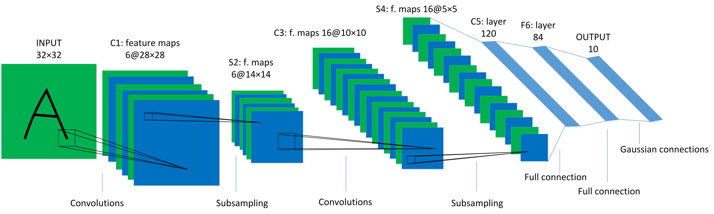
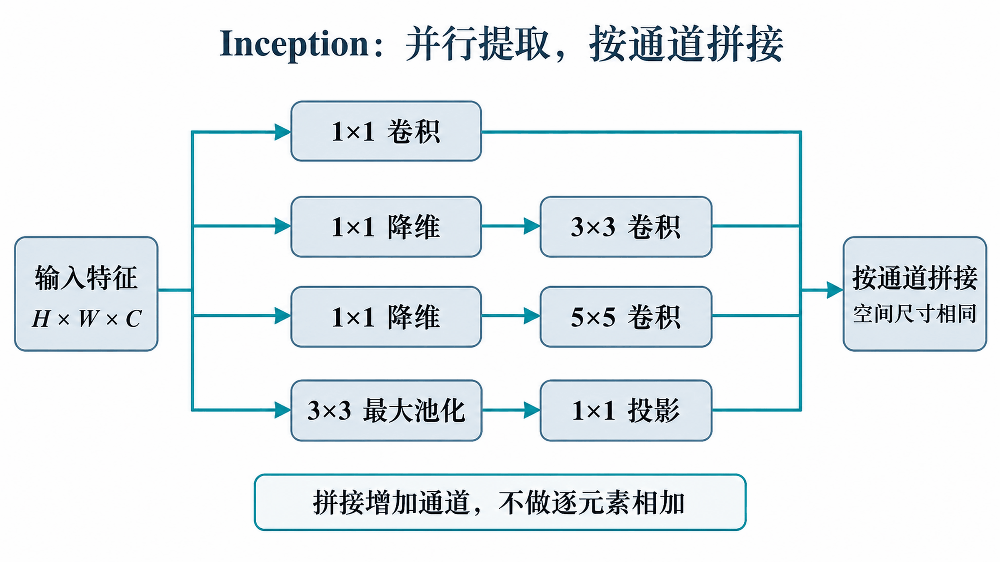
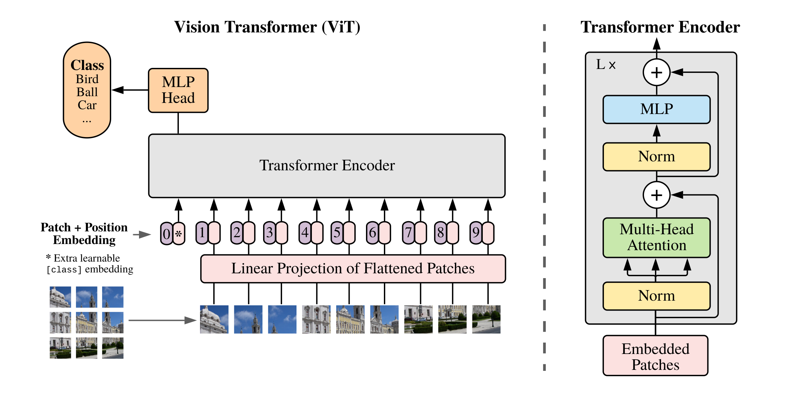

# 目录

[1. CNN 经典骨干的演进主线是什么？](#q-001)
  - [面试问题：LeNet-5、AlexNet、VGG 分别解决了什么关键问题？](#q-002)
  - [面试问题：GoogLeNet / Inception 的核心思想是什么？](#q-003)
  - [面试问题：ResNet 为什么是最重要的 CNN 经典模型之一？](#q-004)
  - [面试问题：DenseNet、ResNeXt、SE-Net 分别改进了什么？](#q-005)

[2. 轻量化 CNN 为什么在 AIGC 工程中仍然重要？](#q-006)
  - [面试问题：MobileNet 的深度可分离卷积为什么能降计算量？](#q-007)
  - [面试问题：EfficientNet 的复合缩放思想是什么？](#q-008)
  - [面试问题：RepVGG 的结构重参数化为什么适合部署？](#q-009)

[3. 从 CNN 到 ViT 的核心变化是什么？](#q-010)
  - [面试问题：ViT 如何把图像变成 token 序列？](#q-011)
  - [面试问题：Swin Transformer 为什么适合检测和分割？](#q-012)
  - [面试问题：ConvNeXt 为什么被称为现代化 CNN？](#q-013)

[4. AIGC 时代哪些视觉骨干最常考？](#q-014)
  - [面试问题：MAE 和 DINOv2 分别代表什么自监督预训练路线？](#q-015)
  - [面试问题：CLIP 为什么改变了视觉分类和检索范式？](#q-016)
  - [面试问题：DiT 为什么会成为扩散模型中的重要 backbone？](#q-017)
  - [面试问题：ViT 如何处理不同分辨率和变长视觉 token 序列？](#q-022)
  - [面试问题：FasterDiT、SiT、LightningDiT 分别从哪些方向改进 DiT？](#q-023)
  - [面试问题：DiT 如何注入时间、类别、文本和结构控制条件？](#q-024)
  - [面试问题：DiT Block 为什么常用 AdaLN、RoPE 和 In-Context Conditioning？](#q-025)
  - [面试问题：DINOv3 相比 DINOv2 的价值应如何理解？](#q-026)
  - [面试问题：ViT 中的 CLS token 有什么作用？](#q-027)
  - [面试问题：DINOv2 如何通过数据去重和检索构建高质量预训练集？](#q-028)
  - [面试问题：如何评估视觉基础模型的迁移能力，为什么分类准确率不能替代下游验证？](#q-201)

[5. 图像分类训练中的数据问题为什么仍然高频？](#q-018)
  - [面试问题：图像分类任务中类别不平衡怎么解决？](#q-019)
  - [面试问题：图像分类中的标签噪声如何处理？](#q-020)
  - [面试问题：图像分类常用评估指标有哪些？](#q-021)

---

<h1 id="q-001">1. CNN 经典骨干的演进主线是什么？</h1>

<h2 id="q-002">面试问题：LeNet-5、AlexNet、VGG 分别解决了什么关键问题？</h2>

**难度评分：⭐⭐ (2/5)  |  考察频率：⭐⭐⭐⭐⭐ (5/5)**

这三个模型分别回答了卷积网络怎样学习图像、怎样扩大训练规模、怎样用规则结构继续加深的问题。把它们放在一起看，比背诵层数更容易理解后来的视觉骨干。

**LeNet-5建立了从局部特征到整体类别的层级**。卷积核在不同位置共享参数，先提取边缘、笔画，再通过下采样和后续层组合成数字形状。以经典的32×32灰度输入为例，5×5有效卷积得到28×28特征，2倍下采样后变成14×14；空间尺寸逐步缩小，表示逐步从局部纹理走向整体结构。原始LeNet-5包含可学习的下采样、部分连接和特殊输出层，现代教学实现常把它改为池化、全连接和Softmax，不能认为所有同名代码逐层相同。

<div align="center">



</div>

图中保留经典LeNet-5的层级与连接示意，原始输出使用Gaussian connections；现代分类头的训练方式应以具体实现为准。

**AlexNet把深层CNN带入大规模自然图像识别**。它将ReLU、GPU训练、数据增强和全连接层Dropout等设计组合起来：ReLU在正半轴具有非饱和梯度，数据增强增加输入变化，Dropout降低部分共适应。这些措施处理的是不同问题。ReLU不能保证整网没有梯度问题，Dropout也不是数据不足的替代品。原论文的双GPU分组连接带有当时硬件条件的影响，不宜当作今天所有CNN必须遵守的结构。

**VGG用连续的小卷积核构建深层特征**。在步长为1、无额外下采样的条件下，两层3×3卷积的理论感受野相当于一层5×5。若输入、隐藏和输出通道都为C，前者有18C²个卷积权重，后者有25C²个；前者还多一次非线性。通道变化时应重新计算，感受野相同也不表示两个函数等价。VGG的全连接部分仍可占用大量参数，因此“使用小卷积核”不等于“整个网络很轻”。

它们留下的共同经验是：结构、优化、数据和硬件需要一起设计。今天仍会在检测或文档处理系统中选择CNN，但应按目标设备上的精度、延迟和内存判断，不能仅凭模型的历史地位选型。

<h2 id="q-003">面试问题：GoogLeNet / Inception 的核心思想是什么？</h2>

**难度评分：⭐⭐⭐ (3/5)  |  考察频率：⭐⭐⭐⭐ (4/5)**

Inception把不同尺度的特征提取放在同一层的并行分支中，再沿通道维合并。一个局部区域可能需要细小纹理，也可能需要较大的上下文；让后续层同时看到这些表示，能减少手工为整层只选一种卷积核的限制。

以GoogLeNet采用的Inception v1模块为例，输入分成四路：1×1卷积；1×1降维后接3×3卷积；1×1降维后接5×5卷积；3×3最大池化后接1×1投影。通过合适的步长和填充，让四路输出保持相同的H、W，最后沿通道拼接。若各路分别输出64、128、32、32个通道，合并结果就是256个通道；这一步没有做逐元素相加。

<div align="center">



</div>

图依据《Going deeper with convolutions》第4节、图2(b)的机制重新绘制，省略激活细节。各分支保持空间尺寸，1×1降维主要改变通道数。

**1×1卷积让大卷积核的成本可控**。假设输入192通道，希望得到32通道的5×5特征。直接计算需要25×192×32个权重；先用1×1降到16通道，再接5×5，只需192×16＋25×16×32＝15,872个，前者是153,600个。这里忽略偏置，示例用于解释成本，并不规定所有模块都应压到16通道。压缩过强会丢信息，分支越多也会增加访存、拼接和调度开销。

GoogLeNet还使用训练阶段的辅助分类器提供额外监督，推理时可以移除。它可能改善优化和正则化，不能简单说成“从此解决梯度消失”。后续Inception版本又改变了卷积分解等设计，讨论3×3、5×5并行时要明确这里说的是v1。

多尺度处理和先压缩后计算的思想至今仍有价值；具体部署时，则要实测并行分支是否适合所用推理引擎。

<h2 id="q-004">面试问题：ResNet 为什么是最重要的 CNN 经典模型之一？</h2>

**难度评分：⭐⭐⭐⭐ (4/5)  |  考察频率：⭐⭐⭐⭐⭐ (5/5)**

ResNet让一个模块学习相对输入的修正量。维度一致时，残差块的核心关系是：

```math
y=x+F(x;\theta).
```

其中x是输入特征，F是卷积、归一化和激活等构成的可学习分支。若当前层不需要改变表示，残差分支接近零即可保留输入。直接学习一个完整映射时，要让多层非线性恰好组成恒等函数，优化通常更困难。

原论文强调的**退化问题**是：一个更深的普通网络训练误差反而更高。它与“训练集很好、测试集变差”的过拟合不同。更深网络在表达能力上可以容纳较浅解，并不说明优化器一定能找到这个解；残差参数化改善了可优化性，而不是提供训练误差必然不增的数学保证。

对一个不含相加后激活的简化块，梯度满足：

```math
\frac{\partial L}{\partial x}
=\left(I+\frac{\partial F}{\partial x}\right)^{\!\top}
\frac{\partial L}{\partial y}.
```

恒等项提供了一条直接传播路径，但其他项仍可能放大、抵消或改变梯度，因而不能说“残差连接彻底消除了梯度消失”。原始后激活块在相加后还有ReLU；预激活设计将归一化与激活移到卷积前，更有利于保持直接的恒等路径。理解具体计算图，比只背“梯度绕过卷积”更准确。

输入输出尺寸不同，例如从56×56×64变为28×28×128时，不能直接相加，通常用带步长的1×1卷积做投影。投影分支也会学习参数，此时已经不是严格的恒等映射。Bottleneck块常用1×1压缩、3×3空间处理、1×1恢复通道，在较低内部通道数下控制计算量。

残差连接后来广泛用于Transformer和生成网络，延续的是“保留已有表示，再学习必要修正”的优化思路。它仍需要合理的初始化、归一化、学习率和数据，增加深度是否值得，要看同一训练预算下的真实收益。

<h2 id="q-005">面试问题：DenseNet、ResNeXt、SE-Net 分别改进了什么？</h2>

**难度评分：⭐⭐⭐ (3/5)  |  考察频率：⭐⭐⭐⭐ (4/5)**

三者处理的是三个不同维度：DenseNet改变特征传递方式，ResNeXt增加并行变换的数量，SE-Net根据当前输入重新分配通道权重。它们可以组合，并不是相互排斥的模型类别。

**DenseNet通过拼接复用已有特征**。第l层接收前面各层输出的连接：

```math
x_l=H_l([x_0,x_1,\ldots,x_{l-1}]).
```

方括号表示通道拼接。若每层新产生k个通道，初始有C₀个通道，l层后累计约为C₀＋lk个。k称为增长率。后续层可以直接使用早期边缘等特征，不必反复重新计算；过渡层再压缩通道和降低空间分辨率。代价是中间特征需要保留，拼接和读取可能造成较大的显存与带宽开销。参数少不自动意味着训练显存少。

**ResNeXt通过cardinality组织同构变换**。可以把残差分支理解为若干组具有相同拓扑的变换，其输出合并后再与shortcut相加；工程上通常借助分组卷积实现。cardinality指组数，要与每组通道数、总宽度区分。固定输入输出宽度下增加组数，单组能看到的通道会减少；固定每组宽度增加组数，总计算量又会增加。因此比较收益时要控制参数、计算量和训练方案。

**SE-Net做输入相关的通道重标定**。先对每个通道全局平均池化，得到一个通道描述向量；再通过小网络和Sigmoid产生权重，乘回原特征。例如某张图中纹理通道更有用，它可以得到更高权重。权重随输入变化，区别于普通卷积的固定参数；全局池化也会压缩位置信息，SE本身不提供精细的像素定位。

<div align="center">

| 设计 | 融合方式 | 主要收益 | 需要评估的代价 |
| --- | --- | --- | --- |
| DenseNet | 早期特征沿通道拼接 | 特征复用、直接监督路径 | 激活存储与访存 |
| ResNeXt | 分组变换聚合并残差相加 | 扩大变换组合能力 | 分组算子效率、通道交互 |
| SE-Net | 动态权重乘回通道 | 根据输入调整通道响应 | 归约、小算子和串行依赖 |

</div>

这张表用于定位设计作用。真正选型时，应把它们接到相同任务头上测试；分类收益不一定按相同比例迁移到检测、分割或低延迟设备。

<h1 id="q-006">2. 轻量化 CNN 为什么在 AIGC 工程中仍然重要？</h1>

<h2 id="q-007">面试问题：MobileNet 的深度可分离卷积为什么能降计算量？</h2>

**难度评分：⭐⭐⭐ (3/5)  |  考察频率：⭐⭐⭐⭐⭐ (5/5)**

标准卷积同时混合空间和通道。深度可分离卷积把它拆为：先在每个输入通道内部做空间卷积，再用1×1卷积混合通道。以下设输入M通道、输出N通道、卷积核K×K、输出空间H×W，忽略偏置，使用depth multiplier＝1。

```math
\mathrm{MACs}_{\mathrm{standard}}=HWMNK^2,
\qquad
\mathrm{MACs}_{\mathrm{separable}}=HWMK^2+HWMN.
```

这里MAC指一次乘加。若把乘法与加法分别记为一次FLOP，数字约需乘2；比较时不能混用两种口径。两者计算量之比为：

```math
\frac{\mathrm{MACs}_{\mathrm{separable}}}
{\mathrm{MACs}_{\mathrm{standard}}}
=\frac{1}{N}+\frac{1}{K^2}.
```

例如K＝3、N＝128时，比值约为0.119，相同输入输出尺寸下理论乘加量减少到原来的约12%。这里说的是算子计算量，并非整网或设备延迟同比下降。Depthwise不在该步骤混合通道，表达受到分解形式约束；后面的Pointwise往往反而成为主要计算开销。

MobileNetV1主要使用这种分解。V2先用1×1扩展通道，在较宽空间做Depthwise，再线性投影回较窄空间；在步长和通道满足条件时建立倒残差连接。线性瓶颈减少在低维表示上反复施加截断非线性造成的信息损失，并非整个块都没有激活。V3进一步结合SE、激活函数和硬件感知搜索等设计。

为什么小FLOPs模型在手机上仍可能慢？低算术强度算子可能受内存带宽限制，小张量反复启动内核也有代价；某些推理引擎对普通卷积优化得更好。部署移动OCR或实时质检时，应同时测目标输入尺寸、batch＝1延迟、峰值内存和量化后的精度。理论公式负责解释省在哪里，设备测试负责判断最终是否省时间。

<h2 id="q-008">面试问题：EfficientNet 的复合缩放思想是什么？</h2>

**难度评分：⭐⭐⭐ (3/5)  |  考察频率：⭐⭐⭐⭐ (4/5)**

EfficientNet把深度、通道宽度和输入分辨率作为共同分配计算预算的变量。网络加宽可以容纳更多特征，增加深度可以组合更复杂的表示，提高分辨率则保留更多局部信息；只扩大一个维度，可能让其他维度成为瓶颈。

在已经选定基准网络的前提下，复合缩放写为：

```math
d=\alpha^\phi,\qquad w=\beta^\phi,\qquad r=\gamma^\phi,
\qquad \alpha\beta^2\gamma^2\approx2.
```

d、w、r分别是相对基准的深度、宽度和分辨率倍率；φ控制整体放大程度。对常见卷积近似，计算量与层数成正比，与输入输出通道的共同倍率及空间分辨率的平方成正比，所以计算倍率约为dw²r²。满足上面的约束时，φ增加1对应计算量大致翻倍。α、β、γ需要在小规模实验中选择，再用于放大；这不是适用于所有架构的物理定律。

例如识别产品包装上的细小图案，只把通道数加倍，已经被输入缩放抹掉的细节不会回来；只把图像放大，过小的模型也未必能利用增加的信息。联合缩放试图找到较合理的资源配比。离散的层数、通道取整、首尾层以及不同算子占比，都会使实际开销偏离近似式。

还要区分**计算量最优与部署延迟最优**。高分辨率增加激活内存，网络加深增加顺序依赖，加宽则可能更好地利用某些GPU。EfficientNet的准确率与计算量结果不保证在每种设备上都是最低延迟；移动端、服务器和小batch需要分别测量。Transformer也不能直接套用同一缩放式，因为全局注意力还具有token数量的二次项。

这一思想的长期价值是把预算分配变成可控实验：先确定输入信息是否足够，再检查模型容量，最后用目标设备的实际成本选择工作点。

<h2 id="q-009">面试问题：RepVGG 的结构重参数化为什么适合部署？</h2>

**难度评分：⭐⭐⭐⭐ (4/5)  |  考察频率：⭐⭐⭐⭐ (4/5)**

RepVGG在训练时采用多个分支，部署时把满足条件的线性分支合并成一个卷积。多分支改变了训练参数化，推理端则保留规则的3×3卷积和激活，有助于减少分支调度、额外张量读写和算子数量。

一个典型块包含3×3卷积＋BN、1×1卷积＋BN，以及尺寸允许时的恒等＋BN。各分支先相加，再通过激活。融合可以分两步理解。

**第一步，把推理态BN吸收到卷积**。对某个输出通道，若卷积权重、偏置为W、b，BN的固定均值与方差为μ、σ²，缩放与偏移为γ、β，则：

```math
W'=\frac{\gamma}{\sqrt{\sigma^2+\epsilon}}W,
\qquad
b'=\beta+\frac{\gamma}{\sqrt{\sigma^2+\epsilon}}(b-\mu).
```

训练态BN依赖当前batch统计量，不能直接当成固定仿射变换；应在参数和统计量确定后做部署转换。

**第二步，把同形状输出的线性变换相加**。将1×1核补零到3×3中心；恒等映射写成中心为通道单位映射的3×3核。三路等效卷积核和偏置分别相加，得到最终卷积。各路步长、填充、分组和输出对齐必须兼容；如果分支内部在相加前存在不可融合的非线性，就不能用这套简单加法。尺寸不匹配时，原本也不会配置普通identity分支。

例如训练一个工业缺陷分类器，可以先保留多分支完成微调，再转换并导出。验收时对同一批输入比较转换前后的浮点输出，并在目标设备上测量延迟；有限精度会带来小误差，量化还可能放大等效权重的动态范围，因此INT8需要单独校准或训练。

结构重参数化不是把任意复杂网络“免费压成一个卷积”，也不等同于剪枝或知识蒸馏。它利用可证明的线性等价关系改变部署计算图，收益取决于原分支开销和硬件实现。

<h1 id="q-010">3. 从 CNN 到 ViT 的核心变化是什么？</h1>

<h2 id="q-011">面试问题：ViT 如何把图像变成 token 序列？</h2>

**难度评分：⭐⭐⭐ (3/5)  |  考察频率：⭐⭐⭐⭐⭐ (5/5)**

ViT先把图像划分为patch，再用共享线性投影把每个patch变成一个token。设输入为H×W×C，patch边长P，且H、W均可整除P，则图像token数为：

```math
N=\frac{HW}{P^2},\qquad
x_i\in\mathbb{R}^{P^2C},\qquad
z_i=x_iE+p_i\in\mathbb{R}^{D}.
```

E把展平patch映射到D维，pᵢ提供位置。以224×224的RGB图像、P＝16为例，得到14×14＝196个patch，每个展平后有768个数。投影维度D可以另选，并不必须等于768。加入一个CLS token后，Transformer看到的序列长度是197。

<div align="center">



</div>

图展示原始ViT的分类结构：位置表示与patch嵌入相加，最终由分类token连接预测头；空间任务通常还需要读取patch输出。模型定义见《An Image is Worth 16×16 Words》。

Patch投影可以用卷积实现：卷积核大小与步长都设为P，输出通道为D，在相同权重布局和边界条件下等价于逐patch的线性映射。之后的自注意力允许一个patch与远处patch交换信息；前馈网络则对每个位置做通道变换。位置信息不能省略，否则纯注意力难以区分内容相同但排列不同的输入。

相较传统卷积骨干，原始ViT没有同样强的逐层局部卷积约束，但也不是“完全没有归纳偏置”：patch切分、共享投影和位置设计都带入了结构假设。它对数据与训练方案的需求较大，合适的增强、正则化、蒸馏或自监督预训练可以改变这个差距。

在分类中，可以读取CLS或平均池化；在检测和分割中，必须保留有空间位置的token。平坦ViT也能通过适配器或简单特征金字塔服务密集预测，并非只有层级Transformer才可以做检测。

<h2 id="q-012">面试问题：Swin Transformer 为什么适合检测和分割？</h2>

**难度评分：⭐⭐⭐⭐ (4/5)  |  考察频率：⭐⭐⭐⭐ (4/5)**

Swin把高分辨率视觉建模拆成“局部窗口计算、相邻窗口交换、逐级形成多尺度特征”。这与检测、分割需要同时定位小目标和理解大区域的需求相适应。

若一层有N个token、通道维为D，全局注意力的两两交互项约为N²D。窗口边长为M时，每个窗口含M²个token，共N/M²个窗口，交互项约为NM²D。在固定窗口大小下，这一部分随图像token数近似线性增长；QKV投影和前馈层仍有ND²量级的开销，不能只看注意力矩阵的大小。

单独做窗口注意力会隔断窗口边界。Swin交替采用普通窗口和移位窗口，后一层把分组边界错开，使原本不同窗口中的token得以相遇。实现中可以用循环移位提高效率，再用attention mask阻止因环绕操作引入的错误连接。它不等于每层都进行全局注意力；信息需要经过多层传播。

Patch Merging将相邻2×2位置的特征拼接成4D维，再投影到通常为2D的通道空间，空间分辨率减半、通道增加。重复这一过程形成多个stage，检测器可以把浅层高分辨率细节和深层语义送入FPN，分割头也可融合多尺度表示。

例如航拍小车可能只占少量像素，早期高分辨率特征有助于定位；停车场整体布局则需要较大上下文。层级结构提供了两种信息的接口，但不会保证小目标不被下采样损失，仍需检查输入分辨率、patch大小和任务头。

窗口切分、移位和特征布局变换也有运行时成本。Swin的理论复杂度优势是否转化为速度，取决于窗口尺寸、batch和内核实现；面对低分辨率分类，简单的全局ViT也可能更合适。

<h2 id="q-013">面试问题：ConvNeXt 为什么被称为现代化 CNN？</h2>

**难度评分：⭐⭐⭐ (3/5)  |  考察频率：⭐⭐⭐ (3/5)**

ConvNeXt用现代训练方案和结构设计重新检查CNN的能力。它的意义在于说明：比较CNN与Transformer时，不能把旧的CNN训练配方与新的Transformer训练配方混在一起，再把全部差距归因于注意力。

典型ConvNeXt块先用7×7的Depthwise卷积交换局部空间信息，再通过归一化和通道扩展的前馈结构混合特征，最后回到原通道并建立残差连接。Depthwise把大核的成本控制在按通道计算的范围内；中间扩展通道让非线性变换在更宽的空间进行。它同时调整stage比例、采用类似patchify的起始下采样，并使用LayerNorm、GELU和更少的归一化或激活位置。

可以从两个维度理解这个块：**空间交互仍由卷积承担，通道交互由逐位置的映射承担**。这与Transformer中“注意力负责token交互、MLP负责通道变换”的组织方式有相似之处，但卷积核的局部连接方式固定，注意力权重随输入变化，两者没有变成同一种算子。

例如为缺陷分割选择骨干时，可以将ConvNeXt和Swin接到相同的解码头，使用相同数据、输入分辨率和合理调参预算。若ConvNeXt更快，要继续确认收益来自实际算子支持，而非仅比较参数量；若某模型准确率更高，也要检查预训练数据和训练时长是否可比。

大核扩大的是单层的理论感受野，不自动提供整图全局交互。LayerNorm的内存布局、Depthwise内核和量化支持也可能影响部署，因此“纯CNN”不代表所有设备上必然更快。长期可迁移的经验是先分清收益来自训练、结构还是硬件，再决定是否值得更换骨干。

<h1 id="q-014">4. AIGC 时代哪些视觉骨干最常考？</h1>

<h2 id="q-015">面试问题：MAE 和 DINOv2 分别代表什么自监督预训练路线？</h2>

**难度评分：⭐⭐⭐⭐ (4/5)  |  考察频率：⭐⭐⭐⭐ (4/5)**

MAE主要让模型从局部可见内容重建被遮挡像素；DINOv2主要让学生预测教师产生的表征分布。两者都可利用无人工标签的图像，但训练目标、计算方式和下游使用习惯不同。

**原始MAE采用不对称编码器与解码器**。随机遮挡大量patch后，较大的编码器只处理可见patch；轻量解码器再接收编码结果和补回的mask token，预测缺失位置的像素。原论文常用75%的遮挡率：196个patch中，编码器只看约49个。高遮挡减少简单的邻域复制机会，也降低编码器计算；完整解码仍有开销，不能把整次训练成本直接等同于25%。训练通常在被遮挡patch上计算重建损失，下游识别主要使用编码器。

**DINOv2结合全局自蒸馏与局部遮挡预测**。同一图像的不同增强视图分别送入学生和教师；全局CLS输出通过投影头得到分布，学生匹配教师的目标。教师由学生参数的指数滑动平均更新，目标端停止梯度。局部iBOT目标则让学生在被遮挡位置预测教师从可见patch产生的表征分布；配合目标分布平衡和特征分散正则，降低表征坍缩风险。它不是仅用一个MSE让两个任意网络输出相同。

<div align="center">

| 维度 | 原始MAE | DINOv2 |
| --- | --- | --- |
| 主要预测对象 | 被遮挡的图像像素 | 教师的全局与patch表征分布 |
| 编码器输入 | 仅可见patch | 学生与教师具有不同视图、遮挡处理 |
| 如何利用监督 | 重建误差 | 跨视图一致性、局部目标与正则 |
| 下游常见使用 | 微调编码器，或检查冻结特征 | 冻结特征接轻量头，也可适配 |

</div>

表中的下游方式不是硬性限制。MAE也能做线性探测，DINOv2也能微调。实际选择要看任务：重建训练可能保留有用结构，但漂亮的重建不证明类别可线性分开；自蒸馏可能学到良好语义，也不保证医学纹理或小字得到保留。

以工业零件为例，应同时测冻结特征检索、少样本分类与缺陷分割。预训练不使用人工类别标签，只减少了这一阶段的标签需求；下游监督、数据筛选和评价仍可能需要人工信息。

<h2 id="q-016">面试问题：CLIP 为什么改变了视觉分类和检索范式？</h2>

**难度评分：⭐⭐⭐⭐ (4/5)  |  考察频率：⭐⭐⭐⭐⭐ (5/5)**

CLIP把分类器的类别权重转化为可由文本描述产生的向量。图像编码器和文本编码器分别输出表示，经归一化后计算相似度；在训练中，一张图应与配对描述更接近，与同批次其他描述相对更远。

设一个batch有B对图文，归一化图像、文本向量为vᵢ、uⱼ，温度为τ，图到文方向的损失为：

```math
\mathcal{L}_{I\rightarrow T}
=-\frac{1}{B}\sum_{i=1}^{B}
\log\frac{\exp(v_i^\top u_i/\tau)}
{\sum_{j=1}^{B}\exp(v_i^\top u_j/\tau)}.
```

文本到图像方向交换角色，原始CLIP对两个方向的交叉熵取平均。温度改变相似度分布的尖锐程度；批内负样本也可能语义相近，甚至是另一张同类图片，因此训练信号并非完美的人工类别关系。

推理时，要区分“猫、狗、汽车”，可以把每个类别写成自然描述，用文本编码器得到三个向量，再比较图像与它们的相似度。更换候选类别通常不需要重新训练一个固定维度的分类头。图文检索同样使用这一公共表示空间，大规模候选可以预先编码后建立索引。

这里的zero-shot指没有针对当前下游任务额外训练分类器，并不证明相关概念从未出现在预训练图文中。开放词汇也不意味着能理解任何词语：专有零件、稀有病灶、计数和精确空间关系都可能表现不佳。候选集内Softmax总会分配概率，最高分不能直接证明图中确实存在该类别；拒识需要额外验证和校准。

CLIP的图文对齐还提供了可复用的视觉或文本表示。部分文生图系统使用其文本编码器输出token条件，但图文对比损失本身不训练图像生成，也不直接规定去噪网络怎样理解这些token。选择提示模板、同义词和类别描述时，应在独立验证集上比较，避免把模板对测试集的反复调优写成无监督的泛化能力。

<h2 id="q-017">面试问题：DiT 为什么会成为扩散模型中的重要 backbone？</h2>

**难度评分：⭐⭐⭐⭐ (4/5)  |  考察频率：⭐⭐⭐⭐ (4/5)**

DiT把扩散去噪网络的主要计算单元改为Transformer，并在压缩的视觉潜空间上处理patch token。它研究的是生成骨干如何设计，不能把DiT与扩散训练目标、VAE或采样器混成同一个组件。

以一种教学配置为例：256×256图像先经8倍空间下采样得到32×32的latent；若latent patch边长为2，去噪主干看到16×16＝256个空间token。每个token经投影、位置表示和多层Transformer处理，再通过线性输出层还原到latent网格。这个示例只说明尺寸关系，实际模型的latent通道和压缩率需读取配置。

原始DiT主要研究ImageNet类别条件生成，将时间步和类别注入网络，预测噪声并学习对角协方差相关输出。后续采用相似Transformer骨干的系统可以改为扩散v预测或flow matching速度场，但**沿用骨干不等于沿用相同的概率路径和预测目标**。尤其扩散中的v参数化与流匹配速度，应结合各自定义解释。

为什么值得采用Transformer？一是全局token交互为远距离结构建模提供了直接路径；二是深度、宽度和patch数量形成较规则的扩展维度；三是注意力、前馈网络和并行训练已有成熟实现。原论文在其类别条件ImageNet实验中观察到计算规模与生成指标的关联，这为扩展提供了证据，不能据此断言任意预算下Transformer都优于U-Net。

计算代价也很明确：latent patch边长减半，token数增加4倍，全局注意力的两两交互项约增加16倍；输出细节能否提高还取决于tokenizer和训练。高分辨率时需要考虑窗口、稀疏交互、token压缩或其他优化，每一项都可能改变可见信息。

U-Net保留多尺度局部结构的优势，DiT提供了另一种可扩展骨干。实际比较应控制数据、tokenizer、训练计算量、采样预算和输出分辨率，而不能只对比两个模型名称。

<h2 id="q-022">面试问题：ViT 如何处理不同分辨率和变长视觉 token 序列？</h2>

**难度评分：⭐⭐⭐ (3/5)  |  考察频率：⭐⭐⭐⭐ (4/5)**

视觉token长度由图像尺寸和patch大小共同决定。改变输入分辨率时，投影权重通常仍可复用，但位置表示、边界处理、batch组织和计算预算都要随之调整。

以patch边长16为例，224×224图像有196个patch，448×448则有784个。边长翻倍使token数增至4倍，全局注意力的两两交互项约增至16倍。QKV和MLP不按相同倍率增长，所以整网延迟仍需实测。

**位置表示要对应新的二维网格**。若原模型采用可学习绝对位置表，通常先把patch位置重排为二维网格，再按新H、W插值；CLS等特殊token单独处理，不能混进图像插值。RoPE或相对位置表示减少了对固定位置表的依赖，但坐标尺度、训练长度和二维轴的定义仍会影响泛化。“能接受更长张量”与“在新分辨率上可靠”是两回事。

**非方形输入需要保留几何关系**。直接拉伸会扭曲长宽比，可以按比例缩放后补边，或采用分块、多尺度编码。补边区域必须按实现正确处理，特别是变长batch中的注意力mask、池化分母和输出裁剪。不能仅在结果上裁掉边界，就假定中间注意力未受到padding影响。

**降低token数要检查损失了什么**。池化、合并或resampler能降低后续语言模型与注意力成本，但小字、密集目标、细边界可能先被压掉。举例说，一张发票整图缩到224可能保留“发票”类别，却丢失金额末位；这时提高全局分类分数没有帮助，应采用局部高分辨率分块或专门的文档处理路径。

同样的关系适用于latent上的DiT，但其patch承载的是压缩特征，不能直接按原始像素patch解释。工程选择应同时报告信息分辨率、token数、位置方案、显存和目标任务误差。

<h2 id="q-023">面试问题：FasterDiT、SiT、LightningDiT 分别从哪些方向改进 DiT？</h2>

**难度评分：⭐⭐⭐⭐ (4/5)  |  考察频率：⭐⭐⭐ (3/5)**

这三项工作的共同启发是把生成系统拆开检查：训练时模型接触哪些噪声难度、学习哪一种预测目标、采用怎样的概率路径，以及潜表示是否容易被生成模型学习。它们并不共同证明“路径越短，模型必然越好”。

<div align="center">

| 工作 | 主要修改对象 | 机制要点 | 需要保留的条件 |
| --- | --- | --- | --- |
| FasterDiT | 噪声难度分布与训练监督 | 从数据相关SNR分布分析缩放、时间采样等策略，在速度MSE之外加入方向余弦监督 | 论文的加速来自特定ImageNet训练与对照，不能当作任意任务的倍速承诺 |
| SiT | 连接噪声与数据的插值及建模选择 | 分别研究时间连续性、插值路径、预测对象和ODE/SDE采样 | 路径、目标、求解器和步数共同影响误差，不能只凭“线性插值”推断最优 |
| VA-VAE / LightningDiT | 潜空间可学习性与生成训练配方 | 用视觉基础模型特征约束视觉tokenizer，再结合生成骨干和训练方案优化 | tokenizer对齐与DiT改动要分开消融，重构和生成指标分别评价 |

</div>

FasterDiT提醒我们，同一个时间步在数据尺度改变后未必对应相同的实际信噪关系。其最终方案组合了数据相关的训练分布调整，以及速度大小和方向的监督。方向损失关注预测向量是否朝向正确方向，MSE还约束幅度，两者作用不同。它保持DiT主干架构，主要实验是256分辨率ImageNet生成；训练迭代减少不自动等于所有硬件上的墙钟时间同比减少。

SiT以可缩放插值模型研究连接数据和噪声的路径，使连续时间训练、速度或分数预测、确定性或随机采样可以分别比较。即使两端之间使用简单插值，学到的边缘速度场和数值求解仍有误差。判断收益要看同样的训练与采样预算，而不是把“换成flow”当作充分解释。

VA-VAE通过具有容差的特征方向与关系约束，让latent更接近有用的视觉表征，同时给重构保留空间；LightningDiT则组合RMSNorm、SwiGLU、RoPE及训练目标、时间采样等改进。若一个新系统更好，应该追问：收益来自tokenizer、主干、训练配方还是额外计算？这比记住三个论文的单个FID更有复用价值。

<h2 id="q-024">面试问题：DiT 如何注入时间、类别、文本和结构控制条件？</h2>

**难度评分：⭐⭐⭐⭐ (4/5)  |  考察频率：⭐⭐⭐⭐ (4/5)**

条件注入首先取决于条件携带的信息形态。时间与类别通常是全局信息；文本是一组有语义结构的token；边缘、深度、姿态和mask则具有空间位置。一个模型要利用这些条件，训练时必须学习对应的交互关系，不能仅在推理时接上一个新张量。

**时间条件**告诉网络当前输入在噪声过程或生成路径上的位置。通常先把t编码成向量，再用MLP映射到各层需要的调制参数。只有路径的噪声水平由t明确确定时，才能直接把t理解为噪声尺度；不同调度下相同t的含义可能不同。

**类别条件**可以使用类别嵌入，与时间嵌入融合后产生AdaLN的缩放、偏移及残差门控。它对整张图提供一个简洁控制信号，例如“猫”，但不独自指定猫在左下角的精确形状。

**文本条件**常通过cross-attention或联合注意力进入：前者让视觉token查询文本token，后者在同一序列或相互耦合的流中交换信息。保留多个文本token有助于表达多个主体及其关系，但准确绑定颜色、数量和位置仍取决于数据与训练。把句子压成一个全局向量会更省计算，也可能丢失细粒度组合信息。

**空间条件**需要坐标对应。可以对深度或边缘编码后逐位置注入残差，加入带二维位置的条件token，或通过独立控制分支逐层影响主干。举例说，用边缘图约束一把椅子，输入图、mask和latent如果经过不同裁剪或缩放，即使模型足够强也可能出现错位。条件分辨率、插值方式和坐标变换应作为接口契约保留。

AdaLN通常成本较低但空间表达有限；注意力更灵活但增加序列与显存开销；独立控制分支便于适配已有模型但带来额外参数。分类器无关引导还需要训练时的条件丢弃等配合，不是任意条件接口都能在推理时直接套用。选择方式应从控制目标出发，再检查可训练性和运行成本。

<h2 id="q-025">面试问题：DiT Block 为什么常用 AdaLN、RoPE 和 In-Context Conditioning？</h2>

**难度评分：⭐⭐⭐⭐ (4/5)  |  考察频率：⭐⭐⭐ (3/5)**

这三个名字描述不同的设计维度：AdaLN调节特征，RoPE表达位置，In-Context Conditioning决定条件与视觉token如何交互。它们可以组合，但并非每个DiT都同时使用；原始DiT不能被追溯描述成已经采用了后来模型中的全部模块。

AdaLN用条件c产生缩放和偏移，例如：

```math
\mathrm{AdaLN}(h,c)
=(1+\gamma(c))\odot\mathrm{LN}(h)+\beta(c).
```

这里γ和β是条件网络的输出，逐通道作用于归一化特征。一个常见残差形式还会使用门控α(c)：

```math
y=h+\alpha(c)\odot F(\mathrm{AdaLN}(h,c)).
```

AdaLN-Zero将相关调制或门控输出做零初始化，使初始残差块接近恒等映射。这样做改变了优化起点，而不是取消网络的非线性。原DiT的类别条件实验中，AdaLN-Zero优于论文比较的若干注入方式；这不能推出它在任意长文本生成任务上都优于cross-attention。

RoPE对query和key按位置施加旋转，使点积反映相对位置关系。二维图像需要明确横纵轴如何分配，视频还涉及时间轴；训练和推理的坐标尺度应兼容。它有利于处理空间关系，但不自动获得真实三维几何或无限分辨率外推能力。原始DiT使用二维正弦余弦位置嵌入，后续设计采用RoPE，应分别说明。

In-Context Conditioning把条件转为token，与视觉token共同进入注意力，让模型学习二者的关系。它易于统一接口，但条件越长，两两交互和KV存储的成本越大。时间、类别、文本和空间token如何编码、是否相互可见、输出时读取哪些位置，都属于具体设计。

例如只有类别标签时，全局调制足够简洁；存在长文本或多个空间对象时，需要保留更细的条件结构。判断一个block应先画出数据和条件流，再分析初始化、信息粒度及成本，不能把几个热门缩写相加当作结构解释。

<h2 id="q-026">面试问题：DINOv3 相比 DINOv2 的价值应如何理解？</h2>

**难度评分：⭐⭐⭐⭐ (4/5)  |  考察频率：⭐⭐⭐ (3/5)**

DINOv3值得关注的一点，是将“全局语义更强”和“局部特征仍可用于密集预测”分开优化。长期训练可能使图像级分类继续改善，同时patch之间的对应关系变得嘈杂；一个更会判断“画面里有狗”的全局向量，不保证每个局部位置都更好地定位狗的边界。

DINOv2已经同时使用全局DINO目标和局部iBOT目标。DINOv3在更大规模训练中观察到，两者的平衡仍可能失稳：部分patch越来越像全局CLS表示，局部一致性下降。寄存器token可以处理某些高范数异常，但不等同于解决这种长期训练中的相似度结构退化。

其**Gram anchoring**对同一图像内patch之间的关系施加约束。设归一化后的学生特征和参考教师特征分别为N×D矩阵Zₛ、Zg，则一种核心形式为：

```math
\mathcal{L}_{\mathrm{Gram}}
=\left\|Z_s Z_s^\top-Z_g Z_g^\top\right\|_F^2.
```

每个Gram矩阵是N×N，元素表示两个patch特征的相似度。参考来自具有较好密集特征的较早教师检查点；训练约束相似关系，而非逐维冻结学生向量。学生仍可改变特征坐标，只要局部关系受到保持。原论文还结合较高分辨率的教师特征、后续精修和模型蒸馏，不能把全部增益归到这一项损失。

举例说，一辆车上的两个patch可以保持接近，车身与路面的patch则应具备可区分关系。关系约束为保留这些结构提供训练信号，但不提供人工语义标签，也不保证相似区域就是同一个实例。

工程上应分别评估全局检索、分割、深度和匹配，关注目标域以及所提取的层。视觉自监督主干本身不自动理解文本查询，开放词汇能力仍需要图文对齐或下游组合；DINOv3论文也指出字符关联等任务仍有差距。更大模型、更多数据和更清晰的特征图提供的是候选能力，最终选择仍需目标任务与成本验证。

<h2 id="q-027">面试问题：ViT 中的 CLS token 有什么作用？</h2>

**难度评分：⭐⭐ (2/5)  |  考察频率：⭐⭐⭐⭐ (4/5)**

CLS token是一个可学习的输入向量，随图像patch一起进入Transformer。它没有对应的像素区域，通过多层注意力与其他token交换信息，最终形成固定维度的全局表示，便于连接分类头。

在一个注意力头内，可以把CLS更新中的一部分理解为对所有value向量的加权组合。权重来自当前CLS的query与各token的key，因此随图像内容变化。经过残差、MLP和多层交互之后，最终CLS已不是输入patch的一次简单加权平均。

全局平均池化则将输出patch向量等权平均。要注意，这些patch已经经过上下文交互，所以“等权池化”不等于模型完全不会选择重要信息。两种汇聚方式的有效性取决于预训练目标和下游任务；CLS不是所有ViT的必需组件，也不应在不匹配训练接口的情况下随意互换。

例如整图判断“是否有施工场景”，一个全局向量可能足够；若要定位安全帽的位置，或对应两张图中的螺丝孔，就需要保留patch网格和坐标。仅输出CLS通常无法保留这种逐位置接口，即使分类非常准确也不够用。

另一个常见误解是把CLS到patch的注意力图当作可靠分割结果。注意力表示模型内部交互权重，可能突出背景线索，也会随层、头和归一化方式变化；它不等于经过像素级验证的类别概率。可将其用于诊断，但定位质量需要用真实标注独立评价。

<h2 id="q-028">面试问题：DINOv2 如何通过数据去重和检索构建高质量预训练集？</h2>

**难度评分：⭐⭐⭐⭐ (4/5)  |  考察频率：⭐⭐⭐ (3/5)**

DINOv2的数据构建重点是从大规模候选池中检索出覆盖多个视觉领域、重复较少的图像，而不是把所有可下载图片等权送入训练。其LVD-142M流程需要区分原论文实际做法与泛化的数据治理建议。

论文先收集经过筛选的参考数据集，以及规模更大的网络图像候选池。候选下载包含URL与内容处理，之后进行近重复去除，并排除与所用评测集近重复的图像。这里的评测集隔离非常关键：同一图片的缩放、裁剪或压缩版本进入训练，也可能使评价过于乐观，文件哈希不同并不证明内容独立。

随后，用一个在ImageNet-22k上自监督预训练的ViT-H/16提取图像嵌入，对候选池做聚类和近邻检索。较大的参考数据集按查询图像取近邻，原文典型设置为每图4个；较小参考集则从相应簇采样，以扩大覆盖。检索和去重使用Faiss等工具提高处理效率。参考集提供视觉内容的方向，图像间相似度决定候选选择，流程不需要依赖网页文字来完成这一步匹配。

为什么不为每张参考图取几十个近邻？多个查询可能反复命中相同热门图，增加数量却不增加有效多样性。为什么不能只去重而不检索？去重解决冗余，但不能保证冷门物体、不同场景和细粒度类别都有足够覆盖。两者解决不同问题。

在自己的业务中，可以保留这套“参考集—候选池—去重—检索—下游验证”的思路，但要重新检查参考集偏差、图像质量、数据许可和敏感内容处理。原论文没有证明该流程已经按地理、风格等所有维度实现均衡；自动检索也不等于版权审查完成。最终应通过分领域测试判断新增数据是否带来真实泛化，而非仅让样本总数更大。

<h2 id="q-201">面试问题：如何评估视觉基础模型的迁移能力，为什么分类准确率不能替代下游验证？</h2>

**难度评分：⭐⭐⭐⭐ (4/5)  |  考察频率：⭐⭐⭐ (3/5)**

视觉基础模型的迁移能力，应按下游实际读取的信息和任务结果评价。图像分类主要考察全局类别可分性；分割需要位置和边界，匹配需要局部对应，机器人策略还需要把当前观测转化为有用动作。这些能力有关联，但没有一个分类分数可以代表全部。

可以把评估分成三个层次：

<div align="center">

| 层次 | 如何检查 | 能支持的判断 |
| --- | --- | --- |
| 冻结表示 | 固定编码器，使用线性头、近邻或统一轻量解码器 | 当前特征中哪些信息容易读出 |
| 适配能力 | 在相同数据预算下微调、使用低秩适配或训练任务头 | 特征能否以可接受成本适应目标域 |
| 完整任务 | 使用真实输入流程，评价任务成功率、误差与运行成本 | 模型组合在目标使用条件下是否有效 |

</div>

这三层需要分别报告。冻结时最好用的骨干，不一定适配后最好；一个更强任务头可以弥补部分表示缺陷，也可能掩盖骨干差异。比较时应明确输入分辨率、patch数量、取哪一层、是否池化、训练样本、优化预算和硬件成本。相同训练步数不意味着相同训练计算量。

以2026年11月的HIVE-Bench为例，它在共同的策略框架下比较第一人称机器人视觉表示，并研究冻结与微调、patch保留与池化等选择。论文发现，视觉基准上的改进并不稳定对应控制任务的改进；某些便宜的动作读出指标能帮助筛选候选，却仍不能替代闭环执行。这项工作的可迁移价值是评估设计，不能由此给出通用于所有机器人的骨干排名。其主要证据集中在一个动作头、两套任务环境，主比较多数采用一个训练种子，另有有限多种子和实体任务补充，推广时仍需重新验证。

在工业质检中也一样：若业务关心0.2毫米缺陷，先检查输入是否保留相应分辨率，再测区域级漏检、不同批次和设备上的误差。可以用分类或线性探测快速缩小候选范围，最终仍要接上完整处理流程，观察错误发生在哪一环。

<h1 id="q-018">5. 图像分类训练中的数据问题为什么仍然高频？</h1>

<h2 id="q-019">面试问题：图像分类任务中类别不平衡怎么解决？</h2>

**难度评分：⭐⭐⭐ (3/5)  |  考察频率：⭐⭐⭐⭐⭐ (5/5)**

类别不平衡的影响取决于训练分布、业务分布和错误成本。假设缺陷率只有1%，一个永远预测“正常”的模型可以获得99%的准确率，却没有发现任何缺陷。先定义少数类漏检和多数类误报的成本，再决定如何训练和设阈值。

**重采样改变模型看到的数据**。过采样少数类可以增加学习机会，但重复少量样本可能过拟合；欠采样多数类可能丢掉重要的正常形态。按类别均衡构造batch还会改变训练时的类别先验，部署时不应直接把未经校准的分数当作真实发生概率。

**损失加权改变每个样本的贡献**。类别权重可以提高稀有类的影响，但极端权重会放大错标和梯度波动。Focal Loss主要降低容易样本的贡献，处理的是学习难度分布；稀有类未必都是难样本，难样本也可能只是噪声，不能把它当作长尾问题的通用答案。

**表征学习与决策边界可以分开**。先利用较完整的数据学习特征，再对分类头做平衡训练，是长尾识别的一类思路。多标签任务还可以按类别设置不同阈值，但阈值应在独立验证集上根据成本和召回要求确定；单标签分类不能简单为每类独立阈值后忽略多个类别同时满足条件的情况。

合成数据和增强可以补足变化，但应检查是否只是重复了同一纹理、生成了不存在的缺陷，或者让模型通过合成痕迹区分标签。评测集要保持真实业务分布，并另外报告各类召回、Macro-F1及关键误报率。举例说，在每万件产品中限制误报数量的条件下比较缺陷召回，往往比只比较一个总体准确率更接近生产目标。

如果真实部署先验变化，还需重新校准阈值。训练时重采样、加权和推理时校准可以配合，但应避免不加区分地重复补偿同一种偏差。

<h2 id="q-020">面试问题：图像分类中的标签噪声如何处理？</h2>

**难度评分：⭐⭐⭐ (3/5)  |  考察频率：⭐⭐⭐⭐ (4/5)**

先判断“错误标签”来自哪里：录入错误、类别定义冲突、只标注了多主体图像中的一个对象，还是自动标注模型的系统性偏差。不同来源需要不同修复，简单删除所有高损失样本可能把罕见但正确的类别一起删掉。

一个较稳妥的流程是先抽取可信人工复核集，统一类别粒度和边界，再利用交叉验证预测、特征近邻或模型分歧寻找疑似问题。尽量使用样本未参与训练时得到的预测判断异常，避免模型已经记住错标之后又为自己的答案背书。

例如“金毛”被标成“狗”，可能是标签体系混用；一张猫狗同框照片被单标成猫，可能需要多标签任务定义；工业缺陷被标成正常，则可能是漏标。前两者靠改损失不能彻底解决，应先统一标注契约。

训练端可以使用样本重加权、软标签、稳健损失或半监督策略减轻影响，但都带有假设。基于小损失选样本的方法通常利用模型先学习较容易规律的现象；面对系统性错标或真正困难的少数类时，这个信号可能失效。Label Smoothing降低对硬标签的过度自信，却没有识别哪个标签错了，不能称为自动纠错。

若用教师模型重标注，应保留原标签、建议标签、来源、置信度和复核结果，并设置独立质量检查。多个模型可能共享训练数据和偏差，它们的一致意见也不是事实证明。图文相似度可以发现部分明显错配，但对计数、细粒度属性和专业场景同样会犯错。

最终在可信测试集上比较各类表现和错误分布，检查清洗是否损害长尾覆盖。数据版本和变更记录要可追溯；否则一次看似有效的清洗可能无法复现，也难以解释线上能力退化。

<h2 id="q-021">面试问题：图像分类常用评估指标有哪些？</h2>

**难度评分：⭐⭐ (2/5)  |  考察频率：⭐⭐⭐⭐ (4/5)**

指标先由任务定义决定。单标签分类要求每张图选一个类别，多标签分类允许多个类别同时成立，开放集合还要处理候选类别之外的输入。不能用同一个“准确率”概括这三种问题。

对一个二分类任务，TP、FP、FN分别是真阳性、假阳性和假阴性：

```math
P=\frac{TP}{TP+FP},\qquad
R=\frac{TP}{TP+FN},\qquad
F_1=\frac{2PR}{P+R}.
```

Precision回答“报出的阳性有多少正确”，Recall回答“真实阳性找回了多少”。分母为零时，应按评测工具约定处理并说明，不能让实现差异悄悄改变结果。F1平衡两者，但不包含真阴性，也不直接体现业务的具体损失。

<div align="center">

| 指标 | 适合回答的问题 | 常见误读 |
| --- | --- | --- |
| Accuracy、Top-k | 单标签整体正确率、真类是否进入前k候选 | 高准确率可能掩盖稀有类失败；Top-5不等于能自动选出正确答案 |
| Macro-F1 | 每类先算F1再等权平均 | 不能先平均P与R再当成同一个Macro-F1 |
| Micro-F1 | 汇总各类计数后计算 | 易受大量样本类别影响；完整单标签设置下与Accuracy相同 |
| ROC-AUC | 跨阈值的阳性/阴性排序能力 | 不证明某个工作阈值下Precision足够高 |
| PR曲线、AP | 阳性较少时的检出与误报权衡 | 受阳性先验和AP实现定义影响 |
| 混淆矩阵 | 哪些类别互相混淆 | 按行归一化与按列归一化含义不同 |

</div>

多标签任务通常按类计算AP再平均，并配合固定阈值下的召回或F1；分类AP与检测AP的匹配规则不同，不能混为一谈。分数要用于风险排序或自动决策时，还需检查校准，例如可靠性曲线和Brier Score；AUC高的模型仍可能过度自信。

评测划分同样重要。相邻视频帧、同一病人的图像、同一零件的多张拍摄如果跨训练测试集，会产生泄漏。应按实体、时间或设备分组，并报告新域和关键子群的表现。对内容审核或工业质检，应给出约束误报下的召回；对开放词汇分类，应固定候选集和提示模板，并测未知输入的拒识。指标只有与这个使用条件绑定，才足以支持选型。

---

## 高频速记

- CNN骨干沿局部特征、可优化深度、多尺度表达和部署成本演进；参数、乘加量、显存和设备延迟需要分别衡量。
- 残差连接提供直接传播路径，不保证任意深度训练误差不增；结构重参数化需要线性等价和正确的推理态统计量。
- ViT保留patch位置，Swin用窗口、移位和层级表示控制高分辨率成本；更长输入可计算不等于能可靠外推。
- MAE重建被遮挡像素；DINOv2结合全局与patch自蒸馏；DINOv3进一步约束局部关系，分类能力与密集特征质量应分别检验。
- CLIP训练图文对齐，DiT组织生成骨干；视觉表示、概率路径、条件注入和采样器是可分开研究的组件。
- 数据去重、标签契约、类别先验与任务适配共同影响结果；完整业务验证是最终判断依据。

## 参考资料

- LeCun et al., [Gradient-Based Learning Applied to Document Recognition](http://yann.lecun.com/exdb/publis/pdf/lecun-98.pdf).
- Krizhevsky et al., [ImageNet Classification with Deep Convolutional Neural Networks](https://proceedings.neurips.cc/paper/2012/hash/c399862d3b9d6b76c8436e924a68c45b-Abstract.html).
- Simonyan and Zisserman, [Very Deep Convolutional Networks for Large-Scale Image Recognition](https://arxiv.org/abs/1409.1556).
- Szegedy et al., [Going deeper with convolutions](https://arxiv.org/abs/1409.4842).
- He et al., [Deep Residual Learning for Image Recognition](https://arxiv.org/abs/1512.03385).
- Huang et al., [Densely Connected Convolutional Networks](https://arxiv.org/abs/1608.06993)；Xie et al., [Aggregated Residual Transformations for Deep Neural Networks](https://arxiv.org/abs/1611.05431)；Hu et al., [Squeeze-and-Excitation Networks](https://arxiv.org/abs/1709.01507).
- Howard et al., [MobileNets](https://arxiv.org/abs/1704.04861)；Sandler et al., [MobileNetV2](https://arxiv.org/abs/1801.04381)；Howard et al., [Searching for MobileNetV3](https://arxiv.org/abs/1905.02244).
- Tan and Le, [EfficientNet: Rethinking Model Scaling for Convolutional Neural Networks](https://arxiv.org/abs/1905.11946).
- Ding et al., [RepVGG官方实现与部署转换](https://github.com/DingXiaoH/RepVGG).
- Dosovitskiy et al., [An Image is Worth 16×16 Words](https://arxiv.org/abs/2010.11929)；Liu et al., [Swin Transformer](https://arxiv.org/abs/2103.14030)；Liu et al., [A ConvNet for the 2020s](https://arxiv.org/abs/2201.03545).
- He et al., [Masked Autoencoders Are Scalable Vision Learners](https://arxiv.org/abs/2111.06377)；Oquab et al., [DINOv2](https://arxiv.org/abs/2304.07193)；Siméoni et al., [DINOv3](https://arxiv.org/abs/2508.10104).
- Radford et al., [CLIP](https://arxiv.org/abs/2103.00020)；Peebles and Xie, [Scalable Diffusion Models with Transformers](https://arxiv.org/abs/2212.09748).
- [FasterDiT](https://arxiv.org/abs/2410.10356)；[SiT](https://arxiv.org/abs/2401.08740)；[Reconstruction vs. Generation: Taming Optimization Dilemma in Latent Diffusion Models](https://arxiv.org/abs/2501.01423).
- Liang et al., [HIVE-Bench: Evaluating Patch-Level Visual Representations for Egocentric Robot Manipulation](https://arxiv.org/abs/2611.30813)，2026-11-23预印本；用于讨论迁移评估设计，实验结论按具体策略、环境和预算理解。
