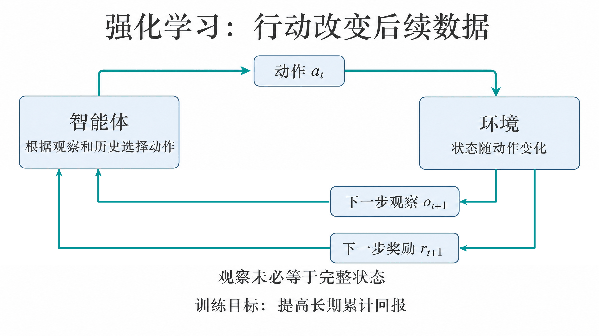

# 目录

[1. 强化学习解决什么类型的问题？](#q-001)
  - [面试问题：Agent、Environment、State、Action、Reward 分别是什么？](#q-002)
  - [面试问题：强化学习和监督学习、无监督学习有什么区别？](#q-003)
  - [面试问题：MDP、价值函数、策略函数的核心概念是什么？](#q-004)

[2. Q-Learning、DQN、Policy Gradient、Actor-Critic 如何对比？](#q-005)
  - [面试问题：Q-Learning 和 DQN 的核心区别是什么？](#q-006)
  - [面试问题：离线强化学习为什么不能直接照搬经验回放，怎样控制分布外动作的估值？](#q-202)
  - [面试问题：Policy Gradient 为什么能直接优化策略？](#q-007)
  - [面试问题：Actor-Critic 和 PPO 为什么高频？](#q-008)

[3. 强化学习如何进入大模型对齐？](#q-009)
  - [面试问题：RLHF 的三阶段流程是什么？](#q-010)
  - [面试问题：PPO 在 RLHF 中起什么作用？](#q-011)
  - [面试问题：DPO 与 RLHF/PPO 的区别是什么？](#q-012)
  - [面试问题：可验证奖励与GRPO怎样训练推理模型，为什么奖励归一化会改变学习方向？](#q-201)
  - [面试问题：RLAIF、Constitutional AI 和 Agent RL 有什么关系？](#q-013)
  - [面试问题：多步Agent怎样分配长期奖励，如何判断学到的是策略还是评测捷径？](#q-203)

[4. 迁移学习为什么是大模型时代的底层方法论？](#q-014)
  - [面试问题：源域、目标域、源任务、目标任务如何理解？](#q-015)
  - [面试问题：样本迁移、特征迁移、模型迁移、关系迁移有什么区别？](#q-016)
  - [面试问题：什么是负迁移，如何避免？](#q-017)
  - [面试问题：Domain Adaptation 和 Fine-tuning 有什么区别？](#q-018)

[5. LoRA、Adapter、Prompt Tuning 如何连接迁移学习？](#q-019)
  - [面试问题：LoRA 为什么能低成本适配大模型？](#q-020)
  - [面试问题：Adapter、Prefix Tuning、Prompt Tuning 如何对比？](#q-021)
  - [面试问题：灾难性遗忘和持续学习在 AIGC 中如何出现？](#q-022)

---

<h1 id="q-001">1. 强化学习解决什么类型的问题？</h1>

<h2 id="q-002">面试问题：Agent、Environment、State、Action、Reward 分别是什么？</h2>

**难度评分：⭐⭐ (2/5)  |  考察频率：⭐⭐⭐⭐⭐ (5/5)**

强化学习研究智能体如何根据交互结果改进决策，使长期累计回报更高。一次动作既产生眼前结果，也改变下一步会遇到的数据，这使它与固定数据上的分类问题有明显差别。

<div align="center">

| 概念 | 在决策中的作用 | 网页任务中的例子 |
| --- | --- | --- |
| Agent，智能体 | 维护策略并选择动作 | 决定下一步查询、点击或填写内容的模型与控制器 |
| Environment，环境 | 根据动作推进状态并返回反馈 | 网站、后台数据库与工具运行环境 |
| State，状态 | 足以描述后续转移所需信息的环境变量 | 订单、登录状态、页面与服务器端信息 |
| Observation，观察 | 智能体实际能读到的信息 | 当前截图、DOM、工具返回值 |
| Action，动作 | 智能体对环境采取的操作 | 点击按钮、提交参数、生成token |
| Reward，奖励 | 优化目标提供的数值反馈 | 完成任务得分、错误或资源消耗扣分 |

</div>

**状态与观察不能随意互换。** 页面截图没有展示服务器内部状态，单帧图像也未必告诉机器人速度。只有观察充分描述了决策所需信息时，才可以把它当作Markov状态；否则需要历史、递归表示或信念状态来缓解部分可观察性。把聊天历史叫“state”是常见建模简写，并不证明真实环境已满足Markov假设。

<div align="center">

<p>图：动作产生下一时刻的观察与奖励。交互过程与参数更新过程应分开理解，部署中的策略可以保持权重固定。</p>
</div>

例如自动订票，智能体看到座位信息后点击预订，环境可能返回成功、无库存或网络错误。即时奖励可以为0，完成整个任务后才给1；也可以对无效调用、耗时和预算设置成本。若只奖励“点击成功”，模型可能学会反复点击而没有真正订到票，说明奖励定义决定了它优化的方向。

还要区分训练和运行。训练可以反复收集轨迹、计算回报并更新策略；运行一次Agent任务不意味着每次收到工具结果都更新模型参数。环境反馈是新的输入，强化学习更新则是另外一个明确的优化步骤。

<h2 id="q-003">面试问题：强化学习和监督学习、无监督学习有什么区别？</h2>

**难度评分：⭐⭐ (2/5)  |  考察频率：⭐⭐⭐⭐ (4/5)**

三类学习方式的关键差别，是训练信号如何产生、目标如何定义，以及模型是否影响后续数据分布。不能简单说“监督学习有反馈，强化学习只有延迟反馈”：强化学习也可以每步获得奖励，监督任务的标签也可能很晚才收集到。

监督学习从输入与目标组成的样本学习映射，例如根据图像预测类别、根据问题学习标准答案。无监督学习通常从数据本身寻找结构；自监督学习通过遮挡、下一token预测或视图对应构造训练目标，在实现上同样会计算明确的损失，但目标不依赖逐条人工标签。

强化学习把动作放进环境轨迹中，目标是优化期望回报。推荐一个内容会影响用户之后的状态和可收集反馈，机器人走向不同区域会看到不同画面。模型既要利用已知的好动作，也要在可承受的条件下探索不确定动作；失败可能来自当下决策，也可能来自更早的选择，因此需要信用分配。

<div align="center">

| 对比点 | 监督/自监督学习 | 强化学习 |
| --- | --- | --- |
| 常见训练材料 | 输入、标签或从数据构造的目标 | 状态或观察、动作、奖励与转移轨迹 |
| 主要优化对象 | 单样本或序列的预测损失 | 策略带来的期望累计回报 |
| 反馈表达 | 正确输出或可计算预测目标 | 结果好坏的标量，可稀疏也可密集 |
| 数据分布 | 常以给定训练集为基础 | 在线时会随策略改变；离线时受历史覆盖限制 |

</div>

用专家动作训练策略，通常称行为克隆：它按监督学习模仿“该怎么做”。用任务完成奖励比较动作轨迹，再更新策略，则属于强化学习。二者可以先后使用，监督初始化有助于减少盲目探索，强化学习再针对目标结果调整行为。

大模型里，预训练的下一token预测、SFT的答案监督和RL的奖励优化可以连续发生。增加一个奖励评分器，并不意味着普通推理已经变成训练；从历史日志学习策略也不一定是RL，若只最大化专家动作似然，仍是行为克隆。准确分类要看目标与更新方式，而不是系统是否使用“Agent”这个名称。

<h2 id="q-004">面试问题：MDP、价值函数、策略函数的核心概念是什么？</h2>

**难度评分：⭐⭐⭐ (3/5)  |  考察频率：⭐⭐⭐⭐ (4/5)**

MDP用状态、动作、转移、奖励和折扣描述序列决策，常写为(S,A,P,R,γ)。Markov性质要求：给定当前状态与动作，下一步的分布不再需要额外的过去历史。它是对状态表示的条件，不能把“时间序列按顺序输入”直接当成Markov性。

设时刻t采取动作at后得到奖励rₜ₊₁，折扣回报、价值与动作价值定义为：

```math
G_t=\sum_{k=0}^{\infty}\gamma^k r_{t+k+1},\qquad
V^\pi(s)=\mathbb E_\pi[G_t\mid s_t=s],\qquad
Q^\pi(s,a)=\mathbb E_\pi[G_t\mid s_t=s,a_t=a].
```

持续任务常取0≤γ<1；有限回合可以在适当条件下取γ＝1，并把求和截到结束。策略π(a|s)给出当前动作分布，也可以是确定性选择。V评价按该策略继续行动的状态，Q额外指定第一步动作；二者依赖策略，不是环境中永远固定的“正确分数”。

Bellman期望方程把长期回报拆成一步奖励和下一状态价值。将R(s,a)定义为当前状态动作下的一步期望奖励，则：

```math
Q^\pi(s,a)=R(s,a)+\gamma\sum_{s'}P(s'\mid s,a)V^\pi(s'),
\qquad
V^\pi(s)=\sum_a\pi(a\mid s)Q^\pi(s,a).
```

离散空间用求和，连续空间相应改为积分。优势函数Aπ(s,a)＝Qπ(s,a)－Vπ(s)表示该动作相对当前策略平均表现的好坏，可作为策略更新信号。

举例来说，两步任务中一个动作立即得2分后结束，另一个动作现在得0分、下一步稳定得5分。γ＝0.9时，后者的回报为4.5，高于前者；γ＝0.2时则只有1。折扣改变优化偏好，也影响学习难度，不能仅把它称为数值技巧。

终止状态后不再累计未来奖励。外部采样时间到达而中断，不一定代表任务真正终止；此时价值学习通常仍需从最后状态bootstrap。若任务本身规定有限剩余时间，时间应进入状态表示。机器人或网页任务看不到完整状态时，还需要用部分可观察模型分析，避免对单个截图套用不成立的假设。

<h1 id="q-005">2. Q-Learning、DQN、Policy Gradient、Actor-Critic 如何对比？</h1>

<h2 id="q-006">面试问题：Q-Learning 和 DQN 的核心区别是什么？</h2>

**难度评分：⭐⭐⭐ (3/5)  |  考察频率：⭐⭐⭐⭐ (4/5)**

Q-Learning通过一步自举更新动作价值，再依据估值选择动作。表格版本为每个状态动作维护一个数，核心更新可写为：

```math
y=r_{t+1}+\gamma(1-d_t)\max_{a'}Q(s_{t+1},a'),\qquad
Q(s_t,a_t)\leftarrow Q(s_t,a_t)+\alpha[y-Q(s_t,a_t)].
```

α是学习率，dt表示该转移是否到达真正终止状态。目标使用最大动作价值，因此即使数据来自带探索的行为策略，也是在向贪心最优目标学习，这体现了off-policy性质。表格收敛结论还需要足够探索、合适学习率等条件，不能直接推广到任意神经网络。

DQN用Qθ(s,a)替代Q表，使高维图像等状态可以共享特征。常见离散动作实现一次输入状态，输出各动作的Q值，再最小化预测与目标的平方误差或Huber损失。**Q-Learning是一类更新方法，DQN是结合深度函数近似及稳定化设计的具体路线**，并不意味着所有Q-Learning只能用表格。

经验回放把转移存进缓冲区，随机采样降低连续样本的相关性并复用数据；目标网络用延迟更新的参数θ⁻计算y，减轻“追逐自己不断变化的目标”。目标在本次更新中停止梯度，并不代表环境或目标网络永远不变。

例如r＝1、γ＝0.9、下一状态最大Q为4，目标为4.6；当前Q为3、α＝0.1，则更新到3.16。若这一步真正终止，目标应为1，而不是4.6。外部时间截断通常仍应bootstrap，还要拿到自动reset之前的最终观察，不能错误地用新回合起点计算旧转移的目标。

max既选择又评估动作，估值噪声会带来过估计倾向。Double DQN用在线网络选动作、目标网络评估该动作，减少这种耦合。标准DQN更适合有限离散动作；高维连续动作中的argmax难求，常转向带actor的算法。回放和目标网络改善实践稳定性，但深度函数近似、bootstrap与off-policy组合仍可能不稳定。

<h2 id="q-202">面试问题：离线强化学习为什么不能直接照搬经验回放，怎样控制分布外动作的估值？</h2>

**难度评分：⭐⭐⭐⭐ (4/5)  |  考察频率：⭐⭐⭐ (3/5)**

Off-policy表示学习目标策略可以与产生数据的行为策略不同；offline则要求训练期间只使用固定历史数据，不再与环境收集新轨迹。在线DQN也使用off-policy回放，但它仍能用当前策略探索和补充数据，因此不能把两者混为一谈。

离线训练的核心困难是**策略优化会主动寻找估值高的动作，而高估可能恰好发生在数据没有覆盖的地方**。假设日志中某状态只记录过动作A与B，网络却给未出现过的C预测了很高的Q值。Bellman目标中的max可能选中C，并把虚假的高价值传播到更早状态；没有在线交互，就无法及时用真实结果纠正它。

常见处理可以分成三类。行为约束让新策略留在日志支持较好的动作附近；保守价值学习对分布外动作的过高估值施加惩罚，CQL是代表；隐式或受限的策略改进尽量从已观察行为中提取优势，减少对任意分布外动作的直接最大化。它们各有假设，并不保证从一个很差的数据集训练出任意高水平策略。

行为克隆是必须认真对待的基线。若日志已有高质量专家行为，模仿可能比复杂离线RL更稳；若日志包含好坏不等的轨迹，回报信息有机会帮助策略筛选更优决策。轨迹片段能够如何组合，还取决于状态覆盖、转移连通性和估值可靠性，不能仅凭数据量推断。

离线策略评估也有相同的覆盖难题。重要性采样需要行为概率或可靠估计，长轨迹上的比率乘积可能高方差；基于价值模型的评估可能延续同一套估值偏差。应检查行为策略组成、状态动作覆盖、奖励记录、终止标志与数据泄漏，报告不确定性，并在允许的环境中使用有限的新交互验证。

这类问题也适用于Agent日志学习：历史工具调用只展示“执行过什么”，没有展示所有未执行动作的结果。把离线训练准确率或估计回报提高，直接说成真实任务成功率提高，会跨越尚未验证的环节。

<h2 id="q-007">面试问题：Policy Gradient 为什么能直接优化策略？</h2>

**难度评分：⭐⭐⭐⭐ (4/5)  |  考察频率：⭐⭐⭐ (3/5)**

策略梯度直接把动作概率写成可微函数πθ(a|s)，然后调整参数，使高回报轨迹更可能出现。它不要求环境转移可微：梯度作用在模型选择动作的概率上，环境负责提供样本与奖励。

设τ为一条轨迹，目标J是从初始状态分布出发的期望折扣回报。在环境动力学与θ无关、满足求导交换等条件时，可由log-derivative技巧得到一种轨迹形式：

```math
\nabla_\theta J
=\mathbb E_{\tau\sim\pi_\theta}
\left[\sum_t\gamma^t\nabla_\theta\log\pi_\theta(a_t\mid s_t)
\big(G_t-b(s_t)\big)\right].
```

Gt是从t开始、以t为起点折扣的未来回报；外层γᵗ保证与从回合起点定义的折扣目标一致，有限不折扣任务中两者可取1。轨迹概率由策略和环境转移相乘，取对数后策略项变成求和，环境项对θ的导数为0。这就是不反传穿过真实环境也能学习的原因。

只依赖状态、不依赖当前采样动作的baseline b，不改变理想梯度期望，因为动作分布下log概率梯度的期望为0。它可以减少方差；训练actor时通常把回报、优势和baseline作为固定权重，不能无意中通过baseline再给策略目标增加另一条梯度。

直觉上，一个动作比预期好，就提高它在该状态下的概率；比预期差，则降低。比如两个回答的回报是1和0，梯度对各自token的概率施加不同方向的权重。单次采样成功可能只是运气，因此需要多个样本、合适baseline和充分评估，不能把一次高分轨迹理解成已发现最优策略。

策略梯度能表达随机策略，连续控制可用高斯等分布输出动作，离散token也可使用分类分布。主要难点是方差与样本成本，稀疏奖励和长轨迹还会加重信用分配。Actor-Critic引入估值降低部分方差，但估值误差又可能带来偏差；算法设计是在这些误差来源之间作权衡。

<h2 id="q-008">面试问题：Actor-Critic 和 PPO 为什么高频？</h2>

**难度评分：⭐⭐⭐⭐ (4/5)  |  考察频率：⭐⭐⭐⭐⭐ (5/5)**

Actor-Critic把策略改进和价值估计分工：actor给动作分布，critic估计在当前策略下还能得到多少回报。用实际结果减去预期，可以得到更有区分度的更新信号，减少单纯使用整条轨迹总分的波动。

常见一步TD误差为δt＝rₜ₊₁＋γV(sₜ₊₁)－V(st)，终止处未来项为0。GAE把不同步长的TD误差按(γλ)ˡ加权求和，构造优势估计；λ控制对较长回报的依赖，在常见设置下体现偏差与方差取舍。critic不是任务的最终裁判，它也从样本训练，估错会影响actor。

PPO-Clip用旧策略采样的轨迹做若干轮更新。令ρt为当前策略与采样策略在同一状态动作上的概率比：

```math
\rho_t(\theta)=\frac{\pi_\theta(a_t\mid s_t)}{\pi_{\mathrm{old}}(a_t\mid s_t)},
\qquad
L^{\mathrm{clip}}(\theta)=
\mathbb E_t\left[\min\big(
\rho_t\hat A_t,
\mathrm{clip}(\rho_t,1-\epsilon,1+\epsilon)\hat A_t
\big)\right].
```

正优势动作的概率已经明显提高时，继续提高不再增加该项收益；负优势动作的概率已经明显降低时，也不再持续奖励这种降低。例如优势为2、ε＝0.2、概率比为1.3，未裁剪项为2.6，裁剪项为2.4，目标取2.4。这样削弱利用同一批数据进行过大更新的动力。

**裁剪的是目标中的收益，不是直接把策略概率比锁死在区间内。** 共享参数、其他样本和多轮优化都可能让新旧策略偏离更远；它不提供严格KL上界或单调性能保证。实现通常还需要监控KL、熵、clip fraction、价值误差，并设置合适学习率、更新轮数或提前停止。

PPO通常被归为on-policy方法：数据由近期策略产生并有限复用，不能仅凭概率比，就把任意陈旧轨迹视为有效训练数据。它的实践吸引力在于目标易实现、适用于离散和连续动作，并能组合估值与批量采样；成功仍依赖奖励、数据质量和训练细节。

<h1 id="q-009">3. 强化学习如何进入大模型对齐？</h1>

<h2 id="q-010">面试问题：RLHF 的三阶段流程是什么？</h2>

**难度评分：⭐⭐⭐⭐ (4/5)  |  考察频率：⭐⭐⭐⭐⭐ (5/5)**

经典RLHF流程把“人更喜欢哪一个回答”转换为可以优化的训练信号，常见三阶段是SFT、偏好奖励建模和策略优化。这是有代表性的实现路线，不是所有对齐系统都必须完整照做的固定定义。

SFT用指令与高质量回答训练模型，提供基本的任务和对话行为。随后针对同一问题采样多个回答，让标注者比较质量；奖励模型rφ(x,y)学习把问题x与回答y映射为分数。对偏好回答yw和较差回答yl，常见成对损失为：

```math
\mathcal L_{\mathrm{RM}}
=-\mathbb E\log\sigma\big(r_\phi(x,y_w)-r_\phi(x,y_l)\big).
```

这是Bradley–Terry式偏好建模：分差越大，前者被偏好的概率越高。监督来自相对偏好，分数的绝对零点并没有直接的人类意义，标注分歧、位置偏差和长度偏好都会影响训练。

策略优化阶段再用语言模型生成新回答，由奖励模型打分，通过PPO等算法调整输出概率。通常保留一个参考策略，并对偏离它的程度施加KL约束或惩罚，防止训练过快离开已有语言行为。人类不必实时评价每条新轨迹，但奖励模型越被反复优化，其分布外误差越可能暴露。

例如标注者偏好解释完整的答案，奖励模型可能把“更长”误学成“更好”。如果直接追逐评分，策略会变得冗长而事实质量没有改善。应保留独立的人类或任务测试，对长度、事实性、任务成功和不同用户群体分别评价，而不是只报告训练奖励上升。

RLHF可以改善帮助性与偏好一致性，却不保证答案真实、所有人意见一致或每种场景都可靠。奖励模型、价值模型和参考模型虽然都可能是神经网络，职责不同：奖励定义训练反馈，价值估计未来回报，参考策略提供行为偏离的比较对象。

<h2 id="q-011">面试问题：PPO 在 RLHF 中起什么作用？</h2>

**难度评分：⭐⭐⭐⭐ (4/5)  |  考察频率：⭐⭐⭐⭐ (4/5)**

在基于PPO的RLHF中，语言模型是actor，生成token是动作，问题与已生成前缀构成模型可见的决策上下文。回答结束时可以得到一个偏好奖励，critic再结合奖励和当前前缀估计优势，用PPO目标更新策略。

这一过程最容易混淆的是三个策略版本：当前策略πθ正在更新；采样旧策略πold产生本轮轨迹，用于计算PPO概率比；参考策略πref通常来自SFT，用于约束较长期的行为漂移。采样旧策略会随轮次刷新，参考策略往往保持冻结，两者的目的不同。

<div align="center">

| 组件 | 提供什么 | 主要用途 |
| --- | --- | --- |
| 当前策略 | 当前token条件概率 | 接受梯度更新 |
| 采样策略 | 生成轨迹时的token概率 | 计算概率比和本轮更新目标 |
| 参考策略 | 参考行为下的token概率 | 计算相对参考的KL项 |
| 奖励模型 | 完整回答或过程的评分 | 定义要优化的反馈 |
| 价值模型 | 前缀对应的预期回报 | 估计优势、降低方差 |

</div>

在一个常见实现中，采样回答的最后位置加入奖励模型分数，各token再加入相对参考的log概率比惩罚。单条样本上的log比值可以为负，只有在相应分布下取期望才对应KL，不能要求每个token的采样项都非负。具体训练代码还可能采用其他KL估计器或把惩罚直接放进损失，需要核对定义。

PPO裁剪控制近期更新的激励，参考KL限制偏离参考行为的成本；前者不自动包含后者，二者都不能证明奖励漏洞已经消除。还要检查rollout与训练时的tokenizer、chat template、截断、EOS、padding mask和log概率计算是否一致，否则概率比可能衡量的是接口错误。

显存也不能只数一个actor。奖励、价值、参考以及采样模型可能共存或分时调度，生成的KV缓存和长回答激活同样占资源。应同时记录真实任务表现、奖励、参考KL、响应长度、优势分布和采样吞吐，避免把训练数值稳定误认为行为质量已经提高。

<h2 id="q-012">面试问题：DPO 与 RLHF/PPO 的区别是什么？</h2>

**难度评分：⭐⭐⭐⭐ (4/5)  |  考察频率：⭐⭐⭐⭐⭐ (5/5)**

DPO把偏好学习直接写成策略参数的损失，在经典离线训练形式中，不需要单独拟合奖励网络，也不需要在每个训练步骤与环境进行新的RL rollout。它与PPO的区别主要在于优化组织和数据来源，不是一个学习偏好、另一个完全不学习偏好。

从带参考KL惩罚的奖励最大化问题出发，理想最优策略满足π*(y|x)与πref(y|x)·exp(r(x,y)/β)成正比。把奖励反解为策略与参考的log概率比，再代入成对偏好模型，同一问题的归一化项相消，得到：

```math
\mathcal L_{\mathrm{DPO}}
=-\mathbb E_{(x,y_w,y_l)}\log\sigma\left(
\beta\left[
\log\frac{\pi_\theta(y_w\mid x)}{\pi_{\mathrm{ref}}(y_w\mid x)}
-\log\frac{\pi_\theta(y_l\mid x)}{\pi_{\mathrm{ref}}(y_l\mid x)}
\right]\right).
```

yw为被偏好回答，yl为另一个回答，β对应推导中的KL强度参数。序列log概率通常是答案token条件log概率的和，要正确屏蔽问题与padding。随意改为按长度平均，就改变了原始目标；参考模型的答案概率可在条件固定时预计算。

损失鼓励偏好回答相对参考的log概率优势高于较差回答。它不保证偏好答案的绝对概率在每一步都增加，也不等于拿好答案做一次SFT。推导使用KL正则目标和偏好概率模型等假设，神经网络有限容量、数据覆盖与优化过程并不保证精确得到理论最优策略。

<div align="center">

| 比较点 | 典型奖励模型加PPO | 经典离线DPO |
| --- | --- | --- |
| 新数据 | 按当前或近期策略持续采样 | 训练既有偏好对 |
| 显式奖励模型 | 通常需要 | 不需要单独训练 |
| 优势/价值估计 | 常见actor-critic实现需要 | 标准损失不需要critic |
| 主要风险 | 奖励漏洞、采样成本、训练耦合 | 偏好噪声、数据覆盖、分布外泛化 |

</div>

DPO在给定数据上更容易组织训练，但不能因此笼统宣称总是更稳定或一定更好。它也可以与迭代采样、新偏好标注结合；“DPO永远不能在线使用”过于绝对。选择时要看是否能获取可靠新反馈、任务是否需要多步环境交互，以及固定偏好数据是否覆盖当前策略的失败。

<h2 id="q-201">面试问题：可验证奖励与GRPO怎样训练推理模型，为什么奖励归一化会改变学习方向？</h2>

**难度评分：⭐⭐⭐⭐ (4/5)  |  考察频率：⭐⭐⭐⭐ (4/5)**

可验证奖励将某些任务的完成结果交给明确规则检查，例如数学答案是否满足约定、程序是否通过测试、工具是否完成指定状态变更。RLVR中的“可验证”指奖励来源具有可执行检查，不代表所有中间推理都正确，也不代表检查器覆盖了真实任务的全部要求。

GRPO是一种利用同题多条采样结果估计相对优势的策略优化方式。对问题x，从采样策略生成G个回答，获得奖励R₁到RG，在常见的结果奖励版本中：

```math
\bar R=\frac1G\sum_{j=1}^G R_j,\qquad
\hat A_i=\frac{R_i-\bar R}{\mathrm{std}(R_1,\ldots,R_G)+\epsilon}.
```

组内比较提供baseline，随后结合新旧策略概率比和裁剪目标更新。原始GRPO不需要单独训练与策略同量级的value critic，但仍要付出多次回答生成、奖励计算、参考概率及反向传播的成本。GRPO与RLVR是两个维度：前者是优化方法，后者描述奖励形式；GRPO也可以使用学习得到的奖励。

例如四条回答奖励为1、1、0、0，均值为0.5，按总体标准差0.5计算，优势约为1、1、－1、－1。若全为0或全为1，中心化结果全为0，这一组没有区分答案的结果优势；加入ε防止除零，并不会凭空创造学习信号。若还有KL或其他辅助损失，它们仍可能产生梯度，不能把“组内优势为零”扩大成整步训练完全停止。

归一化会改变样本权重。按每道题的标准差缩放，可能放大奖励分布接近一致但仍有少数例外的组；再按每条回答长度平均token损失，又会改变长短回答的相对贡献。Dr. GRPO分析了这类问题并调整归一化方式。理解具体实现时，应核对是按token、回答还是问题平均，优势是否按组标准化，以及KL放在哪里，不能只看算法名。

DeepSeekMath提出GRPO，DeepSeek-R1等工作进一步展示了可检查任务结果与大规模策略训练的结合。能否迁移到新任务，要看基座是否有探索到正确结果的可能、验证器是否可靠、数据难度是否合适。答案对了不证明推理过程忠实，公开测试通过也不代表隐藏输入正确；训练应隔离评价答案和测试集，并使用独立规则或人工抽查检查奖励是否被投机利用。

<h2 id="q-013">面试问题：RLAIF、Constitutional AI 和 Agent RL 有什么关系？</h2>

**难度评分：⭐⭐⭐ (3/5)  |  考察频率：⭐⭐⭐ (3/5)**

RLHF、RLAIF、Constitutional AI与Agent RL不在同一个分类轴上。前两者强调反馈主要从哪里来，Constitutional AI强调用哪些原则组织反馈与训练，Agent RL强调策略在多步环境交互中完成什么任务。一个系统可以同时具有其中多个特征。

RLAIF让AI模型提供比较、批评或评分，减少逐条人工标注压力。反馈可以被用来训练奖励模型，也可以形成偏好数据用于其他优化方式。省下的是部分标注成本，评价者的能力、偏差和提示敏感性仍需校准；如果生成模型与评价模型有相同盲点，自动评分可能持续强化错误。

原始Constitutional AI包含监督与RL两部分：先让模型根据一组原则批评并修订回答，用修订结果微调；再用原则引导AI比较候选，训练偏好模型，进行奖励驱动的策略优化。原则的选择来自人类设计，使用AI反馈不等于没有人的价值取舍，也不保证一组文字原则能覆盖所有冲突情况。

Agent RL把策略扩展到工具调用、环境操作与多轮反馈。奖励可以来自执行成功、结果验证、人类偏好或AI判断，常需考虑过程成本、失败恢复和长时序信用分配。一次API调用成功只说明接口执行成功，不一定完成用户任务；奖励应与可验收的最终状态对应。

<div align="center">

| 名称 | 主要回答的问题 | 需要核验的环节 |
| --- | --- | --- |
| RLHF | 人类偏好如何进入训练 | 标注标准、分歧与奖励泛化 |
| RLAIF | AI反馈如何替代或补充人工 | 评价者误判、偏差与校准 |
| Constitutional AI | 原则如何指导批评、修订和比较 | 原则覆盖、冲突和训练效果 |
| Agent RL | 多步行动如何提高任务回报 | 环境真实性、信用分配和独立任务成功 |

</div>

例如训练检索助手，AI可以评价证据是否相关，数据库检查回答中的数值是否正确，人类抽查是否满足需求。多源反馈提供互补信息，但权重一旦改变，策略优化的行为也会改变。最终仍要用与训练评分相分离的任务集和判断方式验收。

<h2 id="q-203">面试问题：多步Agent怎样分配长期奖励，如何判断学到的是策略还是评测捷径？</h2>

**难度评分：⭐⭐⭐⭐ (4/5)  |  考察频率：⭐⭐⭐⭐ (4/5)**

多步Agent的终局奖励只能告诉我们一条轨迹整体是否成功，未必说明哪一步最有贡献。检索三次后回答正确，可能第二次就已找到关键证据，第三次只是浪费；如果给每次搜索都加分，策略又可能学会增加无用调用。信用分配需要把结果与实际动作影响连接起来。

最直接的方法是用回报和价值baseline估计每个决策的优势，或对同一任务采样多条轨迹比较。还可以在可重放的环境中固定前缀，替换后续动作，观察结果差异；这种分支实验更接近动作效果，但成本高，而且不同随机环境结果、工具状态和上下文必须可比。用另一个模型评分每一步较便宜，却引入新的代理误差。

奖励塑形可以提供更密的信号。在满足相应Markov、折扣与终止条件时，势函数形式F(s,a,s′)＝γΦ(s′)－Φ(s)沿轨迹折扣求和会望远镜相消，从而保留原目标的最优策略关系。任意给“解释更长”“搜索更多”加分不具备这个性质，甚至会改变任务本身。有限回合的终止势值也要正确处理，不能只抄公式。

工具轨迹还要确定哪些token受训练。用户输入和工具返回通常是观察，模型生成的调用参数与回答才是策略动作；若把工具返回文本当作模型动作计算策略梯度，会混淆责任来源。动作级奖励与token级损失之间的长度权重、截断和mask，同样会影响哪些行为被强化。

验收需要同时记录成功率、工具调用、总token、耗时与失败类型。pass@1和多次尝试中的最好结果代表不同预算，比较时应固定采样数、工具限制和验证方式。训练过的网页模板、文档实体、时间范围与环境版本也应与测试隔离，避免模型只记住评测结构。

真正的泛化证据，是在新的任务与可独立核对的环境结果上保持收益。评分上升但实际结果不变、调用次数增加却没有补充证据、模型只在可见测试上成功，都提示需要重新检查奖励与数据。奖励优化和评测本身要分开，否则策略越善于优化，越可能放大评分器的盲点。

2026年的ECA在检索问答中提供了一个具体例子：训练时只把问题与去重后的检索文档交给冻结评分快照，观察标准答案的概率是否提高，避免把模型自行撰写的思考和查询措辞混入证据质量评分；辅助优势再分配到搜索动作token。测试时不使用标准答案评分器。它在有限搜索预算、两种Qwen2.5规模和指定问答集上提供了证据，但标准答案概率仍是代理，可能低估有用的桥接文档，也增加训练前向开销。更一般的工具和代码环境是否受益，需要单独验证。

<h1 id="q-014">4. 迁移学习为什么是大模型时代的底层方法论？</h1>

<h2 id="q-015">面试问题：源域、目标域、源任务、目标任务如何理解？</h2>

**难度评分：⭐⭐ (2/5)  |  考察频率：⭐⭐⭐⭐ (4/5)**

迁移学习研究怎样利用已有领域或任务的经验，改善目标领域与任务的学习。分清“域”和“任务”，才能判断需要补数据、换输出头，还是调整内部表示。

域通常包含输入空间及其分布，可记为D＝(X,P(X))；任务包含输出空间和要学习的预测关系，可记为T＝(Y,P(Y|X))。在生成问题里，Y也可以是文本或动作序列。源域、源任务提供已有训练经验，目标域、目标任务对应希望部署的场景。

<div align="center">

| 迁移例子 | 域的变化 | 任务的变化 |
| --- | --- | --- |
| 白天检测迁移到夜间检测 | 光照、噪声和物体外观改变 | 若标签定义一致，仍做同类检测 |
| 自然图像分类迁移到缺陷定位 | 图像与缺陷分布改变 | 图像类别变为区域定位 |
| 通用语言模型适配法律问答 | 文体、术语与知识分布改变 | 下一token预训练迁移到按问题回答 |
| 一个医院的分割迁移到另一医院 | 设备、患者与扫描协议改变 | 分割目标可能相同，也可能标注口径不同 |

</div>

这里的差异可能同时发生。英文OCR转到中文票据，不只是输入外观变了，字符集合、版式、字段与语言规律也可能改变；只对齐图像统计不能解决全部问题。

工程上可先冻结预训练编码器训练轻量头，检验表示是否已包含目标信息；再尝试部分层更新、参数高效微调或全量微调。少量标注不意味着只能选一种方案，模型、任务复杂度与样本质量共同决定适配需求。

迁移收益要与公平基线比较：目标数据量、训练预算、评价集和选择超参数的机会尽量一致。源模型原始任务分数很高，不保证迁移最好；目标域的细节是否在预训练表示中保留、目标输出是否与原目标冲突，往往更关键。

<h2 id="q-016">面试问题：样本迁移、特征迁移、模型迁移、关系迁移有什么区别？</h2>

**难度评分：⭐⭐⭐ (3/5)  |  考察频率：⭐⭐⭐ (3/5)**

样本、特征、模型与关系迁移，描述的是复用知识的不同位置。这是一种分析方法，实际系统可以同时使用几类，不能把它们当作互斥算法名。

样本迁移通过选择或加权已有样本，使训练更贴近目标数据。在协变量偏移假设P源(Y|X)＝P目标(Y|X)成立时，可用输入密度比P目标(X)/P源(X)调整源样本权重。若标签关系也改变，或目标区域在源数据中没有支持，单靠重要性权重就不够；极大权重还会提高方差。

特征迁移希望得到对任务有用、对域变化不过度敏感的表示。DANN的例子是共享特征同时服务标签预测与域分类，特征提取器通过反向梯度让域更难被区分。关键约束是保留类别判别信息；如果不同类别在两个域中的分布错位，盲目对齐边缘分布可能把不该相近的样本混在一起。

模型迁移直接复用参数、结构或正则先验，例如冻结编码器、微调主干、添加LoRA。它把已学到的特征与初始化带入新任务，省去从零学习全部表示的成本。复用范围越大，越要检查目标数据是否与原能力冲突，而不是默认所有层都应更新。

关系迁移关注样本或实体之间的结构，例如图中的交互规律、类别之间的相似关系或任务间依赖。它通常需要定义如何对应不同域的实体、关系和语义；“两个系统都有知识图谱”本身不是可以迁移的证据。

例如新工厂缺陷数据很少，可以筛选相似旧产线样本、复用视觉编码器、调整部分参数，再利用同一产品不同工位的关联信息。每一步都应保留消融基线，判断收益来自数据选择、表示还是额外监督，避免把所有改动一起上之后无法解释结果。

<h2 id="q-017">面试问题：什么是负迁移，如何避免？</h2>

**难度评分：⭐⭐⭐ (3/5)  |  考察频率：⭐⭐⭐⭐ (4/5)**

负迁移是指利用源知识后，目标任务表现反而低于合适的无迁移或其他基线。判断时要说明基线和预算；一次微调后分数下降，可能来自训练超参数、样本不足或测试波动，不能不加分析地全部归因于源知识。

典型原因包括源域特征与目标域不匹配、标签定义冲突、源数据噪声、错误伪标签，以及模型保留了不适用于目标任务的捷径。例如源数据中缺陷总出现在某种背景上，模型学会背景相关性；换到新产线，即使缺陷形态相似，这个捷径也失效。法律问答的数据若混合不同地区、不同时间的规则，不加条件直接微调，也可能学出互相矛盾的回答。

先定位问题，再决定是否冻结或微调。可以比较从零训练、冻结特征加头、部分层微调和全量微调；记录目标指标、源能力指标与训练验证差距。冻结基线好而全量微调差，可能是数据或优化破坏了已有表示；所有迁移方案都差，则要进一步检查源表示是否缺少关键细节。

数据选择与标签清洗通常比复杂正则更优先。其次可以降低学习率、调整更新层、增加相关样本、改变任务头或采用蒸馏与混合回放。PEFT减少更新自由度，但仍可能对目标任务过拟合，也不能保证输出不再改变。域对齐同样需要检验条件，标签语义不同的域不能只靠分布相似性硬对齐。

负迁移与灾难性遗忘要分开。前者关注源知识是否损害目标任务，后者关注学新任务后旧能力是否下降；目标提升、旧能力下降属于常见遗忘，但不必然说明目标发生负迁移。把两个方向分别测量，才能决定是更换源模型、改适配方式，还是补旧任务约束。

<h2 id="q-018">面试问题：Domain Adaptation 和 Fine-tuning 有什么区别？</h2>

**难度评分：⭐⭐⭐ (3/5)  |  考察频率：⭐⭐⭐⭐ (4/5)**

Domain Adaptation描述一个问题：源域与目标域分布不同，希望模型在目标域仍然有效。Fine-tuning描述一种训练操作：从已有参数出发继续更新。因此两者可以同时发生，不能简单列成二选一方案。

有目标标注时，直接用目标数据微调就是很强的领域适配基线；目标标注缺少时，可以使用无监督域适配、伪标签、自监督继续训练、统计对齐等方法。通常的域适配研究会明确源/目标标签空间及可用信息，开放集、标签偏移或未知类别需要额外处理，不宜沿用“类别完全一致”的假设。

<div align="center">

| 问题 | 领域适配关注什么 | 微调时需要决定什么 |
| --- | --- | --- |
| 新设备图像变暗 | 外观偏移是否影响任务表示 | 更新哪些层、使用哪些标注或伪标签 |
| 行业文本术语变多 | 输入语料与知识分布变化 | 是否继续语言建模，再做任务监督 |
| 标注标准变化 | 条件分布或任务定义是否变化 | 数据重标、输出头与损失怎样调整 |
| 无标注新域 | 可利用哪些无监督信号 | 是否更新归一化、特征或适配参数 |

</div>

领域继续预训练用领域文本的自监督目标适应语言分布；SFT学习按指令完成目标任务；LoRA等PEFT决定参数怎样更新。这三者分别涉及训练数据与目标、任务行为和参数化方式，可以组合，不能把LoRA本身当作一种数据分布对齐证明。

对齐分布也要保留任务信息。只让源目标特征无法区分，可能把目标域的新类别或重要异常抹掉。伪标签训练需要监控错误累积，测试时适配还要明确是否允许访问测试流、是否使用标签以及状态是否跨样本保留。评价应遵循预先定义的协议，避免在看过测试答案后继续调整模型。

<h1 id="q-019">5. LoRA、Adapter、Prompt Tuning 如何连接迁移学习？</h1>

<h2 id="q-020">面试问题：LoRA 为什么能低成本适配大模型？</h2>

**难度评分：⭐⭐⭐⭐ (4/5)  |  考察频率：⭐⭐⭐⭐⭐ (5/5)**

LoRA把某些权重更新限制在低秩参数化中，减少需要训练与存储的参数。它假设任务适配可以由较低维的更新子空间近似，**不是假设预训练权重矩阵本身必然低秩**。

设原线性层W₀形状为dout×din，冻结W₀，训练A与B：

```math
y=W_0x+\frac{\alpha}{r}BAx,\qquad
A\in\mathbb R^{r\times d_{\mathrm{in}}},\quad
B\in\mathbb R^{d_{\mathrm{out}}\times r}.
```

r是秩预算，α控制更新尺度，α/r是原始LoRA常用缩放；不同变体可能改变缩放或初始化，应按实现说明。可训练参数从dout·din变为r(din＋dout)。例如4096×4096矩阵有16,777,216个参数，r＝8的A/B共65,536个，为原矩阵的1/256；这只是该层增量参数比例，不是全模型显存直接减少256倍。

常见初始化把A设为随机、B设为0，使初始增量为0，保持初始前向输出。若A和B同时全零，二者相乘路径的梯度会陷入零更新，因此不能随意把两者都清零。训练时冻结基座省去了它的梯度与优化器状态，但基座权重、前向计算和中间激活仍需资源。

QLoRA进一步将冻结基座以低比特形式存储，并通过相应计算路径训练LoRA，结合NF4、双重量化和分页优化器等减少内存。它不意味着所有运算、梯度和可训练参数都在4bit中完成；量化误差、计算精度和硬件内核仍影响结果。

对普通线性层，在兼容的数据类型下可预先合并W₀＋(α/r)BA，使部署不再执行独立低秩分支。量化模型的合并与重新量化可能引入误差，多adapter动态切换也可能采用不同实现，因此“零额外延迟”应限定在已合并且算子形状不变的场景。

选择r和注入层，应根据任务难度与预算比较。小r可能不足，大r也可能过拟合；只改注意力或同时改MLP的效果不必相同。保存adapter时还需记录准确基座版本、模块名、缩放和预处理，尺寸相同并不能保证载入别的基座后仍有效。

<h2 id="q-021">面试问题：Adapter、Prefix Tuning、Prompt Tuning 如何对比？</h2>

**难度评分：⭐⭐⭐ (3/5)  |  考察频率：⭐⭐⭐⭐ (4/5)**

这些PEFT方法的共同目标是保留大部分基座参数，只训练少量任务相关参数；差别在于新增能力放在哪里，以及部署时需要付出什么代价。

Adapter在网络层中加入小型可训练模块，典型瓶颈结构先降维、非线性变换再升维，并以残差方式加回表示。它能在中间特征层面改变计算，适合按任务保存模块，但额外非线性通常不能像LoRA那样直接合并成同一线性权重，推理可能增加算子与延迟。

Prompt Tuning在输入端学习一组连续向量，作为软提示与真实token embedding一起进入模型。这些向量由梯度学习，不必能解码成人类可读文字；这与手工撰写prompt不同。Prefix Tuning则让多个层的注意力读取可学习前缀，常表现为各层额外的K/V表示，影响比单独输入软提示更深入，也会占用注意力与缓存预算。

<div align="center">

| 方法 | 参数放在哪里 | 运行时主要代价 | 适配时重点 |
| --- | --- | --- | --- |
| Adapter | 中间层的小型变换模块 | 额外模块计算 | 瓶颈宽度、插入位置与模块切换 |
| Prompt Tuning | 输入端的连续提示 | 额外序列位置 | 提示长度、初始化与基座规模 |
| Prefix Tuning | 多层注意力的可学习前缀 | K/V和注意力开销 | 前缀参数化、层与长度 |
| LoRA | 选定线性层的低秩增量 | 未合并时有额外分支 | 秩、缩放、目标模块及合并精度 |

</div>

冻结基座不意味着整个计算图都可以关闭梯度。为了把损失传到前面的软提示或adapter，梯度仍要穿过冻结层对输入的变换；若错误地对整段模型使用`no_grad`，可能把可训练参数的梯度路径也切断。节省的是哪些权重需要梯度和优化器状态，而非所有反向计算都消失。

选型要同时看质量、训练显存、推理延迟、任务数量与切换方式。保存很小的任务模块方便分发，但输入长、并发高时，前缀的缓存成本也可能显著；需要单模型低延迟部署时，可合并LoRA有优势。不存在仅根据可训练参数数量就能决定的统一最优方案。

<h2 id="q-022">面试问题：灾难性遗忘和持续学习在 AIGC 中如何出现？</h2>

**难度评分：⭐⭐⭐ (3/5)  |  考察频率：⭐⭐⭐⭐ (4/5)**

灾难性遗忘指模型学习新任务后，旧任务能力明显下降。神经网络共享参数，新数据上的梯度会改变旧任务也依赖的表示；如果训练长期只看新分布，旧行为缺少约束，就可能被覆盖。这与没有学会新任务、测试域本来不同或推理配置改变，需要分开诊断。

例如客服SFT让模型熟悉订单模板，却可能降低一般问答表现；检测器只用新类别训练，旧类别可能被当成背景；图像生成模型专门学习一种风格后，其他风格的控制能力也可能变化。新增数据中的标注范围、负样本定义和采样比例，常与优化本身同样重要。

常见办法包括回放旧数据，用旧模型输出蒸馏，限制重要参数变化，以及隔离任务参数。回放直接保留旧分布信号，但增加存储和训练成本；蒸馏依赖教师覆盖与输入样本；参数正则对“哪些参数重要”的估计可能不准；分任务adapter便于保留模块，但需要知道何时选用哪个模块，并处理共享能力。

LoRA冻结基座，使移除adapter后可以恢复原基座行为，但**启用adapter时仍可能遗忘或干扰旧任务**。连续在同一adapter上学习新任务，也会改变此前增量；多个adapter合并还可能产生冲突。因此，“基座没改”不能替代对实际启用模型的旧能力评测。

持续学习应该按时间顺序记录能力矩阵：第k阶段训练完成后，在第1到k阶段的测试集及固定通用集上评价。平均准确率或任务指标反映整体表现，旧任务相对历史最好值的下降反映遗忘，新任务学习速度与成本反映适应性。不要只测试最后一个新任务，也要避免反复利用同一测试集选择训练超参数。

如果新旧要求本来互相冲突，例如同一事实随时间更新，保留旧答案未必是正确目标。需要把“应被保留的技能”和“应被更新的知识”分开定义，并用版本、时间和上下文条件评价。持续学习要维持的是可用能力与正确知识，而非机械复制所有旧输出。

---

## 高频速记

- 状态描述环境转移需要的信息，观察是智能体实际看见的内容；二者只在满足条件时等同。
- 回报是奖励沿时间累积，V与Q评价的是指定策略下的未来，优势反映相对预期。
- Q-Learning可使用不同函数表示，DQN结合神经网络、回放与目标网络；深度近似不继承全部表格收敛保证。
- PPO裁剪目标收益，不提供严格概率比或KL上界；采样旧策略与参考策略职责不同。
- DPO直接学习偏好对的相对概率关系，经典离线形式不需要独立奖励模型或critic。
- GRPO用组内奖励构造优势，可验证奖励定义反馈来源；归一化、长度权重与验证器质量都会改变训练行为。
- 离线RL受固定数据覆盖限制，off-policy回放不能自动解决分布外估值问题。
- 域适配是分布变化下的问题，微调是训练操作，LoRA是参数化方式，可以组合。
- LoRA节省增量参数与相应训练状态，基座和激活仍有成本；启用adapter后也可能发生旧能力下降。
- 持续学习要同时记录新任务学习与旧能力保持，并区分应该更新的事实和应该保留的技能。

## 参考资料

1. Sutton and Barto. Reinforcement Learning: An Introduction：<http://incompleteideas.net/book/the-book-2nd.html>。
2. Mnih et al. Human-level control through deep reinforcement learning：<https://www.nature.com/articles/nature14236>。
3. Schulman et al. PPO：<https://arxiv.org/abs/1707.06347>；Spinning Up关于裁剪与KL的说明：<https://spinningup.openai.com/en/latest/algorithms/ppo.html>。
4. Gymnasium，终止与时间截断：<https://gymnasium.farama.org/tutorials/gymnasium_basics/handling_time_limits/>。
5. Ouyang et al. InstructGPT：<https://arxiv.org/abs/2203.02155>；Rafailov et al. DPO：<https://arxiv.org/abs/2305.18290>。
6. Shao et al. DeepSeekMath / GRPO：<https://arxiv.org/abs/2402.03300>；DeepSeek-R1：<https://arxiv.org/abs/2501.12948>。
7. Liu et al. Understanding R1-Zero-Like Training: A Critical Perspective / Dr. GRPO：<https://arxiv.org/abs/2503.20783>。
8. Bai et al. Constitutional AI：<https://arxiv.org/abs/2212.08073>。
9. Levine et al. Offline Reinforcement Learning：<https://arxiv.org/abs/2005.01643>；Kumar et al. CQL：<https://arxiv.org/abs/2006.04779>。
10. Ganin et al. Domain-Adversarial Training of Neural Networks：<https://arxiv.org/abs/1505.07818>。
11. Hu et al. LoRA：<https://arxiv.org/abs/2106.09685>；Dettmers et al. QLoRA：<https://arxiv.org/abs/2305.14314>。
12. Houlsby et al. Adapter：<https://arxiv.org/abs/1902.00751>；Li and Liang. Prefix-Tuning：<https://arxiv.org/abs/2101.00190>；Lester et al. Prompt Tuning：<https://arxiv.org/abs/2104.08691>。
13. Ng et al. Policy invariance under reward transformations：<https://people.eecs.berkeley.edu/~russell/papers/icml99-shaping.pdf>。
14. Evidence-Based Credit Assignment for Search-Augmented Language Models，2026年11月：<https://arxiv.org/abs/2611.23824v1>。

近期机制与接口核对截至2026年11月26日；实验结论以具体奖励、数据、采样预算和环境协议为边界。
