# 目录

[1. 检测任务、框几何与候选筛选](#q-101)
  - [面试问题：目标检测中IOU的相关概念与计算](#q-001)
  - [面试问题：目标检测中NMS的相关概念与计算](#q-002)
  - [面试问题：One-stage目标检测与Two-stage目标检测的区别？](#q-003)
  - [面试问题：请介绍下目标检测算法中基于Anchor-based和Anchor-free方法的区别？](#q-008)
  - [面试问题：YOLOv2 怎样用框形状聚类生成 anchor？](#q-009)
  - [面试问题：什么是Soft-NMS，它与传统NMS的区别是什么?](#q-006)
  - [面试问题：GIoU、DIoU、CIoU 分别补充了哪些几何约束，什么时候仍会失效？](#q-007)

[2. 正负样本、质量估计与训练目标](#q-102)
  - [面试问题：Focal Loss的作用？](#q-005)
  - [面试问题：困难负样本为什么影响检测训练，OHEM 与 Focal Loss 有何区别？](#q-014)
  - [面试问题：介绍一下解耦头（Decoupled Head）是什么？](#q-011)
  - [面试问题：TAL 如何让样本分配和分类得分兼顾定位质量？](#q-012)
  - [面试问题：什么是动态头（Dynamic Head,DyHead），它解决了什么问题？](#q-013)
  - [面试问题：自适应训练样本分配（ATSS）是什么？](#q-020)
  - [面试问题：介绍一下SimOTA标签分配方法？](#q-021)
  - [面试问题：介绍一下DFL？](#q-022)
  - [面试问题：目标检测模型训练中，为何要使用Warmup策略，它解决了什么问题？](#q-030)

[3. 多尺度特征、小目标与几何对齐](#q-103)
  - [面试问题：FPN 如何构建多尺度语义特征，为什么不能直接补回丢失的细节？](#q-041)
  - [面试问题：什么是PANet（Path Aggregation Network），它如何增强特征融合？](#q-025)
  - [面试问题：原始 SPP 怎样把不同尺寸的区域变成固定长度表示？](#q-042)
  - [面试问题：哪些方法可以提升小目标检测的效果？](#q-004)
  - [面试问题：什么是SAHI（Slicing Aided Hyper Inference），它是如何解决高分辨率小目标检测难题的？](#q-031)
  - [面试问题：目标检测中常用的多尺度训练（Multi-scale Training）策略是什么？](#q-019)
  - [面试问题：目标检测中的Test Time Augmentation(TTA)是什么？](#q-018)
  - [面试问题：介绍一下WBF？](#q-023)
  - [面试问题：旋转目标检测（Oriented BBox，OBB）为何重要？](#q-028)
  - [面试问题：RoI Pooling 如何提取固定尺寸特征，量化误差来自哪里？](#q-054)
  - [面试问题：RoIAlign 怎样用双线性采样改善空间对齐？](#q-055)

[4. 经典检测器与实时架构](#q-104)
  - [面试问题：在 Faster R-CNN 中，Region Proposal Network (RPN) 的作用是什么？它如何实现端到端训练？](#q-061)
  - [面试问题：什么是Cascade R-CNN，它解决了什么问题？](#q-026)
  - [面试问题：介绍一下SSD算法？](#q-058)
  - [面试问题：RetinaNet 如何用 FPN 与 Focal Loss 改善密集检测？](#q-060)
  - [面试问题：介绍一下FCOS及其核心思想？](#q-059)
  - [面试问题：介绍一下CenterNet的原理，它与传统的目标检测有什么不同点？](#q-056)
  - [面试问题：CenterNet中heatmap（热力图）如何生成？](#q-057)
  - [面试问题：轻量人脸检测应怎样选型，单一类别为什么仍可能很难？](#q-052)
  - [面试问题：LFFD人脸检测模型的结构和特点？](#q-053)
  - [面试问题：如何沿任务设计理解 YOLO 的演进，而不是背版本组件表？](#q-032)
  - [面试问题：介绍下YOLOv5中的CSP结构？](#q-033)
  - [面试问题：YOLO 中的 SPP/SPPF 与原始 SPPNet 有什么区别？](#q-034)
  - [面试问题：请介绍下YOLOv5中的Focus操作？](#q-035)
  - [面试问题：什么是结构重参数化（Structural Re-parameterization）？以RepVGG为例介绍一下。](#q-010)
  - [面试问题：介绍一下RTMDet(Real-Time Model for Object Detection)？](#q-037)
  - [面试问题：介绍一下YOLOv9的核心创新：可编程梯度信息（PGI）和GELAN？](#q-038)
  - [面试问题：YOLOv10是如何实现NMS-Free（无需非极大值抑制）的端到端检测的？](#q-039)
  - [面试问题：Ultralytics YOLO11 的 C3k2、C2PSA 改了什么，它与 YOLOv10 有何关系？](#q-040)

[5. 集合预测与迭代定位](#q-105)
  - [面试问题：请介绍一下DETR？](#q-044)
  - [面试问题：什么是DETR中的Hungarian Matching(匈牙利匹配)?](#q-047)
  - [面试问题：全局注意力与端到端集合预测是什么关系，为什么注意力本身不能保证去重？](#q-048)
  - [面试问题：请介绍一下Deformable DETR？](#q-046)
  - [面试问题：检测模型 DINO 的去噪、混合查询选择和框更新分别解决什么问题？](#q-045)
  - [面试问题：什么是Co-DETR，它是如何利用混合标签分配提升DETR性能的？](#q-049)
  - [面试问题：什么是Sparse R-CNN？它作为连接Dense和Set Prediction的桥梁有何意义？](#q-051)
  - [面试问题：介绍一下DiffusionDet？](#q-050)
  - [面试问题：RT-DETR 怎样兼顾集合预测与实时性，与不同 YOLO 路线如何比较？](#q-036)
  - [面试问题：边界框分布怎样逐层精修，为什么定位自蒸馏比只传最终坐标提供更多信息？](#q-201)

[6. 骨干选择、预训练、评价与部署](#q-106)
  - [面试问题：经典 CNN 骨干迁移到检测时，应检查哪些结构和训练条件？](#q-062)
  - [面试问题：轻量骨干怎样减少计算，为什么参数少不一定推理快？](#q-063)
  - [面试问题：检测任务怎样在层级 Transformer、普通 ViT 和现代 CNN 之间选骨干？](#q-064)
  - [面试问题：视觉状态空间模型怎样建模长距离关系，检测部署中有什么代价？](#q-066)
  - [面试问题：掩码图像预训练何时有利于检测，为什么不能认为它总优于分类预训练？](#q-067)
  - [面试问题：Precision 与 Recall 如何定义，怎样选择业务工作点？](#q-016)
  - [面试问题：AP、AP50、AP75 和 mAP 怎样计算，评测协议会怎样改变结果？](#q-015)
  - [面试问题：你知道哪些边缘端部署的方案？](#q-029)

[7. 开放词汇、视觉提示与统一接口](#q-107)
  - [面试问题：在目标检测中，“少样本／零样本检测（Few-Shot/Zero-Shot Object Detection）”是什么？](#q-027)
  - [面试问题：介绍一下GLIP（Grounded Language-Image Pre-training）及其如何将检测重构为短语定位问题？](#q-068)
  - [面试问题：介绍一下YOLO-World？](#q-069)
  - [面试问题：介绍一下Grounding DINO？](#q-070)
  - [面试问题：怎样把大模型的丰富语义用于检测训练，同时保持轻量推理？](#q-202)
  - [面试问题：什么是T-Rex模型？它是如何通过“视觉提示（Visual Prompting）”实现通用物体检测的？](#q-076)
  - [面试问题：文本提示与视觉样例各自提供什么信息，混合提示怎样处理歧义？](#q-077)
  - [面试问题：SEEM 怎样统一交互提示，它与检测和语音输入是什么关系？](#q-078)
  - [面试问题：介绍一下Florence-2？它是如何统一目标检测、分割和图像描述任务的？](#q-085)

[8. 未知发现与持续学习](#q-108)
  - [面试问题：开放词汇、开放世界与增量目标检测的任务边界是什么？](#q-071)
  - [面试问题：什么是 ORE？它旨在解决什么问题，核心机制是什么？](#q-072)
  - [面试问题：开放世界检测（OWD）中，如何区分“未知目标（Unknown）”和“背景（Background）”？](#q-073)
  - [面试问题：OW-DETR 怎样选择未知伪标签，它与 ORE 的条件有何不同？](#q-074)
  - [面试问题：开放世界中将 Unknown 转成新类别时，怎样控制遗忘和错误吸收？](#q-075)
  - [面试问题：什么是增量目标检测？它与普通目标检测的核心区别是什么？](#q-079)
  - [面试问题：增量检测中的背景语义漂移来自哪里，为什么不回放也可能发生？](#q-080)
  - [面试问题：增量目标检测中基于知识蒸馏的方法是如何工作的？请介绍代表性工作。](#q-081)
  - [面试问题：怎样设计增量检测评测，区分遗忘、新类学习和联合训练差距？](#q-082)
  - [面试问题：DETR 如何用于增量检测，为什么冻结旧 query 不能保证旧类不遗忘？](#q-083)

---

<h1 id="q-101">1. 检测任务、框几何与候选筛选</h1>

<h2 id="q-001">面试问题：目标检测中IOU的相关概念与计算</h2>

<a id="1.目标检测中iou的相关概念与计算"></a>

**难度评分：⭐⭐ (2/5)  |  考察频率：⭐⭐⭐⭐⭐ (5/5)**

IoU（Intersection over Union，交并比）衡量两个区域的重叠程度：交集面积除以并集面积。它既可以比较预测与真值，也可以比较两个预测框，分别用于评价、样本分配或重复框筛选。

```math
\mathrm{IoU}(A,B)=
\frac{|A\cap B|}{|A|+|B|-|A\cap B|}
```

对水平框 $`(x_1,y_1,x_2,y_2)`$，先取左上角坐标的最大值和右下角坐标的最小值，得到交集候选；宽高为负时截成零。采用连续坐标或半开区间约定时，面积是宽乘高，不额外加 1：

```python
def box_iou(a, b):
    """连续 xyxy 坐标；退化框按零面积处理。"""
    aw, ah = max(0.0, a[2] - a[0]), max(0.0, a[3] - a[1])
    bw, bh = max(0.0, b[2] - b[0]), max(0.0, b[3] - b[1])
    iw = max(0.0, min(a[2], b[2]) - max(a[0], b[0]))
    ih = max(0.0, min(a[3], b[3]) - max(a[1], b[1]))
    inter = iw * ih
    union = aw * ah + bw * bh - inter
    return inter / union if union > 0.0 else 0.0
```

例如两个 10×10 的框，分别为 $`(0,0,10,10)`$ 和 $`(5,0,15,10)`$，交集是 50，并集是 150，IoU 为 $`1/3`$。完全相同的有效框为 1，不相交时为 0。输入有 NaN、坐标反向或超出约定范围时应先检查数据，不能把所有异常都用一个极小分母掩盖。

一些历史实现把整数像素框的两端都算进去，面积会使用 $`x_2-x_1+1`$。这属于另一种坐标约定；同一套训练、后处理与评估中必须一致，尤其小框的一像素差异就可能明显改变 IoU。

IoU 对同等相对形变具有尺度归一性，但对小目标的绝对像素误差很敏感，而且不相交时无法反映“相距一像素还是一百像素”。旋转框要计算旋转多边形交集，mask 则计算像素集合交并，不能直接套水平外接框结果。

<h2 id="q-002">面试问题：目标检测中NMS的相关概念与计算</h2>

<a id="2.目标检测中nms的相关概念与计算"></a>

**难度评分：⭐⭐ (2/5)  |  考察频率：⭐⭐⭐⭐⭐ (5/5)**

NMS 用来筛掉多个候选对同一目标的重复响应。它依据检测分数和几何重叠做决策，并不知道两个框是否真的对应同一个实例。

标准按类别贪心 NMS 先过滤极低分候选，在某一类别中选得分最高的框，将它加入结果；再删除与它 IoU 超过阈值的剩余框，重复这一过程。分数阈值决定哪些候选进入处理，IoU 阈值决定多大重叠被视为重复，两者不能混为一谈。

假设 A、B、C 的分数分别为 0.9、0.8、0.7，A 与 B 的 IoU 为 0.8，A 与 C 为 0.1。当阈值为 0.5，先保留 A、删除 B，再处理 C。若 B 实际是站在 A 身后的另一个人，这次删除就造成漏检；若 A 的高分伴随较差定位，NMS 也可能保留较差的框。

**按类别 NMS**允许不同类别的框彼此重叠，适合人与背包等真实共存的对象；**类别无关 NMS**跨类别抑制，可以减少同一目标被分成多个类别的重复框，但可能误删相互覆盖的不同对象。多标签任务和互斥类别任务需要不同选择。

朴素实现最坏情况下需要平方级框比较，实际系统会先做 top-k、分层过滤并使用优化算子。NMS 能减少下游候选量，但自身也增加后处理耗时，不能直接说它“加快检测网络推理”。还应记录坐标约定、等于阈值时的处理、最大输出数以及分数相同的排序规则。

拥挤场景可尝试 Soft-NMS，集成预测可考虑 WBF，集合预测检测器可通过一对一监督减少对 NMS 的依赖。这些方法的成立条件不同，不能只删掉传统模型的 NMS 就获得可靠的无重复输出。

<h2 id="q-003">面试问题：One-stage目标检测与Two-stage目标检测的区别？</h2>

<a id="3.one-stage目标检测与two-stage目标检测的区别？"></a>

**难度评分：⭐⭐ (2/5)  |  考察频率：⭐⭐⭐⭐⭐ (5/5)**

一阶段与两阶段的主要区别，是**是否先生成候选区域，再对这些区域进行专门的分类和定位**。它描述计算流程，不是精度和速度的固定排名。

Faster R-CNN 一类两阶段方法先共享骨干特征，由 RPN 提出可能包含物体的框，再为各 RoI 提取固定尺寸区域特征，交给检测头细分和修正。第一阶段先集中候选，第二阶段可以为较少区域分配更多计算，还便于增加 mask、关键点等分支。代价来自候选筛选、区域采样和逐区域处理，目标数量或候选数也影响成本。

SSD、RetinaNet、许多 YOLO 设计在多尺度特征上直接预测类别与框，没有独立的 RoI 精修阶段。它们结构规整，容易批量计算，但需要处理密集预测的正负不均衡、样本分配和重复响应。Focal Loss、动态分配、解耦头等设计正是在解决这些训练问题。

例如同一张图输出一万个密集候选，并不意味着模型执行了一万次独立网络；卷积可以共享计算。反过来，两阶段也不会对每个原始候选都重新跑一次完整骨干，Faster R-CNN 的卷积特征是共享的。

现代集合预测方法又展示了不同组合：DETR 使用查询解码，Sparse R-CNN 使用少量可学习框和迭代 RoI 精修。用“有没有 proposal”解释所有检测器会失去细节，应继续说明密集/稀疏预测、一对多/一对一监督、是否做 NMS。

选型最终要在相同输入尺度、训练数据、设备、精度类型和后处理范围下比较。两阶段不保证总更准，一阶段不保证总更快；移动端小目标检测、离线精细标注和高密度计数，对计算分配的要求也不相同。

<h2 id="q-008">面试问题：请介绍下目标检测算法中基于Anchor-based和Anchor-free方法的区别？</h2>

<a id="8.请介绍下目标检测算法中基于Anchor based和Anchor free方法的区别？"></a>

**难度评分：⭐⭐ (2/5)  |  考察频率：⭐⭐⭐⭐⭐ (5/5)**

Anchor-based 方法预先为某些位置设置宽高和比例参考框，网络预测相对这些参考框的修正。Anchor-free 方法省去这类预设形状，通常从空间点、角点或查询状态直接恢复目标框。

以锚框中心 $`(x_a,y_a)`$、宽高 $`(w_a,h_a)`$ 为例，常见回归目标是中心偏移除以锚框尺寸，以及宽高比的对数。这样把不同尺度目标转换为相对量。锚框形状可以人工设置，也可以从训练数据聚类；“anchor 一定来自 K-means”并不成立。

FCOS 在特征位置预测到四条边的距离；CenterNet 预测中心热图、宽高和亚网格偏移；CornerNet 预测成对角点并学习配对。三者都是常见无锚框思路，但并非都回归“中心到四边”。DETR 类查询也可能携带参考点或动态框，分析时要说明具体参数化，不能仅靠标签判断有无几何先验。

**框表示与样本分配是两个轴。** Anchor-based 可以采用动态分配，Anchor-free 也可以根据预测 IoU、中心约束或全局匹配选正样本。因此不能把区别硬写成“一方只看 IoU，另一方只看点在框内”。

省去锚框长宽比可减少超参数和候选数量，但无锚框模型仍有特征步幅、尺度范围、中心区域或查询数量等设计。两类方法都可能依赖 NMS，也都能通过新的训练方式改变去重机制。

在工业小目标或长宽比极端的场景，先检查目标如何映射到预测位置、哪些位置获得监督，以及解码范围是否覆盖目标，再决定是否调整 anchor。统一数据、骨干和分配策略之后，历史上被归因于“有无 anchor”的差距往往会明显改变。

<h2 id="q-009">面试问题：YOLOv2 怎样用框形状聚类生成 anchor？</h2>

<a id="9.yolov2中的anchor如何生成？"></a>

**难度评分：⭐⭐⭐ (3/5)  |  考察频率：⭐⭐⭐⭐ (4/5)**

YOLOv2 从训练集真值框的宽高分布中聚类出一组参考形状，使 anchor 更贴近数据。聚类对象是**尺寸与比例**，不是目标在图中的绝对位置。

先把框变换到一致尺度约定，例如归一化宽高，或与网络输入缩放一致的坐标；比较形状时把两个框中心对齐，采用：

```math
d((w,h),(w_a,h_a))=1-\mathrm{IoU}((w,h),(w_a,h_a))
```

若直接对像素宽高使用欧氏距离，一个大框的几十像素误差可能压过大量小框的相对误差。IoU 距离更关注相对形状匹配：20×40 与 40×80 的尺寸不同，但是否适合作为同一个参考簇，要看它们能够达到的重叠。

迭代流程类似 K-means：初始化若干中心，为每个框分配最近的中心，再按选定规则更新中心，直到稳定。这里换用了非欧氏距离，不能直接套用平方欧氏 K-means 的所有最优性结论；不同复现的中心更新和初始化也可能不同。

聚类数增加通常能提高训练框的平均最佳 IoU，同时增加预测通道、候选量和匹配成本。应查看各尺寸段的覆盖率，而不仅是整体平均值，并在独立数据上评估。

若线上相机视角或目标形状分布变化，训练集聚类可能失配；漏标或异常大框也会影响结果。聚类只能改善初始参考，无法弥补输入中已丢失的小目标信息，更不是 Anchor-free 检测器必需的步骤。

<h2 id="q-006">面试问题：什么是Soft-NMS，它与传统NMS的区别是什么?</h2>

<a id="6.什么是Soft-NMS，它与传统NMS的区别是什么?"></a>

**难度评分：⭐⭐⭐ (3/5)  |  考察频率：⭐⭐⭐⭐ (4/5)**

Soft-NMS 在保留最高分框后，根据重叠程度**降低其他候选分数**，让部分被硬 NMS 一次删除的真实目标仍有机会留下。

常见高斯形式为：

```math
s_i'=s_i\exp\!\left(-\frac{\mathrm{IoU}(M,b_i)^2}{\sigma}\right)
```

$`M`$ 是当前最高分框，$`b_i`$ 为其他候选，$`\sigma>0`$ 控制衰减强度。线性版本则只在 IoU 超过指定阈值后乘 $`1-\mathrm{IoU}`$。分数更新后需要重新选择剩余最高分候选，不能始终沿用最初排序。

例如 B 的原分数为 0.8，与 M 的 IoU 为 0.7，取 $`\sigma=0.5`$，更新后约为 0.30。若最终阈值为 0.2，它仍可输出；若为 0.4，则仍会被过滤。所以 Soft-NMS 并不是永远保留全部框，也不能保证两个重叠行人都被正确识别。

其优势主要出现在重复候选与真实重叠目标较难区分的场景。代价是分数改变、额外候选处理和可能保留更多重复框。与朴素 NMS 同属平方级比较，不代表实际延迟相同；设备算子、重新排序和候选数量都可能改变耗时。

替换后应重新评估工作阈值、误检和拥挤场景召回。对已经采用一对一集合预测的模型，额外 Soft-NMS 也可能改变原本的输出协议，不能默认加入就会更好。

<h2 id="q-007">面试问题：GIoU、DIoU、CIoU 分别补充了哪些几何约束，什么时候仍会失效？</h2>

<a id="7.什么是GIoU/DIoU/CIoU_Loss，它们为什么比IoU_Loss更好？"></a>

**难度评分：⭐⭐⭐⭐ (4/5)  |  考察频率：⭐⭐⭐⭐ (4/5)**

IoU 回归损失 $`1-\mathrm{IoU}`$ 直接对应区域重叠，但当两框严格分离时，交集在一段坐标范围内保持零，难以提供靠近目标的有效梯度。GIoU、DIoU 和 CIoU 分别引入额外几何信息，并非沿同一条公式逐项叠加。

GIoU 用两框的最小外接轴对齐矩形 $`C`$，惩罚其中未被两框覆盖的区域：

```math
\mathrm{GIoU}
=\mathrm{IoU}-\frac{|C\setminus(A\cup B)|}{|C|},
\qquad L_{\mathrm{GIoU}}=1-\mathrm{GIoU}
```

两框不相交时，外接区域仍能随框位置变化，为优化提供信号。但当一个框完全包含另一个框时，外接区域与并集相同，新增项为零，GIoU 退回 IoU，不能显式区分全部中心偏差。

DIoU 直接在 IoU 损失上加归一化中心距离：

```math
L_{\mathrm{DIoU}}=1-\mathrm{IoU}
+\frac{\rho^2(b,b^{*})}{c^2}
```

$`b,b^{*}`$ 为两框中心，$`\rho`$ 为欧氏距离，$`c`$ 为外接矩形对角线长度。它没有同时保留 GIoU 的空白面积项，不能说“在 GIoU 上再加中心距离”。

CIoU 再加入宽高比项：

```math
\begin{aligned}
L_{\mathrm{CIoU}}&=L_{\mathrm{DIoU}}+\alpha v,\\
v&=\frac{4}{\pi^2}
\left(\arctan\frac{w^{*}}{h^{*}}-\arctan\frac{w}{h}\right)^2,\\
\alpha&=\frac{v}{1-\mathrm{IoU}+v}.
\end{aligned}
```

$`w,h`$ 与 $`w^{*},h^{*}`$ 分别为预测和真值宽高。实际实现要处理退化框、分母稳定项以及 $`\alpha`$ 是否停止梯度等细节。宽高比一致不代表尺寸一致，IoU 仍承担重要约束。

这些损失补充了重叠之外的优化信号，但不保证在每个数据集和框分布上都优于其他回归方法。极小框的标注抖动、细长目标的形状敏感性、旋转框的角度周期性仍需专门处理。选择时应检查高 IoU 指标、目标尺度切片与训练稳定性，而非只比较损失名字。

<h1 id="q-102">2. 正负样本、质量估计与训练目标</h1>

<h2 id="q-005">面试问题：Focal Loss的作用？</h2>

<a id="5.focal-loss的作用？"></a>
<a id="focal-loss"></a>

**难度评分：⭐⭐⭐ (3/5)  |  考察频率：⭐⭐⭐⭐⭐ (5/5)**

Focal Loss 针对密集检测中的一个问题：**大量已经容易判断的背景，累加起来仍可能主导训练损失和梯度**。它根据样本当前预测难度连续降权，让优化更多关注尚未学好的正、负样本。

令二分类真值 $`y\in\{0,1\}`$，预测正类概率为 $`p`$；定义真值类别的概率 $`p_t=yp+(1-y)(1-p)`$，正类权重为 $`\alpha`$，负类权重为 $`1-\alpha`$。则：

```math
\mathrm{FL}(p_t)=-\alpha_t(1-p_t)^\gamma\log p_t
```

$`\alpha_t`$ 控制类别权重，$`\gamma\geq0`$ 控制容易样本被抑制的程度。$`\gamma=0`$ 时退化为加权交叉熵。$`\gamma=2`$ 时，$`p_t=0.9`$ 的调制因子是 0.01，$`p_t=0.3`$ 时是 0.49。二者相对权重拉开，但因子都不大于 1；这不能解释成把困难样本损失绝对放大了 49 倍。

调制因子本身依赖预测，反向传播也经过它，因此效果不只是训练前给样本乘一组固定权重。分类长尾和前景/背景不均衡也并非同一个问题：Focal Loss 优先改变难易分布，稀有类别仍可能需要采样、类别权重或更好的数据。

RetinaNet 的经典配置使用 $`\alpha=0.25,\gamma=2`$，是特定训练设置的选择，并非所有任务最优，也不是正负样本都乘 0.25。多类别检测可以采用逐类别 sigmoid 形式，具体标签与归一化方式要与实现一致。

困难样本里可能包含漏标目标、错标和不可辨认图像。持续强调它们会放大噪声，因此需要配合标注检查。Focal Loss 通常不会减少前向计算量，也不保证输出概率已经校准；上线工作点仍应在独立验证集上选择。

<h2 id="q-014">面试问题：困难负样本为什么影响检测训练，OHEM 与 Focal Loss 有何区别？</h2>

<a id="14.在目标检测训练中，&quot;硬负样本挖掘（Hard_Negative_Mining）&quot;为何关键？"></a>
<a id="14.在目标检测训练中，"></a>

**难度评分：⭐⭐⭐ (3/5)  |  考察频率：⭐⭐⭐⭐⭐ (5/5)**

困难负样本是标注为背景、却容易被模型当成目标的区域，例如车窗反光像行人、树叶纹理像人脸。密集检测同时产生很多容易背景，训练需要控制它们与困难样本的贡献。

**硬负样本挖掘**可以按负样本损失或前景分数选出一部分重点训练。SSD 常见做法是在匹配正样本后，按分类损失挑负样本并限制负正比例。**OHEM**则从候选区域中选择高损失训练样本，原始思路并不只限负样本，也可包括困难正样本，并需要避免大量重叠候选重复占据预算。

**Focal Loss**采用连续降权，不把样本简单分成选中与未选中。它通常仍计算所有候选的预测；OHEM 也往往要先前向计算候选损失，不能把二者宣传为自动减少全部推理或训练成本。

还有一种工程上很有价值的离线循环：让当前模型处理真实背景视频，收集误检，核验标注，再把代表性失败场景加入训练。与单次 top-k 相比，它能发现训练集未覆盖的玻璃反射、广告牌和特殊照明，但需要控制同一视频相邻帧的重复占比。

高损失不等于有价值。漏标的人脸会被当成“困难背景”，继续强训会压低真实目标召回；极端模糊帧可能本来就没有足够辨识信息。先区分可学习难例、标注问题和不可辨识样本，再决定加权或忽略。

验收应看误检来源是否减少、稀有正样本召回是否受损，以及噪声是否被放大。不要把某个版本的 Focal Loss、固定正负比或 OHEM 当成整个 YOLO/Faster R-CNN 家族的统一默认配置。

<h2 id="q-011">面试问题：介绍一下解耦头（Decoupled Head）是什么？</h2>

<a id="11.介绍一下解耦头（Decoupled_Head）是什么？"></a>

**难度评分：⭐⭐⭐ (3/5)  |  考察频率：⭐⭐⭐⭐⭐ (5/5)**

解耦头让分类与框回归在共享特征之后使用各自的处理分支。分类需要区分语义，定位需要保留边界与位置关系，二者未必在所有层、所有位置都偏好同一表示。

以 YOLOX 的检测头为例，输入特征先做通道调整，再分别进入分类分支和回归分支；目标存在性预测与回归路径相关联，最终输出类别、框和 objectness。共享骨干与 neck 仍同时接受多个任务的梯度，因此“解耦”并不是把整个模型拆成互不影响的两个网络。

例如一个候选位置恰好落在人脸纹理最明显的区域，分类分数可能很高，但它对身体框边界的回归不一定最好。分开处理可以为两类信息提供不同变换，提高优化灵活性；额外分支也会增加参数、算子和内存访问，移动端未必免费。

需要区分**结构解耦**与**任务质量对齐**。前者提供专用特征路径，后者让分类分数、定位质量和样本分配更一致。解耦头本身不能保证高分框一定定位准，TAL 等训练策略也不等同于再增加一条分支。

验证时可比较收敛、分类错误、定位错误和实际延迟，并固定其他训练设置。不能把某个领域模型的 AP 增益直接当成所有解耦头的预期收益；如果瓶颈是小目标像素不足，修改头部可能远不如保住输入细节有效。

<h2 id="q-012">面试问题：TAL 如何让样本分配和分类得分兼顾定位质量？</h2>

<a id="12.什么是任务对齐学习（Task_Alignment_Learning,TAL）"></a>
<a id="7.介绍一下TAL(Task_Alignment_Learning)？"></a>

**难度评分：⭐⭐⭐⭐ (4/5)  |  考察频率：⭐⭐⭐⭐ (4/5)**

TAL（Task Alignment Learning）让正样本选择和监督质量同时考虑分类与定位。其出发点很具体：NMS 按分数排序，如果分数最高的框位置不准，定位更好的候选反而可能被删掉。

TOOD 中对一个候选与某个真值目标定义：

```math
t=s^\alpha u^\beta
```

$`s`$ 是该真值类别的预测分数，$`u`$ 是预测框与真值框的 IoU，$`\alpha,\beta`$ 控制相对权重。对每个真值在有效候选中选择较高对齐度的 top-k，并处理落点约束与多个真值争用同一预测的冲突。这里使用了当前模型预测，因此分配会随训练变化。

例如 A 分类 0.95、IoU 0.5，B 分类 0.8、IoU 0.8；取 $`\alpha=1,\beta=6`$ 时，A 的对齐度约 0.015，B 约 0.210。虽然 A 分类更高，B 更适合作为高质量候选。超参数并不通用，过度强调早期不稳定的预测也可能影响监督。

不能把原始 $`t`$ 不加处理就当分类目标。TOOD 在每个实例的正候选内部归一化，使最大软目标等于该实例候选中的最大 IoU，可写成 $`\hat t_i=t_i u_{\max}/t_{\max}`$，实际计算需处理零分母。分类用软目标配合聚焦权重，例如正样本项 $`|\hat t_i-s_i|^\gamma\mathrm{BCE}(s_i,\hat t_i)`$；回归损失也按归一化对齐度加权。

这使分类监督含有定位质量信息，但不意味着每个梯度方向都一致，也不构成“高分类分数必然高 IoU”的保证。训练时有真值 IoU，推理时没有；推理只能使用网络实际输出的分数，不能偷偷再算与真值的 IoU。

还要区分 TOOD 的 TAL、后续工程实现中的 task-aligned assigner，以及其他质量感知动态分配。RTMDet 主要使用动态软标签分配，DINO 使用集合匹配与去噪训练，不能把它们统一称为直接采用 TAL。具体的候选范围、软标签归一化、梯度停止和损失，应按目标实现核对。

<h2 id="q-013">面试问题：什么是动态头（Dynamic Head,DyHead），它解决了什么问题？</h2>

<a id="13.什么是动态头（Dynamic_Head,DyHead），它解决了什么问题？"></a>

**难度评分：⭐⭐⭐⭐ (4/5)  |  考察频率：⭐⭐⭐ (3/5)**

DyHead 将检测特征组织成层级、空间位置和通道三个维度，分别设计尺度、空间和任务感知机制，使检测头能根据输入调整特征聚合。它的动态性来自输入相关的权重、采样和激活，不是简单把所有静态卷积替换成一张注意力图。

**尺度感知**在不同特征层之间学习权重，调节不同尺度表征的贡献。多层特征需要先按设计对齐，不能直接把尺寸不同的 P3、P4、P5 当成同形张量逐元素相加。

**空间感知**使用可变形采样，预测偏移和调制权重，在少量位置采集信息并聚合邻近层级。它能随目标形变改变采样位置，区别于仅用一个 sigmoid 空间权重图对原位置做乘法。

**任务感知**通过通道上的动态激活选择特征，例如以输入条件生成参数，对两个仿射响应取最大值。不同通道组合可适应分类、定位等任务需求；这不等于凭空生成两个任务完整的专属网络。

例如倾斜的细长目标，在统一矩形感受野中会混入大量背景。动态采样可以把部分读取位置移向有效区域，而层级加权调节尺度，通道激活再选择有用表示。是否真正改善边界和分类，需要消融和目标切片验证。

这些模块也有开销：可变形算子不一定在所有推理后端高效，偏移预测可能在低质量输入上失准，层间对齐会产生读写。比较 DyHead 时应计入整个检测头与 neck 的成本，并明确堆叠层数。动态计算增加了适应能力，但不能替代对训练分布和部署算子的检查。

<h2 id="q-020">面试问题：自适应训练样本分配（ATSS）是什么？</h2>

<a id="3.自适应训练样本分配（ATSS）是什么？"></a>

**难度评分：⭐⭐⭐⭐ (4/5)  |  考察频率：⭐⭐⭐⭐ (4/5)**

ATSS（Adaptive Training Sample Selection）通过真值目标附近的候选框统计，自动确定该目标的正样本 IoU 门限。它减少了对一个全局固定阈值的依赖，也说明样本分配对检测效果的影响可以大于“是否有 anchor”的标签。

经典步骤是：对每个真值框，在每一层选中心距离最近的 $`k`$ 个候选锚框，合并成跨层候选集；计算这些**锚框**与真值的 IoU，求均值 $`m`$ 和标准差 $`s`$，以 $`m+s`$ 为阈值；保留 IoU 达标且中心位于真值内的候选。同一候选竞争多个真值时，再按实现规则解决冲突。

假设一个目标周围的候选 IoU 平均为 0.4、标准差为 0.1，则阈值为 0.5。另一个极细目标与所有预设框都不太贴合，其候选均值可能更低，自适应阈值不会机械沿用同一个 0.5。它调整的是相对候选集合中的筛选标准，并不保证留下的框都已经高质量。

原始 ATSS 基于候选 anchor 几何统计，不应笼统写成“根据当前预测框的 IoU 动态分配”，那是其他方法常用的设计。阈值用标准差，不是方差，也不是均值加减一个任意量。

它仍有每层候选数、特征尺度、参考框形状和中心约束等条件。若目标太小、候选中心不落在框内，或边界标注质量差，正样本仍可能不足。实现应统计每个目标获得的正样本数，并检查零正样本和冲突处理。

ATSS 适合用来理解“分配规则塑造监督”。与 SimOTA、TAL 比较时，应明确候选来自几何先验还是模型预测，质量度量包含什么，以及一对多分配如何处理竞争。

<h2 id="q-021">面试问题：介绍一下SimOTA标签分配方法？</h2>

<a id="4.介绍一下SimOTA标签分配方法？"></a>

**难度评分：⭐⭐⭐⭐ (4/5)  |  考察频率：⭐⭐⭐⭐ (4/5)**

SimOTA 是 YOLOX 使用的动态标签分配方法。它借鉴最优传输分配的整体思路，用中心先验、联合成本和 dynamic-k 构造高效近似，避免每次训练都进行较重的传输求解。

先根据目标框和中心附近区域形成候选范围，对候选预测与每个真值计算分类及定位成本，并对不满足更严格空间条件的组合施加较大代价。具体实现会区分候选筛选和最终成本中的中心约束，不能将二者混成“只要中心附近都算正样本”。

对某个真值，取一组较高的预测 IoU，求和后取整并至少保留 1，得到动态正样本数 $`k`$；再选择总成本最低的 $`k`$ 个候选。例如前若干高 IoU 的和是 3.7，可得到 3 个正样本。IoU 和只是决定容量的依据，真正入选仍取决于联合成本。

若一个预测同时被多个真值选中，则保留成本最低的配对，再整理正样本索引和标签。它不像匈牙利一对一匹配那样每个真值只分到一个预测，也不具有对原始最优传输问题求全局最优的保证。

动态分配使监督随预测能力变化：较容易目标可能获得更多有效匹配，困难目标仍有最低正样本预算。但训练早期预测不稳定、极密集目标的竞争、错误标签都可能改变分配。需要用训练日志查看正样本数量和成本分布，而非只看总 loss。

SimOTA、ATSS 和 TAL 共同关注正样本质量，但统计对象、候选机制与软标签都不同。复现时应使用目标版本的具体公式、权重和冲突规则，不能仅把一个固定 top-k 改成变化的 k 就声称完整复现。

<h2 id="q-022">面试问题：介绍一下DFL？</h2>

<a id="5.介绍一下DFL？"></a>

**难度评分：⭐⭐⭐⭐ (4/5)  |  考察频率：⭐⭐⭐⭐ (4/5)**

DFL（Distribution Focal Loss）用离散分布表示连续框边界。检测头不直接只输出一个距离，而是预测一组离散支持点上的概率，再取期望恢复连续值。

设某一边距离的支持点为 $`0,1,\ldots,R`$，对应 softmax 概率 $`p_0,\ldots,p_R`$，则：

```math
\hat y=\sum_{j=0}^{R}j\,p_j
```

若真值 $`y`$ 位于相邻整数 $`i`$ 与 $`i+1`$ 之间，损失为：

```math
L_{\mathrm{DFL}}
=-(i+1-y)\log p_i-(y-i)\log p_{i+1}
```

例如 $`y=3.2`$，软标签在 3 上为 0.8、4 上为 0.2，其余为零，理想分布的期望仍为 3.2。离散支持点并不强迫输出坐标为整数；如果距离以特征步幅为单位，解码时还要乘步幅并结合参考位置。

**只有两个非零目标，不等于只有两个 logit 收到梯度。** softmax 的归一化把全部支持点耦合起来，交叉熵对第 $`j`$ 个 logit 的梯度是 $`p_j-q_j`$，其中 $`q_j`$ 为对应软标签；远离目标的支持点若概率过高，同样受到抑制。实现时仍需保留全部支持点的归一化与梯度。

DFL 一般与 IoU 等框级损失结合。单独的期望不能唯一决定分布形状，DFL 的局部软标签约束帮助稳定学习。概率分布也不自动等于经过校准的真实定位不确定性，不能直接据其方差作安全保证。

还需检查范围和端点：有的实现用 `reg_max` 表示支持点个数，有的用作最大索引，含义可能差 1；真值超范围会被截断或需要重新设计尺度。增加支持点提高表达空间，也增加输出通道和计算。它与分类 Focal Loss、质量分数 QFL 是相关但不同的目标，不能只因名字带 Focal 就混用公式。

<h2 id="q-030">面试问题：目标检测模型训练中，为何要使用Warmup策略，它解决了什么问题？</h2>

<a id="13.目标检测模型训练中，为何要使用Warmup策略，它解决了什么问题？"></a>

**难度评分：⭐⭐⭐ (3/5)  |  考察频率：⭐⭐⭐⭐⭐ (5/5)**

Warmup 在训练开始阶段把学习率从较低水平逐步提升到计划值，减少初期参数和梯度统计尚未稳定时的大幅更新。检测模型常混合预训练骨干与随机初始化的头部，两部分的初始状态不同，更需要检查学习率尺度。

一种线性形式是：

```math
\eta_t=\eta_{\mathrm{base}}
\left(r+(1-r)\frac{t}{T_w}\right),
\quad 0\leq t\leq T_w
```

$`\eta_{\mathrm{base}}`$ 是 warmup 结束时的学习率，$`r`$ 是起始比例，$`T_w`$ 是 warmup 步数。结束后再接余弦、分段衰减等日程。也可对不同参数组使用不同起始值，具体应与优化器和预训练策略一致。

训练刚开始时，回归头可能输出很差的框，正样本分配和损失尺度也会变化，较小步长能缓冲这些不稳定。Adam 类优化器的矩估计、有效 batch 改变和混合精度也会影响初期行为，不能把原因只归于“所有参数都是随机的”。

Warmup 太短可能仍有尖峰，太长则让训练预算耗在过小步长上。它不保证最终精度提升，也不能修复错误标签、除零、梯度溢出或不合理的损失权重。

遇到 NaN，应先定位发生的算子、输入范围与梯度，再看学习率是否诱发问题。将所有数值错误都用更长 warmup 掩盖，会让训练变慢且难以复现。

<h1 id="q-103">3. 多尺度特征、小目标与几何对齐</h1>

<h2 id="q-041">面试问题：FPN 如何构建多尺度语义特征，为什么不能直接补回丢失的细节？</h2>

<a id="1.fpnfeature-pyramid-network的相关知识"></a>
<a id="3.FPN网络的主要作用是什么？"></a>
<a id="fpn的创新点"></a>
<a id="fpn的主要模块"></a>
<a id="fpn应用"></a>

**难度评分：⭐⭐⭐ (3/5)  |  考察频率：⭐⭐⭐⭐⭐ (5/5)**

FPN（Feature Pyramid Network）把骨干的多层特征组织成具有较强语义的多尺度金字塔，让不同尺寸目标在合适的分辨率上接受预测。

<div align="center">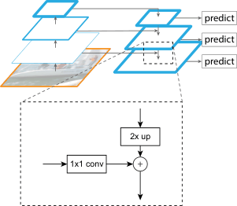</div>

<p align="center">横向连接投影当前层通道，上采样连接带来高层语义，再作逐元素相加。来源：<a href="https://arxiv.org/abs/1612.03144">FPN，图 3</a>。</p>

设骨干输出 $`C_2,C_3,C_4,C_5`$，空间尺寸逐级减半、语义逐渐增强。FPN 从高层开始上采样，与下一层经过 1×1 投影的横向特征相加，再用 3×3 卷积处理，得到 $`P_2,P_3,P_4,P_5`$。1×1 卷积主要用于通道对齐和变换，3×3 卷积帮助减轻上采样融合的混叠。

高层语义可以帮助浅层区分“像物体的边缘”与背景纹理，浅层空间细节有助于定位。多尺度预测不只是在多张大小不同的图上重复运行网络，FPN 大部分骨干计算只做一次。

在 RPN 中，不同金字塔层可产生不同尺度候选；在 RoI 检测头中，经典实现按框面积选择合适层采样。密集单阶段检测器则可在每层直接预测。它们利用同一金字塔思想，但样本分配与读取方式不同。

例如 16 像素宽的小物体，在步幅 4 的层上有较多空间采样，在步幅 32 的层上很难精确区分。较高分辨率层有利于定位，但如果原图早已被缩到目标仅剩几个模糊像素，再融合高层也无法补出真实纹理。

FPN 会增加横向卷积、上采样、融合和特征存储，并非“基本没有成本”。其收益取决于训练标签、预测层和目标尺度。若增加 P2 后误报大增，应检查背景纹理和正负分配，而不是只把它视为免费的小目标增强。

<h2 id="q-025">面试问题：什么是PANet（Path Aggregation Network），它如何增强特征融合？</h2>

<a id="8.什么是PANet（Path_Aggregation_Network），它如何增强特征融合？"></a>

**难度评分：⭐⭐⭐⭐ (4/5)  |  考察频率：⭐⭐⭐⭐ (4/5)**

PANet 在 FPN 的基础上增加自底向上的路径，使高分辨率层中的定位信息更快传到高层，同时改进 RoI 的多层特征利用。

<div align="center">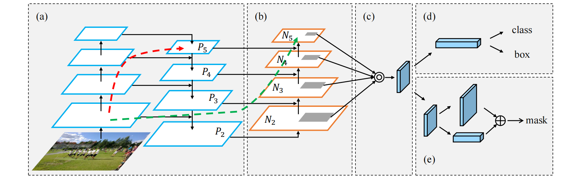</div>

<p align="center">PANet 的短路径让低层定位信息更快到达高层；图中的框分支与掩码分支属于完整实例分割框架。来源：<a href="https://arxiv.org/abs/1803.01534">PANet，图 1</a>。</p>

FPN 通过自顶向下上采样和横向连接，把深层语义注入浅层。PANet 再从低层金字塔特征开始，逐级用步幅为 2 的卷积下采样，并与对应层特征融合。这样定位信息不必重新走一遍完整骨干的漫长路径。

原始 PANet 还提出自适应特征池化：一个 RoI 可以从多个金字塔层提取并融合特征，而不是只按框面积硬选一层；此外还有用于实例分割的全连接融合设计。因此原论文中的 PANet 比许多 YOLO neck 中被称为“PAN”的双向路径更完整。

以一个面积较大但边界细节重要的目标为例，只取高层 RoI 可能缺少局部信息，融合其他层可补充不同粒度证据。但“多层融合”不代表所有尺度都一样有用，低层背景纹理也会进入计算，需要学习如何利用。

这些路径增加了卷积、特征图存储和带宽开销。它能够改善信息流动，不能凭空恢复输入缩放时丢失的像素，也不保证所有小目标都受益。

复现时应说明使用原始 PANet 的哪些部分，是否包含多层 RoI 池化和 mask 分支；比较 FPN、PAN、BiFPN 时，也应同时报告特征层数、通道宽度和真实延迟。

<h2 id="q-042">面试问题：原始 SPP 怎样把不同尺寸的区域变成固定长度表示？</h2>

<a id="2.sppspatial-pyramid-pooling的相关知识"></a>

**难度评分：⭐⭐⭐ (3/5)  |  考察频率：⭐⭐⭐⭐⭐ (5/5)**

原始 SPP（Spatial Pyramid Pooling）在特征图或候选区域内使用多级固定网格池化，把不同空间尺寸的输入转换为固定长度表示，以连接需要固定输入维度的分类层。

例如选取 1×1、2×2、4×4 三种网格，在每个格子中对每个通道池化。若输入有 $`C`$ 个通道，输出长度为：

```math
C(1^2+2^2+4^2)=21C
```

只有单通道时才是 21 个数。池化窗口随特征区域尺寸变化，以便始终得到这些固定数量的格子；这不同于在任意大小特征图上直接使用几个固定核后就自动得到固定长度。

SPPNet 可以共享整图卷积特征，再对候选区域做空间金字塔池化，减少早期 R-CNN 对每个区域重复卷积的开销。它也减轻了为了满足全连接输入而对区域做强行固定尺寸扭曲的问题。

但固定长度不代表全部空间细节都保留。格子内的最大或平均聚合会丢失精细位置信息，离散网格也会带来边界量化；批量训练、硬件和后续结构仍可能要求统一图像尺寸。

它与 RoI Pooling、RoIAlign 的共同点是区域到固定规格表示，区别在网格层级和采样方式。YOLO 中保持空间尺寸的 SPP/SPPF 另见[对应问题](#q-034)，不要把两种输出形态混为一谈。

<h2 id="q-004">面试问题：哪些方法可以提升小目标检测的效果？</h2>

<a id="4.哪些方法可以提升小目标检测的效果？"></a>

**难度评分：⭐⭐⭐⭐ (4/5)  |  考察频率：⭐⭐⭐⭐ (4/5)**

小目标检测首先受**可用像素和空间采样**限制。原图只有 4×4 像素的物体，插值放大无法恢复本来没有记录的纹理；原图清晰却在缩放到网络输入时变成 4×4，则可以通过改输入策略保住信息。这两种情况要先区分。

以 4096 像素宽的图像缩到 640 为例，原来 32 像素宽的目标只剩约 5 像素；如果主要检测特征步幅为 16，目标宽度还不到一个特征网格。它并非一定不可检，但定位容错已经很小，邻近目标也更容易混在一起。

可以按失效环节逐步处理：

- **采集与输入**：改善焦距、曝光和压缩质量；使用更高输入分辨率，或按重叠切片保留原生细节。切片还要补充全图上下文，并处理边缘截断与重复框。
- **特征与分配**：保留更高分辨率层、适配 FPN 和预测步幅，检查小框能否分到正样本。增加浅层分支会提高显存和计算量，也可能引入更多背景响应。
- **训练分布**：保证小目标标注质量与数量，设计合理的尺度增强、裁剪和粘贴。Mosaic 等增强如果继续把目标缩小到不可辨认，可能适得其反。
- **排序与后处理**：检查低分过滤和 NMS 是否误删真实小框，分别看分类、定位与重复误检，避免通过无限降阈值换取表面召回。

Anchor 聚类只对相应参数化有意义，不能作为所有模型的通用解法。超分辨率也可能制造纹理，需要检查它是否真的改善独立检测评价，而非仅让图像看起来更锐。

验收时应按目标在实际输入中的像素尺寸、遮挡、密度和场景切分，同时看 AP、召回、误检与延迟。COCO 的 small 定义基于标注面积区间，与业务中“远处的人”并不天然一致。具体切片流程见[SAHI](#q-031)，不要用整体 AP 掩盖最小一档目标的退化。

<h2 id="q-031">面试问题：什么是SAHI（Slicing Aided Hyper Inference），它是如何解决高分辨率小目标检测难题的？</h2>

<a id="14.什么是SAHI（Slicing Aided Hyper Inference），它是如何解决高分辨率小目标检测难题的？"></a>

**难度评分：⭐⭐⭐⭐ (4/5)  |  考察频率：⭐⭐⭐⭐ (4/5)**

SAHI（Slicing Aided Hyper Inference）通过重叠切片减少高分辨率图像缩放时的小目标信息损失。它是一种推理与配套训练策略框架，不是替代检测骨干的新网络。

例如一张 4000×3000 图像中的车辆宽 30 像素，整图缩到约 640 宽时只剩约 4.8 像素；若取 640×640 原分辨率切片输入，车辆仍接近 30 像素。收益来自保留已有细节，并非插值创造了新视觉信息。

流程包括：按设定重叠率切片，对每片检测，将框从切片坐标回投原图，最后融合重叠区域的结果。必要时增加全图预测，以照顾被切断的大目标和整体上下文。合并可以用 NMS、非极大合并等策略，具体实现也可能采用 IoU 或交小比，不能统一写成只做 NMS。

若切片宽为 $`L`$、水平重叠率为 $`r`$，常见水平移动步长约为 $`L(1-r)`$。重叠增大能减少边缘漏检，但也增加片数、重复候选和计算。边缘片尺寸、padding、框截断和全图框与局部框融合，都需要可复现规则。

切片还会改变模型看到的物体尺度和上下文。如果训练时一直看全图，测试时突然给极近裁剪，可能带来分布偏移；可以配合切片微调，但要保留不同尺度和完整目标样本。

推理成本随切片数增长，却未必严格线性：batch、并发、内存、数据传输和后处理都会影响。测试要同时报告小目标召回、切片边界错误、大目标性能和完整图像耗时，而不是只展示“框更多”的前后截图。

<h2 id="q-019">面试问题：目标检测中常用的多尺度训练（Multi-scale Training）策略是什么？</h2>

<a id="2.目标检测中常用的多尺度训练（Multi-scale_Training）策略是什么？"></a>

**难度评分：⭐⭐⭐ (3/5)  |  考察频率：⭐⭐⭐⭐⭐ (5/5)**

多尺度训练让模型在训练期间接触不同输入分辨率与目标像素尺寸，减少对固定尺度的依赖。它改变训练分布，不等于推理时必须跑多遍图像。

常见做法是按批次或若干步随机选一个输入尺度，再保持长宽比缩放并按要求补边。图像、框、mask 和关键点必须共享变换；标注坐标、padding mask 及有效区域也要同步更新。网络通常还要求尺寸能被最大步幅整除。

例如同一辆车在 640 输入中宽 40 像素，在 960 输入中约宽 60 像素，模型获得不同采样密度下的监督。若缩到只剩 2 像素，类别细节可能已经消失，保留错误或极小标注会引入难以学习的样本。

多尺度训练、图像金字塔推理、FPN 和裁剪缩放是不同机制。FPN 在一次前向中输出多个特征尺度；多尺度训练在不同迭代改变输入；图像金字塔 TTA 则在测试时多次运行网络。随机裁剪还改变视野与目标截断，不能只按缩放理解。

范围越大不一定越好。大输入增加显存与计算，导致有效 batch 波动；尺度变化还会影响 BN 统计、正样本数量和不同层的负载。训练尺度应覆盖实际部署，并以目标像素分布为依据。

最终应在固定部署输入下评价收益，再根据需要另报多尺度推理结果。若只拿训练时大分辨率、测试时 TTA 的结果与单尺度基线比较，就无法判断提升到底来自哪里。

<h2 id="q-018">面试问题：目标检测中的Test Time Augmentation(TTA)是什么？</h2>

<a id="1.目标检测中的Test_Time_Augmentation(TTA)是什么？"></a>

**难度评分：⭐⭐⭐ (3/5)  |  考察频率：⭐⭐⭐⭐ (4/5)**

测试时增强（TTA）对同一图像做多个可恢复几何关系的变换，分别检测，再将输出映射回原坐标系并融合。它利用不同视图下的预测互补性，换取额外计算。

例如原图宽度为 $`W`$，连续坐标水平翻转后预测框为 $`(x'_1,y'_1,x'_2,y'_2)`$，回原图时横坐标为 $`(W-x'_2,W-x'_1)`$。缩放要除以比例，letterbox 还要先减去补边；这些步骤的顺序不能混淆。旋转后的水平框可能对应多边形，直接取外接框又会改变定位误差。

融合可采用 NMS、Soft-NMS 或 WBF：前两者主要选取或降权候选，WBF 在认为同属一个目标的框簇内平均坐标。分类 TTA 只平均类别概率的图示，不能直接代替检测 TTA 的坐标逆变换。

小目标可能在放大视图下更易发现，大目标和全局关系可能在较小尺度更稳定，但镜像未必符合所有业务语义。例如标志方向、文字朝向和左右部件有实际意义，增强后类别是否仍不变需要核对。

总成本通常接近多次前向加融合，但批处理、缓存和不同视图大小会影响实际延迟，不能机械认为 N 个视图就恰好 N 倍。离线自动标注可以接受较重 TTA，实时报警则应衡量收益是否超过延迟预算。

TTA 不更新模型参数，与测试时适应 TTA（Test-Time Adaptation）的同缩写含义不同。报告中应写清采用哪一种，以及增强列表、融合方式和完整推理耗时。

<h2 id="q-023">面试问题：介绍一下WBF？</h2>

<a id="6.介绍一下WBF？"></a>

**难度评分：⭐⭐⭐⭐ (4/5)  |  考察频率：⭐⭐⭐⭐ (4/5)**

WBF（Weighted Boxes Fusion）用于融合多个来源对同一目标的框预测。先按类别与几何相似度分簇，再在簇内根据置信度和模型权重平均坐标。

若簇中第 $`i`$ 个框为 $`b_i`$，检测分数为 $`s_i`$，其模型权重为 $`w_i`$，常见坐标融合为：

```math
\bar b=\frac{\sum_i w_is_i b_i}{\sum_i w_is_i}
```

两个来源分别预测左边界 10 和 14，权重相同、分数分别为 0.9 与 0.6，则融合左边界是 11.6。它可能比任选一个框更稳，但如果两框对应相邻的不同目标，平均会制造一个不存在的中间框。

因此先要把所有预测还原到同一坐标系，统一类别映射，并校准不同模型的分数尺度。聚类过程中代表框会更新，匹配阈值、顺序和一模型多框的处理都会影响结果。

融合后的**分数**是另一项规则，不能把“取簇内最大值”当成标准 WBF 定义。不同实现可根据参与模型数、缺席模型、模型权重和重复框惩罚重新计算置信度，必须与具体评测配置一致。

WBF 适合多模型或多视图结果互补、定位误差相对独立的情况。若所有模型共用同一偏差，平均并不会消除偏差；弱模型高分误检还可能拉偏结果。它也无法找到所有来源都漏掉的目标。

与 NMS 的核心区别是输出坐标可能被重新组合，而不是仅保留原候选。代价包括额外模型/TTA 和融合计算，部署时应把全链路成本一起计入。

<h2 id="q-028">面试问题：旋转目标检测（Oriented BBox，OBB）为何重要？</h2>

<a id="11.旋转目标检测（Oriented_BBox，OBB）为何重要？"></a>

**难度评分：⭐⭐⭐⭐ (4/5)  |  考察频率：⭐⭐⭐⭐ (4/5)**

旋转框用朝向描述细长或倾斜目标，可减少水平外接框中的多余背景和相邻实例重叠。在遥感船只、货架零件和倾斜文字中，这往往比只追求更高类别分数更有价值。

常见表示为 $`(x,y,w,h,\theta)`$，也可直接表示四个有序顶点。五参数紧凑，但同一矩形可能由 $`(w,h,\theta)`$ 与 $`(h,w,\theta+\pi/2)`$ 表示，角度还具有周期性。接近角度区间边界时，几何上很接近的框可能具有很大的数值角度差。

因此应固定长边/短边约定、角度范围、顺逆时针方向与图像坐标轴，并让标注、损失、增强、NMS 和评估使用同一标准。仅强制 $`w\geq h`$ 不能消除所有问题，近正方形目标的朝向本身也可能不稳定。

处理方法包括周期性角度编码、循环平滑分类标签、旋转 IoU 损失，或将框映射为高斯分布后比较 Wasserstein 距离、KL 散度。分布度量有助于缓解参数边界突变，但并不等于精确旋转 IoU，仍需按任务验收。

比如两艘相邻斜船，水平外接框可能高度重叠，NMS 容易误删；旋转框更贴合轮廓，可以减少这种混淆。但细长目标的旋转 IoU 对角度误差非常敏感，小角度偏差也可能显著降低匹配质量，这属于旋转定位本身的挑战。

模型可采用旋转 anchor、点距离+角度、可变形点集或旋转 RoI 对齐。四点表示还需保证点序、凸性及非自交；真正的透视四边形与严格矩形也不同。曲线文字不宜强塞成一个旋转矩形，必要时应使用多边形或分割。

评价需注明数据集版本、困难区域、切片回投和旋转匹配算子。旋转等变特征与旋转不变描述也不能混淆：前者随输入旋转按规则变化，后者希望输出不随旋转变化，定位往往需要保留方向信息。

<h2 id="q-054">面试问题：RoI Pooling 如何提取固定尺寸特征，量化误差来自哪里？</h2>

<a id="3.请介绍ROIPooling？"></a>

**难度评分：⭐⭐⭐ (3/5)  |  考察频率：⭐⭐⭐⭐⭐ (5/5)**

RoI Pooling 将共享特征图上大小不一的候选区域，转换成固定的 $`H_o\times W_o`$ 特征。Fast R-CNN 因而可以对整图只计算一次卷积，再把不同候选交给同一个分类与框回归头。

过程是先把原图候选框按特征步长映射到特征图，量化其边界，再将区域划为 $`H_o\times W_o`$ 个 bin，最后在每个 bin 内按通道做最大池化。通道数保持为 $`C`$，输出形状为 $`C\times H_o\times W_o`$；它没有把所有候选框直接缩放成同一张输入图像。

例如原图边界 $`x=37`$，特征步长为 16，对应特征坐标 $`2.3125`$。如果先取整成 2，几何位置已经发生偏移；将区域再切成若干 bin 时，bin 边界也可能需要取整。**候选坐标量化与分箱量化是两处不同的误差来源**。具体取整细节依实现，但误差会随着粗特征步长映射回原图。

这种误差对大目标分类可能影响有限，对小目标、关键点和实例掩码却更敏感：一个特征像素可能对应原图十几像素，而边界任务恰恰需要分清这些位置。增加输出 bin 数只改变最终特征尺寸，不会自动恢复此前丢失的分数坐标。

最大池化能把梯度传回被选中的特征值，但离散取整与 argmax 使它不能被理解为对任意候选坐标都平滑可导。这里“共享计算”与“准确几何对齐”是不同目标，RoIAlign 进一步处理的是后一个问题。

与原始 SPP 相比，两者都有分箱池化的思想；RoI Pooling 将这种区域到固定网格的变换接入检测网络，使每个 proposal 都能得到固定尺寸特征。不要把它的提出归给后来的 Mask R-CNN。

<h2 id="q-055">面试问题：RoIAlign 怎样用双线性采样改善空间对齐？</h2>

<a id="4.请介绍ROIAlign？"></a>

**难度评分：⭐⭐⭐ (3/5)  |  考察频率：⭐⭐⭐⭐⭐ (5/5)**

RoIAlign 保留候选区域和采样点的浮点坐标，用双线性插值读取特征，减少 RoI Pooling 的取整偏移。Mask R-CNN 引入它，是因为掩码预测对“这个特征究竟对应哪里”尤其敏感。

将 RoI 映射到特征图后，按连续坐标划成固定数量的 bin。在每个 bin 内选择若干采样点，利用附近四个整数位置插值，再按实现对采样值求平均或最大值，形成该 bin 的输出。输出仍是固定的 $`C\times H_o\times W_o`$ 特征。

设采样点为 $`(x,y)=(x_0+\alpha,y_0+\beta)`$，其中 $`x_0,y_0`$ 是向下取整后的坐标，$`\alpha,\beta\in[0,1)`$，则：

```math
\begin{aligned}
F(x,y)={}&(1-\alpha)(1-\beta)F_{00}\\
&+\alpha(1-\beta)F_{10}\\
&+(1-\alpha)\beta F_{01}+\alpha\beta F_{11}
\end{aligned}
```

$`F_{ab}=F(x_0+a,y_0+b)`$。例如四角值为 0、10、20、30，在 $`\alpha=0.25,\beta=0.5`$ 处，插值得到 12.5；直接取整读取左上角则得到 0。前者保留了采样点与周围网格的相对位置。

“不取整”不等于没有坐标约定。像素中心位于整数还是半整数、`aligned` 参数是否施加半像素偏移、`spatial_scale` 和采样密度，都必须与训练实现一致。导出到其他框架后，即使张量形状完全相同，也可能因这些细节造成稳定偏移。

RoIAlign 改善的是特征读取的几何一致性，不能补回骨干下采样已经丢失的图像细节，也不能保证错误 proposal 内能读到完整目标。梯度通常可通过插值回到特征；具体算子是否支持对 RoI 坐标求梯度，需要查实现，不能仅凭数学表达就假设部署库提供了该能力。

<h1 id="q-104">4. 经典检测器与实时架构</h1>

<h2 id="q-061">面试问题：在 Faster R-CNN 中，Region Proposal Network (RPN) 的作用是什么？它如何实现端到端训练？</h2>

<a id="10.在 Faster R-CNN 中，Region Proposal Network (RPN) 的作用是什么？它如何实现端到端训练？"></a>

**难度评分：⭐⭐⭐ (3/5)  |  考察频率：⭐⭐⭐⭐⭐ (5/5)**

RPN（Region Proposal Network）利用共享卷积特征，为两阶段检测器生成类无关的候选框。它回答“哪里可能有目标”，后续 RoI 头再细分目标类别并精修位置。

RPN 在特征图上滑动小网络，对各位置的多个 anchor 预测 objectness 和框偏移。训练按 anchor 与真值的重叠关系构造正负样本，用分类损失学习前景/背景，用回归损失学习候选几何；推理通过解码、过滤与 NMS，保留有限数量 proposal。

随后从同一张共享特征图读取 proposal 内的 RoI 特征，输入第二阶段分类与回归头。共享骨干避免为每个候选重新做一次完整卷积，是 Faster R-CNN 相对外部 proposal 流程的重要效率来源。

训练可以写成多个目标的组合：

```math
\begin{aligned}
\mathcal L={}&\mathcal L_{\mathrm{RPN,cls}}
+\lambda_1\mathcal L_{\mathrm{RPN,box}}\\
&+\lambda_2\mathcal L_{\mathrm{RoI,cls}}
+\lambda_3\mathcal L_{\mathrm{RoI,box}}
\end{aligned}
```

权重与归一化由实现确定。共享骨干可同时受到两阶段的监督，但不能由这个式子推断所有中间步骤都可微。候选筛选、NMS 和部分区域坐标处理包含离散操作；原论文讨论了交替训练、近似联合训练及更完整的联合训练，常见近似方案忽略检测损失对 proposal 坐标的那部分梯度。

例如 RPN 漏掉一辆很小的车，第二阶段再强也通常无法对这个未被覆盖的区域作有效预测；RPN 候选过多又会增加 RoI 成本。因此要分别看 proposal recall、候选数和最终 AP，定位瓶颈发生在哪一阶段。

RPN 的 objectness 也受训练类别和数据分布约束。称它“类无关”，是指输出没有为每个已知类别设置独立语义判断，不意味着它对世界上任意未知物体都具有可靠召回。

<h2 id="q-026">面试问题：什么是Cascade R-CNN，它解决了什么问题？</h2>

<a id="9.什么是Cascade_R-CNN，它解决了什么问题？"></a>

**难度评分：⭐⭐⭐⭐ (4/5)  |  考察频率：⭐⭐⭐⭐ (4/5)**

Cascade R-CNN 针对高质量定位中的一个训练矛盾：提高正样本 IoU 门限有助于训练更严格的检测头，但原始候选中满足高门限的样本可能很少，而且训练与推理的候选质量分布未必一致。

<div align="center">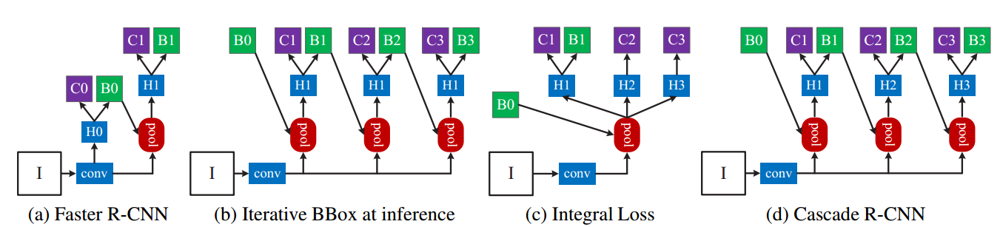</div>

<p align="center">右侧级联逐阶段使用修正后的框读取区域特征；B 为框输出，C 为分类输出，H 为检测头。来源：<a href="https://arxiv.org/abs/1712.00726">Cascade R-CNN，图 3</a>。</p>

它串联多个检测阶段，每个阶段接收前一阶段修正后的框，并采用逐渐提高的正样本门限，例如 0.5、0.6、0.7。框经过前面的回归后更接近真值，后面的高标准检测头才更容易获得足够正样本。

假设初始 proposal 的 IoU 为 0.55，在第一阶段可以作为正样本，回归后提升到 0.65，第二阶段又有机会继续修正。若直接用 0.7 训练单阶段头，这个候选一开始可能被当成负样本，无法形成同样的监督链。

级联不仅在测试时对同一个回归器重复调用；各阶段的样本分布和训练门限都经过设计。高门限也不能无限增大，标注本身的边界误差、遮挡规则和框参数化会限制可达到的 IoU。

推理通常还涉及各阶段框精修及分数融合，具体输出规则应按实现核对。更多阶段增加 RoI 计算和延迟，因此应观察 AP75 等定位较严格指标的收益，而非假设三阶段在任何任务都优于一阶段。

这类设计的可迁移价值，是让后续模块面对逐步改善的数据分布，并按相应质量水平训练。若前面阶段就漏掉目标，后续精修也无法凭空找回。

<h2 id="q-058">面试问题：介绍一下SSD算法？</h2>

<a id="7.介绍一下SSD算法？"></a>

**难度评分：⭐⭐⭐ (3/5)  |  考察频率：⭐⭐⭐⭐⭐ (5/5)**

SSD（Single Shot MultiBox Detector）在多层特征图上直接预测类别和框偏移，通过不同分辨率的特征层覆盖不同尺度目标。它把候选生成与最终预测合在一次前向中，是经典单阶段检测器。

每个特征位置放置若干不同尺度、宽高比的 default boxes，可将其理解为 anchor。预测头为每个 default box 输出类别分数和相对几何偏移；高分辨率层提供较密的位置采样，低分辨率层通过较大感受野处理大目标。

训练时，首先保证每个真值有匹配的 default box，再将满足 IoU 条件的其他候选分为正样本。定位损失只作用于正样本，分类损失同时使用正样本和挑选出的负样本。原始 SSD 用 hard negative mining 控制背景数量，通常将负正样本比例上限设为 3:1，避免易背景淹没训练信号。

框回归预测的是相对于 default box 的中心位移与对数宽高变化，再结合预设尺度因子解码。推理得到密集候选后，还要做分数筛选和 NMS；“一次预测”不等于不需要后处理。

SSD 与 FPN 不能简单画等号。原始 SSD 在多个不同深度的特征层上分别预测，没有 FPN 那套自顶向下与横向融合路径。较浅层虽然分辨率高，但语义不足，这也是其小目标能力受到限制的原因之一。原实现还对早期特征采用归一化等处理，以控制不同层特征尺度。

例如同一张街景里，近处车辆可由粗层负责，远处行人依赖细层；如果细层语义弱、default box 形状不合适或输入缩放损失细节，单纯增加候选数未必提高召回。SSD 留下的核心设计问题仍然有效：每种尺度从哪层读取信息、谁负责匹配、如何让分类与定位共同收敛。

<h2 id="q-060">面试问题：RetinaNet 如何用 FPN 与 Focal Loss 改善密集检测？</h2>

<a id="9.请简述RetinaNet的主要思想，它是如何有效结合One-stage速度和Two-stage精度优势的？"></a>

**难度评分：⭐⭐⭐ (3/5)  |  考察频率：⭐⭐⭐⭐⭐ (5/5)**

RetinaNet 的关键贡献是说明：单阶段密集检测器如果妥善处理大量易背景的训练影响，也能取得很强的检测精度。它采用骨干加 FPN，再接分类与框回归两个子网络，核心训练变化是 Focal Loss。

FPN 为多个尺度提供较强语义，每层每个位置设置若干 anchor。分类子网络预测每个 anchor 的类别，回归子网络预测框偏移，两个子网络分别建模任务。原方法的头部参数在不同金字塔层之间共享，但分类头与回归头不是同一组参数。

密集布局意味着一张图有很多背景 anchor。即使单个易背景损失很小，它们的总和仍可能主导更新。Focal Loss 使用 $`(1-p_t)^\gamma`$ 压低已被正确分类的样本贡献，让有限梯度预算更多用于尚未学好的正负样本；$`\alpha_t`$ 则用于类别平衡。它没有直接改变目标的几何位置，也没有保证难样本都是真实、干净的监督。

例如背景的正确分类概率已达 0.99，$`\gamma=2`$ 时调制系数为 0.0001；一个正确类别概率为 0.2 的样本，系数为 0.64。两者都受到不大于 1 的调制，只是易样本被压得更多，不能表述成“所有困难样本损失都会比交叉熵放大”。

RetinaNet 仍要做匹配、框回归、阈值筛选和 NMS。论文在当时的基准与计算预算下缩小了单阶段和两阶段的精度差距；“兼有最快速度和最高精度”不是架构的无条件性质。输入尺寸、骨干和硬件变化后，应重新测精度—延迟曲线。

对今天的工程，最有用的启示是先检查训练样本和梯度如何分配，再决定是否增加模型容量。若数据存在大量漏标，Focal Loss 可能持续强调那些被错误标为背景的真实目标，需要先处理标注问题。

<h2 id="q-059">面试问题：介绍一下FCOS及其核心思想？</h2>

<a id="8.介绍一下FCOS及其核心思想？"></a>

**难度评分：⭐⭐⭐ (3/5)  |  考察频率：⭐⭐⭐⭐⭐ (5/5)**

FCOS 将特征图的每个有效位置看作候选点，直接回归该点到目标框四条边的距离。它不需要预设多种矩形 anchor，但仍需要定义哪些点负责哪个目标。

<div align="center">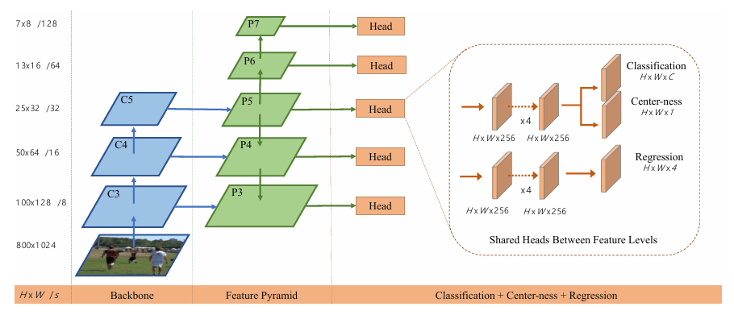</div>

<p align="center">图中是原始结构的分支安排；不同改进配置可调整 centerness 的连接位置。来源：<a href="https://arxiv.org/abs/1904.01355">FCOS，图 2</a>。</p>

对特征点 $`(x,y)`$ 与真值框 $`(x_0,y_0,x_1,y_1)`$，回归目标为：

```math
l=x-x_0,\quad t=y-y_0,\quad r=x_1-x,\quad b=y_1-y
```

点位于框内时，四个距离非负。多尺度层会限制 $`\max(l,t,r,b)`$ 的范围，将合适的回归距离分给相应层；它不完全等价于按一个固定的全局目标面积分层。若同一位置仍落在多个有效框内，原方法倾向选择面积较小的目标，减少大框吞掉小框监督的问题。

除了类别和距离，FCOS 还预测 centerness，其训练目标为：

```math
c^*=
\sqrt{
\frac{\min(l,r)}{\max(l,r)}
\frac{\min(t,b)}{\max(t,b)}
}
```

越靠近框中心，左右与上下距离越平衡，值越高；靠近边缘的点值较低。例如 $`l=r,t=b`$ 时为 1。推理将它与类别分数结合，降低偏远位置产生低质量框的影响，再进行候选筛选和 NMS。

centerness 是根据点在真值框中的相对位置构造的质量代理。它不是预测框与真值框 IoU 的精确概率，更不等于校准后的置信区间。位于中心的点仍可能回归错误，严重遮挡时中心附近也可能没有充足证据。

后续 FCOS 配置可加入中心采样、不同归一化和分支安排，因此复现要区分原方法与改进训练配方。它说明去掉 anchor 模板后，尺度分工、重叠消歧和质量排序仍然是检测器的核心问题。

<h2 id="q-056">面试问题：介绍一下CenterNet的原理，它与传统的目标检测有什么不同点？</h2>

<a id="5.介绍一下CenterNet的原理，它与传统的目标检测有什么不同点？"></a>

**难度评分：⭐⭐⭐ (3/5)  |  考察频率：⭐⭐⭐⭐⭐ (5/5)**

这里的 CenterNet 指 **Objects as Points** 路线：将目标表示为中心点，并在该位置预测宽高与局部偏移。另有同名的关键点三元组工作，讨论前应先明确是哪一篇。

网络输出三类量：按类别组织的中心热力图、目标宽高图，以及补偿下采样量化误差的中心偏移图。热力图上的局部峰值提供候选中心，宽高决定框的范围，偏移把整数网格上的中心修正到更精确的位置。

设输出步长为 $`s`$，热力图峰值坐标为 $`(u,v)`$，预测偏移为 $`(\delta_x,\delta_y)`$，宽高 $`w,h`$ 已按实现解码到原图单位，则：

```math
x_c=s(u+\delta_x),\qquad y_c=s(v+\delta_y)
```

```math
b=(x_c-w/2,\ y_c-h/2,\ x_c+w/2,\ y_c+h/2)
```

实现也可在特征图尺度回归宽高，再统一乘步长；关键是所有量使用同一坐标约定。原图中心在 50.7 像素、步长为 4 时，映射为 12.675，整数位置是 12，偏移监督就是 0.675。

它避免为每个位置设置多组矩形 anchor，也不必为所有位置回归所有目标。常用推理通过局部最大值筛选和 top-k 选峰，再解码目标；通常无需传统框级 NMS，但局部峰值抑制本身仍是后处理。

限制来自中心表示的容量与特征分辨率。两个同类目标中心落到同一输出单元时，同一通道同一位置很难表达两个独立实例；严重遮挡下中心可能缺乏明显局部证据，需要更大感受野。它的优势应结合热力图峰值质量、拥挤程度和输入分辨率判断，不能从“无 anchor”推出对小目标天然更好。

<h2 id="q-057">面试问题：CenterNet中heatmap（热力图）如何生成？</h2>

<a id="6.CenterNet中heatmap（热力图）如何生成？"></a>

**难度评分：⭐⭐⭐ (3/5)  |  考察频率：⭐⭐⭐⭐⭐ (5/5)**

CenterNet 的中心热力图为每个类别设置一个通道。真值中心映射到输出网格后，在整数中心位置画一个峰值为 1 的二维高斯，邻近位置的数值随距离下降。

若目标中心映射为 $`(\tilde x,\tilde y)`$，整数中心为 $`(\lfloor\tilde x\rfloor,\lfloor\tilde y\rfloor)`$，则该中心上的目标值严格为 1。高斯半径根据目标在输出尺度上的宽高与规定的最小重叠要求计算，通常大目标允许更宽的邻域。多个同类目标的高斯相遇时逐点取最大值，避免把数值相加到大于 1。

训练中的一个关键区别是：**高斯邻域一般不被当成普通 BCE 中的软正标签**。原实现的修改版 focal loss 将目标值等于 1 的中心视为正位置；其他位置仍按负项处理，只是用 $`(1-Y)^\beta`$ 减轻靠近中心处的惩罚：

```math
\ell(p,Y)=
\begin{cases}
-(1-p)^\alpha\log p,&Y=1,\\
-(1-Y)^\beta p^\alpha\log(1-p),&Y\lt1.
\end{cases}
```

$`p`$ 是预测概率，$`Y`$ 是高斯目标值。原方法常用 $`\alpha=2,\beta=4`$，再按目标数等规则归一化。若邻点 $`Y=0.8`$，负项的空间权重为 $`0.2^4=0.0016`$；这样中心附近的少量偏移不会像远处假峰值一样被严厉惩罚。

中心的小数部分单独监督 offset，宽高通常也只在有效中心位置回归。高斯图解决的是“如何安排中心附近的训练惩罚”，offset 解决的是“如何补偿网格量化”，两者不能互相替代。

实际实现要检查缩放、裁剪、翻转后中心与宽高同步变换，边缘高斯的裁切，以及同一位置冲突。增大高斯半径并不能让同一单元凭空容纳两个同类目标，反而可能让邻近峰更难区分。

<h2 id="q-052">面试问题：轻量人脸检测应怎样选型，单一类别为什么仍可能很难？</h2>

<a id="1.有哪些经典的轻量型人脸检测模型？"></a>

**难度评分：⭐⭐⭐ (3/5)  |  考察频率：⭐⭐⭐⭐ (4/5)**

轻量人脸检测的任务是尽可能便宜地找出人脸位置；是否认识这个人、是不是活体，属于后续模块。单类别只减少了类别判别负担，并没有消除尺度、姿态、遮挡和低照度带来的困难。

门禁近距离正脸与远处人群中的十几像素小脸，需要的网络能力很不一样。前者可能用低分辨率输入和紧凑骨干就能满足要求；后者更依赖细尺度特征、足够输入像素、困难样本和密集场景的去重策略。把所有照片缩到同一小尺寸，远处人脸甚至没有足够纹理可供模型判断。

选型可以按四步推进：

1. **定义输入分布**：最小人脸尺寸、姿态范围、遮挡、模糊、摄像头和压缩质量。若后续要对齐，还要明确是否输出五点关键点。
2. **确定实际设备预算**：在目标 CPU、GPU 或 NPU 上测预处理、模型、解码和 NMS 的总延迟，连续运行时记录温升与内存，避免只比较桌面 GPU 的 FPS。
3. **选择可部署的候选**：LFFD 展示了普通卷积与多分支尺度覆盖的路线；轻量 RetinaFace、SCRFD 等可作为包含关键点或更强调训练配置的候选。名称只是起点，最终依赖具体版本、模型规模和后端支持。
4. **在工作点上比较**：固定可接受的误检率，再看小脸、侧脸、遮挡子集的召回；同时检查关键点误差和后续识别质量。

例如将输入从 640 缩到 320，卷积计算量可能明显下降，但原来宽 16 像素的人脸只剩 8 像素。此时继续换损失函数，未必比保留合理分辨率有效。也可以用低频全图发现和局部跟踪降低平均成本，但必须承担跟踪漂移、重新检测与漏检恢复的系统工作。

不能把“人脸只有一类”推导为“越小的模型越好”。小模型是否适合，要看它在业务允许的误报成本下保留了多少有效人脸，以及后续模块能否使用这些框。

<h2 id="q-053">面试问题：LFFD人脸检测模型的结构和特点？</h2>

<a id="2.lffd人脸检测模型的结构和特点？"></a>

**难度评分：⭐⭐⭐⭐ (4/5)  |  考察频率：⭐⭐⭐ (3/5)**

LFFD（A Light and Fast Face Detector）用**特征图位置的感受野作为自然的尺度参照**，在多个分支上预测人脸/背景和边界框。它希望减少复杂算子与手工 anchor 模板，使普通设备也能运行。

原论文设计了八个检测分支，分支接在不同深度，其步长、感受野和负责的人脸尺寸范围不同。较浅分支保留密集空间采样，照顾小脸；较深分支用更大感受野覆盖大脸。每个位置对应原图中的感受野中心，在指定尺度范围内，中心落在人脸框内部的有效位置可获得正样本监督，再回归到该人脸框的边界。

这里的“自然 anchor”不等于预设多组宽高比的矩形模板。模型仍有位置、步长、尺度区间和匹配规则这些先验，所谓 anchor-free 也没有免除样本分配。分类分支判断当前位置是否覆盖有效人脸，回归分支输出相对几何量，两者共同形成检测结果。

假设某层步长为 8 像素，一张足够宽的人脸通常会覆盖至少一个采样中心；但仅凭这一几何条件，不能保证模型一定识别出来。训练不足、脸部模糊、超出负责尺度、边界裁切或置信度被压低，都可能造成漏检。论文中针对一定最小尺寸讨论的覆盖条件，不能转述为真实场景的“百分之百召回”。

结构上，它以普通卷积、ReLU 和残差连接为主，避免对复杂算子的强依赖。这样的算子组合可能比同 FLOPs、但频繁跨设备或使用后端不支持算子的网络更快。实际速度仍取决于内核实现、线程数、输入尺寸和 NMS 候选数，不能给“去掉 BN”套上一个跨设备恒定的提速比例。

LFFD 的价值在于把尺度覆盖、采样密度和部署算子一起设计。今天选择人脸检测器时仍可沿这条思路检查，但需要与当前数据和硬件上的强基线比较，历史论文中的速度排名不会自动延续。

<h2 id="q-032">面试问题：如何沿任务设计理解 YOLO 的演进，而不是背版本组件表？</h2>

<a id="1.yolo系列的面试问题"></a>

**难度评分：⭐⭐⭐ (3/5)  |  考察频率：⭐⭐⭐⭐ (4/5)**

理解 YOLO，最有效的主线是沿着**框如何表示、监督如何分配、特征如何融合、重复预测如何消除、部署成本如何控制**追问。版本号背后包含不同团队与分支，不能把它们视为同一个实现的连续升级。

早期 YOLO 用单网络直接完成类别和位置预测，强调规整的单次前向。YOLOv2 引入尺寸聚类、多尺度训练等设计，YOLOv3 使用多尺度预测；之后不同路线继续改造骨干、neck、训练增强和标签分配。到 YOLOX 等设计，解耦头、无预设框形状和动态分配成为重要讨论点；YOLOv9 重点处理训练信息路径，YOLOv10 探索一对一分支的无 NMS 推理。

拿到一个具体实现，可以顺着张量走一遍：输入缩放到什么尺度，P3/P4/P5 的步幅和通道是什么，预测头输出类别、objectness、框偏移还是距离分布，正样本怎样选，推理怎样解码和筛框。这些问题比背一句“某版增加注意力”更能检验理解。

例如从有 objectness 的头迁移到另一种质量感知分类头，旧的 `score=objectness×class_prob` 解码公式不一定还能直接使用。训练时换成一对一分配，也不意味着可以无条件复用旧的一对多后处理。

模型比较必须记录仓库、版本、权重、数据、输入、精度类型和完整延迟。不同团队使用相同 YOLO 名称，不保证相同训练协议；更大的模型、更长训练或更高输入都可能解释分数变化。

可结合 [YOLOv1—v7 系列解析](https://mp.weixin.qq.com/s?__biz=Mzg4NDYwOTUwNA==&mid=2247486017&idx=1&sn=ff028fa235f384fe74576ef346849600)了解早期设计，但对当前项目应回到所用配置与代码。长期需要掌握的是检测问题怎样拆解，以及改动在哪一环真正产生收益。

<h2 id="q-033">面试问题：介绍下YOLOv5中的CSP结构？</h2>

<a id="2.介绍下YOLOv5中的CSP结构？"></a>

**难度评分：⭐⭐⭐ (3/5)  |  考察频率：⭐⭐⭐⭐⭐ (5/5)**

CSP（Cross Stage Partial）通过跨阶段的分路与融合，减少重复计算并改善特征和梯度路径。核心是让一部分特征经过较深变换，另一部分走较短路径，最后沿通道维组合，再进行融合。

需要区分概念示意与 YOLOv5 的具体实现。BottleneckCSP 和 C3 常将同一输入送入不同的 1×1 投影，其中一路经过若干 bottleneck，另一路较短，再拼接。它们不一定是直接把原始张量机械地切成两半，也不要求两条分支都堆相同数量的残差块。

设两路输出均为 $`B\times C'\times H\times W`$，通道拼接后是 $`B\times2C'\times H\times W`$，最后用卷积映射到目标通道。拼接与残差相加不同：相加要求对应元素形状相同，拼接保留两组通道供后续学习融合。

设计收益来自只对部分中间特征使用较重变换，并让不同路径的信息共同参与输出。是否真正减少计算取决于隐藏通道数、重复次数和投影层开销，不能只看到“分两路”就推断一定更轻。

YOLOv5 不同版本使用的模块和激活有变化，例如较新配置常见 C3、SiLU。不能一边贴 `SiLU` 代码，一边把对应节点解释成 Leaky ReLU，也不能将阶段下采样说成每个 CSP 块必有的组成。

部署时还需考虑 concat 的内存访问与后端融合能力。结构选择应结合实际张量尺寸和设备延迟；CSP 的知识价值是计算路径分配，具体模块名只是其中一种实现。

<h2 id="q-034">面试问题：YOLO 中的 SPP/SPPF 与原始 SPPNet 有什么区别？</h2>

<a id="3.介绍下YOLOv5中的SPP结构?"></a>

**难度评分：⭐⭐⭐ (3/5)  |  考察频率：⭐⭐⭐⭐⭐ (5/5)**

原始 SPPNet 把空间划分成固定数量的网格，输出固定长度向量；YOLO 中常见的 SPP/SPPF 则主要在**保持特征图空间尺寸**的同时聚合不同感受野。两者共享多尺度池化思想，输出目的不同。

YOLO 的 SPP 模块通常先调整通道，对同一特征分别做步幅为 1、带适当 padding 的多种核尺寸最大池化，例如 5、9、13；再将原特征与池化结果沿通道拼接并融合。输出仍是空间特征图，供后续密集检测使用，而不是把任意图片变成 21 维向量。

SPPF 将多个池化改为串行：连续使用三个 5×5、stride=1 的最大池化，再拼接原始特征及三个中间结果。其有效窗口逐步扩大，对应 5、9、13 的范围；在相应 padding 和最大池化规则下可实现与并行窗口相近的多尺度聚合，并减少实际运算调度成本。

例如输入为 $`B\times C\times H\times W`$，经过通道调整后为 $`C'`$ 通道，四路拼接临时产生 $`4C'`$ 通道，最后卷积再压到需要的输出维度。它增加上下文，不改变目标在特征图上的位置索引。

扩大池化范围不能恢复下采样前已经丢失的小目标纹理，极大背景响应也可能被传播。实际速度优势取决于硬件、核实现和输入尺寸，不能只据有效核大小判断。

版本也要明确：早期 YOLOv5 配置出现 SPP，v6/v7 系列配置常见 SPPF。回答某个部署模型时，应以该模型的配置为准，并将原始 SPP 固定分格机制另见[SPPNet](#q-042)。

<h2 id="q-035">面试问题：请介绍下YOLOv5中的Focus操作？</h2>

<a id="4.请介绍下YOLOv5中的Focus操作？"></a>

**难度评分：⭐⭐⭐ (3/5)  |  考察频率：⭐⭐⭐⭐⭐ (5/5)**

Focus 将输入的偶/奇行、偶/奇列四个子采样结果沿通道拼接，再用卷积混合。它先做空间到通道的重排，让空间尺寸减半、通道数变成四倍。

对偶数高宽的输入，四片可以表示为：

```python
pieces = (
    x[..., 0::2, 0::2],
    x[..., 1::2, 0::2],
    x[..., 0::2, 1::2],
    x[..., 1::2, 1::2],
)
y = torch.cat(pieces, dim=1)
```

若 $`x`$ 为 $`B\times3\times640\times640`$，重排后为 $`B\times12\times320\times320`$。在这个条件下，切片拼接没有删除像素，只改变布局；随后卷积和通道压缩才进行信息变换。奇数高宽会造成切片尺寸不一致，需要统一 padding 或限制输入。

与直接取隔行隔列的一片不同，Focus 保留了四种采样相位；与最大池化不同，它没有在重排时做数值聚合。因此不能仅用“下采样丢一部分像素”描述它。

空间尺寸变小也不等于总元素数减少，四倍通道仍要读写，切片/concat 在某些后端可能不够高效。相关步幅卷积可表达类似局部映射，但是否等价要看核大小、padding 和权重重排条件。

Focus 是较早 YOLOv5 配置的组件，后续版本已可使用 6×6、stride=2 的卷积替代。解释当前模型时不要把历史 Focus 当成所有 YOLOv5 必备结构，真正需要理解的是输入重排与硬件实现之间的取舍。

<h2 id="q-010">面试问题：什么是结构重参数化（Structural Re-parameterization）？以RepVGG为例介绍一下。</h2>

<a id="10.什么是结构重参数化（Structural_Re-parameterization）？以RepVGG为例介绍一下。"></a>

**难度评分：⭐⭐⭐⭐ (4/5)  |  考察频率：⭐⭐⭐⭐ (4/5)**

结构重参数化允许训练和部署使用不同计算图。RepVGG 的典型块在训练时包含 3×3 卷积+BN、1×1 卷积+BN，以及形状允许时的恒等映射+BN；这些分支相加后再过激活。部署前把可合并的仿射运算等价折叠为一个 3×3 卷积。

关键条件是 **BN 使用固定统计量，并且分支合并前没有无法吸收的非线性**。设卷积权重和偏置为 $`W,b`$，BN 的固定均值、方差、缩放和平移为 $`\mu,\sigma^2,\gamma,\beta`$，则：

```math
W'=\frac{\gamma}{\sqrt{\sigma^2+\epsilon}}W,\qquad
b'=\beta+\frac{\gamma}{\sqrt{\sigma^2+\epsilon}}(b-\mu)
```

计算按输出通道进行。之后将 1×1 核补零到 3×3 中心，将恒等分支写成输入输出对应通道中心为 1 的卷积核，分别吸收其 BN，再把核和偏置相加。分支之后共同的激活仍然保留。

训练模式的 BN 依赖当前批次，不能直接当作固定线性层融合；严格说固定 BN 也是带平移的仿射变换。不同步幅、分组、通道连接或 padding 也必须能够对齐。普通多分支网络中若每条分支内部已有 ReLU，通常不能直接按核相加得到同一函数。

部署收益主要来自减少分支、BN 和中间张量读写，让硬件运行更规整的卷积。它不是剪枝，不要求删去一部分学习到的权重，也不保证 FLOPs 更低就一定加速。

转换时应在 eval 模式用相同输入检查输出误差，并记录融合后量化的精度。浮点舍入可能使结果有小差异，低比特量化又会引入新的误差；速度需要在目标设备上实测。训练辅助结构与推理图分离的思想可以推广，但每种结构都要证明自己的等价条件。

<h2 id="q-037">面试问题：介绍一下RTMDet(Real-Time Model for Object Detection)？</h2>

<a id="6.介绍一下RTMDet(Real-Time_Model_for_Object_Detection)？"></a>

**难度评分：⭐⭐⭐⭐ (4/5)  |  考察频率：⭐⭐⭐⭐ (4/5)**

RTMDet 的重点是系统性调整实时检测器中的计算分配和训练条件，而不是靠单一模块解释全部效果。其 CSPNeXt 骨干与 neck、检测头、标签分配和数据增强共同构成方案。

结构上，它探索大核深度卷积及骨干/neck 的容量比例，使上下文和多尺度融合得到合适计算预算。检测头在不同尺度间共享部分卷积权重，同时使用独立 BN，避免把不同尺度的特征统计强行混在一起；分类与回归仍有各自预测路径。

训练中使用**动态软标签分配**，在 SimOTA 类框架上将 IoU 质量引入分类匹配成本，并配合定位成本与空间先验。这样可以区分“类别分高但框不准”的候选与整体更好的候选。它与 TAL 有共同问题意识，但不应直接写成 RTMDet 原样采用 TOOD 的 TAL。

数据侧使用 Cached Mosaic、Cached MixUp 等缓存机制，减少构造跨图增强时的重复数据读取，并结合先强增强、后较弱增强的训练安排。缓存规模和替换策略会改变样本重复性，因此缓存既是效率选择，也需要关注数据分布。

例如网络前向只占训练时间的一半，继续减少卷积计算未必能明显加快训练；优化增强数据加载可能更有效。反过来，若端侧推理受内存访问限制，论文中的大核算子也需要检查设备实现。

RTMDet 可扩展到旋转检测与实例分割，但额外头部会改变成本。比较时应固定具体规模、训练日程和推理环境，不把某一配置对同期模型的优势写成所有设备上的永久结论。

<h2 id="q-038">面试问题：介绍一下YOLOv9的核心创新：可编程梯度信息（PGI）和GELAN？</h2>

<a id=" 7.介绍一下YOLOv9的核心创新：可编程梯度信息（PGI）和GELAN？"></a>

**难度评分：⭐⭐⭐⭐ (4/5)  |  考察频率：⭐⭐⭐⭐ (4/5)**

YOLOv9 将**训练监督怎样传回网络**与**推理网络怎样组织特征**分开设计。PGI 主要作用于学习过程，GELAN 主要作用于网络结构，二者可以分别讨论和消融。

深层网络经过下采样和非线性变换，会丢失部分输入信息；若只依赖末端任务损失，传回浅层的监督可能不足以引导有用表示。PGI（Programmable Gradient Information）通过主分支、辅助可逆分支和多级辅助信息，给训练提供更丰富的监督路径。

这里的可逆辅助设计是为了保留更多信息、改善梯度指导，不能解释成“任意深层网络终于没有信息损失”或“梯度都被编程为正确答案”。PGI 也不是简单给每层加一份相同检测 loss，多级信息需要按设计汇合，避免浅层监督彼此干扰。

辅助分支在推理时可以移除，部署主要保留主分支，因此训练成本增加不必原样传递到推理。使用的权重和转换流程仍需与仓库配置一致，不能直接删除任意训练节点。

GELAN（Generalized Efficient Layer Aggregation Network）综合 CSP 的部分路径和 ELAN 的层聚合思想，让不同计算块在可控的深宽结构中组合。它强调梯度路径、参数利用和推理计算的协调，不仅是“再多拼接几个特征”。

工程判断可以分两次做：固定推理结构，看 PGI 的训练收益；固定训练策略，看 GELAN 的精度、内存和延迟。把更长训练、辅助分支与主模型规模混在一起比较，会难以解释究竟哪个设计有效。

<h2 id="q-039">面试问题：YOLOv10是如何实现NMS-Free（无需非极大值抑制）的端到端检测的？</h2>

<a id=" 8.YOLOv10是如何实现NMS-Free（无需非极大值抑制）的端到端检测的？"></a>

**难度评分：⭐⭐⭐⭐ (4/5)  |  考察频率：⭐⭐⭐⭐ (4/5)**

YOLOv10 的无 NMS 思路是：训练时保留一对多监督的丰富正样本，再额外训练一对一预测分支，推理时只使用后一分支输出较少重复响应。

<div align="center">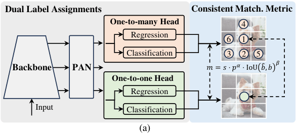</div>

<p align="center">双分支共享输入特征，匹配度量协调候选选择；图中箭头表示特征流，一对一头的梯度截断见正文。来源：<a href="https://arxiv.org/abs/2405.14458">YOLOv10，图 2(a)</a>。</p>

一对多分配让每个真值可以监督多个候选，利于学习特征，但推理产生冗余，需要去重。一对一分配让一个真值只对应一个正预测，其余相近重复候选不再同时获得正标签；单独使用又可能因监督稀疏而影响收敛。双分支设计希望兼顾两者。

两套分配采用相关的一致性匹配度量，将类别分数、IoU 和空间先验组合，使一对一选择与一对多中的高质量候选排序尽量协调。它不是额外施加一个“两个分支所有输出必须相等”的通用一致性损失。原方法的一对一选择也可用 top-one 方式实现，不必强行等同于完整 DETR 匈牙利匹配。

推理时丢弃一对多头，保留一对一头及其所需特征，仍会做框解码、分数筛选和输出数量选择。**NMS-free 不等于没有任何后处理，也不是每张图数学上绝不可能重复。** 去重行为来自训练和模型泛化，拥挤分布仍要评价。

如果只是把普通 YOLO 的 NMS 关掉，冗余正样本的训练行为没有变化，通常会直接输出许多重复框。原作者代码将输入一对一头的特征做 `detach`：该头仍学习自己的参数，但其损失不通过这条路径更新共享特征；共享特征主要接受一对多路径的监督。复现必须同时匹配训练分配、两个头的梯度连接和最终导出路径，不能把“双头”理解成两份损失无条件共同反传到骨干。

原论文也讨论了一对一无 NMS 配置与一对多+NMS 的精度差距，尤其小模型并非毫无代价。应同时比较 AP、密集场景计数、最大输出上限和包含后处理的延迟，才能判断对具体部署是否合算。

<h2 id="q-040">面试问题：Ultralytics YOLO11 的 C3k2、C2PSA 改了什么，它与 YOLOv10 有何关系？</h2>

<a id="9.介绍一下YOLOv11的核心改进点（相对于YOLOv8/v10）？"></a>

**难度评分：⭐⭐⭐⭐ (4/5)  |  考察频率：⭐⭐⭐⭐ (4/5)**

Ultralytics 的正式名称是 **YOLO11**。它与 YOLOv10 来自不同路线，不能据数字顺序认为 v10 的训练和无 NMS 机制全部被继承。

YOLO11 检测配置中的主要变化包括 C3k2、较深层的 C2PSA，以及配套的深宽缩放和检测头实现。应把配置中的模块实例与宣传性概述分开核对。

**C3k2**沿用 CSP/C2f 类分路与聚合，内部可以选择普通 bottleneck 或 C3k 组合。参数控制内部计算块的组织，部分 C3k 结构支持核尺寸配置，但标准 YOLO11 并不等于在推理时为每个目标动态搜索卷积核。其目的在于平衡特征加工与计算成本。

**C2PSA**将通道分成路径，在部分特征上使用注意力和前馈变换，再与旁路合并。较深层空间尺寸小，对部分通道做注意力，可以控制开销，同时增加内容相关的空间交互。它仍有注意力计算和投影成本，不能仅凭“partial”就断言比所有注意力方案都便宜。

配置还通过深度、宽度和最大通道数形成 n/s/m/l/x 等规模，同一个模块名在不同规模里并不意味着同样的实际计算量。SPPF、多尺度上采样/下采样路径和检测输出也需要一起看。

YOLO11 的常规检测路径通常仍使用 NMS；导出选项和后续库版本可能改变封装方式，应核对所用权重与调用路径。比较 v8、v10 和 YOLO11 时，至少固定训练数据、输入和后处理范围，不把参数量下降直接当成全部设备上的延迟收益。

<h1 id="q-105">5. 集合预测与迭代定位</h1>

<h2 id="q-044">面试问题：请介绍一下DETR？</h2>

<a id="1.请介绍一下DETR？"></a>

**难度评分：⭐⭐⭐⭐ (4/5)  |  考察频率：⭐⭐⭐⭐ (4/5)**

DETR 把目标检测建模为**无序目标集合的预测**。网络并行输出固定数量的候选槽位，训练时用一对一匹配把它们与真值集合对应起来，剩余槽位学习“无目标”。

<div align="center">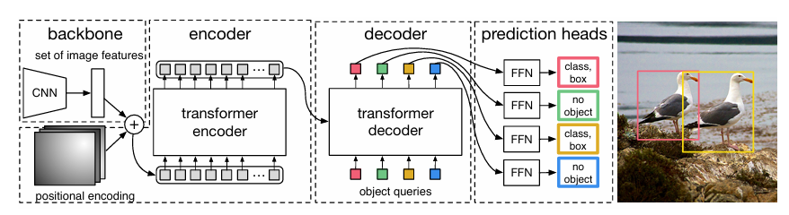</div>

<p align="center">每个查询经共享预测头产生一个候选；查询数固定，实际目标数可变。来源：<a href="https://arxiv.org/abs/2005.12872">DETR，图 2</a>。</p>

原始结构用 CNN 提取图像特征，加二维位置编码后进入 Transformer 编码器；解码器使用一组可学习 object queries，通过自注意力交互并读取图像特征，每个槽位预测类别和归一化框坐标。

query 是预测槽位的表示，不是预先指定的类别。一个 query 可以在不同图像中负责不同物体，固定 100 个 query 也不意味着图里必须有 100 个目标。框通过回归头输出，未使用的槽位以 no-object 类吸收。

训练先建立类别与框几何的匹配成本，用匈牙利算法选择一对一对应，再对已匹配预测计算类别、L1 与 GIoU 等损失，对其余预测计算适当加权的无目标分类损失。集合无序，因此不用要求第一项真值永远对应第一个 query。

假设图里有三只猫而网络输出 100 个槽位，只有三项获得相应猫框监督。其他槽位如果重复预测同一只猫，就不会都被当成正样本。这种训练结构配合 query 交互，使模型能够在常规推理中省去 NMS；注意力本身没有“保证不重复”的数学约束。

原始 DETR 在收敛、低分辨率特征和小目标上存在挑战，query 数也限制最大输出容量。后续可变形注意力、去噪训练和查询初始化分别改进不同环节。端到端集合预测简化了部分手工流程，但仍有损失权重、查询数、位置编码和阈值等工程选择。

<h2 id="q-047">面试问题：什么是DETR中的Hungarian Matching(匈牙利匹配)?</h2>

<a id="4.什么是DETR中的Hungarian_Matching(匈牙利匹配)?"></a>

**难度评分：⭐⭐⭐⭐ (4/5)  |  考察频率：⭐⭐⭐⭐ (4/5)**

匈牙利匹配解决的是：在当前预测与真值之间，寻找**总成本最小的一对一分配**。它负责确定监督对象，损失函数再负责更新网络参数。

假设有 $`N`$ 个预测、$`M\leq N`$ 个真值，对预测 $`i`$ 和真值 $`j`$ 构造成本：

```math
C_{ij}=-p_i(c_j)
+\lambda_1\|b_i-b_j^{*}\|_1
+\lambda_g(1-\mathrm{GIoU}(b_i,b_j^{*}))
```

这是原始 DETR 思路的一种写法；实现也可使用负 GIoU，因常数项不改变该匹配。$`p_i(c_j)`$ 为真值类别概率，$`b`$ 为框，$`\lambda`$ 为权重。**匹配中的负概率与训练分类损失的负对数概率不必相同**，后续变体又可使用 focal 风格成本。

如果 A、B 两个预测都最像同一个真值，逐个贪心可能让另一个真值没有合适候选。全局分配会综合全部边，确定每个真值占用哪个预测。全局最优是相对于当前成本矩阵，不代表网络训练已达到全局最优，也不代表每次配对语义都正确。

获得离散匹配后，已匹配框计算分类与回归损失，未匹配槽位学习无目标。反向传播通常不对匈牙利算法的离散选择本身求导，而是对选定配对的连续预测求导；这种训练仍能端到端更新网络参数。

训练早期成本不稳定，配对会变化，是 DETR 收敛困难的一部分。去噪监督、候选初始化和多种辅助分配都在改善这一问题。推理时没有真值集合，通常也不运行这套“预测对真值”的匈牙利匹配，更不能把它描述成测试时 NMS 的直接替代算子。

<h2 id="q-048">面试问题：全局注意力与端到端集合预测是什么关系，为什么注意力本身不能保证去重？</h2>

<a id="5.Transformer中的自注意力机制（Self-Attention）与目标检测中的全局特征融合有何关联？为什么说DETR能够实现End-to-End检测？"></a>

**难度评分：⭐⭐⭐⭐ (4/5)  |  考察频率：⭐⭐⭐⭐ (4/5)**

全局注意力让图像位置与预测槽位交换信息，集合监督规定“哪些输出应当对应哪些真值”。二者配合有利于检测，但承担不同职责。

编码器自注意力可以融合远距离上下文，例如局部纹理模糊时利用周围结构；解码器交叉注意力让 query 读取图像证据；query 间自注意力允许预测槽位相互协调。位置编码补充空间关系，否则单纯把特征当集合并不能表达准确位置。

然而两个 query 即使能交流，也仍可能输出同一个物体。让重复预测受到训练约束的是一对一匹配、无目标监督及相关设计，不能说“自注意力天然消除重复”。同样，全局感受野不代表网络已经学会可靠的关系推理，注意力图也不等于因果解释。

DETR 常被称为端到端，强调从图像到集合输出、无需传统候选生成/NMS 组合的检测流程。它仍需要人设计骨干、位置编码、查询数、损失和匹配成本；离散匹配也不是处处可导。“端到端”不等于删掉全部人为选择。

全局融合与多尺度表示也不互相替代。原始单尺度 DETR 即使看到全图，仍受特征空间采样限制；细节已经丢失时，注意力无法补回。Deformable DETR 等因此引入多尺度和稀疏读取。

理解这一关系有助于迁移到别的任务：结构负责允许怎样的信息交互，监督决定鼓励怎样的行为，部署输出还要接受实际分布检验。只改成 Transformer，不会自动获得集合去重或开放世界能力。

<h2 id="q-046">面试问题：请介绍一下Deformable DETR？</h2>

<a id="3.请介绍一下Deformable_DETR？"></a>

**难度评分：⭐⭐⭐⭐ (4/5)  |  考察频率：⭐⭐⭐⭐ (4/5)**

Deformable DETR 用少量可学习采样点替代每个 query 对所有空间位置的密集读取，并直接融合多尺度特征。它降低注意力聚合成本，也为定位提供更明确的空间参照。

<div align="center">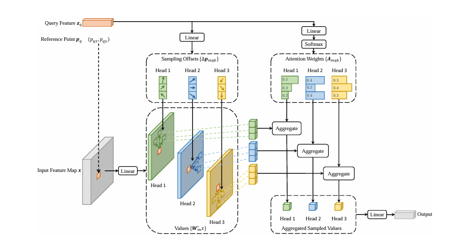</div>

<p align="center">查询分别预测偏移和权重，各注意力头从参考点附近的可学习位置读取特征。来源：<a href="https://arxiv.org/abs/2010.04159">Deformable DETR，图 2</a>。</p>

每个 query 带有参考位置，网络根据 query 预测各注意力头、各特征层上的采样偏移和权重，在相应位置通过双线性插值取特征，最后加权聚合。采样点不必落在整数网格上，位置由训练调整，不是人工固定的邻域。

可把一次聚合理解为：

```math
z_q=\sum_{l=1}^{L}\sum_{k=1}^{K}
a_{qlk}\,W_l\,x_l(p_{ql}+\Delta p_{qlk})
```

这是省略多头输出投影的简化形式。$`L`$ 为特征层数，$`K`$ 为每层采样数，$`a`$ 为归一化权重，$`p`$ 为该层参考位置，$`\Delta p`$ 为偏移，$`x_l`$ 为第 $`l`$ 层特征。权重与偏移主要由 query 预测，不需要为它与所有空间 key 显式构造完整相似度矩阵。

一个 query 可以从粗层读语义、从细层读边界，使多尺度交互更自然。它并不保证采样点都在物体上，训练早期或异常图像中仍可能采到背景。

复杂度降低应限定到对应算子：每个 query 的采样数受 $`LK`$ 控制，但编码器 query 总数、特征投影、骨干与存储仍随图像尺寸增长。不能说整个检测器计算量与分辨率无关。

它还可结合两阶段候选初始化和迭代框精修。实际部署需要高效可变形采样算子，否则理论节省可能被不规则访存和后端回退抵消。评价除总体 AP 外，还应看小目标、收敛预算和设备延迟。

<h2 id="q-045">面试问题：检测模型 DINO 的去噪、混合查询选择和框更新分别解决什么问题？</h2>

<a id="2.请介绍一下DINO？"></a>

**难度评分：⭐⭐⭐⭐ (4/5)  |  考察频率：⭐⭐⭐⭐ (4/5)**

这里的 DINO 指 **DETR with Improved deNoising anchOr boxes**，是检测模型；它与自监督视觉表征中的 DINO/DINOv2 不是同一方法。检测 DINO 在可变形注意力、动态框查询等基础上改进监督、初始化和梯度路径。

**对比去噪训练（CDN）**：从真值框构造带噪查询。噪声较小的正查询学习恢复原目标，噪声较大的负查询学习输出无目标，帮助区分真值附近的有效候选与重复或偏离候选。它并非对所有扰动框都做同一种恢复任务。去噪组和正常匹配查询之间使用注意力掩码，防止正常预测直接从真值条件中泄漏答案；推理时移除这部分训练查询。

<div align="center">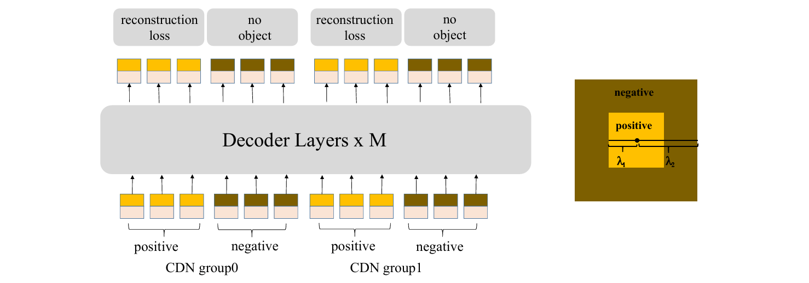</div>

<p align="center">右侧方形示意扰动范围；实际框有四维参数，图中二维示意不能当成原图上的真实框间距离。来源：<a href="https://arxiv.org/abs/2203.03605">DINO，图 3</a>。</p>

**混合查询选择**混合的是位置与内容的初始化来源。位置查询所需的初始 anchor box 来自编码器中选出的高质量候选，内容查询仍是可学习参数。它不是“一半 query 用固定 anchor，另一半来自上一解码层”。编码器位置先验帮助更快读取目标区域，而保留可学习内容表示，避免把未经充分精炼的候选内容直接当成完整实例表示。

<div align="center">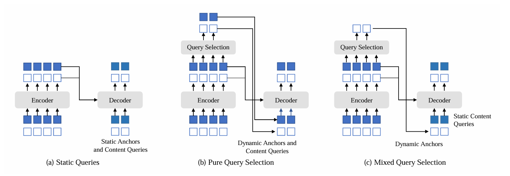</div>

<p align="center">右侧混合选择仅从图像候选取得位置，内容查询仍为可学习参数；static 表示不同图像共享初始化参数。来源：<a href="https://arxiv.org/abs/2203.03605">DINO，图 5</a>。</p>

**Look Forward Twice**调整迭代框更新的梯度连接，使某层的框偏移不仅受本层损失影响，也能受相邻下一层预测损失的影响。它利用后续精修结果监督相邻早层，而不是在推理时预知未来数据，也不是“先更新下一层参数再回头猜当前参数”。

<div align="center">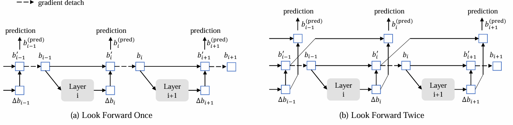</div>

<p align="center">虚线表示梯度截断；右侧增加相邻层定位监督到早层偏移的路径。来源：<a href="https://arxiv.org/abs/2203.03605">DINO，图 6</a>。</p>

例如初始框只覆盖目标上半身，较好位置初始化能降低寻找目标的难度，去噪任务帮助学习从附近框修正，后续层的定位损失进一步约束早层偏移。这三种机制作用不同，不能统一归结为增加 Transformer 层数。

代价包括训练查询和辅助监督、匹配与多尺度特征计算。性能比较要固定预训练、分辨率和训练预算，模型名相同也可能具有不同骨干与规模。DINO 仍是闭集检测框架的代表，文本开放词汇能力需要 Grounding DINO 等额外设计。

<h2 id="q-049">面试问题：什么是Co-DETR，它是如何利用混合标签分配提升DETR性能的？</h2>

<a id="6.什么是Co-DETR，它是如何利用混合标签分配提升DETR性能的？"></a>

**难度评分：⭐⭐⭐⭐ (4/5)  |  考察频率：⭐⭐⭐⭐ (4/5)**

Co-DETR 在训练阶段加入多种一对多辅助监督，增强共享特征，再让推理阶段仍使用 DETR 的主要一对一解码路径。它缓解单一集合匹配正样本稀疏带来的学习困难。

辅助检测头可以使用 ATSS、两阶段候选等不同分配方式，同一真值因而在更多位置产生有效监督。共享编码特征收到更丰富的训练信号，但各头的标签和损失仍按自己的规则计算，并不是将所有匹配强制合成一个万能矩阵。

它还从辅助头分配出的正样本位置生成定制的正查询，参与解码器辅助训练，帮助模型学习怎样读取真正有目标的区域。这些训练查询不应被描述成推理时始终依赖额外检测头先找框。

例如一对一主分支对某个目标只有一个正预测，辅助密集头可以在多个邻近位置提供分类与定位梯度；解码器再通过定制查询获得更多直接定位监督。训练信息丰富与最终输出稀疏可以同时成立。

推理时可去掉辅助头和相应辅助查询路径，但训练时的显存、计算、超参数和调试成本会增加。说“无推理额外头部”也不意味着整个模型与任意基线有相同延迟，骨干、主解码器和输入配置必须一致。

评估应分清收益来自辅助分配、查询生成还是更强骨干，并检查标签冲突、不同损失尺度和困难目标覆盖。它展示的是训练图与部署图可以不同，具体舍弃哪些节点需要按实现核对。

<h2 id="q-051">面试问题：什么是Sparse R-CNN？它作为连接Dense和Set Prediction的桥梁有何意义？</h2>

<a id="2.什么是Sparse R-CNN？它作为连接Dense和Set Prediction的桥梁有何意义？"></a>

**难度评分：⭐⭐⭐⭐ (4/5)  |  考察频率：⭐⭐⭐⭐ (4/5)**

Sparse R-CNN 用少量可学习 proposal boxes 和对应 proposal features 替代密集候选生成。每个框给出初始区域，每个特征向量控制如何读取和加工该区域，随后多轮精修。

这些初始框和特征是训练得到的模型参数，通常在不同图像间共享初始值；它们不是已知真值，也不是 RPN 根据当前图像生成的密集 proposal。图像仍先由骨干和特征金字塔编码，因此“稀疏”主要指候选交互和预测部分，不是完全不计算全图特征。

每轮用当前框提取 RoI 特征，利用 proposal feature 生成动态实例交互参数，再更新分类、框和实例表示。候选之间可通过自注意力交换信息，下一轮使用修正后的区域。

训练使用集合的一对一匹配，使少量槽位学习覆盖不同目标，推理通常不需要传统 NMS。初始框不必一开始就与每个物体贴得很近，迭代结构和图像证据帮助其移动；也不能据此保证所有罕见位置和拥挤实例都能被覆盖。

例如 100 个槽位遇到超过 100 个需要输出的实例，容量本身就形成限制；增加槽位又增加交互和 RoI 成本。极小目标、严重遮挡和初始分布偏差都需要检查。

它说明区域采样与集合预测可以结合：不使用密集 RPN，也能利用 RoI 的定位归纳偏置。与 DETR 比较时，应关注图像读取方式、迭代框状态和动态头，而不是简单称为“更好的初始框”。

<h2 id="q-050">面试问题：介绍一下DiffusionDet？</h2>

<a id="1.介绍一下DiffusionDet？"></a>

**难度评分：⭐⭐⭐⭐ (4/5)  |  考察频率：⭐⭐⭐ (3/5)**

DiffusionDet 将检测框的位置与尺寸看作待去噪的变量，用图像特征作为条件，从随机框逐步预测目标框。这里生成的是框集合，不是把整张图像重新生成一遍。

训练时将真值框转换到规定坐标尺度，补齐到训练框数，再按时间步给框参数加入高斯噪声。图像骨干提取特征，带噪框用于读取 RoI 特征，检测头结合时间条件预测类别与干净框。学习目标与匹配规则服务于检测，不应机械照搬图像扩散中的每一项噪声预测损失。

推理从随机框开始，反复调用条件检测头并按采样规则更新框。Box renewal 会替换一部分低质量框，给后续迭代重新探索的机会；图像特征可以复用，但每轮 RoI 读取和检测头仍有计算成本。

它允许在一定范围内调整推理候选数与迭代步数，提供精度和计算的折中。更多框、更多步不保证一直提升，拥挤目标、随机初始化和分数阈值也会影响结果。原论文的多步结果可通过 NMS 集成，因此“用了扩散检测就无需 NMS”是不正确的。

例如同一张图可在低预算下用较少随机框做一次预测，离线标注时增加采样预算以探索遗漏目标；是否值得增加预算，要看额外召回和耗时，而不是只看最终最优 AP。

其长期启发是把固定一次回归扩展为条件迭代精修，并让推理计算成为可调参数。是否优于成熟实时检测器，仍需在训练预算、输出质量和端到端延迟相同的条件下比较。

<h2 id="q-036">面试问题：RT-DETR 怎样兼顾集合预测与实时性，与不同 YOLO 路线如何比较？</h2>

<a id="5.介绍一下RT-DETR及其与YOLO系列的区别？"></a>

**难度评分：⭐⭐⭐⭐ (4/5)  |  考察频率：⭐⭐⭐⭐ (4/5)**

RT-DETR 通过控制高分辨率特征交互成本、改善查询初始化，把 DETR 的集合预测方式推进到实时检测。它保留一对一训练与稀疏查询输出，同时对编码器和多尺度融合做了效率设计。

**高效混合编码器**把尺度内交互与跨尺度融合分开。代表设计主要在较深、分辨率较低的特征上做注意力交互，再用卷积式结构融合多尺度信息。与对全部高分辨率 token 做全局自注意力相比，这能减少关系矩阵和计算负担。

**质量相关的查询选择**从编码器候选中选较有希望的位置初始化解码器，并通过训练约束改善分类与定位质量的一致性。推理时无法知道真值 IoU，因此“选 IoU 最高的框”不是可执行描述；应说明所用分数怎样被训练得更适合排序。

**迭代解码**逐层修正类别与框。固定 query 数控制了部分成本，但骨干、编码器特征和交叉注意力仍受图像大小影响，不能说复杂度完全与分辨率无关。部分实现允许调整使用的解码层数，在同一模型上折中速度和精度，也需要实际验证。

与 YOLOv8 一类密集、通常依赖 NMS 的配置相比，RT-DETR 的输出去重更多由一对一监督完成；与 YOLOv10 一类无 NMS 路线相比，这个差异就不能再按“Transformer 对 YOLO”简单划分。YOLO11 等也可包含注意力，不能把全部 YOLO 定义成纯卷积。

部署比较应包含导出后完整延迟和后处理，特别注意可变形采样等算子的后端支持。实时性由输入、设备、模型规模和目标密度共同决定；框架名字不保证在边缘 NPU 上仍具有论文中的速度关系。

<h2 id="q-201">面试问题：边界框分布怎样逐层精修，为什么定位自蒸馏比只传最终坐标提供更多信息？</h2>

**难度评分：⭐⭐⭐⭐ (4/5)  |  考察频率：⭐⭐⭐ (3/5)**

将框回归成四个坐标，只保留了一次定位的点估计；为每条边预测离散分布，则能保留多个候选偏移及其相对权重。若解码器逐层更新这个分布，后续层就可以在前一层的定位状态上继续精修。

这与 DFL 的基本分布回归有联系，但增加了**层间状态如何传递、精细定位知识如何反向约束浅层**两个问题。D-FINE 的 Fine-grained Distribution Refinement（FDR）提供了一个具体例子：初始层预测参考框，各边对应偏移分布，后续层预测残差 logits。

对某一条边，可简化写成：

```math
z^{(\ell)}=z^{(\ell-1)}+\Delta z^{(\ell)},
\qquad p^{(\ell)}=\mathrm{softmax}(z^{(\ell)})
```

```math
d^{(\ell)}=d^{(0)}+s_b\sum_{n=0}^{N}w_n p_n^{(\ell)}
```

$`z`$ 是分布的未归一化分数，$`p`$ 是概率，$`d^{(0)}`$ 是初始参考框中心到该边的距离，$`s_b`$ 是对应的初始框宽或高，$`w_n`$ 是候选归一化偏移。残差加在 logits 上，再经 softmax，不能直接把两层概率相加后仍当成归一化分布。D-FINE 还采用非均匀偏移刻度，让零附近拥有更细的调整能力，同时覆盖较大的偏移范围。

例如遮挡目标的右边界有两种合理位置，分布可以暂时保留两处权重，后续层读到更多区域证据后再调整。最终输出期望仍会将分布压成一个位置，甚至可能落在两峰之间，因此“能表示多峰”不等于最终坐标一定正确，也不代表分布已成为统计校准的不确定性。

定位自蒸馏进一步用末层较精细的分布监督浅层，传递的不仅是最终均值，还包括各候选偏移的相对关系。D-FINE 的 GO-LSD 汇总不同层的匹配信息，并对匹配/未匹配候选采用相应权重，避免只看分类置信度而忽略定位较好的候选；分类仍遵守一对一监督。名字中的“Global Optimal”不构成每个样本达到全局最优的数学保证。

收益需要与分布维度、解码层数、训练辅助损失和设备内核成本一起评价。最有价值的思想是把定位中间状态做得更丰富，再让深层学习结果帮助早层；不是给所有检测器额外加一组 logits 就必然提精度。

<h1 id="q-106">6. 骨干选择、预训练、评价与部署</h1>

<h2 id="q-062">面试问题：经典 CNN 骨干迁移到检测时，应检查哪些结构和训练条件？</h2>

<a id="1.介绍一下介绍目标检测中常用的经典CNN_Backbone？"></a>

**难度评分：⭐⭐⭐ (3/5)  |  考察频率：⭐⭐⭐⭐ (4/5)**

将分类 CNN 用作检测骨干，首先要把“整图是什么”的输出接口改成“不同空间位置包含什么”的特征接口。通常移除全局池化和分类全连接层，从多个阶段取出二维特征，再交给 FPN、检测头或 Transformer。

VGG 的连续小卷积、ResNet 的残差连接、DenseNet 的特征复用，分别影响特征学习、梯度传播与内存访问；检测中的选择还必须考虑输出步长和通道。以典型 ResNet 为例，可从 C2—C5 取得约为输入 1/4、1/8、1/16、1/32 的特征，具体步长仍以实际 stem 和下采样配置为准。

迁移时至少检查以下条件：

- **尺度接口**：检测头期待哪些分辨率和通道，是否需要 lateral projection；最细层能否覆盖业务小目标。
- **输入约定**：RGB/BGR、归一化、插值方式和预训练分辨率是否一致。输入约定错误会让预训练权重难以发挥作用。
- **归一化状态**：检测训练常因大图而使用小 batch，BN 统计可能不稳定；可比较冻结统计、同步 BN 或其他适配方式，不能只冻结参数却忘记运行统计。
- **训练范围**：冻结早层能降低训练成本，但领域偏移明显时可能限制适应；全量微调则需要合理学习率与足够数据。

例如工业灰度图与自然图像的纹理、噪声完全不同，照搬分类输入预处理并冻结全部骨干，往往不如先检查输入通道和领域适应。反过来，标注量很小且图像接近预训练域时，过度更新骨干可能更容易过拟合。

分类 top-1 更高，也不必然带来更好的检测 AP。分类可容忍空间位置丢失，检测需要局部边界和多尺度覆盖。应在相同检测头、训练预算和输入设置下比较，并拆看小/中/大目标，而不是用一张分类榜单代替骨干选型。

<h2 id="q-063">面试问题：轻量骨干怎样减少计算，为什么参数少不一定推理快？</h2>

<a id="2.介绍一下目标检测中常用的轻量级Backbone？"></a>

**难度评分：⭐⭐⭐ (3/5)  |  考察频率：⭐⭐⭐⭐⭐ (5/5)**

轻量骨干主要通过减少昂贵的跨通道计算、限制中间宽度和改善特征复用来节省资源。参数量反映权重存储的一部分，真实速度还由激活、访存、算子调度和硬件利用率共同决定。

以卷积为例，忽略 batch 和边界效应，普通 $`k\times k`$ 卷积的乘加量约为：

```math
\mathrm{MACs}_{\mathrm{conv}}
=HWk^2C_{\mathrm{in}}C_{\mathrm{out}}
```

深度可分离卷积先逐通道做空间卷积，再用 $`1\times1`$ 进行通道混合，约为：

```math
\mathrm{MACs}_{\mathrm{sep}}
=HWk^2C_{\mathrm{in}}+HWC_{\mathrm{in}}C_{\mathrm{out}}
```

$`H,W`$ 为输出空间尺寸，$`C_{\mathrm{in}},C_{\mathrm{out}}`$ 为通道数。MobileNet 利用这类分解，倒残差则在扩展空间中处理特征后投影回较窄表示；ShuffleNet 用分组计算节省开销，再通过通道混洗促进组间交互。这些结构都在计算与信息混合之间做取舍。

但低 MACs 算子可能受内存带宽限制，分组过细也可能让设备利用率下降。一次通道重排看似没有很多乘加，却可能引入数据拷贝；频繁的小算子启动、布局转换和后端回退，都可能吃掉理论节省。

检测还要保留多个中间尺度，高分辨率特征的激活内存可能比权重更大。若轻量骨干节省的计算被过宽 FPN 和检测头重新花掉，系统总延迟不会按骨干参数比例下降。

实践应在目标设备上拆分 backbone、neck、head 与后处理耗时，记录 batch=1 延迟、峰值内存和精度，再评估量化后的误差。尤其要观察小目标与罕见类别：它们往往最先受到低分辨率、通道压缩和低精度表示的影响。

<h2 id="q-064">面试问题：检测任务怎样在层级 Transformer、普通 ViT 和现代 CNN 之间选骨干？</h2>

<a id="3.介绍一下目标检测中Transformer-based和新兴Backbone？以及如何选择"></a>

**难度评分：⭐⭐⭐⭐ (4/5)  |  考察频率：⭐⭐⭐⭐ (4/5)**

检测骨干的选择应从空间分辨率、上下文交互和部署预算出发。层级 Transformer、普通 ViT 和现代 CNN 都能构建优秀检测器，差别在于怎样组织特征，以及为此付出什么成本。

三条路线可以这样比较：

<div align="center">

| 路线 | 空间与交互方式 | 检测中的适配重点 |
|---|---|---|
| 层级 Transformer，如 Swin | 分阶段降采样，窗口内注意力与跨窗口交互 | 多尺度接口自然；核查窗口划分、位置处理及动态尺寸支持 |
| 普通 ViT | 大体维持单一 token 网格，按配置使用全局或局部注意力 | 构建特征金字塔适配；处理位置编码、长序列与高分辨率成本 |
| 现代 CNN，如 ConvNeXt | 卷积、残差和现代归一化等组合 | 算子通常成熟；大核与通道布局仍需设备实测 |

</div>

普通全局自注意力的 token 两两交互随 token 数平方增长。图像长宽各加倍、patch 尺寸不变时，token 约增至四倍，注意力矩阵元素可增至十六倍。窗口注意力限制局部交互范围，可缓解这一成本，但跨窗口信息需要通过移动窗口、层级或其他结构传播。

普通 ViT 也能通过 simple feature pyramid 等适配参与检测；上采样某一层特征只是生成更密网格，不等于重新获得了 patch 化前的细节。对极小目标，要同时考虑 patch 尺寸、输入像素和预训练局部表示。

例如服务器离线标注可以接受较大骨干与高分辨率，边缘相机更可能受支持算子和单帧延迟约束。训练数据少时，优质预训练可能比更换架构名称带来的收益更大；如果预训练规模、训练时长不同，也不能把全部 AP 差距归因于 Transformer 或 CNN。

比较时固定数据、检测头、输入与预算，并报告参数、峰值显存、实际延迟和分尺度 AP。骨干优劣需要落到完整检测系统，而不是在“局部归纳偏置”和“全局建模”之间作抽象站队。

<h2 id="q-066">面试问题：视觉状态空间模型怎样建模长距离关系，检测部署中有什么代价？</h2>

<a id="4.除了CNN和Transformer，目标检测领域还有哪些新兴的Backbone设计趋势？请简要介绍一个。"></a>
<a id="5.视觉Mamba（Vision Mamba/VMamba）相比传统CNN和Transformer在目标检测中有什么潜在优势？"></a>

**难度评分：⭐⭐⭐⭐ (4/5)  |  考察频率：⭐⭐⭐ (3/5)**

状态空间模型（SSM）通过递推状态把历史输入压缩成有限维表示，再用于当前输出。视觉 SSM 将二维特征按一定路径组织成序列，使较远位置的信息能够沿扫描路径传递。

一个简化的离散状态更新是：

```math
h_t=\bar A_t h_{t-1}+\bar B_t x_t,
\qquad y_t=C_t h_t+D x_t
```

$`x_t`$ 是当前输入，$`h_t`$ 是状态，$`y_t`$ 是输出，矩阵控制历史保留和当前写入。在选择性 SSM 中，部分参数由输入决定，使模型有条件地保留或忽略信息；这比固定滤波器更灵活，但仍受状态维度和更新机制约束。

图像没有唯一自然顺序。只按从左到右、从上到下展开，会让原本相邻的像素在序列中相隔很远，也会引入方向偏置。VMamba 的二维选择性扫描以多个方向处理特征，再将结果对齐合并，尽量把不同方向的上下文纳入表示。其层级结构还可为检测提供多尺度输出。

在固定状态和通道规模下，扫描部分通常随序列长度近似线性增长；这不意味着完整模型无条件比注意力更快。多方向扫描、投影、张量变换和存储仍有代价，训练的并行扫描与推理的设备实现也会影响吞吐。

例如高分辨率遥感图需要远距离上下文，但小目标边缘依然依赖局部特征。SSM 可参与骨干表示，却不能自动解决尺度分配、旋转框和极端类别不平衡。扫描方向对目标形状与布局是否造成偏差，也要通过任务实验判断。

部署前应确认选择性扫描算子的导出与后端支持，比较实际内存和延迟，并保持预训练条件一致。递推状态提供一种长距离信息组织方式，并不构成视觉任务上普遍优于 Transformer 或 CNN 的证明。

<h2 id="q-067">面试问题：掩码图像预训练何时有利于检测，为什么不能认为它总优于分类预训练？</h2>

<a id="6.掩码图像建模（MIM，如MAE）预训练为何比分类预训练更适合目标检测？"></a>

**难度评分：⭐⭐⭐⭐ (4/5)  |  考察频率：⭐⭐⭐ (3/5)**

掩码图像建模（MIM）通过遮住一部分图像，让网络从剩余信息预测缺失内容或其表征。它可能使骨干学习更丰富的局部结构和上下文，对检测有帮助，但收益依赖重建目标、遮挡策略、数据和微调方式。

分类预训练主要要求整图表示区分类别，网络可以依赖最显著的局部区域完成任务。MIM 要利用可见区域解释缺失区域，更有机会学习物体部件、空间关系和纹理；若目标只是容易预测的低层统计，它也可能过多关注颜色或局部平滑，未必形成好的语义边界。

MAE 的一种典型设计是编码器只处理可见 patch，轻量解码器重建像素；迁移时移除重建解码器，用编码器处理完整图像。另一些方法预测离散视觉 token 或教师特征，它们学习到的偏置并不相同，不能笼统认为“重建越清晰，检测越准确”。

例如遮挡车辆的一部分，合理的上下文表示有助于定位完整车辆；但目标比一个 patch 还小，或者预训练数据从未覆盖工业缺陷，MIM 也不会自动获得所需细节。更大的预训练数据与更长训练可能贡献大量收益，比较时应分离目标函数与训练预算。

检测迁移还需处理多尺度特征、位置编码插值、归一化和层级学习率。线性探测衡量冻结特征的可用性，全量微调衡量适应能力，二者结论可能不同。优质分类监督、对比学习或自蒸馏预训练，同样可以是强检测骨干。

可采用同骨干、相近数据与计算预算的对照，在不同标注量和领域上评测 AP、AP75、小目标及收敛速度。如果某种预训练只在长时间全量微调后领先，而业务预算不允许，它的理论优势就未必能转化为实际收益。

<h2 id="q-016">面试问题：Precision 与 Recall 如何定义，怎样选择业务工作点？</h2>

<a id="2.准确率(Precision)与召回率(Recall)的含义"></a>

**难度评分：⭐⭐ (2/5)  |  考察频率：⭐⭐⭐⭐⭐ (5/5)**

Precision 应译为**精确率或查准率**，与分类任务中常说的整体 Accuracy 不同。目标检测的 Precision 和 Recall 都建立在规定类别及 IoU 门限下的实例匹配上。

```math
\mathrm{Precision}=\frac{\mathrm{TP}}{\mathrm{TP}+\mathrm{FP}},
\qquad
\mathrm{Recall}=\frac{\mathrm{TP}}{\mathrm{TP}+\mathrm{FN}}
```

假设画面中有 10 个真值目标，系统输出 8 个框，其中 6 个正确匹配，则 TP=6、FP=2、FN=4，精确率为 75%，召回率为 60%。检测背景区域并没有一个自然固定的“真负框总数”，因此用包含 TN 的 Accuracy 很难概括检测质量。

提高分数阈值通常减少输出，降低误报的同时可能漏掉真目标；降低阈值则增加候选。精确率的经验曲线可能局部波动，不能认为每次升阈值都会严格提高精确率。NMS、最大输出数与类别筛选也会改变工作点。

阈值应根据**具体错误成本和处理能力**选择。医疗漏检、机器人漏检障碍和工业漏检缺陷都可能很严重；误报同样可能带来无效复核、错误停机甚至不当动作。不能简单按行业贴上“只看召回”或“只看精确率”的标签。

可先规定最低召回或最高每小时误报量，再在验证集上选择阈值，最后在独立测试集报告结果。类别不均衡时应按类别和场景分别查看，必要时校准分数；部署后目标出现频率变化，也可能明显改变实际精确率。

当没有预测或没有真值时，分母可能为零，评估器需要明确空集规则。阈值选择还要避免反复看测试集调参，否则报告的误差水平会过于乐观。

<h2 id="q-015">面试问题：AP、AP50、AP75 和 mAP 怎样计算，评测协议会怎样改变结果？</h2>

<a id="1.目标检测中ap，ap50，ap75，map等指标的含义"></a>

**难度评分：⭐⭐⭐ (3/5)  |  考察频率：⭐⭐⭐⭐⭐ (5/5)**

AP 评价的是**随检测分数阈值变化，精确率与召回率形成的整体关系**。在计算前，必须先约定类别、定位 IoU 门限、忽略区域和预测与真值的匹配规则。

对某一类别，通常将全数据集预测按分数从高到低排序；在各图内部按协议与尚未匹配的同类真值配对，满足定位要求记为 TP，否则记为 FP。一个真值一般只能被一项普通预测命中，重复框会形成 FP；crowd、ignore 等标注有专门规则。沿排序累积 TP、FP，就能得到 PR 曲线。

AP 经常概括为 PR 曲线下面积，但不同实现有不同插值与采样。VOC 2007 采用 11 点插值，后续 VOC 常用全点插值，COCO 在 101 个召回位置采样精确率包络。只写“积分”不足以复现评测结果。

- **AP50**：定位匹配的 IoU 门限为 0.50，并非置信度阈值为 0.50。
- **AP75**：IoU 门限为 0.75，更严格地要求定位。
- **COCO AP@[.50:.95]**：对 0.50、0.55、……、0.95 共 10 个 IoU 门限的结果平均，并聚合有效类别。
- **mAP**：强调类别平均；具体是否再跨 IoU 门限平均，必须看后缀和基准约定。COCO 的主指标常直接写 AP，但已包含这些平均。

例如一个框类别正确、IoU 为 0.65，它可能在 AP50 中算命中，在 AP75 中算误检，同时对应真值仍未召回。若对它重复输出三个高分框，通常只有一个能匹配，不会得到三个 TP。

COCO 还规定每图最大检测数、目标面积范围和无有效真值类别的处理。小目标 AP 不能脱离缩放、裁剪和面积定义解释；框 AP 与 mask AP 更不能混用。比较实验应固定评估器版本、类别映射、坐标格式、最大输出数和数据划分。

AP 很适合比较排序和定位，但线上一般使用某个固定工作阈值。两个模型 AP 接近，低误报区间的召回仍可能不同，因此还需要报告业务工作点、每图或每小时误报量和延迟，避免只有榜单分数。

<h2 id="q-029">面试问题：你知道哪些边缘端部署的方案？</h2>

<a id="12.你知道哪些边缘端部署的方案？"></a>

**难度评分：⭐⭐⭐⭐ (4/5)  |  考察频率：⭐⭐⭐⭐ (4/5)**

边缘部署的目标是让完整检测流程在设备预算内稳定运行。模型文件小、理论 FLOPs 低、导出成功，都不能单独证明部署完成。

先根据硬件选择后端，例如 NVIDIA GPU 可考虑 TensorRT，Intel 平台可考虑 OpenVINO，移动 CPU/GPU/NPU 则按设备选择适配框架。ONNX 是常见交换格式，但并非所有模型必须或都能无损经过相同导出链路；可变形采样、动态 shape、特殊激活和 NMS 的算子支持需要逐项检查。

优化可以分为结构选择、精度压缩和系统调度：减少输入尺度与通道数，做结构化剪枝或蒸馏，采用 FP16/INT8，融合卷积与 BN，复用内存，减少图像在 CPU/GPU 间拷贝。每一项都可能改变准确率、启动成本或尾延迟。

INT8 校准数据必须覆盖真实曝光、背景和目标尺度。小目标、低对比度和稀有类别可能先退化，因此除整体 AP 外，要看关键切片及固定误报下的召回。量化也应明确哪些算子保持浮点、哪些落到 CPU，混合回退可能抵消预期收益。

部署验收至少包含预处理一致性、坐标回投、输出解码、类别映射、后处理及异常输入。比较 FP32 原模型与目标后端的中间或最终结果，可以区分导出错误与数值近似；只看运行不报错远远不够。

速度应从采集/解码到业务可用结果计时，记录预热、batch、目标数量、分位延迟和持续运行的温度/功耗。异步流水可以提高吞吐，同时增加等待；热降频和内存峰值也可能让短跑 FPS 失去代表性。

<h1 id="q-107">7. 开放词汇、视觉提示与统一接口</h1>

<h2 id="q-027">面试问题：在目标检测中，“少样本／零样本检测（Few-Shot/Zero-Shot Object Detection）”是什么？</h2>

<a id="10.在目标检测中，“少样本／零样本检测（Few-Shot/Zero-Shot_Object_Detection）”是什么？"></a>

**难度评分：⭐⭐⭐ (3/5)  |  考察频率：⭐⭐⭐⭐ (4/5)**

少样本检测研究用少量新类别标注建立检测能力；零样本检测研究在规定的训练信息限制下，对没有相应检测训练标注的类别进行推理。二者都要解决定位，不能仅把分类器认出新类别视为完成检测。

少样本通常先用较充分的 base 类数据学习，再用 novel 类的 K-shot 数据适配检测头或模型。这里 K 指图像数还是实例数、每类怎样抽样、图中其他类别是否完整标注，都需要写清。不同随机采样可能带来很大波动，应报告多次试验而非只挑一组最优样本。

零样本检测可以把区域特征与文本语义对齐，用类别名或描述替代固定分类权重。大规模预训练可能已经见过相关词汇或图像；“零样本”通常是相对于当前检测训练或适配协议，不能随意宣称模型从未见过任何相关概念。

还要区分只评新类和广义零样本设置：后者让已知类与新类一起竞争，分数偏向已知类的问题更明显。新类别名称可以扩展，并不保证候选生成覆盖新物体，也不保证具备未知发现能力。

例如工业零件只有 5 张标注图，文本名又难准确描述其形状，可尝试视觉样例提示、轻量微调或区域级特征适配，并用完全不同批次和背景的图像验证。对照时要避免同一物件的近重复拍摄同时进入训练与测试。

选择路线应依据标注成本、类别变化频率、视觉与语言先验适配度，以及允许的延迟。没有充分独立测试，少量样本上的漂亮效果很容易只反映背景或拍摄方式被记住。

<h2 id="q-068">面试问题：介绍一下GLIP（Grounded Language-Image Pre-training）及其如何将检测重构为短语定位问题？</h2>

<a id="1.介绍一下GLIP（Grounded Language-Image Pre-training）及其如何将检测重构为短语定位问题？"></a>

**难度评分：⭐⭐⭐⭐ (4/5)  |  考察频率：⭐⭐⭐⭐ (4/5)**

GLIP（Grounded Language-Image Pre-training）把目标检测与短语定位放到同一套区域—文本对齐任务中：图像区域对应哪些文字，而不只是属于固定类别表中的哪个整数。

<div align="center">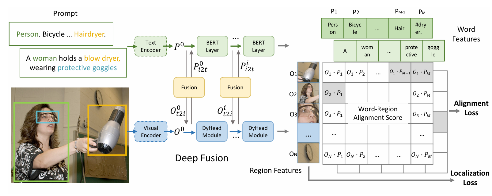</div>

<p align="center">类别名和描述都可形成词语监督，区域—词语匹配与框定位共同训练。来源：<a href="https://arxiv.org/abs/2112.03857">GLIP，图 2</a>。</p>

普通检测数据可以被改写为 grounding 数据。例如一张图含有猫和狗，把候选类别名组织成文本，猫框就与“cat”对应的 token 建立正关系，狗框与“dog”建立正关系。原本带有短语和框的数据，也可进入相同训练接口。这让检测标注与更丰富的语言描述能够共同训练模型。

架构上，视觉骨干提供多尺度图像特征，文本编码器提供 token 表示；深层融合模块让两种特征交互，检测头预测框及区域与 token 的匹配。一个简化的匹配分数可写成：

```math
s_{ij}=\phi(v_i)^\top\psi(t_j)
```

$`v_i`$ 是区域表示，$`t_j`$ 是文本 token 表示，$`\phi,\psi`$ 将它们映射到可比较的空间。训练通过区域与词语的对应关系监督这个矩阵，并同时监督框的位置。实际模型还有特征融合、归一化与具体损失，不是直接对原始视觉向量和词向量作一次点积。

例如“戴蓝色帽子的人”需要同时识别人、帽子和颜色，以及这些属性属于哪一个人。区域—短语数据能提供比单一类别标签更细的监督，但属性、关系和指代能力仍取决于训练覆盖，不能从“支持自然语言”推导出任意复杂描述都能准确定位。

GLIP 还利用大规模图文数据构造伪 grounding 监督，扩大概念覆盖。图像级文字并不天然附带准确框，伪标注的遗漏与偏差也会传播，需要区分人工框监督和生成标注。

部署时文本长度、类别词表、同义词和分词方式都会影响结果。开放词汇能力意味着模型可通过文本接口迁移到新的检测词汇，并不表示它从未在预训练中接触过相关概念；报告 zero-shot 时必须明确“相对于哪份检测训练集、哪类标注而言”。

<h2 id="q-069">面试问题：介绍一下YOLO-World？</h2>

<a id="2.介绍一下YOLO-World？"></a>

**难度评分：⭐⭐⭐⭐ (4/5)  |  考察频率：⭐⭐⭐⭐ (4/5)**

YOLO-World 将区域—文本对齐接入实时 YOLO 检测框架，使类别表能够由文本提示指定。其工程重点是把较重的语言计算从逐帧检测路径中尽量移走。

<div align="center">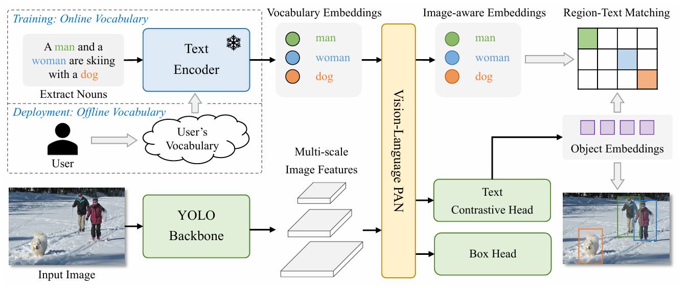</div>

<p align="center">离线词表先编码再用于反复检测；词表发生变化时，缓存与相关部署权重需要同步更新。来源：<a href="https://arxiv.org/abs/2401.17270">YOLO-World，图 3</a>。</p>

训练时，图像编码器产生多尺度特征，文本编码器将类别或短语转为向量，RepVL-PAN 在特征融合过程中引入语言信息，最终预测框与区域嵌入，通过区域—文本对比监督建立可迁移的类别判别。检测、grounding 和图文数据被组织成区域—文字配对，但它们的标注可靠程度不同。

推理采用 prompt-then-detect：先把业务词汇编码成离线向量，再让检测器反复处理图像。对固定词表，相应文本表示可缓存或在支持的部署配置中重参数化进网络，避免每帧重新运行文本编码器。

例如工厂长期检测“安全帽、反光背心、灭火器”，可在启动或配置更新时生成这些词的表示，视频帧只执行检测部分。新增“急救箱”时需要更新词表及相关缓存，不能让旧缓存继续工作却声称新提示已生效。不同导出配置能否动态修改类别，也要单独验证。

这种离线词表仍然来自开放语义表示，不等同于从头训练一个固定三类分类头；但一次部署所实际检测的类别，仍受当前提供的词表约束。模型没有收到某个未知物体的名称，并不意味着它会自动发现并命名该物体。

实时性也有明确条件。固定文本缓存、输入大小、设备与批量会改变 FPS；如果每帧都换长文本，必须把文本编码和缓存失效成本算进去。常规 YOLO-World 检测流程仍使用候选去重，开放词汇与 NMS-free 是两个独立问题。

它适合低成本更换业务类别的场景，但细粒度工业零件、相似包装、罕见概念仍可能需要视觉提示、少量标注或领域微调。选型要看新类别的召回、误检与更新成本，而不仅是能否接受一串新名字。

<h2 id="q-070">面试问题：介绍一下Grounding DINO？</h2>

<a id="3.介绍一下Grounding DINO？"></a>

**难度评分：⭐⭐⭐⭐ (4/5)  |  考察频率：⭐⭐⭐⭐ (4/5)**

Grounding DINO 把语言条件引入 DINO 检测器的特征增强、查询选择和解码过程，输出与输入词语或描述对应的框。这里的 DINO 指检测模型，不是同名的自监督视觉表征方法。

<div align="center">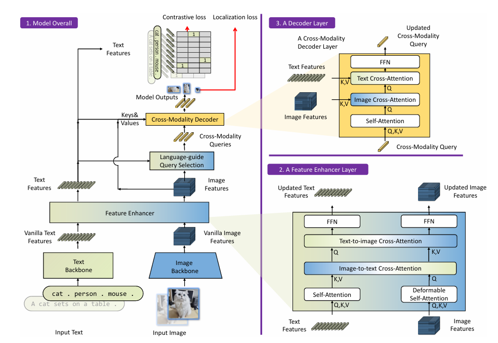</div>

<p align="center">语言分别参与特征融合、候选初始化与解码精修，三者并非只在最终分类分数处相接。来源：<a href="https://arxiv.org/abs/2303.05499">Grounding DINO，图 3</a>。</p>

它的三处跨模态设计各有职责：

1. **特征增强**：图像和文本分别编码，再通过视觉/语言内部建模与双向跨模态交互，使图像特征知道当前关注什么，文本特征也获得场景信息。
2. **语言引导查询选择**：根据视觉位置与文本 token 的相关性选择较有希望的候选，用来初始化解码器的查询位置，减少完全盲目的搜索。
3. **跨模态解码器**：查询在迭代中读取图像和文本，更新框与表示，最终给出框及其对不同 token 的相关分数。

比如输入“左边穿红衣的人”，仅识别“person”会得到多个人框；正确结果还需要将颜色和方位绑定到对应实例。Grounding 训练为这种对应关系提供监督，但复杂关系、计数和否定仍可能失败，不能等同于通用视觉推理。

文本通常经过分词，类别短语可能占多个 token。把输出映射回类别或短语，需要正确维护 token span、标点分隔和分数规则；阈值改变会影响召回与误检。同义词并不保证相同结果，输入多个近义类别还可能产生重复语义匹配。

它的检测主体沿用集合预测思想，原始架构不依赖传统密集检测的框级 NMS。实际应用若将多个提示分批运行后合并，仍可能额外去重；应用后处理不能反过来改变模型训练范式的定义。

与 SAM 组合时，可以先由 Grounding DINO 提供框，再由分割模型输出 mask。框找错对象时，分割模型可能把错误对象分得很精细；要分别评价定位、语义匹配和掩码质量。开放词汇接口降低了重新训练分类头的门槛，但没有取消数据覆盖与可靠性验证。

<h2 id="q-202">面试问题：怎样把大模型的丰富语义用于检测训练，同时保持轻量推理？</h2>

**难度评分：⭐⭐⭐⭐ (4/5)  |  考察频率：⭐⭐⭐ (3/5)**

检测推理不必执行训练时使用的全部语义计算。可以让较强模型离线生成描述或语义表征，再用这些信息监督紧凑检测器，使昂贵知识在训练中发挥作用，部署时只保留必要的视觉与轻量文本路径。

这条路线至少包含三个独立环节：

1. **构造监督**：为目标区域建立类别、属性或描述，并保证描述与正确区域对应。图像级描述与区域级描述不能混用，否则“红色”可能来自背景而不是目标。
2. **传递表征**：教师将描述编码为语义向量，学生在真值匹配区域上学习对齐，必要时同时学习全图上下文。教师特征可预计算，但生成、存储与刷新仍有成本。
3. **保持部署接口一致**：学生推理时使用的类别或提示路径也应在训练中得到直接监督，不能只对齐一个上线后不存在的教师空间。

截至 2026-11-26 的 RT-DETR-World 以冻结的 DINOv3 视觉编码器、轻量多尺度投影和 DETR 解码器为基础，用 MiniLM 提供部署所需的文本接口。训练同时使用类别、对象描述和整图描述：MiniLM 路径学习可部署的区域—文本对应，LLM2CLIP 教师预计算的对象/整图向量提供更丰富的语义目标。大语言教师不在检测器训练和推理时在线运行，辅助对齐模块在部署时移除。

它还处理了对比学习中的假负例问题。例如“戴头盔的工人”和“穿反光衣的工人”可能共享大量语义，若将所有未配对描述都强力推远，会破坏有用邻近关系。Relation-Aware Negative Relaxation 用教师相似度减轻相关负例的排斥，同时保留确切正配对。语义相似并不代表是同一实例，所以不能简单把相关负例全部改成正例。

这一思路值得学习，模型本身仍需按证据边界判断。论文报告了教师监督、描述层级和对齐策略的消融，但具体效果依赖预训练骨干、生成标注质量与数据覆盖；其 COCO-O 实验衡量分布变化，不能在使用 COCO 训练图的情况下称为完全未见 COCO 的验证。速度还采用类别嵌入缓存，不能代表每帧动态长文本的总延迟。

更重要的是，部署接口仍以类别导向的 OVD 为主，丰富描述用于训练，并不意味着上线后已支持任意关系描述定位。该版本论文注明代码待发布，不能据此声称可直接复现全部流程。可迁移的结论是：先设计哪些语义值得传给学生，再明确训练成本、部署路径与验证条件。

<h2 id="q-076">面试问题：什么是T-Rex模型？它是如何通过“视觉提示（Visual Prompting）”实现通用物体检测的？</h2>

<a id="1.什么是T-Rex模型？它是如何通过“视觉提示（Visual_Prompting）”实现通用物体检测的？"></a>

**难度评分：⭐⭐⭐⭐ (4/5)  |  考察频率：⭐⭐⭐⭐ (4/5)**

T-Rex 用点或框指定视觉样例，再到目标图像中寻找外观与该样例相符的对象。它特别适合“能指给你看，却很难准确命名”的检测和计数任务。

<div align="center">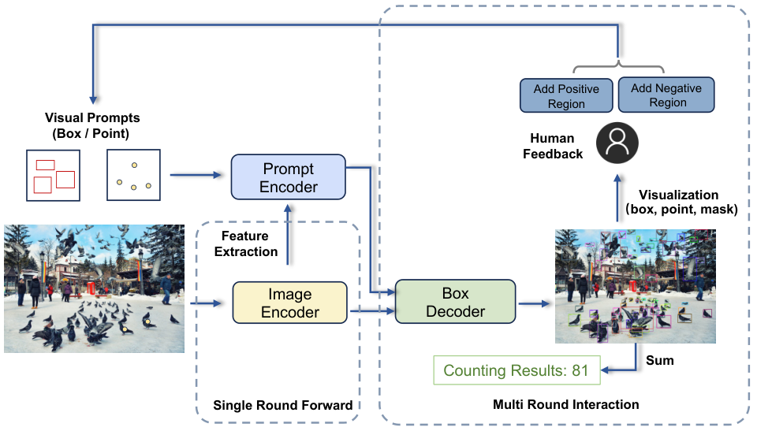</div>

<p align="center">点或框提供样例，检测框让用户核对并补充提示；图中的 81 是示例计数，不是性能指标。来源：<a href="https://arxiv.org/abs/2311.13596">T-Rex，图 3</a>。</p>

流程包含图像编码器、视觉提示编码器和框解码器。图像编码器提取目标图与参考图特征；提示编码器结合用户指定的位置和参考区域的内容，形成提示表示；框解码器读取目标图特征，在提示条件下输出框和分数。参考图可以就是当前图，也可以来自另一张图。

例如货架上有一种特殊瓶盖，仅输入“瓶盖”可能把相近款式都找出来。用户框出一个样例，模型就能得到具体颜色、形状和局部纹理。它学习的是如何利用样例匹配目标，不是每次交互都重新训练一个新分类器。

若用于计数，模型先检测，再将达到阈值的框数相加。这样用户能够看到漏检和误检发生在哪里，再补充提示进行修正。固定图像的编码特征还可缓存，减少重复交互的成本；跨图提示变化、输入分辨率变化则需要处理缓存边界。

视觉提示也有局限。样例框若混入大块背景，模型可能把背景当线索；只给正面样例，未必能覆盖背面和遮挡；同形异类或极小目标也可能难以区分。密集计数还受到查询容量、阈值和重复框影响，不能将“输出框数”直接视为准确计数。

原始 T-Rex 的重点是视觉提示检测与交互计数；T-Rex2 进一步研究文本和视觉提示协同。不能把后续版本的全部能力倒填到原始方法。它提供的可迁移思路是让用户用样例表达目标，再通过可见的定位结果闭环纠错。

<h2 id="q-077">面试问题：文本提示与视觉样例各自提供什么信息，混合提示怎样处理歧义？</h2>

<a id="2.相比于文本提示（如GLIP），视觉提示（Visual_Prompting）在目标检测中有什么独特优势？"></a>

**难度评分：⭐⭐⭐⭐ (4/5)  |  考察频率：⭐⭐⭐⭐ (4/5)**

文本提示给出类别、属性与关系，视觉样例给出具体外观。两者解决的歧义不同：文本更容易概括“所有消防栓”，样例更容易说明“这种特殊接头长什么样”。

提示应先区分两种使用方式：**同图交互**是在待检测图上点出或框出对象，图像风格与尺度较一致；**跨图泛化**是从其他图片提取样例，再寻找新图中的同类对象，必须跨越视角、光照、背景和实例差异。同图示范有效，不足以证明跨图原型同样可靠。

混合提示需要让检测区域与两种提示在表示和训练目标上对齐，简单把两个分数相加可能放大冲突。例如文字写“红色安全帽”，样例却是反光后偏白的帽子，系统需要判断颜色是硬约束还是样例噪声。多个代表性样例、提示质量筛选和冲突时要求补充信息，比盲目提高融合权重更可控。

截至 2026-11-26 的 OPUS 工作展示了一条值得关注的路线：在统一的提示感知解码器中使用文本和视觉提示，并通过实例级对比对齐，将匹配到真值的检测查询与对应视觉提示靠近，减少视觉信息只经过类别文字这一中介而丢失细节的问题。它将同图交互 Visual-I 与跨图原型 Visual-G 分开评估，明确承认两者存在训练—推理差异。

这个机制的价值在于保留“具体实例长什么样”的证据，而非仅增加一种输入按钮。论文中的跨图原型仍受参考图质量、聚合噪声和罕见类别影响，自动 grounding 数据的域覆盖也有限，不能由自然图像基准推断工业或医学场景已验证。

工程评测应分别比较文本、视觉、混合三种输入，并固定参考图数量、是否来自同一图、图像/提示缓存和延迟统计范围。如果混合提示只在优质同图样例上有效，就应把它定位为交互标注工具，而不是无需配置的通用检测服务。

<h2 id="q-078">面试问题：SEEM 怎样统一交互提示，它与检测和语音输入是什么关系？</h2>

<a id="3.介绍一下SEEM（Segment_Everything_Everywhere_All_at_Once）？它支持哪些类型的交互提示？"></a>

**难度评分：⭐⭐⭐⭐ (4/5)  |  考察频率：⭐⭐⭐ (3/5)**

SEEM 的主要任务是可提示分割。它将文本、点、框、涂鸦和参考区域等信息组织为提示表示，再由统一解码器输出目标掩码，强调多种交互方式可以组合。

文本编码器提供语义提示，视觉提示由指定位置或区域的视觉信息形成；解码器让对象查询、图像特征与提示交互。不同输入因此可以表达互补约束：文字说明“狗”，点选区分图中哪一只，涂鸦进一步修正边界。交互记忆等设计可帮助利用前面的修正，但错误提示也可能累积。

它与目标检测的输出职责不同。检测框回答目标的大致位置，mask 给出像素归属；把 mask 的最小外接矩形转成框是可行的后处理，但不能据此认为 SEEM 就是按标准检测协议训练和评测的通用框检测器。相反，检测器给出的框也可以成为分割提示。

语音接口尤其要区分系统层与模型层。官方演示将音频先交给 Whisper 转成文本，再用文本提示完成分割。这个链路支持“说一句话选中对象”，但并不能证明 SEEM 原生联合编码声音波形、声源位置和图像区域。

例如用户说“选中左边的狗”，语音识别若漏掉“左边”，分割模型可能准确执行了错误的文字指令。排查应分别看转写、指代和掩码，而不是将所有错误归给视觉模型。

因此，它适合说明统一交互接口怎样降低标注与编辑成本。具体 mask 解码、实例/语义分割区别可继续阅读[图像分割章](./图像分割高频知识点.md)，检测章重点保留提示、定位与输出形式之间的关系。

<h2 id="q-085">面试问题：介绍一下Florence-2？它是如何统一目标检测、分割和图像描述任务的？</h2>

<a id="1.介绍一下Florence-2？它是如何统一目标检测、分割和图像描述任务的？"></a>

**难度评分：⭐⭐⭐⭐ (4/5)  |  考察频率：⭐⭐⭐⭐ (4/5)**

Florence-2 把多种视觉任务表达为“图像加任务提示，输出结构化序列”。检测输出类别与位置，描述输出自然语言，部分区域任务输出坐标或多边形；共享的图像编码与序列生成框架承载不同任务。

视觉编码器将图像转换为特征，文本任务提示说明当前要做什么，编码器—解码器式语言模型生成对应结果。例如 `<OD>` 触发目标检测，`<CAPTION>` 触发图像描述，带文本的 grounding 提示则要求将短语与区域对应起来。任务 token 是经过训练的接口，不能假设换成任意自然语言命令都会得到同等可靠的行为。

几何量被离散成位置 token，与类别或文字一起生成，再由处理器反量化为原图坐标。检测输出并不是随意写一句“物体在左边”，而是必须遵守可解析的语法。分割类输出也可采用轮廓/多边形序列，与直接输出每个像素概率的稠密 mask 头不同。

例如图片经过缩放后输入模型，最终坐标需要按照处理器规定映射回原图。图像尺寸参数传反、位置 token 被提前删除、输出长度被截断，都可能让看似合理的字符串变成错误框。应保存原始生成结果并检查解析后的几何范围，而不只展示叠框截图。

统一序列接口有利于多任务共享数据和能力，但也有代价：目标越多，输出越长；坐标量化存在精度限制；自回归错误可能影响后续对象；任务之间还可能竞争训练容量。语言 token 的生成分数也不能未经校准就当成目标检测置信度。

因此，要分别评价检测 AP、描述质量、OCR 或区域分割指标，固定具体 checkpoint、任务提示、最大生成长度和解析版本。能在一个模型里调用多种任务，是接口和表示统一的进展，并不表示每项能力都已经替代专门模型。

<h1 id="q-108">8. 未知发现与持续学习</h1>

<h2 id="q-071">面试问题：开放词汇、开放世界与增量目标检测的任务边界是什么？</h2>

<a id="1.开放词汇检测 (OVD) 与开放世界检测 (OWD) 有什么本质区别？"></a>
<a id="6.增量目标检测与开放世界检测（OWD）、开放词汇检测（OVD）有什么本质区别？"></a>

**难度评分：⭐⭐⭐ (3/5)  |  考察频率：⭐⭐⭐⭐ (4/5)**

开放词汇检测、开放世界检测和增量检测处理的是三种不同的开放性：**类别如何指定、未知对象如何处理、知识如何随时间更新**。实际系统可以组合这些能力，但不能用一个名称替代其余两项。

<div align="center">

| 任务 | 主要输入或变化 | 核心要求 | 不能直接推出的能力 |
|---|---|---|---|
| 开放词汇检测 OVD | 用文本等语义接口指定候选类别 | 对检测监督之外的新词汇进行定位与识别迁移 | 自动发现、命名未给提示的所有未知物体 |
| 开放世界检测 OWOD/OWD | 推理遇到未知类，之后可能取得新类标注 | 发现未知、与已知区分，并逐步吸收新知识 | 没有人工语义监督就正确命名全部新类 |
| 增量目标检测 IOD | 分阶段得到新类别训练数据，旧数据访问受限 | 学新类并保留旧类定位和分类能力 | 在更新前就能主动发现未知 |

</div>

例如仓库已有“箱子、托盘”检测器，现在出现一种新设备。OVD 可在提供设备名称或合适提示后尝试检测；OWD 应先将它作为潜在未知对象保留下来；IOD 关注拿到设备标注后，怎样更新模型而不忘记箱子与托盘。三个环节可接在同一条流程中，却需要不同监督和评价。

“新类别”也要限定参照系。OVD 的新类可能不在当前检测训练集里，却出现在图文预训练中；IOD 的新类是对当前阶段已学类别而言；OWD 的 unknown 则是在当时知识集合与任务协议下尚未识别的类别。没有这些定义，zero-shot 与 unknown recall 很容易被误读。

评测必须分别报告：OVD 的基础类/新类 AP 与预训练重叠条件，OWD 的未知召回及未知被认成已知的错误，IOD 的各阶段旧类/新类表现及记忆预算。论文中 open-set、open-world 等术语有时使用范围不同，应以实际协议为准。

业务选型可以据此拆解：改词表能否满足需求，是否必须保留未知候选，模型是否需要持续更新。只有确认缺哪项能力，才能决定用开放词汇模型、未知识别模块，还是增量训练流程。

<h2 id="q-072">面试问题：什么是 ORE？它旨在解决什么问题，核心机制是什么？</h2>

<a id="2.什么是 ORE？它旨在解决什么问题，核心机制是什么？"></a>

**难度评分：⭐⭐⭐⭐ (4/5)  |  考察频率：⭐⭐⭐ (3/5)**

ORE（Open World Object Detector）把未知发现和持续学习接入两阶段检测器。它的流程是先给潜在未知对象提供粗监督，使特征空间形成分离，再利用能量分数识别未知；新类取得标注后，用平衡回放缓解遗忘。

**未知伪标签来自 RPN 候选。** 在未与已知真值重叠的候选中，选择 objectness 较高的区域作为潜在 unknown。这个规则利用“看起来像物体，但没有已知标注”的线索，不证明候选一定属于新类别：未标完整的旧类、背景纹理和定位偏差，都可能被选中。

**对比聚类约束 RoI 特征。** 同类特征向对应原型靠拢，不同类之间保持距离；原型通过特征记忆与逐步更新维持稳定，unknown 也有相应原型。它希望让未知与已知在表示空间中更容易分开，但把许多不同未知类别聚到一个原型会损失其内部结构。

**能量分数用于未知判别。** 对区域特征 $`f`$，已知类别 logits 为 $`g_i(f)`$，温度为 $`T`$，可定义：

```math
E(f)=-T\log\sum_{i=1}^{C}\exp\!\left(\frac{g_i(f)}{T}\right)
```

原方法在留出的验证数据上拟合已知与未知的能量分布，再据此判别。因而不能将其描述成完全不需要未知验证信息的通用阈值方法；未知校准数据的使用范围是与后续方法比较时必须说明的条件。

当一部分 unknown 获得明确类别标注后，模型扩展类别集合，并用平衡的旧类样本回放进行微调。例如新设备被确认后纳入新类，同时保留箱子、托盘样本，避免更新只围绕新设备进行。

ORE 给出了一个完整的开放世界问题框架，但每个环节都可能失败：RPN 漏掉未知，伪标签污染原型，能量分布随域变化，有限回放遗漏旧类变化。能量较高表示当前模型证据不足，不是未知真值；实际系统需要检查发现率、误报以及后续吸收后的旧类表现。

<h2 id="q-073">面试问题：开放世界检测（OWD）中，如何区分“未知目标（Unknown）”和“背景（Background）”？</h2>

<a id="3.开放世界检测（OWD）中，如何区分“未知目标（Unknown）”和“背景（Background）”？"></a>

**难度评分：⭐⭐⭐⭐ (4/5)  |  考察频率：⭐⭐⭐⭐ (4/5)**

unknown 是“像一个值得识别的对象，但无法归入当前已知类”，background 是当前检测任务不准备输出的区域。两者都可能缺少已知类标签，仅靠“分类分数低”通常分不开。

可以把判断拆成两项：先估计物体性，再估计与已知类别的兼容程度。高物体性、低已知兼容度的区域才是有价值的未知候选。ORE 的高分 RPN 背景候选、OW-DETR 的未匹配高激活区域，都是这种思路的近似实现。

例如一张图里有墙面、模糊的旧类车辆和新设备。三者的已知类分数都可能低：墙面是背景，车辆是困难已知样本，新设备才是 unknown。反过来，神经网络也可能把新设备高置信识别成车辆，因此只调高拒识阈值并不充分。

可利用区域形状、视觉特征、能量、跨增强一致性和时间上的持续性共同筛选，再由人工或后续语义模型确认。但多种线索一致也不是真值证明，尤其当它们来自同一偏置模型时，错误会高度相关。

评估不能只追求 unknown recall。把整幅图输出成大量未知框，可能提高召回，却让系统无法使用。需要同时观察未知候选精度、误报数、定位质量、已知类 AP，以及 A-OSE 等“未知被误认成已知”的错误指标。不同论文对阈值和忽略区域处理可能不同，数值只能在相同协议下比较。

背景定义还取决于业务：路边标牌对车辆检测可能是背景，对自动驾驶场景理解却可能是重要对象。开放世界不等于要求模型把所有像素都变成某个物体，应先定义可行动的对象范围和人工复核成本。

<h2 id="q-074">面试问题：OW-DETR 怎样选择未知伪标签，它与 ORE 的条件有何不同？</h2>

<a id="4.介绍一下OW-DETR？它相比于基于Faster_R-CNN的ORE有什么优势？"></a>

**难度评分：⭐⭐⭐⭐ (4/5)  |  考察频率：⭐⭐⭐ (3/5)**

OW-DETR 在 Deformable DETR 风格的集合预测框架中引入未知伪标注、novelty classification 和 objectness 监督。它希望利用未被已知真值匹配的预测，学习哪些区域可能包含未知物体。

<div align="center">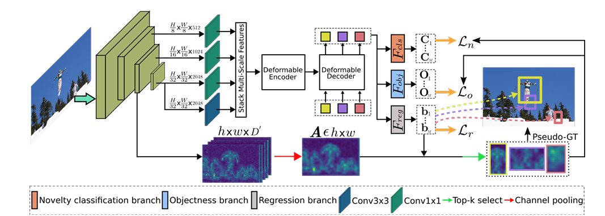</div>

<p align="center">下方激活图为未知候选选择提供线索；伪标签仍需面对背景显著性和漏标干扰。来源：<a href="https://arxiv.org/abs/2112.01513">OW-DETR，图 2</a>。</p>

训练先用已知类别和框完成匹配。随后在剩余查询中，依据其预测框覆盖区域的视觉特征激活强度等规则，挑选较有前景的候选，赋予 unknown 伪标签。这里使用的是骨干特征的激活线索，不能笼统写成“Transformer 注意力高的区域一定是未知物体”。

novelty classification 将已知类别与 unknown 纳入判别；objectness 则把已知目标和伪未知都视为前景，使模型有机会将未知与纯背景分开。分类回答类别归属，物体性回答是否值得保留，两种监督的职责不同。

例如已知真值标出了人和车，画面里还有未标注的施工设备。若某个未匹配查询的框覆盖设备且特征响应较强，它可能获得未知监督；但显著广告纹理也可能被误选，特征不明显的小设备又可能漏选。这些是伪标注质量问题，不能靠新增 unknown 类名直接消除。

与 ORE 相比，OW-DETR 不依赖同样的已知/未知能量分布拟合流程，强调在没有未知类标注监督的训练条件下挖掘未知。比较时必须统一未知验证数据使用、任务类别划分、骨干与回放设置；不能把两套不同监督条件下的一个指标直接归因为 Transformer 更强。

集合预测减少了传统候选冗余，但查询数量、未知选择数和已知匹配都影响结果。unknown 将多种语义合在一个标签下，也不会自动形成可直接命名的新类结构。它依然需要后续标注与持续学习过程。

<h2 id="q-075">面试问题：开放世界中将 Unknown 转成新类别时，怎样控制遗忘和错误吸收？</h2>

<a id="5.在开放世界检测中，什么是“灾难性遗忘（Catastrophic_Forgetting）”，通常如何解决？"></a>

**难度评分：⭐⭐⭐⭐ (4/5)  |  考察频率：⭐⭐⭐ (3/5)**

把 unknown 吸收成新类别，需要同时解决两件事：新标签是否可信，以及模型更新后是否仍能识别旧类别。未知发现只提供候选，不能直接充当自动扩类的真值。

一条可执行流程是：

1. **整理候选**：按外观、时间和场景聚合，去掉同一对象的重复帧，避免一个异常片段占满标注预算。
2. **确认类别边界**：人工核对或用可追溯证据辅助命名，区分真新类、旧类新外观和背景误报；明确相近类如何标注。
3. **补齐监督**：新图中的旧类、旧回放图中的新类，都可能原本未标。对确认区域补标，对不确定区域设置忽略，减少互相当背景的冲突。
4. **受控更新**：扩展分类头，结合回放、蒸馏或其他约束训练，再用冻结的独立验证集验收。

例如“叉车”被长期当成 unknown，但候选里混入了普通托盘车。如果不清理就统一赋成叉车，模型会学到错误类边界。只看训练损失下降甚至会误以为更新成功，因为错误标签本身也可以被拟合。

遗忘要拆看旧类的分类、定位和召回：新头对旧类分数的竞争、骨干表征漂移、RPN 候选变化都可能造成性能损失。仅冻结旧分类器并不能保证它收到的特征不变；仅回放少数“容易旧样本”也可能保不住罕见姿态。

更新验收应同时要求新类有效提升、旧类下降可接受、剩余 unknown 检出不恶化，并记录训练数据与词表版本。若一个未知簇只是旧类的新外观，更合理的动作可能是补充旧类数据，而不是不断新增类别。系统的长期可维护性取决于类别体系和标注质量，而不只是模型能否增加一列 logits。

<h2 id="q-079">面试问题：什么是增量目标检测？它与普通目标检测的核心区别是什么？</h2>

<a id="1.什么是增量目标检测？它与普通目标检测的核心区别是什么？"></a>

**难度评分：⭐⭐⭐⭐ (4/5)  |  考察频率：⭐⭐⭐⭐ (4/5)**

增量目标检测是在旧数据不能完全重新使用的条件下，分阶段加入新类别，同时尽量保留旧类别的检测能力。它与普通微调的区别，是旧能力仍然属于必须验收的任务范围。

第 $`t`$ 阶段已知类别为 $`\mathcal C_{\mathrm{old}}`$，新数据提供 $`\mathcal C_{\mathrm{new}}`$ 的标注，更新后的模型应覆盖两者并集。若能随时访问全部旧数据并重新联合训练，问题的资源约束就已不同；只在新数据上微调，则容易遗忘旧类。

检测比分类多了定位和背景问题。一张新类训练图里可能出现旧类对象，却没有旧类框；这些区域可能被训练成背景。即使保住旧类分类头，RPN 不再提议旧物体、骨干改变局部表示或框回归漂移，都可能让旧类 AP 下降。

主要应对手段各有代价：回放保留部分旧样本，直接补充旧监督；蒸馏以冻结旧模型约束学生的特征和输出；参数正则或模块隔离限制旧知识变化。回放有存储与标注成本，蒸馏受教师错误和输入覆盖限制，隔离方法可能增加模型容量与维护成本。

例如先学人和车，再加入自行车。训练时要确保没有把未标注的人和车反复惩罚为背景，同时让模型能够真正区分自行车与车辆旧类。把全部更新限制得过紧，可能减少遗忘，却也学不会新类，这就是稳定性与可塑性的取舍。

评测应在同一阶段同时输出全部已学类别，除非协议明确允许提供任务标识。否则为每个阶段另存一个模型，再由外部告知当前任务，并没有解决同一模型面对混合场景的类别竞争问题。

<h2 id="q-080">面试问题：增量检测中的背景语义漂移来自哪里，为什么不回放也可能发生？</h2>

<a id="2.在增量目标检测中，&quot;背景类语义漂移（Background Shift）&quot;是什么问题？如何解决？"></a>
<a id="2.在增量目标检测中，"></a>

**难度评分：⭐⭐⭐⭐ (4/5)  |  考察频率：⭐⭐⭐⭐ (4/5)**

背景语义漂移发生在不同阶段的标注范围变化时：某个区域今天没有被标注，明天却成为需要检测的前景。模型看到的像素并不一定变化，监督含义却变了。

这种冲突有两个方向：

- **新数据中的旧类漏标**：第二阶段只标自行车，图里的人和车未标，普通检测损失可能把它们作为背景压低。
- **旧回放数据中的新类漏标**：第一阶段只标人和车，旧图片里本来就有自行车；第二阶段回放这些旧图片时，自行车又可能被当背景。

因此，不做回放只能避开第二种来源，第一种仍然存在。把旧图保留下来也不代表监督完整，必须连同标签版本一起管理。

可用冻结旧模型为新图生成可信旧类伪标签，用新类标注或可靠模型补全旧图中的新类，再对不确定区域采用忽略策略。忽略意味着不将其强行作为负样本，仍会减少可用监督；伪标签则可能漏检或误检，需要阈值、几何一致性和抽查。

蒸馏也需要处理背景含义。旧教师的“背景”可能包含新类别，如果让学生对这些区域继续强制输出旧背景，会直接阻碍学习。可在可信旧类区域保持旧知识，在新类真值附近让新监督优先，并为重叠和冲突制定明确规则。

例如教师把新自行车当成背景，但人工新类框已经确认其存在，此时不应让教师的背景概率覆盖真值。反过来，一个高置信旧类伪框与新类真值冲突，也不能机械保留两份标签。

诊断时，抽取跨阶段同时出现新旧类的图像，画出真值、忽略区和伪标签，往往比反复调整蒸馏权重更有效。背景是相对于当前标注体系定义的剩余集合，不能假定它在所有阶段都代表同一种视觉分布。

<h2 id="q-081">面试问题：增量目标检测中基于知识蒸馏的方法是如何工作的？请介绍代表性工作。</h2>

<a id="3.增量目标检测中基于知识蒸馏的方法是如何工作的？请介绍代表性工作。"></a>

**难度评分：⭐⭐⭐⭐ (4/5)  |  考察频率：⭐⭐⭐ (3/5)**

增量检测蒸馏把旧模型作为冻结教师，用其对旧知识的响应约束新模型，同时让新模型学习新类标注。它保存的是教师在可见输入上的行为，无法凭空恢复从未出现在新数据或回放中的旧场景。

一个概念性训练目标是：

```math
\begin{aligned}
\mathcal L={}&\mathcal L_{\mathrm{new}}
+\lambda_{\mathrm{cls}}\mathcal L_{\mathrm{KD,cls}}\\
&+\lambda_{\mathrm{box}}\mathcal L_{\mathrm{KD,box}}\\
&+\lambda_{\mathrm{feat}}\mathcal L_{\mathrm{KD,feat}}
\end{aligned}
```

新类损失来自新监督；其余项分别约束旧类分类、定位和特征。具体蒸馏位置、采样区域、归一化和权重决定效果，不能只说“加一个 KL 散度”就算完整方案。

**ILOD** 的早期代表工作基于 Fast R-CNN，使用 EdgeBoxes 等外部 proposal，针对选出的区域蒸馏旧类分类响应与框回归。外部候选避免了学习型 RPN 自身在增量更新中遗忘的问题，但候选生成又带来额外成本。它不应被误写成一开始就基于 Faster R-CNN 的 RPN 蒸馏。

**Faster ILOD** 将方案推进到 Faster R-CNN，兼顾特征、RPN 和最终检测输出。其自适应约束在部分特征和 RPN 响应上采用教师作为下界的思路，避免学生所有激活都被要求与教师完全相同，为新知识留下空间；最终输出仍保留旧类蒸馏。多模块蒸馏针对的是检测链上不同的遗忘位置。

例如只蒸馏最终分类分数，而学生的候选已经漏掉旧类目标，后面就没有合适区域可供分类。反过来，在所有背景位置强行对齐特征，海量无关区域可能主导损失，还会限制新类学习。

实际应优先保护可信旧目标区域，并处理教师与新真值冲突、类别扩展后的概率归一化和候选对齐。教师也会错，蒸馏权重越大不意味着越可靠。要用旧类定位/分类变化、新类学习速度和训练成本共同判断，而不是只看总蒸馏损失是否下降。

<h2 id="q-082">面试问题：怎样设计增量检测评测，区分遗忘、新类学习和联合训练差距？</h2>

<a id="4.增量目标检测的主流评估协议有哪些？如何设计实验来衡量一个模型的遗忘程度？"></a>

**难度评分：⭐⭐⭐⭐ (4/5)  |  考察频率：⭐⭐⭐⭐ (4/5)**

增量检测的评价需要同时回答：旧知识掉了多少、新知识学到了多少、整个更新过程花了多少资源。只报告最后阶段的一个总 mAP，会把这些变化混在一起。

先固定类别顺序、每阶段数据、允许保留的样本或字节数、是否允许旧教师、训练计算量，以及是否使用未标注旧类信息。至少报告每阶段旧类 AP、新类 AP、全部已学类 AP，并保留逐类结果。类别顺序差异较大时，应采用多个顺序和随机种子。

设 $`A_{t,k}`$ 表示完成阶段 $`t`$ 后，在第 $`k`$ 阶段引入的类别上计算的 AP。对已经学习过的阶段，一种常用遗忘量是：

```math
F_{t,k}=\max_{s\in\{k,\ldots,t-1\}}A_{s,k}-A_{t,k},
\qquad k\lt t
```

它比较该组类别过去最好的表现与当前表现。若成绩从 60 升到 65，后来降到 58，遗忘量是 7 个百分点；若当前超过过去最好值，该定义可能为负，也可按明确约定截为零。无论哪种都应说明，不能混用。

**联合训练差距是另一项指标。** 若同预算或规定预算下，用全部历史数据联合训练得到 70 AP，而增量模型得到 58 AP，两者差 12，反映与该参考训练方案的差距，不是上述时间意义上的遗忘量。联合模型是重要参照，但并非理论上不可超越的上界。

还应拆看分类与定位错误、不同目标尺度、类间混淆，以及长期多阶段误差是否累积。回放方法要计入样本存储，教师方法要计入额外前向和模型存储，扩展网络要计入随阶段增长的参数。

例如一个方法旧类几乎不掉，但新类 AP 很低，可能只是更新过于保守；另一个方法总 AP 较高，却在少数关键旧类严重下降，也未必满足业务。可接受的稳定性—可塑性平衡应由这些分项结果体现。

<h2 id="q-083">面试问题：DETR 如何用于增量检测，为什么冻结旧 query 不能保证旧类不遗忘？</h2>

<a id="5.如何将 DETR 架构应用于增量目标检测？它相比基于 Faster R-CNN 的方法有什么天然优势？"></a>

**难度评分：⭐⭐⭐⭐ (4/5)  |  考察频率：⭐⭐⭐ (3/5)**

DETR 可以通过扩展分类空间、回放和教师约束用于增量检测，但它不会因为使用 object query 就天然保留旧知识。标准 query 是预测槽位，不是为每个类别预留的独立记忆格。

同一个 query 在不同图像里可以匹配不同类别，也可能输出 no-object。即使冻结旧 query 向量，图像骨干、编码器、解码器、分类器和框回归器仍会变化，query 读取到的特征和最终输出因而会改变。冻结几个输入向量无法固定整条计算路径。

蒸馏还必须处理集合的排列不唯一。教师的第 7 个输出与学生第 7 个输出未必指向同一对象，逐下标做分类/框差异会约束错误配对。可以根据类别与几何成本建立教师—学生匹配，或通过明确的共享查询协议维持对应，再对可信旧对象施加监督。

新增真值的匹配也会改变：一对一分配、no-object 比例、分类概率归一化与辅助层损失，都可能引入新旧竞争。若旧教师把新类别当作 no-object，强行对齐所有背景响应会抑制新类，应结合真值区域和忽略规则处理。

例如同一图新增“自行车”标注后，学生原本用于某个人的 query 可能重新分工。正确目标是保留对人的检测能力，不是要求这个人永远由同一编号槽位负责。是否保留槽位身份，应由方法的专门设计决定。

增加 queries 能缓解输出容量不足，但会增加交互与匹配成本，也不等于保留旧知识。一个完整方案需要说明类别扩展、匹配、蒸馏、回放与背景处理，并按多阶段旧/新类 AP 验收。

---

## 参考资料

- [GIoU](https://arxiv.org/abs/1902.09630)、[DIoU/CIoU](https://arxiv.org/abs/1911.08287)、[Soft-NMS](https://arxiv.org/abs/1704.04503)、[WBF](https://arxiv.org/abs/1910.13302)：框几何、候选抑制与多模型融合。
- [Focal Loss / RetinaNet](https://arxiv.org/abs/1708.02002)、[ATSS](https://arxiv.org/abs/1912.02424)、[TOOD](https://arxiv.org/abs/2108.07755)、[YOLOX / SimOTA](https://arxiv.org/abs/2107.08430)、[Generalized Focal Loss](https://arxiv.org/abs/2006.04388)：样本分配、分类质量与分布回归。
- [DyHead](https://arxiv.org/abs/2106.08322)、[RepVGG](https://arxiv.org/abs/2101.03697)：动态特征调制与训练/推理结构变换。
- [FPN](https://arxiv.org/abs/1612.03144)、[PANet](https://arxiv.org/abs/1803.01534)、[SPPNet](https://arxiv.org/abs/1406.4729)、[SAHI](https://arxiv.org/abs/2202.06934)：尺度融合、区域表示与切片推理。
- [Fast R-CNN](https://arxiv.org/abs/1504.08083)、[Faster R-CNN](https://arxiv.org/abs/1506.01497)、[Mask R-CNN](https://arxiv.org/abs/1703.06870)、[Cascade R-CNN](https://arxiv.org/abs/1712.00726)：区域共享计算、候选生成、对齐与级联精修。
- [SSD](https://arxiv.org/abs/1512.02325)、[FCOS](https://arxiv.org/abs/1904.01355)、[CenterNet: Objects as Points](https://arxiv.org/abs/1904.07850)、[CenterNet 目标构造代码](https://github.com/xingyizhou/CenterNet/blob/master/src/lib/datasets/sample/ctdet.py)、[LFFD](https://arxiv.org/abs/1904.10633)：多尺度密集预测、中心点表示与轻量检测。
- [RTMDet](https://arxiv.org/abs/2212.07784)、[YOLOv9](https://arxiv.org/abs/2402.13616)、[YOLOv10](https://arxiv.org/abs/2405.14458)、[YOLOv10 检测头代码](https://github.com/THU-MIG/yolov10/blob/main/ultralytics/nn/modules/head.py)：训练监督、梯度路径与实时部署。
- [YOLOv5 v7.0 模型定义](https://github.com/ultralytics/yolov5/blob/v7.0/models/yolov5s.yaml)、[Ultralytics YOLO11 文档](https://docs.ultralytics.com/models/yolo11/)、[YOLO11 模型定义](https://github.com/ultralytics/ultralytics/blob/main/ultralytics/cfg/models/11/yolo11.yaml)：具体组件与版本边界。
- [DETR](https://arxiv.org/abs/2005.12872)、[Deformable DETR](https://arxiv.org/abs/2010.04159)、[DINO 检测器](https://arxiv.org/abs/2203.03605)、[Co-DETR](https://arxiv.org/abs/2211.12860)：集合预测、稀疏读取、去噪与混合监督。
- [Sparse R-CNN](https://arxiv.org/abs/2011.12450)、[DiffusionDet](https://arxiv.org/abs/2211.09788)、[RT-DETR](https://arxiv.org/abs/2304.08069)、[D-FINE](https://arxiv.org/abs/2410.13842)：稀疏候选、条件迭代、实时集合预测和分布精修。
- [Swin Transformer](https://arxiv.org/abs/2103.14030)、[ViTDet](https://arxiv.org/abs/2203.16527)、[ConvNeXt](https://arxiv.org/abs/2201.03545)、[MAE](https://arxiv.org/abs/2111.06377)、[VMamba](https://arxiv.org/abs/2401.10166)：骨干、预训练与空间表示的不同选择。
- [COCO 官方评测实现](https://github.com/cocodataset/cocoapi/blob/master/PythonAPI/pycocotools/cocoeval.py)：IoU 阈值、召回采样、面积区间和最大检测数等协议细节。
- [GLIP](https://arxiv.org/abs/2112.03857)、[YOLO-World](https://arxiv.org/abs/2401.17270)、[Grounding DINO](https://arxiv.org/abs/2303.05499)：区域—文本对齐、离线词表与语言条件定位。
- [T-Rex](https://arxiv.org/abs/2311.13596)、[T-Rex2](https://arxiv.org/abs/2403.14610)、[SEEM](https://arxiv.org/abs/2304.06718)、[SEEM 官方演示说明](https://github.com/UX-Decoder/Segment-Everything-Everywhere-All-At-Once)：视觉样例、混合交互与语音转写接口。
- [Florence-2](https://arxiv.org/abs/2311.06242)、[官方模型与处理器](https://huggingface.co/microsoft/Florence-2-large)：任务提示、位置 token 和多任务序列输出。
- [ORE](https://arxiv.org/abs/2103.02603)、[OW-DETR](https://arxiv.org/abs/2112.01513)：未知候选、特征分离与开放世界学习。
- [ILOD](https://arxiv.org/abs/1708.06977)、[Faster ILOD](https://arxiv.org/abs/2003.03901)：旧类响应保持、多模块自适应蒸馏与漏标问题。
- [OPUS](https://arxiv.org/abs/2608.30247)、[RT-DETR-World](https://arxiv.org/abs/2610.09502)：实例级提示对齐和离线丰富语义监督；按 2026-11-26 可获得论文版本讨论，研究结果与实际部署可用性分别判断。
