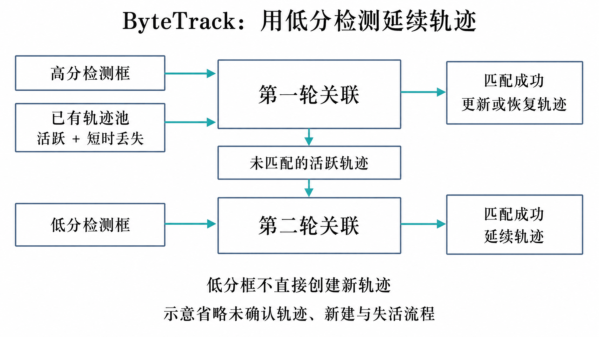

# 目录

[1. 跟踪任务与状态估计](#q-101)
  - [面试问题：什么是目标跟踪？它和目标检测有什么区别？](#q-001)
  - [面试问题：SOT、MOT、VOS、MOTS 分别是什么？](#q-002)
  - [面试问题：目标跟踪的主流工程范式是什么？](#q-003)
  - [面试问题：请简要介绍下卡尔曼滤波算法原理？](#q-004)

[2. 检测、运动与身份关联](#q-102)
  - [面试问题：SORT 为什么使用 Kalman Filter + Hungarian Matching？](#q-005)
  - [面试问题：DeepSORT 相比 SORT 改进了什么？](#q-006)
  - [面试问题：ByteTrack 为什么说低分检测框也有价值？](#q-007)
  - [面试问题：OC-SORT、BoT-SORT 这类方法主要优化了什么？](#q-008)
  - [面试问题：端到端多目标跟踪怎样传播 track query，为什么记忆更新仍会造成身份漂移？](#q-202)

[3. 模板、注意力与视频分割](#q-103)
  - [面试问题：孪生网络类单目标跟踪器的核心思想是什么？](#q-009)
  - [面试问题：Transformer 跟踪器相比 CNN/Siamese 跟踪器有什么优势？](#q-010)
  - [面试问题：SAM 2 对视频目标跟踪和分割有什么意义？](#q-011)
  - [面试问题：Grounding DINO + SAM 2 如何实现文本指令驱动的目标跟踪？](#q-012)
  - [面试问题：点跟踪与目标跟踪有什么区别，从二维轨迹走向三维需要哪些条件？](#q-201)

[4. 视频应用与可靠验收](#q-104)
  - [面试问题：目标跟踪在 AIGC 视频生成与视频编辑中有什么作用？](#q-013)
  - [面试问题：AI Agent 如何调用目标跟踪模型完成视频理解任务？](#q-014)
  - [面试问题：目标跟踪常用评估指标有哪些？](#q-015)
  - [面试问题：目标跟踪面试中常见的工程问题有哪些？](#q-016)

---

<h1 id="q-101">1. 跟踪任务与状态估计</h1>

<h2 id="q-001">面试问题：什么是目标跟踪？它和目标检测有什么区别？</h2>

<a id="1.什么是目标跟踪它和目标检测有什么区别"></a>

**难度评分：⭐⭐ (2/5)  |  考察频率：⭐⭐⭐⭐⭐ (5/5)**

目标检测回答一帧里“有哪些目标、位于哪里”，目标跟踪进一步建立这些观测在时间上的对应关系。两个人交错走过摄像头，检测器可以在每一帧都正确框出两个人；如果系统把两人的编号交换了，检测仍可能满分，跟踪却已经出错。

对第 $`t`$ 帧，检测输出通常是框、类别与分数的集合；跟踪输出还包含轨迹编号 $`i`$，将多帧中的观测连接成 $`\mathcal{T}_i=\{(t,b_{i,t},c_{i,t})\}`$。其中 $`b_{i,t}`$ 是位置，$`c_{i,t}`$ 可以记录类别或可信度，实际系统还应保存观测是否缺失、位置来自检测还是运动预测。分割跟踪把框换成 mask，三维跟踪则把位置扩展到空间坐标。

这增加了三类决策：**同一目标怎样延续，新目标何时建立轨迹，丢失目标何时终止**。检测只给出当前证据，运动模型帮助预测下一帧位置，外观特征帮助区分相邻目标，轨迹管理决定短时缺失能保留多久。它们可以组成显式流水线，也可以部分由神经网络联合学习。

例如门店统计“有多少人进入”，逐帧累加检测框会重复计数；跟踪后可以判断同一条轨迹是否按方向穿越入口线。但遮挡后新建了编号，仍可能重复计数，因此业务验收还需要检查入口附近的断轨和重新连接。

**轨迹 ID 是当前系统中的关联编号。** 它不等于经过核验的真实身份，也不天然跨镜头、跨日期稳定。在线跟踪只能使用当前及历史帧，离线跟踪可以利用未来观测重新连接轨迹；二者允许的信息不同，精度和延迟不能脱离这一条件比较。

<h2 id="q-002">面试问题：SOT、MOT、VOS、MOTS 分别是什么？</h2>

<a id="2.SOTMOTVOSMOTS-分别是什么"></a>

**难度评分：⭐⭐⭐ (3/5)  |  考察频率：⭐⭐⭐⭐⭐ (5/5)**

这几个缩写同时涉及目标数量、初始化方式和输出形式，不能只按“算法先进程度”排序。

<div align="center">

| 任务 | 典型输入与输出 | 主要困难 |
| --- | --- | --- |
| SOT，单目标跟踪 | 给定目标框等初始化信息，持续输出该目标的位置 | 区分类似干扰物，适应形变、遮挡与出画 |
| MOT，多目标跟踪 | 在视频中发现多个目标并维护各自 ID | 检测、关联、目标进入退出与身份切换 |
| VOS，视频目标分割 | 输出目标在各帧的像素级区域 | 边界、遮挡、形变与时序传播 |
| MOTS，多目标跟踪与分割 | 对多个实例同时输出 ID 和实例 mask | 联合处理目标发现、像素归属与身份连续性 |

表 1：任务协议决定系统需要解决什么；同一网络结构可以用于不同任务。

</div>

SOT 常见协议会在第一帧给出一个目标框。模型之后找的是“这个具体实例”，即使两辆车属于同一类别，也不能随意换车。MOT 常见的 tracking-by-detection 协议则每帧产生候选检测，持续管理目标集合。某些 MOT 研究固定外部检测输入，另一些联合学习检测与跟踪，比较时需要说明检测器是否相同。

VOS 的初始化并不统一。半监督 VOS 通常给定首帧或指定帧的目标 mask；可提示视频分割允许点、框、mask 等交互；还存在无监督、文本指代等协议。“VOS 一定输入首帧 mask”只覆盖其中一部分。MOTS 更强调多实例身份与分割结果共同正确。

选框还是 mask 应由下游决定。通道计数、粗粒度轨迹检索通常用框已经够用；给行走人物换衣服，需要衣服或人体的精细区域；要合成发丝、透明纱裙，还需要 alpha matting，二值 mask 无法表达半透明混合。

mask 的空间表达更丰富，但边界模型同样会出错，成本也更高。不能据此推导“分割跟踪必然比框跟踪准确”。应该分别评估身份保持、位置误差和边界质量，再看这些误差对业务是否重要。

<h2 id="q-003">面试问题：目标跟踪的主流工程范式是什么？</h2>

<a id="3.目标跟踪的主流工程范式是什么"></a>

**难度评分：⭐⭐⭐ (3/5)  |  考察频率：⭐⭐⭐⭐⭐ (5/5)**

选择跟踪方案，先看**关联依据保存在什么地方、怎样随时间更新**，再讨论使用 CNN 还是 Transformer。

**检测后关联**先找出当前帧目标，再把检测与已有轨迹配对。SORT、DeepSORT、ByteTrack 属于这条路线，模块可以分别替换，便于定位漏检和关联错误。代价是检测遗漏会直接削弱后续证据，关联代价和生命周期阈值也需要适配场景。

**模板匹配**保存指定目标的特征，在后续搜索区域寻找最相似位置，常用于 SOT。它适合“用户先选中一个物体，系统持续跟随”的任务。搜索范围太小会追不上快速运动，范围太大则容易引入相似干扰物；模板更新既能适应新外观，也可能把背景记进去。

**跨帧状态传播**把目标状态编码成轨迹 query、时序特征或记忆，再用当前帧证据更新。端到端 MOT 和带记忆的视频分割都可以采用这种思路，但输出与监督不同：前者通常维护实例框及 ID，后者还要预测逐像素归属。将关联纳入网络以后，目标出生、遮挡和终止仍然存在，只是部分决策换了实现位置。

**离线图优化或轨迹连接**把一段视频的检测、短轨迹作为节点，再利用未来信息修复中断。在视频资产整理中可以接受等待全片处理；机器人避障通常无法等待。因此“利用全局信息更准”必须连同延迟条件一起说明。

这些分类可以交叉。Transformer 是计算和表征结构，既能做模板匹配，也能做检测、轨迹传播或分割记忆。工程上可以先建立检测后关联的可解释基线，再判断主要瓶颈是漏检、拥挤关联、长时记忆还是像素边界，避免因为某种结构更新就替换整个系统。

<h2 id="q-004">面试问题：请简要介绍下卡尔曼滤波算法原理？</h2>

<a id="4.请简要介绍下卡尔曼滤波算法原理"></a>

**难度评分：⭐⭐⭐ (3/5)  |  考察频率：⭐⭐⭐⭐⭐ (5/5)**

卡尔曼滤波用一套递推方式融合**运动预测和有噪声的观测**，同时估计状态的不确定性。它不会识别“这是哪一个人”，但可以回答“根据过去的运动，这个人现在大概在哪里，预测有多不可靠”。

用水平运动举例，状态 $`x_t=[p_t,v_t]^\top`$ 包含位置和速度，检测器只观测位置 $`z_t`$。相邻采样间隔是 $`\Delta t`$，匀速模型可写成：

```math
\begin{aligned}
x_t&=F_tx_{t-1}+w_t,\\
z_t&=H_tx_t+v_t^{\mathrm{obs}}.
\end{aligned}
```

这里 $`F_t=\begin{bmatrix}1&\Delta t\\0&1\end{bmatrix}`$ 将上一时刻状态推进到当前时刻，$`H_t=[1,0]`$ 把状态映射到观测空间。过程噪声 $`w_t`$ 描述加速度等未建模变化，协方差为 $`Q_t`$；观测噪声 $`v_t^{\mathrm{obs}}`$ 描述检测误差，协方差为 $`R_t`$。上标用于避免把观测噪声与状态中的速度混淆。

**预测**阶段先得到状态均值和误差协方差：

```math
\begin{aligned}
\hat x_{t|t-1}&=F_t\hat x_{t-1|t-1},\\
P_{t|t-1}&=F_tP_{t-1|t-1}F_t^\top+Q_t.
\end{aligned}
```

$`t|t-1`$ 表示只利用截至上一时刻的信息估计当前状态。$`P`$ 描述估计误差分布的尺度与方向，不是目标尺寸。随后用创新 $`r_t=z_t-H_t\hat x_{t|t-1}`$，也就是观测与预测的差，完成**更新**：

```math
\begin{aligned}
S_t&=H_tP_{t|t-1}H_t^\top+R_t,\\
K_t&=P_{t|t-1}H_t^\top S_t^{-1},\\
\hat x_{t|t}&=\hat x_{t|t-1}+K_tr_t,\\
P_{t|t}&=(I-K_tH_t)P_{t|t-1}.
\end{aligned}
```

$`S_t`$ 是创新协方差，$`K_t`$ 是卡尔曼增益，决定修正强度，$`I`$ 为单位矩阵。数值实现中常采用更稳定的协方差更新形式，避免浮点误差破坏对称性和半正定性。

假设一维位置预测是 100，预测方差为 25，检测位置是 110，检测方差为 4，则增益为 $`25/(25+4)\approx0.862`$，更新位置约为 108.62。检测更可信，所以结果更接近 110；若观测方差很大，则更依赖预测。多维情况下，位置和速度通过协方差耦合，位置观测也能修正速度。

目标短时遮挡时可以只预测，但不确定性会随未观测时间增加，不能把外推框当成已确认检测。丢帧或变帧率时应按真实时间间隔调整 $`F_t`$ 和过程噪声模型；突然转弯、镜头切换和严重非线性运动则会破坏匀速假设。

在线性模型、已知初始高斯分布，以及零均值、相互独立且与初始状态独立的高斯白噪声等条件下，卡尔曼滤波可给出最优的条件均值估计。若放宽高斯条件，但保留适当的不相关性和已知二阶统计量，则仍有线性最小均方意义。实际跟踪通常只是近似满足条件，还需要可靠关联。把另一人的框更新进去，滤波器可能非常平滑地追错人。

<h1 id="q-102">2. 检测、运动与身份关联</h1>

<h2 id="q-005">面试问题：SORT 为什么使用 Kalman Filter + Hungarian Matching？</h2>

<a id="5.SORT-为什么使用-Kalman-Filter--Hungarian-Matching"></a>

**难度评分：⭐⭐⭐ (3/5)  |  考察频率：⭐⭐⭐⭐⭐ (5/5)**

SORT 把多目标跟踪拆成两个小问题：用卡尔曼滤波预测每条轨迹的位置，用匈牙利算法完成当前帧的一对一分配。它的价值是用很低的关联开销建立可用基线，同时清楚暴露出检测质量对跟踪的影响。

原始 SORT 的状态为 $`[u,v,s,r,\dot u,\dot v,\dot s]^\top`$：$`u,v`$ 是框中心，$`s`$ 是框面积，$`r`$ 是宽高比，带点的三项表示相应变化率。注意 $`s`$ 在这里不是边长。面积和宽高比可以还原宽高：$`w=\sqrt{sr}`$，$`h=\sqrt{s/r}`$。模型采用近似匀速状态转移，宽高比没有单独的速度项。

每帧先预测轨迹框，然后计算预测框与检测框之间的 IoU，以 $`1-\mathrm{IoU}`$ 一类距离构造代价矩阵。匈牙利算法在当前矩阵上寻找总成本较小的一对一指派，避免两个轨迹同时抢同一个检测。低于合理重叠要求的配对要拒绝，未匹配的轨迹继续累计丢失时长，未匹配的检测可建立候选轨迹，并通过命中次数等规则确认。

假设两条预测轨迹 A、B 与两项检测的 IoU 分别为 A→1：0.8，A→2：0.7，B→1：0.75，B→2：0.1。A 先贪心占检测 1，会迫使 B 接受很差的检测 2；整体指派可以选择 A→2、B→1，使总相似度从 0.9 提高到 1.45。这说明分配需要联合考虑当前候选。

但匈牙利算法只优化**给定代价下当前帧的分配**，不保证整段视频的身份全局正确。无效边、未匹配选项和阈值怎样参与求解也会影响结果；先强制全配对再随意删边，可能与带门控的分配行为不同。

SORT 没有显式外观记忆。人群交错、检测中断或镜头移动时，预测位置与 IoU 可能不足以区分身份。提高轨迹保留时间有助于等待重现，也扩大了旧轨迹误接新目标的机会。因此 SORT 很适合固定视角、运动较平稳、检测较可靠的场景，不能用其轻量性推导拥挤环境中的身份稳定性。

<h2 id="q-006">面试问题：DeepSORT 相比 SORT 改进了什么？</h2>

<a id="6.DeepSORT-相比-SORT-改进了什么"></a>

**难度评分：⭐⭐⭐ (3/5)  |  考察频率：⭐⭐⭐⭐⭐ (5/5)**

DeepSORT 在 SORT 的运动关联之外加入深度外观表示，让系统在位置暂时不可靠时，仍有机会判断“这个检测像不像此前的目标”。

每个检测框被裁剪并编码成归一化向量 $`f_j`$，每条轨迹保存一组历史外观特征 $`\mathcal{R}_i`$。外观距离常取检测与历史库中最接近特征的余弦距离：

```math
d^{\mathrm{app}}(i,j)=
\min_{r\in\mathcal{R}_i}(1-r^\top f_j)
```

这样，一条轨迹可以同时保留正面、侧面等外观。只用最新一帧容易受遮挡污染，保存全部历史又会增加计算量并保留错误特征，所以实现通常限制特征库容量。

运动距离使用观测与预测之间的平方马氏距离：

```math
d^{\mathrm{motion}}(i,j)=
(z_j-\hat z_i)^\top S_i^{-1}(z_j-\hat z_i)
```

$`\hat z_i`$ 是第 $`i`$ 条轨迹在观测空间的预测，$`S_i`$ 是相应协方差。与像素欧氏距离相比，马氏距离考虑预测的不确定方向与尺度，可用卡方分布阈值做门控，把明显不可能的匹配排除。

两种距离可以组合，但不能把 DeepSORT 简化成“固定比例加权”。原论文在相应实验中可令组合系数 $`\lambda=0`$，以外观代价求匹配，同时仍使用运动门控。**用什么排序候选**与**允许哪些候选进入匹配**是两项不同决策。

它还采用匹配级联，优先处理近期更新过的轨迹，再处理较久未匹配的轨迹，避免长时间失踪、位置不确定性很大的轨迹抢占当前证据。未确认轨迹和部分剩余轨迹再通过 IoU 等规则处理；多次命中后确认，长期未更新则删除。

例如两个行人相向经过，框位置十分接近，服装特征可能帮助保持各自 ID。但同款制服、极小裁剪、强烈色偏或长时换装会使外观依据失效；错误裁剪写入特征库，还可能把一次误配变成长时间漂移。部署时应同时检查检测裁剪质量、ReID 领域适配、特征更新条件和关联门控。外观向量支持相似性判断，不能单凭相似度确认现实中的同一个人。

<h2 id="q-007">面试问题：ByteTrack 为什么说低分检测框也有价值？</h2>

<a id="7.ByteTrack-为什么说低分检测框也有价值"></a>

**难度评分：⭐⭐⭐⭐ (4/5)  |  考察频率：⭐⭐⭐⭐⭐ (5/5)**

低检测分数不只来自背景，也可能来自被遮挡、运动模糊或尺寸较小的真实目标。ByteTrack 利用已有轨迹提供的时间先验，让这部分弱观测在合适条件下继续发挥作用。

如果上一帧已经稳定跟到一个人，这一帧因为柱子遮挡，检测分数从 0.9 降到 0.3；直接用高阈值删掉这个框，就人为制造了漏检。反过来，如果把所有 0.3 的框都建立为新目标，背景误检又会大量增加。**延续已有轨迹与创建新轨迹，所需要的证据强度可以不同。**

<div align="center">
  
  <p>图 1：ByteTrack 两阶段关联的概念示意。第二轮只接收第一轮未匹配的活跃轨迹；未确认、新建、丢失与删除等生命周期规则见正文。</p>
</div>

按官方 `byte_tracker.py` 的主要流程理解：

1. 将检测分成高分集合和处于较低分数区间的集合，极低分候选仍被过滤。轨迹先进行运动预测。
2. 已确认的活跃轨迹与仍在保留期内的丢失轨迹组成候选池，先关联高分框；匹配后更新活跃轨迹，或重新激活丢失轨迹。
3. 第一轮未匹配且状态仍为 `TrackState.Tracked` 的轨迹，再与低分框关联。**这一轮不包括所有历史丢失轨迹。**
4. 第二轮匹配成功则延续轨迹，仍失败的活跃轨迹进入丢失状态。未确认轨迹与剩余高分检测另行处理，满足新建阈值的高分检测可启动轨迹；超时丢失和重复轨迹还要清理。

这一区分容易在简图中丢失：第一轮可以用高分检测恢复先前丢失的轨迹，第二轮主要挽救这一帧没被高分框接住的活跃轨迹。低分框不能直接凭空创建新 ID。不同移植实现可能调整距离和阈值，分析结果时要检查实际代码。

ByteTrack 的基础关联主要依赖运动预测与 IoU，不要求额外 ReID 网络。它能修复一部分“有检测但被阈值提前删除”的断轨，不能恢复检测器完全没有提出的目标，也无法单靠低分框解决外观相同目标的长时重识别。

调参时至少区分检测保留阈值、高分划分阈值、新轨迹建立阈值、关联门限和丢失缓冲时长。把这些阈值一并降低，往往得到更多且更长的错误轨迹。验收应在遮挡和拥挤切片上同时看召回、身份切换和误轨迹，而非只看框数量增加。

<h2 id="q-008">面试问题：OC-SORT、BoT-SORT 这类方法主要优化了什么？</h2>

<a id="8.OC-SORTBoT-SORT-这类方法主要优化了什么"></a>

**难度评分：⭐⭐⭐⭐ (4/5)  |  考察频率：⭐⭐⭐⭐ (4/5)**

两类方法都在补强 SORT 系列的运动关联，但针对的问题不同：**OC-SORT 更关心遮挡期间预测误差怎样积累，BoT-SORT 同时改进运动状态、相机运动补偿和关联信息。**

**OC-SORT 的观察中心思想。** 连续若干帧没有检测时，卡尔曼滤波只能按模型外推。如果目标实际转弯，重现时的位置与预测可能相差很远。Observation-Centric Momentum 利用真实历史观测估计方向，在匹配中加入方向一致性；Observation-Centric Re-Update 在目标重现后，以遮挡前的最后观测和重现观测构造虚拟观测路径，重新更新遮挡期间积累的状态；Observation-Centric Recovery 再利用最近观测尝试恢复部分漏配。

例如人在柱子后转弯，旧速度指向正前方，重现位置却偏向右侧。重新利用遮挡两端的观测，可以减少继续沿错误速度运动的影响。但两端插值只是一种近似，不代表柱子后真实走过直线。在线算法在当前重现时修正内部状态，也不等于此前已经输出的所有位置都在当时获得了未来信息。

**BoT-SORT 的场景运动补偿。** 相机向右平移会令大量背景和目标在图像中向左移动，直接把这种共同位移当成每个目标的独立运动会破坏关联。BoT-SORT 利用特征匹配估计相机运动，对轨迹预测进行补偿；它还采用中心、宽、高及相应速度的状态表示，调整框尺寸建模，并结合检测置信度、IoU 与可选外观 ReID。需要区分启用和未启用 ReID 的配置，不能把全部收益归到外观网络。

补偿也有条件。单个二维变换难以同时解释强视差下的近景和远景，画面中大量动态物体会污染背景匹配，镜头切换更不应强行延续。运动模糊导致特征不足时，需要检查补偿质量并回退，而非把估计矩阵无条件应用到所有轨迹。

比较这些方法时应尽量固定检测器、输入分辨率、阈值和评测协议。分别查看遮挡时长、非线性运动和相机运动切片：方向更准、状态恢复更稳、补偿更好，属于不同收益。否则更强的检测器或额外 ReID 成本很容易被误记为关联算法本身的提升。

<h2 id="q-202">面试问题：端到端多目标跟踪怎样传播 track query，为什么记忆更新仍会造成身份漂移？</h2>

**难度评分：⭐⭐⭐⭐ (4/5)  |  考察频率：⭐⭐⭐ (3/5)**

端到端多目标跟踪可以将每个对象的历史状态编码成一个 track query，并把它传给下一帧。这样，模型在读取当前图像时已经带着“我正在找谁”的条件，检测与关联可以共同学习。

以 MOTR 为例，检测 query 负责发现新目标，已存在目标的轨迹 query 继续读取当前帧特征、预测位置，并更新表示后传播。训练时要让同一真值轨迹在时间上继承对应关系，新目标再通过匹配获得监督；如果每帧完全独立地重新分配身份，就难以学到持续状态。轨迹感知标签分配和序列训练因此与解码器结构同样关键。

可以把状态更新抽象为 $`q_i^t\rightarrow o_i^t\rightarrow q_i^{t+1}`$：$`q_i^t`$ 是当前帧输入的轨迹表示，$`o_i^t`$ 是结合图像后得到的输出表示，后者再经具体更新模块用于下一帧。这个向量不是固定身份证，它同时携带外观、位置和上下文，内容会不断变化。

当两个人拥挤交错，当前帧注意力可能把另一人的特征写入目标 query。下一帧再基于这个已污染状态寻找目标，错误就能自我强化。类似问题也存在于模板更新和视频分割记忆，区别在于状态形式与监督方式。

2026 年的 TQC 研究把干预放在传播之前：先计算当前帧表示更新 $`d_i^t=o_i^t-q_i^t`$，利用框 IoU 找到附近的活跃轨迹，估计更新中朝向这些候选表示的正投影，再减去一个幅度受限的修正量。它不额外训练网络，通过限制修正相对原始更新的大小，避免连正常外观变化一起过度削弱。

这里的“附近轨迹”只是潜在干扰者，不能直接视为造成错误的真因；多个候选方向也未必正交，减去合成修正不保证每个方向都得到改善。该方法面向持续传播的活跃轨迹，依赖候选框正 IoU，不能直接解决目标初始化错误或轨迹终止后的重识别。论文在相应 DanceTrack、SportsMOT 设置中报告的改善，也不是对所有视频分布的保证。

因此，端到端跟踪仍需说明出生、遮挡、终止与更新规则，并在同一检测质量和计算预算下评价。值得保留的认识是：**记忆更新本身就是需要监督和验收的决策**。持续写入更多历史，并不自然等于保留了更可靠的身份。

<h1 id="q-103">3. 模板、注意力与视频分割</h1>

<h2 id="q-009">面试问题：孪生网络类单目标跟踪器的核心思想是什么？</h2>

<a id="9.孪生网络类单目标跟踪器的核心思想是什么"></a>

**难度评分：⭐⭐⭐ (3/5)  |  考察频率：⭐⭐⭐⭐ (4/5)**

孪生网络把单目标跟踪转化为**给定目标样例后的相似性搜索**。初始化时从图像中裁出目标模板 $`z`$，下一帧裁出较大的搜索区域 $`x`$，使用共享参数的特征提取器 $`\phi`$ 编码两者，再比较模板与不同空间位置的匹配程度。

SiamFC 的代表性形式是：

```math
R(z,x)=\phi(z)\star\phi(x)+b
```

$`\star`$ 表示互相关，$`R`$ 是二维响应图，$`b`$ 为偏置。模板特征相当于一个由当前目标决定的匹配核，在搜索特征上滑动；响应峰值指示较可能的位移。原始 SiamFC 还通过多尺度搜索适应尺度变化，而不直接把响应峰值理解为完整精确框。

例如首帧框中是一辆白色轿车，模板保存其外观，后续在上一位置周围搜索匹配。网络在离线训练时见过许多成对样本，学会“哪些特征适合比较”，测试时不必为每个目标从头训练分类器。这解释了其速度优势，也解释了为什么输入模板质量非常重要。

后续 SiamRPN 类方法增加分类与框回归，使匹配结果能直接产生位置和尺度修正；分割分支可以进一步预测目标区域。它们共享“模板引导搜索”的思想，但预测头、训练标签和模板更新规则并不相同，不能把整个家族都等同于一次简单卷积。

搜索区域是关键约束。区域小，计算少且干扰少，但快速运动或长遮挡后目标可能已经跑出窗口；区域大，更容易找回目标，也会遇到相似车辆和更多背景。全图重检测能够补充局部搜索，却需要额外的候选确认，防止重新找到的是另一辆白车。

模板也不能无条件跟着预测更新。若当前框已经偏到背景，把它写回模板会让下一帧更加确信错误位置。常见处理是保留初始模板、使用多个高质量模板，或只在定位、外观和可见性共同可靠时更新。模板更新的核心权衡，是适应真实外观变化与避免错误自我强化。

<h2 id="q-010">面试问题：Transformer 跟踪器相比 CNN/Siamese 跟踪器有什么优势？</h2>

<a id="10.Transformer-跟踪器相比-CNNSiamese-跟踪器有什么优势"></a>

**难度评分：⭐⭐⭐⭐ (4/5)  |  考察频率：⭐⭐⭐⭐ (4/5)**

Transformer 为跟踪提供的主要能力，是让目标模板、搜索区域和必要的历史状态进行**内容相关的信息交互**。收益取决于交互对象与训练方式，不能仅由“使用注意力”推出更强的长时记忆。

在简单相关匹配中，模板特征与搜索特征通常先独立提取，再比较相似度。交叉注意力允许搜索位置根据模板内容读取相关信息，也允许模板结合当前搜索场景调整表示。这样可以同时利用目标局部纹理、周边上下文和不同空间区域之间的关系，改善形变或部分遮挡下的匹配。

几种代表设计的区别是：

- **TransT**通过自注意力与交叉注意力融合模板和搜索特征，再预测分类与框。
- **STARK**把模板及搜索区域的时空信息纳入 Transformer 建模，具体模板更新和预测方式依版本而异。
- **OSTrack**将模板与搜索 patch token 放入同一骨干中联合编码，特征提取和关系建模在一个流里完成，并可筛除部分搜索候选以降低后续成本。

它们并不都保存整段视频的任意长历史。许多单目标跟踪器主要读取初始模板、有限动态模板与当前搜索区域。只有明确设计了可持续状态、记忆选择和更新机制，才能讨论长期信息怎样保存。

设模板有 $`N_z`$ 个 token，搜索区域有 $`N_x`$ 个 token，朴素全局自注意力的关系矩阵规模随 $`(N_z+N_x)^2`$ 增长。更高分辨率有助于看清小目标，也会扩大计算和显存开销。窗口、稀疏采样、候选消除等设计在减少成本的同时，可能提前丢掉真正目标，需要检查遮挡和快速运动场景。

两辆外观相同的车交错时，注意力仍然可能把目标信息混合；模板已经错误时，强交互还会传播错误。工程比较应固定训练数据、输入分辨率、更新策略和算力，分别评估定位、重检测与身份保持。Transformer 改变了信息融合方式，跟踪任务中的证据不足问题仍然存在。

<h2 id="q-011">面试问题：SAM 2 对视频目标跟踪和分割有什么意义？</h2>

<a id="11.SAM-2-对视频目标跟踪和分割有什么意义"></a>

**难度评分：⭐⭐⭐⭐ (4/5)  |  考察频率：⭐⭐⭐⭐⭐ (5/5)**

SAM 2 把可提示图像分割扩展到视频，通过当前帧视觉特征和历史目标记忆，持续输出指定对象的 mask。它降低了“每帧重新标注一次”的成本，也让视频编辑可以直接围绕对象区域组织。

用户在某帧点选人物或给出框，模型得到初始分割。随后每一帧仍要进行图像编码，并根据相关记忆理解目标在当前画面中的位置与形状，再解码 mask；当前结果还可写入记忆，服务后续帧。记忆中既可以包含空间信息，也包含对象层面的表示。具体结构见[视频分割中的 SAM 2 机制](./图像分割高频知识点.md#q-016)。

以人物转身为例，框只能描述一个矩形区域，视频分割可以随姿态改变刻画手臂、身体和背景之间的边界。将 mask 提供给局部重绘或自动标注流程，可以减少逐帧修边工作。用户在失败帧补一个纠正提示，还能让后续传播使用更可靠的条件。

但“有记忆”并不等于身份永远不丢。长时间遮挡、相似目标交叉、出画后重现都可能使错误 mask 写入记忆。需要检查目标存在性、跟踪质量和提示来源，在明显失效处重新定位或交互修正，不能只依靠 mask 连续输出就认定一直追对。

SAM 2 本身的点、框、mask 提示也不自动解决自然语言选目标、多目标出生与跨镜头重识别。要持续发现新进入画面的对象，需要额外的检测或其他发现机制；要跟踪“第二个走进来的红衣人”，还要处理时间顺序和指代关系。

最后，分割 mask 不等于抠像 alpha。发丝、运动模糊和透明物体包含混合像素，即使区域分割稳定，直接用二值边界合成也可能出现硬边和闪烁。视频制作应把对象定位、边界精修、时序质量和合成效果分别验收。

<h2 id="q-012">面试问题：Grounding DINO + SAM 2 如何实现文本指令驱动的目标跟踪？</h2>

<a id="12.Grounding-DINO--SAM-2-如何实现文本指令驱动的目标跟踪"></a>

**难度评分：⭐⭐⭐⭐ (4/5)  |  考察频率：⭐⭐⭐⭐⭐ (5/5)**

这条工具链把自然语言选目标和跨帧区域传播连接起来：Grounding DINO 根据文本产生候选框，SAM 2 由框等空间提示启动分割，再把选中的实例传播到视频后续帧。

例如用户要求“跟踪画面左侧的红色背包”，系统先用“red backpack”等短语定位候选背包；如果找到多个，应结合左侧位置等条件选择实例，再把选定框与当前帧交给 SAM 2。后续保存目标 ID、mask、时间戳和存在性状态，而不是每帧只留下一个没有来源的框。

这里有三个容易被省略的步骤。

**文本定位需要消歧。** 开放词汇检测擅长短语与区域对应，但复杂关系、否定或“最早进入画面的那个人”需要额外的关系和时间判断。将长指令原样塞入检测器，不保证每个约束都生效。没有符合条件的目标时，也应允许返回空结果。

**持续视频需要管理新目标。** 只在第一帧检测，无法发现之后进入的背包。可以按时间间隔或跟踪失败信号重新检测，再把新候选与已有轨迹去重、匹配。每次重检都直接建新 ID，会制造重复目标；把相似候选都合并，又可能吞掉真实的新实例。

**坐标和时间必须一致。** 检测输入可能经过缩放、补边，SAM 2 输入又可能使用另一尺寸。框必须回到正确坐标系，视频帧序号要与原始时间戳对应；抽帧、可变帧率或异步推理时更应显式保存映射。坐标错位会造成看似合理却追错区域的结果。

当目标完全遮挡后再出现，重新用文本找出的“红色背包”只证明语义匹配，不能保证仍是先前那个背包。应结合时间、空间、外观和轨迹状态判断，必要时标记身份不确定。

集成模型正在吸收部分文本发现与视频分割能力，例如本板块讨论的[概念提示视频分割](./图像分割高频知识点.md#q-201)。无论模块是否合并，语义选择、实例身份和跨帧传播仍是三个需要分别验证的能力。

<h2 id="q-201">面试问题：点跟踪与目标跟踪有什么区别，从二维轨迹走向三维需要哪些条件？</h2>

**难度评分：⭐⭐⭐⭐ (4/5)  |  考察频率：⭐⭐⭐ (3/5)**

目标跟踪主要维护“哪一个实例”，点跟踪进一步维护“这个具体表面位置去了哪里”。一只手转动时，手的检测框可能几乎不变，指尖、指节和手背上的纹理点却沿不同轨迹移动。点轨迹因此更适合局部形变、机器人操作、运动迁移和视频编辑。

二维点跟踪通常给定查询点 $`(x_q,y_q,t_q)`$，预测其在各帧的坐标与可见性。TAPIR 一类方法结合全局匹配与局部时序细化；CoTracker 系列联合建模多个点的关系，利用共同运动和时空上下文减少独立匹配的歧义。CoTracker3 还探索用真实视频的伪标签扩大训练，说明高质量数据与可见性监督同样重要，不能把改进都归于网络结构。

与光流相比，光流常从相邻两帧估计密集位移，点跟踪更直接围绕跨多帧的指定查询建立对应。光流连续累加也能构造轨迹，但每一步误差会累积，遮挡后缺少观测尤其难处理。两者可以组合，并非完全互斥。

**遮挡状态必须与坐标一起理解。** 模型可能为不可见点预测位置，这是一种基于时序和几何的估计，不是相机直接观测。评价应分别检查可见性判断和位置误差，并说明允许使用未来帧还是只能流式处理。离线双向信息带来的恢复能力不能直接宣称为实时能力。

走向三维后，还要回答坐标系、尺度和相机运动来自哪里。单目二维轨迹一般不足以唯一恢复物理尺度；额外深度、已知相机参数、多视角或学习先验会提供不同约束。多个视角只有在标定、时间同步和对应关系可信时，才可能有效融合。

2026 年的 Tracktail 提供了一个具体例子：在**同步、静态、已标定的多相机视频和三维查询点**条件下，它分别编码各相机的视频，再让查询在相机维、时间维和场景特征之间交互，融合各视角预测得到三维轨迹。它根据相机参数与查询点计算尺度归一化，无需把深度图作为跟踪器输入。

这不意味着无相机标定的单目视频也能直接输出可靠的米制运动，三维查询点本身仍需获得。论文中的长视频通过重叠窗口传播，仍存在点漂移、移动相机和合成到真实数据的限制。因此值得长期学习的是**几何约束、可见性和时序状态怎样一起组织**，而非把“无深度输入”理解为去掉了所有三维先验。

<h1 id="q-104">4. 视频应用与可靠验收</h1>

<h2 id="q-013">面试问题：目标跟踪在 AIGC 视频生成与视频编辑中有什么作用？</h2>

<a id="13.目标跟踪在-AIGC-视频生成与视频编辑中有什么作用"></a>

**难度评分：⭐⭐⭐ (3/5)  |  考察频率：⭐⭐⭐⭐ (4/5)**

目标跟踪把视频中的对象连接成持续的编辑对象，使“处理某个角色”能够落实到每一帧的具体区域或运动状态。

**局部编辑**先得到人物、衣物等目标的跨帧 mask，再向生成模型提供区域条件。例如把外套改成蓝色，需要保证袖口、身体转向和遮挡后的衣服区域都被正确选中。跟踪的空间误差会造成漏改或背景污染，身份切换会把修改转移到另一个人身上。即使 mask 完全正确，生成模型仍可能改变纹理、亮度或人物细节，因此跟踪稳定只是编辑一致性的一个条件。

**运动控制**可以把目标中心、关键点或稠密点轨迹作为生成条件。框中心只能表达粗位移，关节点能表达姿态，点轨迹更适合描述局部形变。控制信号要与生成视频的时间长度、分辨率和相机坐标对齐；把参考轨迹简单缩放到新视频，并不自动保留真实三维运动。

**生成质量评估**可以观察同一对象的轨迹是否突然跳变、关键点是否异常漂移、外观是否持续变化。但跟踪器本身也可能在生成纹理、特殊光照或运动模糊上失效。出现 ID 切换时，应回看原始帧，区分生成器改变了角色、跟踪器接错身份，还是两者同时发生。不能把跟踪评分直接当成生成器的身份一致性真值。

**数据构建**可以用跟踪生成视频伪标签，降低逐帧标注成本。连续错误也会被成批复制，尤其是目标长时遮挡后的段落。更稳妥的做法是抽查进入、退出、交叉和遮挡恢复等高风险片段，并把人工纠正回写到轨迹或提示，而非仅检查随机静止帧。

用于抠像和合成时，还要单独检查 alpha 边界、遮挡层次和背景一致性。对象轨迹回答“这一帧该处理哪里”，生成与渲染模块决定“处理后是否仍自然”。这两个质量维度需要一起验收。

<h2 id="q-014">面试问题：AI Agent 如何调用目标跟踪模型完成视频理解任务？</h2>

<a id="14.AI-Agent-如何调用目标跟踪模型完成视频理解任务"></a>

**难度评分：⭐⭐⭐⭐ (4/5)  |  考察频率：⭐⭐⭐⭐⭐ (5/5)**

视频 Agent 可以把跟踪结果作为结构化时序证据，减少反复理解整段视频的成本。它应围绕待回答的问题选择目标、时间范围和证据精度，而不是先对全片所有像素做最重的处理。

以“找出第一个拿起黑色背包的人，并说明他随后去了哪里”为例，可以分为四步：

1. 在低帧率浏览或候选片段中发现人物和背包，保存候选时间段，而不提前确定最终身份。
2. 在候选段内提高采样密度，跟踪人物、背包及必要的手部区域，建立临时轨迹 ID。
3. 检查“拿起”的事件证据：手与包的接触、包离开原支撑位置、随后与人的运动关系，以及事件发生的先后时间。
4. 沿已经确认的事件参与者轨迹查询后续位置，将答案连到具体时间戳与帧证据；遇到遮挡断轨则保留不确定段。

人物与背包距离接近，只能证明空间接近，不能单独证明拿起。两者一起移动也可能来自相机运动。把位置关系、动作变化和原始视频证据结合起来，才能支持事件判断。

工具返回结果应明确 `track_id`、`frame_index`、`timestamp`、位置或 mask 引用、观测/预测标记、丢失状态和模型版本。检测分数、mask 质量分数、身份关联分数含义不同，不宜混成一个万能“置信度”。Agent 可以据此决定局部重看、增加检测或请求人工确认。

长视频尤其要注意抽帧与时钟。每秒看一帧可能漏掉半秒内的拿放动作；视频容器时间戳也未必等于“帧号除以标称 FPS”。回答“第一个”需要覆盖所有合理候选时间段，不能只在少量片段中找到一个例子就下结论。

最终输出最好区分直接观测与推断，例如“12.4 秒包离开桌面，随后随轨迹 7 移动；15.1—17.0 秒人物被遮挡，之后身份关联未确认”。这样的结果能被用户复核，也能让后续工具只补查缺失证据。

<h2 id="q-015">面试问题：目标跟踪常用评估指标有哪些？</h2>

<a id="15.目标跟踪常用评估指标有哪些"></a>

**难度评分：⭐⭐⭐ (3/5)  |  考察频率：⭐⭐⭐⭐⭐ (5/5)**

跟踪评价要同时回答：目标是否被发现、位置是否准确、同一身份是否持续，以及系统使用了多少时间和计算资源。单个指标通常覆盖不了这些问题。

**MOTA**汇总漏检 FN、误检 FP 和身份切换 IDSW：

```math
\mathrm{MOTA}
=1-\frac{\mathrm{FN}+\mathrm{FP}+\mathrm{IDSW}}{\mathrm{GT}}
```

$`\mathrm{GT}`$ 为所有帧中的真值目标实例总数。假设共 1000 个真值实例，漏检 100、误检 20、身份切换 10，MOTA 为 0.87。若错误总量超过真值数量，MOTA 可以为负。由于漏检、误检往往数量更大，MOTA 提升可能主要来自检测，不能据此确认身份更稳。

**IDF1**先在整段序列层面建立真值身份与预测身份的一对一对应，再统计身份正确、身份误报与身份漏报：

```math
\mathrm{IDF1}
=\frac{2\mathrm{IDTP}}
{2\mathrm{IDTP}+\mathrm{IDFP}+\mathrm{IDFN}}
```

一位行人被拆成多个短轨迹，或两个行人长期共用一个 ID，都可能受到明显惩罚。IDF1 的身份分配与普通逐帧检测匹配不同；较高 IDF1 也不代表每个目标都被完整检出。

**HOTA**在每个定位阈值 $`\alpha`$ 下结合检测准确性 DetA 和关联准确性 AssA：

```math
\mathrm{HOTA}_{\alpha}
=\sqrt{\mathrm{DetA}_{\alpha}\,\mathrm{AssA}_{\alpha}}
```

DetA 可理解为检测层面的 Jaccard 比例，AssA 衡量已匹配检测所属身份在序列中的对应质量，再对匹配检测平均。最终 HOTA 对一组定位阈值的结果聚合；不能把“先平均 DetA、AssA 再开方”当成完全相同的计算。应使用基准规定的匹配与 TrackEval 等实现，并同时看 DetA、AssA 分项定位问题。

**SOT**常用框 IoU 成功率曲线的 AUC、中心距离阈值下的 Precision 和归一化中心精度；固定像素阈值会受分辨率与目标尺寸影响。**VOS**常用区域 IoU $`\mathcal{J}`$ 和边界准确度 $`\mathcal{F}`$，后者包含边界匹配容差。MOTS 则还需要联合评估分割质量与实例身份。

业务评价应另看断轨时长、误计数、遮挡后恢复、目标进入发现延迟及 mask 抖动。速度要说明是否包含检测、ReID、解码、传输和后处理，报告设备、分辨率、目标数和延迟分位数。使用未来帧插值的离线结果不能与严格在线结果直接等价比较；每次换模型都应保留相同协议和场景切片。

<h2 id="q-016">面试问题：目标跟踪面试中常见的工程问题有哪些？</h2>

<a id="16.目标跟踪面试中常见的工程问题有哪些"></a>

**难度评分：⭐⭐⭐⭐ (4/5)  |  考察频率：⭐⭐⭐⭐ (4/5)**

排查跟踪故障，先定位**第一处错误出现在哪个环节**。轨迹后半段已经错得很明显，根因却可能只是几秒前的一次坏检测写入记忆。

<div align="center">

| 现象 | 优先检查的证据 | 可能的处理及代价 |
| --- | --- | --- |
| 清晰目标也频繁断轨 | 原始检测、分数过滤前后候选、类别限制 | 改善检测召回或保留弱候选；同时检查误检增量 |
| 两个目标交错后交换 ID | 关联代价、运动门控、外观裁剪和历史库 | 调整关联或外观模型；警惕相似衣物与坏模板 |
| 镜头一动大量轨迹失配 | 背景运动、补偿矩阵、帧时间间隔 | 做相机运动补偿；低质量估计需要回退 |
| 遮挡后找回了另一个人 | 丢失时长、恢复条件、目标是否已经出画 | 收紧恢复、结合外观与空间条件；必要时保留未知 |
| 框更平滑但反应迟钝 | 原始观测与平滑输出、事件延迟 | 降低平滑强度或改模型；避免掩盖真实急转弯 |
| 单模型很快，整路视频积压 | 解码、批处理队列、ReID和传输耗时 | 按全链路瓶颈优化，并记录端到端尾延迟 |

表 2：跟踪诊断应从可回放证据出发；增加缓存或降低阈值都可能引入另一类错误。

</div>

例如将轨迹保留期从 30 帧增到 90 帧，在固定 30 FPS 下相当于从约 1 秒增到约 3 秒，可能接住更长遮挡，也会让离场目标与后来者产生更多误匹配。若实际只处理 10 FPS，仍按“30 帧就是 1 秒”理解会产生三倍偏差。生命周期最好按真实时间解释，并明确跳帧时是否推进状态。

隔帧检测可以省算力，但目标每次观测之间的位移更大，匀速误差与关联歧义随之增加。ReID 批量抽特征可以提高吞吐，却可能增加等待时间；异步完成后必须按帧与轨迹版本正确回填，不能把旧结果覆盖到新状态上。检测分辨率、模型量化和目标数量上限也需要结合小目标、夜景、拥挤切片验证。

建议保留一小批完整失败片段，以及每帧检测、关联候选、状态转移和最终轨迹。先在同一检测输入上比较关联策略，再换检测器，才能判断收益来源。线上还应关注分布变化：摄像头角度、码率、曝光或制服更换，都可能使旧阈值失效。

视频剪辑可以使用离线插值修补断点，但要标记补出的轨迹；实时告警则必须面对当时可用信息。工程上的可靠结果，是在准确性、延迟与证据完整性之间给出可复现的取舍。

---

## 参考资料

- [SORT](https://arxiv.org/abs/1602.00763)、[DeepSORT](https://arxiv.org/abs/1703.07402)：运动估计、外观距离、级联匹配与生命周期的基础。
- [ByteTrack](https://arxiv.org/abs/2110.06864)、[官方关联实现](https://github.com/ifzhang/ByteTrack/blob/main/yolox/tracker/byte_tracker.py)：高低分框关联，以及论文概念与实际状态筛选的对应。
- [OC-SORT](https://arxiv.org/abs/2203.14360)、[BoT-SORT](https://arxiv.org/abs/2206.14651)：观察中心运动恢复、相机运动补偿与关联设计。
- [SiamFC](https://arxiv.org/abs/1606.09549)、[OSTrack](https://arxiv.org/abs/2203.11991)：模板匹配与模板/搜索联合表征。
- [SAM 2](https://arxiv.org/abs/2408.00714)、[Grounding DINO](https://arxiv.org/abs/2303.05499)：可提示视频分割和开放词汇目标定位。
- [HOTA](https://arxiv.org/abs/2009.07736)、[TrackEval](https://github.com/JonathonLuiten/TrackEval)：定位、检测和身份关联的评价定义与实现。
- [TAPIR](https://arxiv.org/abs/2306.08637)、[CoTracker3](https://arxiv.org/abs/2410.11831)、[Tracktail](https://arxiv.org/abs/2611.26779)：长时点对应、可见性和多视角三维跟踪。Tracktail 的条件与局限按 2026-11-26 可获得版本讨论。
- [MOTR](https://arxiv.org/abs/2105.03247)、[TQC](https://arxiv.org/abs/2610.38494)：轨迹 query 传播、身份监督与测试时状态更新校准。
