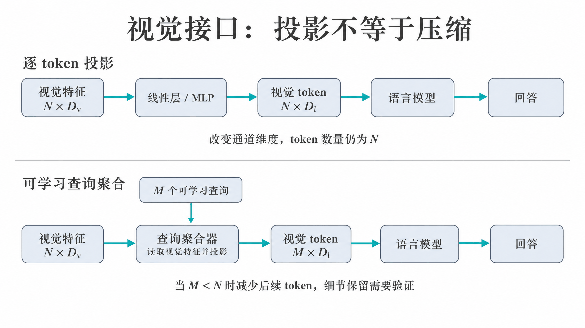

# 目录

[1. NLP 经典模型如何演进到大语言模型？](#q-001)
  - [面试问题：词向量 Word2Vec / GloVe 解决了什么问题？](#q-002)
  - [面试问题：RNN、LSTM、GRU 为什么曾经是序列建模主力？](#q-003)
  - [面试问题：Seq2Seq 和 Attention 如何推动机器翻译？](#q-004)

[2. Transformer 为什么成为 NLP 和多模态大模型的基础结构？](#q-005)
  - [面试问题：Self-Attention 的核心计算是什么？](#q-006)
  - [面试问题：BERT 和 GPT 的预训练目标有什么区别？](#q-007)
  - [面试问题：T5 的 Text-to-Text 思想有什么意义？](#q-008)
  - [面试问题：线性注意力和状态空间模型怎样保存历史，为什么仍需要关注记忆容量？](#q-202)

[3. 传统 NLP 任务在大模型时代还重要吗？](#q-009)
  - [面试问题：机器翻译、情感分析、问答系统的经典路线是什么？](#q-010)
  - [面试问题：知识图谱和 RAG 有什么关系？](#q-011)
  - [面试问题：双编码器、交叉编码器与多向量检索，如何权衡语义交互和检索成本？](#q-201)
  - [面试问题：NLP 与强化学习、元学习、Agent 有什么联系？](#q-012)

[4. 多模态模型如何从 CLIP 走向视觉语言助手？](#q-013)
  - [面试问题：CLIP 的图文对比学习为什么重要？](#q-014)
  - [面试问题：BLIP、BLIP-2、Flamingo 分别解决了什么问题？](#q-015)
  - [面试问题：LLaVA 的视觉指令微调有什么意义？](#q-016)
  - [面试问题：Florence-2 为什么被称为统一视觉任务模型？](#q-017)
  - [面试问题：CLIP 的文本编码器如何把自然语言变成视觉条件？](#q-021)
  - [面试问题：CLIP 有哪些代表性变体，分别解决什么问题？](#q-022)
  - [面试问题：多模态模型如何压缩视觉 token 以提升效率？](#q-023)

[5. NLP、多模态和生成模型如何组合成 AIGC 系统？](#q-018)
  - [面试问题：文本编码器在文生图、视频生成和多模态理解中有什么作用？](#q-019)
  - [面试问题：RAG、多模态 Agent 和工具调用如何复用经典 NLP 模型思想？](#q-020)

---

<h1 id="q-001">1. NLP 经典模型如何演进到大语言模型？</h1>

<h2 id="q-002">面试问题：词向量 Word2Vec / GloVe 解决了什么问题？</h2>

**难度评分：⭐⭐ (2/5)  |  考察频率：⭐⭐⭐⭐ (4/5)**

词向量把离散词映射到可学习的连续空间，使模型能够利用不同词之间的统计联系。词表中的每个词都用one-hot表示时，“猫”“狗”“发动机”在编码上彼此正交；模型必须从后续参数中重新学习它们的关系。稠密embedding让这类关系有机会直接进入表示，但**距离反映什么，取决于训练数据和目标**。

Word2Vec利用局部上下文学习词向量。CBOW根据窗口中的上下文预测中心词，Skip-gram根据中心词预测窗口内的词。以“猫躺在沙发上”为例，Skip-gram把“猫”与邻近词构成训练对；大量语料中相似的使用环境，使“猫”“狗”等词获得某些相近特征。这是分布假设，不是把词典定义硬编码进向量。

对一个正样本词对(w,c)，负采样的一种训练目标是最大化：

```math
\log\sigma(u_c^\top v_w)
+\sum_{j=1}^{k}\mathbb E_{n_j\sim P_n}
  [\log\sigma(-u_{n_j}^\top v_w)].
```

v和u分别属于中心词表与上下文词表，σ是sigmoid，负词从分布Pn抽取。它让真实共现对更容易被识别，避免每一步对整个词表计算完整softmax；负采样目标应与完整softmax似然区分，负词数量和采样分布也会改变学到的表示。

GloVe从全局共现矩阵出发。设Xij为词i和上下文j的共现次数，其典型加权最小二乘目标为：

```math
\sum_{i,j:X_{ij}>0} f(X_{ij})
\big(w_i^\top\tilde w_j+b_i+\tilde b_j-\log X_{ij}\big)^2.
```

权重f控制不同频次样本的影响，词向量的内积与对数共现统计建立联系。因此，Word2Vec偏向从窗口样本学习预测关系，GloVe显式拟合统计矩阵；不能只用“局部与全局”四个字替代对目标的解释。

静态词向量给同一个词一个固定表示，难以区分“苹果手机”和“苹果成熟了”；反义词也可能因上下文相似而距离很近。后来的上下文编码器使每次出现的词随语境变化，LLM的输入embedding则仍是查表起点，丰富语义在后续层逐步形成。RAG使用的句向量还需要针对检索匹配训练，直接平均词向量并不保证能处理否定、实体和长文关系。

<h2 id="q-003">面试问题：RNN、LSTM、GRU 为什么曾经是序列建模主力？</h2>

**难度评分：⭐⭐⭐ (3/5)  |  考察频率：⭐⭐⭐ (3/5)**

RNN用一个随时间更新的状态，把变长序列转成可重复执行的计算。常见形式为：

```math
h_t=\tanh(W_xx_t+W_hh_{t-1}+b).
```

xt是当前输入，ht概括到当前位置为止的信息。同一组参数沿时间共享，因此不必为不同句长设计不同网络。这个结构天然适合逐帧语音、逐词文本和流式传感器输入，历史状态可以随新数据持续更新。

困难出现在长距离梯度和状态容量上。跨多个时间步求导，需要连续相乘状态变换的雅可比矩阵，乘积可能衰减或增长；梯度裁剪主要控制爆炸，不能凭空找回已消失的信号。将全部历史压进一个固定大小状态，也要求模型主动选择保留什么。

LSTM增加细胞状态ct，并用门控制信息流：

```math
\begin{aligned}
f_t&=\sigma(W_f[x_t,h_{t-1}]+b_f),\quad
i_t=\sigma(W_i[x_t,h_{t-1}]+b_i),\\
\tilde c_t&=\tanh(W_c[x_t,h_{t-1}]+b_c),\quad
c_t=f_t\odot c_{t-1}+i_t\odot\tilde c_t,\\
o_t&=\sigma(W_o[x_t,h_{t-1}]+b_o),\quad
h_t=o_t\odot\tanh(c_t).
\end{aligned}
```

遗忘门f控制旧信息保留，输入门i控制写入，输出门o控制对外暴露。沿细胞状态的直接路径，导数包含遗忘门的连乘；当相关维度的f接近1时，信息与梯度更容易传播。这里说的是一条直接路径，完整导数还包含门对输入和历史状态的依赖。LSTM缓解长依赖困难，却没有保证无限记忆。

例如读到“这部电影虽然开头拖沓，最后却令人惊喜”，分类器需要保留转折前后的评价并更新结论。门控提供了可学习的更新方式，但能否学会仍取决于数据、目标和训练。GRU把机制简化为更新门与重置门：更新门调节旧状态与新候选的混合，重置门调节计算候选时读取多少旧信息。它不再单独维护LSTM式的细胞状态，参数和计算通常更少；哪一种更好需要在同一任务预算下比较。

循环状态依赖前一时刻，标准RNN/LSTM沿时间的训练难以充分并行。Transformer可以在训练时并行处理已知序列，因而更适合大规模计算；低延迟流式任务仍可能受益于递归状态。选型应同时看吞吐、状态大小、实际依赖长度与硬件实现，不能只依据模型诞生时间。

<h2 id="q-004">面试问题：Seq2Seq 和 Attention 如何推动机器翻译？</h2>

**难度评分：⭐⭐⭐ (3/5)  |  考察频率：⭐⭐⭐⭐ (4/5)**

Seq2Seq把“输入长度与输出长度不同”变成统一的条件生成问题：编码器读取源句，解码器逐步生成目标句。早期编码器常把整句压进最后一个固定维度向量，长句中的人名、修饰关系和细节容易竞争同一份容量。

Attention让解码器在每一步重新读取全部源位置。设编码器输出h₁到hₙ，解码器上一步状态为sₜ₋₁，可写为：

```math
e_{ti}=a(s_{t-1},h_i),\qquad
\alpha_{ti}=\frac{\exp(e_{ti})}{\sum_j\exp(e_{tj})},\qquad
c_t=\sum_i\alpha_{ti}h_i.
```

a是可学习的匹配函数，α是本步分配到源位置的权重，ct是加权上下文。解码器结合ct、已有状态和上一个目标词，预测当前词。翻译“a red car”时，生成“红色”与生成“汽车”可以读取不同的源位置；词序不一致时，也无需强迫输入与输出按位置一一对应。

训练通常使用teacher forcing：预测第t个目标词时输入真实的前缀，并最小化条件负对数似然。推理时真实前缀不可得，只能使用此前生成的内容。早期一个错误可能改变后续输入分布，这就是训练与自由生成之间需要关注的差异。贪心、beam search等解码策略改变搜索方式，但不能保证纠正模型自身的遗漏或错误概率分配。

Attention缓解了固定向量瓶颈，代价是每个输出位置需要访问多个源位置。它的权重可帮助观察对齐，却不能直接当作完整因果解释；多个位置可能提供重复信息，后续层也会继续变换它们。Transformer保留了“按查询读取序列”的机制，并以self-attention构造输入和输出表示，原始编码器—解码器中仍通过cross-attention连接两侧。

<h1 id="q-005">2. Transformer 为什么成为 NLP 和多模态大模型的基础结构？</h1>

<h2 id="q-006">面试问题：Self-Attention 的核心计算是什么？</h2>

**难度评分：⭐⭐⭐⭐ (4/5)  |  考察频率：⭐⭐⭐⭐⭐ (5/5)**

Self-Attention让每个位置按照当前内容，从允许访问的其他位置汇集信息。设输入X有n个token、每个维度为d，一头注意力计算：

```math
Q=XW_Q,\quad K=XW_K,\quad V=XW_V,
\qquad
Y=\mathrm{softmax}_{\mathrm{row}}
\left(\frac{QK^\top}{\sqrt{d_k}}+M\right)V.
```

WQ、WK的形状为d×dk，WV为d×dv，因此QKᵀ是n×n矩阵，输出Y是n×dv。每一行softmax在可见的key位置之间归一化。Q决定当前位置如何查询，K决定其他位置如何被匹配，V提供被混合的信息；三者是同一输入的不同投影，并不要求对应三种人工定义的语义。

缩放因子来自一个近似：若query与key的各分量独立、均值为0、方差约为1，dk项点积的方差约为dk，除以√dk可控制其尺度，避免softmax过度尖锐。真实训练特征未必满足这些独立性假设，缩放是稳定计算的设计依据，不能说它保证梯度永不消失。

M是加性mask，允许位置通常加0，禁止位置加负无穷或数值实现中的足够小值。因果mask使位置t不能读取未来token；padding mask排除填充位置。实现时要避免整行全部被遮挡导致无效归一化，并留意不同库对布尔mask真假含义的约定。

多头结构在不同投影空间分别完成混合，再拼接并投影。某些头可能呈现距离、实体或语法偏好，但训练没有保证“一头负责语法、一头负责语义”。Transformer还需要位置机制、前馈网络、残差和归一化；无mask且不带位置信息的self-attention对输入排列呈等变性，仅靠内容匹配不能表达输入的完整顺序。

工程上应分清两个阶段：训练时目标序列已知，各位置能在因果mask下并行算损失；自回归推理时下一个token尚未确定，仍要逐步生成。标准稠密注意力的序列交互计算为O(n²d)，FlashAttention通过分块减少中间存储和访存，并未把标准注意力变成线性算术复杂度。KV cache避免每步重算历史K/V，却会随历史长度增长，长上下文成本仍然存在。

<h2 id="q-007">面试问题：BERT 和 GPT 的预训练目标有什么区别？</h2>

**难度评分：⭐⭐⭐ (3/5)  |  考察频率：⭐⭐⭐⭐⭐ (5/5)**

BERT与GPT的核心区别，是训练时允许看见哪些位置，以及要求预测什么。原始BERT使用双向Transformer编码器，根据被扰动序列恢复选中的token；GPT式因果语言模型只能使用前缀，学习下一个token的分布。

```math
\mathcal L_{\mathrm{CLM}}
=-\sum_t\log p_\theta(x_t\mid x_{<t}),
\qquad
\mathcal L_{\mathrm{MLM}}
=-\sum_{i\in\mathcal M}\log p_\theta(x_i\mid\tilde x).
```

M表示被选为预测目标的位置，x̃是扰动后的输入。原始BERT选取约15%的token作为目标，其中80%换成`[MASK]`、10%换成随机词、10%保留原词，三类都参与对应位置的预测损失。这样可减少模型只会处理`[MASK]`的偏差。原始BERT还训练下一句预测NSP；后续模型可移除或替换它，不能把NSP写成所有双向编码器的必备条件。

<div align="center">

| 比较点 | BERT式双向编码 | GPT式因果建模 |
| --- | --- | --- |
| 可见上下文 | 可同时使用目标位置左右的可见信息 | 只使用当前位置之前的内容 |
| 常见输出 | 位置特征、句子特征，再接任务头 | 每一步的词表概率 |
| 自然适配 | 分类、实体抽取、匹配、抽取式问答 | 自回归续写、对话、代码与序列动作 |
| 主要限制 | MLM本身不是普通的从左到右生成过程 | 单个位置不能直接读取未来上下文 |

</div>

这里的GPT通常称decoder-only，但它去掉了原始Transformer decoder中读取encoder输出的cross-attention。名称相同不代表模块完全一致。

“BERT理解、GPT生成”只能作为初步印象。因果模型也能完成分类、检索表征和抽取，双向编码器也可参与生成系统，只是训练和接口需要适配。例如固定标签、低延迟的情感分类，编码器加分类头很直接；需要开放答案和多轮交互时，生成模型通常更方便。评价时还要比较数据、模型规模、微调方式和推理预算，不能把两种目标的差异解释成能力的永久分界。

<h2 id="q-008">面试问题：T5 的 Text-to-Text 思想有什么意义？</h2>

**难度评分：⭐⭐⭐ (3/5)  |  考察频率：⭐⭐⭐ (3/5)**

T5把任务写成“输入一段文本，输出一段文本”，使多种NLP任务共用编码器—解码器、词表和生成损失。翻译加语言方向前缀，摘要要求生成概括，情感分类把类别写成“positive”等文本，问答则输出答案。统一接口减少了任务头的差异，也让多任务训练的数据组织更一致。

原始T5的重要预训练方式是span corruption。它把连续若干token组成的片段替换成不同的sentinel标记，decoder依次生成被删片段。例如按词示意：

```text
原句：The cute dog walks in the park.
输入：The <extra_id_0> walks in <extra_id_1>.
目标：<extra_id_0> cute dog <extra_id_1> the park <extra_id_2>
```

sentinel说明每段缺失内容的位置与边界，目标不必复制全部未损坏文本。encoder可双向读取损坏后的输入，decoder以因果方式生成目标，并通过cross-attention访问encoder输出。这与BERT在原位置分类、GPT预测完整后续序列的计算组织都有区别。

统一输出为文本仍然有工程代价。分类时可能产生标签表之外的表达，需要规范标签、比较候选序列概率或约束解码；输出长度越长，逐步生成的成本越高。输入前缀提供任务标识，也不等于模型能理解训练中从未学过的任意任务。

T5的长期价值在于把任务差异尽量放进数据和条件接口，使共享模型能够处理多种目标。这与后来的指令学习有共同思路，但不能据此断言所有LLM都直接沿袭T5。今天选择编码器—解码器还是decoder-only，仍要看输入输出长度、预训练资源、缓存方式和任务需求；统一文字接口并没有消除结构选择。

<h2 id="q-202">面试问题：线性注意力和状态空间模型怎样保存历史，为什么仍需要关注记忆容量？</h2>

**难度评分：⭐⭐⭐⭐ (4/5)  |  考察频率：⭐⭐⭐ (3/5)**

长序列建模的一个根本取舍，是历史信息按位置保留下来，还是持续压缩到有限状态。标准因果注意力通常保存历史K/V，新query能重新匹配不同旧位置；线性注意力和状态空间模型则尝试维护可递推的摘要，降低历史长度带来的开销。

以一种核化因果线性注意力为例，使用非负特征映射φ，可维护：

```math
S_t=S_{t-1}+\phi(k_t)v_t^\top,\qquad
z_t=z_{t-1}+\phi(k_t),\qquad
y_t=\frac{\phi(q_t)^\top S_t}{\phi(q_t)^\top z_t+\epsilon}.
```

若φ输出r维，S是r×dv矩阵，z是r维向量，ε用于数值稳定。历史信息通过外积累积，新query读取这个摘要。状态大小与已经读过多少token无关，但与r、dv和层数有关；这不是把标准softmax注意力无条件等价改写，采用不同核或近似会改变表达能力。带门控、遗忘或delta更新的变体也不应强行套用上述纯累加公式。

状态空间模型的一种离散表达是ht＝Aₜhₜ₋₁＋Bₜxₜ，yt＝Cₜhₜ；状态保存动态历史，输入相关参数让模型选择写入、遗忘和读取。Mamba-2研究结构化状态空间对偶，利用受约束的状态空间结构与注意力式矩阵计算之间的联系设计高效算法，不能把结论扩大为“任意Transformer都等价于同样大小的SSM”。

有限状态意味着过去的内容需要共享容量。若要精确找回很久以前出现的罕见编号，摘要中的干扰可能比逐位置访问更明显；若输入是连续传感器信号，很多历史细节本来就可以压缩，递推结构可能更合适。实际效果仍由容量、训练与任务决定，不能只凭理论复杂度判定输赢。

评估这类模型，应把prefill吞吐、逐token解码、状态显存、长距离检索和下游任务同时摆出来。长度增加后显存不再随KV缓存线性增长，是一个有价值的结构性质；它并不保证所有长度都更快，也不保证无限上下文中信息不丢失。混合模型保留部分注意力层与递推层，正是在成本与可寻址历史之间作进一步分配。

截至2026年11月，另一条值得区分的研究路线是学习“保留哪些原始片段”。SSA用评分器选择固定数量的历史块，再用标准注意力读取，保存的是选中的K/V块，而非把所有历史累加进同一个矩阵。它提示我们把保留策略与读取机制分开分析。该工作的400M实验仍有单种子和复现波动，预填充、训练成本较高，RULER也落后于完整注意力基线，适合作为有边界的机制研究，尚不足以推出通用替代结论。

<h1 id="q-009">3. 传统 NLP 任务在大模型时代还重要吗？</h1>

<h2 id="q-010">面试问题：机器翻译、情感分析、问答系统的经典路线是什么？</h2>

**难度评分：⭐⭐ (2/5)  |  考察频率：⭐⭐⭐ (3/5)**

经典NLP任务一直在变化的是表示与决策方式，业务需要判断的错误并没有消失。翻译要保持含义与实体，情感分析要区分对象和倾向，问答要给出有依据的答案。把任务交给一个通用LLM之后，这些评价责任仍然存在。

统计机器翻译通过翻译概率、语言模型与搜索组合候选译文，短语系统需要处理切分、重排序和特征权重。神经Seq2Seq把条件概率学习集中到网络，Attention改善长句读取，Transformer进一步提高并行训练效率。到多语言LLM阶段，模型还能借助指令控制风格，但数字、术语和漏译仍需独立检查；流畅度不能替代语义一致性。

情感分析从词典计数、TF-IDF加线性分类器，发展到CNN/RNN，再到预训练编码器微调和LLM指令。难点常在否定与评价对象：“屏幕很好，续航很差”若只给整句一个标签，会丢掉对产品改进最有用的信息。标注定义应先决定做整体情绪、方面级情感，还是细粒度观点抽取，然后再选择模型。

问答可以按答案如何产生来区分：FAQ检索返回已有答案；抽取式阅读理解从证据中定位片段；生成式问答组织新文本；RAG先检索外部证据再生成；需要实时数据或计算时，再接数据库、搜索和代码工具。它们可以组合，并非新路线出现后旧路线自动失效。

<div align="center">

| 场景 | 可优先尝试的基线 | 验收重点 |
| --- | --- | --- |
| 标签固定、请求量大 | 编码器加分类头，或轻量分类器 | 宏平均F1、类别混淆、校准、延迟 |
| 术语严格的翻译 | 专用翻译模型配术语约束 | 实体数字一致性、漏译、人工评估 |
| 变化频繁的知识问答 | 检索、重排与受证据约束的生成 | 召回、证据充分性、引用与答案一致性 |
| 要执行查询或计算 | 语言模型加确定性工具 | 参数正确性、工具结果、最终任务完成 |

</div>

数据划分还要防止同一用户、模板、文档的近重复进入训练和测试两侧。模型越通用，越需要用真实业务失败来拆分评测；仅看一个平均榜单分数，很难判断问题来自检索、理解还是输出格式。

<h2 id="q-011">面试问题：知识图谱和 RAG 有什么关系？</h2>

**难度评分：⭐⭐⭐ (3/5)  |  考察频率：⭐⭐⭐⭐ (4/5)**

知识图谱是一种知识组织形式，RAG是一种在生成时引入外部证据的系统方式，二者可以组合。图谱用实体、属性和关系表达结构，例如“公司A—控股—公司B”；RAG可以从文本、向量库、图数据库或关系数据库中取回信息，再让模型回答问题。

普通向量检索擅长根据语义相似度寻找片段，但多个片段之间的关系未必在同一段中显式出现。若问题是“公司A的子公司中，哪些供应商还服务于项目C”，图检索可以沿已定义关系查找交集，再附上关系来源。这里的价值来自结构化连接与检索约束，最终结论仍要检查实体是否同名、关系是否过期、路径是否真正支持问题中的条件。

一种可落地的组合过程是：从文档抽取实体和关系，为它们保留原文位置与时间；查询时先完成实体链接，再取邻居、路径和相关片段；随后重排证据、控制上下文长度，最后生成可追溯答案。向量召回也能作为图检索入口，两种索引并不互斥。

Microsoft GraphRAG给出了更具体的一条路线：构建实体关系图及社区层级，为社区生成摘要。local search围绕实体组织关系和原始文本，global search利用社区报告分批回答，再汇总全局主题。这适合讨论“这批材料共同反映哪些趋势”等问题，但不是所有graph-based RAG都必须进行社区发现，也不是每个问题都要跑全局汇总。

图谱的成本集中在抽取、消歧、更新和错误传播。把“曾任职”“现任职”“被报道将任职”压成一条无时间、无证据状态的关系，会制造比原文更强的错误断言。关系由LLM抽取时尤其需要保留出处，而不能因为结果画成了图就把它当作已验证事实。

如果问题大多是查单条说明，简单检索配合重排可能已经足够；如果跨实体关系反复成为瓶颈，且维护成本可接受，图结构才更有机会发挥作用。验收应分别看关系抽取准确率、有效路径召回、证据覆盖、生成正确性及增量更新成本，避免把更复杂的架构本身当成收益。

<h2 id="q-201">面试问题：双编码器、交叉编码器与多向量检索，如何权衡语义交互和检索成本？</h2>

**难度评分：⭐⭐⭐⭐ (4/5)  |  考察频率：⭐⭐⭐⭐ (4/5)**

三类检索模型的区别，在于查询与文档何时交互，以及文档能否提前编码。文档规模达到百万级时，这个差异直接影响在线延迟和索引成本。

双编码器分别计算查询向量f(q)和文档向量g(d)，用内积或余弦打分。文档向量可离线建立近似最近邻索引，在线只编码一次查询，适合大规模召回。代价是长文和多条件被压到少量向量里，例如型号、否定词、适用范围可能被全局主题掩盖；训练时需要与任务匹配的正例和困难负例。

交叉编码器把查询与候选文档一起送入模型，让token充分交互后输出相关性分数。它能直接比较“支持退款”与“明确不支持退款”这样的局部关系，但查询变化后候选文档通常要重新参与计算。因而常用于几十到几百条候选的重排，候选规模应由时延预算决定，不能把这一范围当固定标准。

多向量后交互保留文档的token或patch级特征，并将昂贵的文档编码移到离线。ColBERT式MaxSim可写为：

```math
s(q,d)=\sum_{i=1}^{m}\max_{1\le j\le n} q_i^\top d_j.
```

qi、dj通常为归一化的查询与文档特征。对每个查询位置，寻找最匹配的文档位置，再汇总分数。它保留了比单向量更细的匹配通道，同时避免每对候选都跑完整联合编码器。注意各查询位置可以命中同一个文档位置，MaxSim并不自动保证整句逻辑、顺序和否定关系全部成立。

ColPali把这类思想用于页面图像：页面由视觉语言模型编码成多个向量，查询与页面局部特征后交互，从而利用表格布局、图形和文本的联合信息。它减少了完全依赖OCR转写的需要，却不意味着所有OCR都可以删除；精确引用、字段导出和逐字符校对仍可能需要文本解析。

选择时要同时量化召回质量、重排收益、索引体积与延迟。多向量文档存储更多向量，检索还需要相应索引和近似策略；交叉编码器重排也救不回第一阶段完全漏掉的证据。可以先建立词法与单向量混合召回基线，再检查是召回覆盖不足，还是候选之间难以区分，最后决定增加哪一种交互能力。

2026年的FLINT进一步把查询和文档两侧都通过可学习query池化为固定数量向量，再做MaxSim。这样不仅限制每篇文档的索引体积，也控制长查询带来的匹配次数；输入编码成本仍随长度变化，固定向量数不等于全流程恒定延迟。其BERT与ModernBERT实验支持这一取舍在部分长查询任务中的价值，但也保留了相对token级方法的质量差距。可迁移的经验是根据任务复杂度分配表示预算，而非假设一种压缩率适合所有文档。

<h2 id="q-012">面试问题：NLP 与强化学习、元学习、Agent 有什么联系？</h2>

**难度评分：⭐⭐⭐ (3/5)  |  考察频率：⭐⭐⭐ (3/5)**

NLP模型提供可学习的语言表示和条件生成能力，强化学习提供根据行动结果改进策略的方法，元学习研究跨任务适配，Agent则把模型接入持续观察与行动的系统。它们可以结合，但分别位于不同层面，不能互相代称。

在对话中，把整句回答或逐个token看作动作，奖励来自任务成功、偏好评分或可验证结果，就能构造序列决策问题。RLHF的一条典型路线是先做监督微调，再学习偏好奖励，最后用策略优化提高奖励并约束对参考模型的偏离。奖励只是目标的代理，模型可能学会更讨评分器喜欢的表达而没有提高事实正确性；因此还需要独立的任务评价。DPO等直接偏好优化也属于对齐路线，但不等同于显式训练奖励模型并在线跑PPO。

元学习关心“如何利用多个任务的经验，更快适应一个新任务”。有的方法学习参数初始化，使少量梯度步骤就有效；有的方法在序列中学习利用示例。普通in-context learning把示例放进上下文，推理时通常不更新权重，而是让固定参数网络产生条件化行为。它与快速适配有联系，却不能仅凭几条示例有效就认定使用了某种特定元学习算法。

Agent把语言模型的输出交给环境：生成检索查询、调用函数、执行代码，再把返回结果作为新观察。历史上下文或外部记忆帮助估计当前状态，工具模式规定动作格式，控制流程决定何时继续、重试或结束。现实环境往往只能部分观察，历史记录的完整性会直接影响决策。

例如售后助手先检索政策，再查询订单状态，最后给出处理建议。这个系统可以通过人工工作流和监督训练搭建，未必进行过强化学习；若希望根据成功率与成本优化调用策略，才进一步考虑RL。评价时分别检查语言理解、工具参数、环境反馈利用和任务完成，便于判断错误应该靠数据、模型训练还是流程修复。

<h1 id="q-013">4. 多模态模型如何从 CLIP 走向视觉语言助手？</h1>

<h2 id="q-014">面试问题：CLIP 的图文对比学习为什么重要？</h2>

**难度评分：⭐⭐⭐⭐ (4/5)  |  考察频率：⭐⭐⭐⭐⭐ (5/5)**

CLIP让自然语言参与定义视觉类别。图像编码器与文本编码器分别输出向量，通过图文对比训练，使匹配样本的全局表示更接近。训练时不必把所有图片严格归入一个固定人工类别表，因此能从描述中学习更广的视觉概念。完整损失与零样本分类推导见[图像分类章的CLIP问答](图像分类高频知识点.md#q-016)。

在NLP与多模态接口中，关键变化是文本变成了可计算的视觉查询。假设要区分猫、狗和汽车，可以分别构造“a photo of a cat”等描述，提前编码、归一化，再与图像向量计算相似度。换一组文字就能改变候选类别，不必每次重新训练分类头。

这类零样本使用仍有条件。候选类别的措辞会改变结果，数据中的语言和视觉覆盖影响迁移，模型也未必能判断“所有候选都不对”。将若干相似度做softmax，得到的是在当前候选集合中的相对分数，不能直接当作开放世界里已校准的真实性概率。

全局对齐也有分辨率边界。“红杯子在蓝盘子左边”涉及颜色、对象绑定和相对位置，单个全局向量可能主要抓住“杯子、盘子”而忽略组合关系。开放词汇检测需要区域或查询特征，分割需要像素或mask结构，视觉问答需要语言生成与指令训练；CLIP可提供语义基础，但不会仅靠余弦相似度自动完成这些任务。

在生成系统里，还可以使用CLIP文本编码器的序列特征作为条件。这里复用的是已经训练过的语言表示，后续扩散或其他生成网络必须学会如何读取它。检索、零样本分类和文生图各自使用不同输出接口，应避免把“一个共享空间”解释成所有跨模态任务都已被同一种损失解决。

<h2 id="q-015">面试问题：BLIP、BLIP-2、Flamingo 分别解决了什么问题？</h2>

**难度评分：⭐⭐⭐⭐ (4/5)  |  考察频率：⭐⭐⭐⭐ (4/5)**

BLIP、BLIP-2和Flamingo展示了三种重要设计：改善图文数据、利用冻结的强模型，以及在语言生成过程中持续读取视觉条件。它们的差异应从训练信号和信息通路解释。

**BLIP把数据自举与多任务训练结合起来。** 网络通过图文对比学习建立全局匹配，通过图文匹配目标学习更细的对应关系，通过图像条件语言建模生成描述。CapFilt流程先用captioner为网页图片补充合成描述，再由filter去掉与图像不匹配的原始或生成文本，用清洗后的数据训练。合成数据有机会补齐原始alt-text的噪声，但captioner的遗漏和偏差也可能被带入下一轮，不能把“模型生成”当作高质量保证。

**BLIP-2在冻结图像编码器与LLM之间训练Q-Former。** 一组可学习query通过cross-attention读取视觉特征，输出固定数量的query表示。原始实验使用32个query，先在图文对比、匹配与图像条件生成目标下学习视觉语言表示；第二阶段把query输出投影为LLM可接受的向量，训练它们帮助冻结LLM生成文本。query是可训练参数，不是用户输入的32个问题；长度固定也意味着存在信息瓶颈。

**Flamingo把视觉读取模块插入冻结语言模型。** Perceiver Resampler将可变数量的图像或视频特征聚合为固定数量的视觉token，原始配置使用64个；新增的gated cross-attention层让文本状态查询这些视觉特征。门控在初始化时接近关闭，减轻对原有语言计算的突然扰动。冻结的是已有视觉编码器和语言模型主体，新增重采样、交叉注意力等模块仍需训练。

<div align="center">

| 模型 | 关键训练或结构 | 需要保留的判断边界 |
| --- | --- | --- |
| BLIP | 多任务视觉语言训练与CapFilt | 数据自举可能放大原有偏差 |
| BLIP-2 | 两阶段Q-Former桥接 | 冻结节省训练参数，不消除前向计算和适配成本 |
| Flamingo | Resampler与门控cross-attention | 交错多模态上下文仍受长度、分辨率和训练覆盖限制 |

</div>

这三条思路今天仍有用：弱数据如何变成可训练监督，已经学好的能力如何复用，新模态如何以受控成本进入主干网络。实际系统可以组合这些思想，但要重新检查模块输出维度、训练目标与冻结范围，不能认为名字相近的“连接器”可以直接互换。

<h2 id="q-016">面试问题：LLaVA 的视觉指令微调有什么意义？</h2>

**难度评分：⭐⭐⭐⭐ (4/5)  |  考察频率：⭐⭐⭐⭐⭐ (5/5)**

LLaVA把视觉表示接入语言模型，并用指令数据训练模型按用户要求回答。图文预训练可能让模型会描述图像，却不一定会根据“比较这两个人的动作”或“只回答颜色”调整行为；视觉指令微调把这类交互要求变成了可学习监督。

原始LLaVA使用CLIP视觉编码器提取patch特征，以线性投影映射到语言模型的输入维度，再把视觉向量与文本token表示组合，交给Vicuna生成答案。后续版本使用更强连接器、分辨率和数据，例如常见的MLP projector；应区分原始结构与系列演进，逐token投影也不会自动减少视觉token数量。

训练分两阶段理解更清楚。第一阶段进行特征对齐，冻结视觉编码器和语言模型，主要训练投影层，让视觉表示能参与语言生成。第二阶段用多模态指令样本联合训练投影层与语言模型，视觉编码器在原始方案中仍冻结。损失主要施加在助手答案位置，以用户问题和图像作为条件，避免把所有输入文本都无差别当作答案监督。

原论文还提供了一个有影响的数据构造方式：把COCO图片对应的文字描述与检测框坐标提供给当时的文本GPT-4/ChatGPT，生成对话、详细描述和推理问答。**原始数据生成流程没有把图片直接输入这些文本教师模型。** 因而教师能使用的信息受文字与框限制，生成的推理也可能包含超出图像证据的推测，需要过滤和抽检。

例如“桌上为什么放着蛋糕”可以诱导合理故事，但图片未必证明这是生日聚会。模型若学习了大量这样的答案，表达会更像助手，事实 grounding却可能退步。验收应分别看指令遵循、视觉内容正确、OCR与空间关系，以及拒绝对不可见内容过度推断的能力。

LLaVA说明，视觉编码、模态接口和指令数据可以共同把预训练模型组织成通用对话入口。连接器参数少，并不代表任务只靠它解决；语言模型、视觉表示和监督质量之间的匹配，才决定系统是否真正用到了图像。

<h2 id="q-017">面试问题：Florence-2 为什么被称为统一视觉任务模型？</h2>

**难度评分：⭐⭐⭐⭐ (4/5)  |  考察频率：⭐⭐⭐ (3/5)**

Florence-2把多种视觉任务的输出序列化，再用任务提示选择要执行的操作。图像经过视觉编码器，任务文本与图像特征进入序列到序列模型，decoder生成描述、类别及位置token，随后由任务对应的处理器还原成结构化结果。

这套接口可以用具体例子说明。输入`<CAPTION>`要求生成图像描述；`<OD>`要求输出目标类别和框；`<OCR>`输出识别文本；带短语的grounding任务将文字关联到区域。坐标用离散位置token表达，后处理再根据原图尺寸恢复位置。分割相关任务也可把区域轮廓表示为多边形序列，不能把所有输出笼统理解成一张逐像素类别概率图。

<div align="center">

| 输出类型 | 序列中需要表达的信息 | 后处理需要恢复什么 |
| --- | --- | --- |
| 图像描述 | 自然语言token | 可读文本 |
| 检测或短语定位 | 标签、词组与位置token | 图像坐标中的边界框 |
| OCR带区域 | 文字及其空间位置 | 文本与对应区域 |
| 部分区域分割任务 | 轮廓或多边形位置序列 | 区域几何表示 |

</div>

统一接口依赖足够丰富的监督。FLD-5B在原始工作中指约1.26亿张图像上的54亿条标注，**54亿不是图像数量**。区域、短语、文本和图像描述等多粒度标注让共享网络学习任务之间的联系；多任务混合如何采样，仍会影响某一任务的表现。

序列化也引入新的限制：复杂页面可能需要很长的输出，坐标离散化存在精度范围，格式错误会让后处理失败，任务间共享参数还可能产生干扰。统一模型在工程集成上很方便，但精细抠图、极小文字、高吞吐检测等要求仍需与专用系统比较。

使用时应锁定具体检查点、处理器和任务token，核对原图尺寸、输出长度与解析规则。同名仓库后续继续预训练的权重，不能自动等同于论文最初报告的版本。长期值得掌握的是“把任务及输出结构表达清楚”的方法，而非把一个统一入口理解为所有视觉问题都已达到同样精度。

<h2 id="q-021">面试问题：CLIP 的文本编码器如何把自然语言变成视觉条件？</h2>

**难度评分：⭐⭐⭐ (3/5)  |  考察频率：⭐⭐⭐⭐ (4/5)**

CLIP文本编码器首先把自然语言变成token序列，再通过embedding、位置信息和Transformer得到上下文表示。用于原始图文对比训练时，从结束标记位置读取句级特征，经投影和归一化，与图像侧的全局向量比较。原始CLIP文本Transformer使用因果注意力mask，这一点与BERT式双向编码不同。

需要分清两种输出：**句级向量用于全局匹配，token级序列用于更细的条件读取**。零样本分类或图文检索常用前者；文生图网络可以通过cross-attention读取后者，其中图像或潜空间特征产生query，文本序列提供key/value。后续模型必须经过相应条件训练，不能把任何embedding接上去就期望语义自动对齐。

以“红色杯子旁边有一本蓝色书”为例，句级向量压缩整句话，适合判断总体内容是否相关；序列表示保留多个位置，让生成网络有机会分别读取颜色、物体和关系。但是某个token特征仍受到训练目标和上下文影响，并不是一个可以直接指定空间坐标的独立开关。

原始公开CLIP采用固定上下文长度77，包含特殊token；这是特定实现的配置，不能推广成所有CLIP衍生编码器的统一上限。超长文本是否报错、截断或分段取决于实现。中文、罕见词和专有名词还会受tokenizer切分与训练覆盖影响，字符数也不等于token数。

实际接入时应核对tokenizer、最大长度、特殊token、提取层、是否使用句级投影、归一化和attention mask。有的生成系统使用倒数层隐藏状态，有的组合多个文本编码器；仅凭“都叫CLIP”不足以保证接口兼容。更换文本编码器需要重新验证甚至训练下游读取方式，维度相同也不代表特征分布相同。

<h2 id="q-022">面试问题：CLIP 有哪些代表性变体，分别解决什么问题？</h2>

**难度评分：⭐⭐⭐⭐ (4/5)  |  考察频率：⭐⭐⭐⭐ (4/5)**

CLIP之后的改进，围绕训练信号、数据覆盖和视觉细节三个问题展开。判断一个变体时，可以先问它改变了哪一部分，再看改动是否解决自己的实际瓶颈。

OpenCLIP提供可复用的开源训练和模型生态，方便比较不同数据与规模；它不是一条固定的新损失。多语言路线扩大文本覆盖，区域或token对齐让局部对象与词语发生更细联系，高分辨率路线尝试保住小目标与文字。即使结构相似，数据清洗、采样和评测协议的变化，也可能比多加一层网络更影响结果。

SigLIP改用成对sigmoid目标。设归一化图文向量为u、v，匹配标签yij为正负1，分数zij＝s·uᵢᵀvⱼ＋b，则一对样本的损失为：

```math
\ell_{ij}=-\log\sigma(y_{ij}z_{ij}).
```

它判断每一对图文是否匹配，不需要像CLIP的softmax那样，为每一行或列构造跨候选归一化分母。这有利于分块组织成对计算，但负样本数量、正负比例与数据分布依然重要；“没有softmax分母”不等于完全不受batch或负样本影响，也不意味着相似度已在任意下游分布上校准。

SigLIP 2进一步组合描述生成、定位相关训练、自蒸馏、掩码预测与数据整理，改善语言覆盖和稠密特征。其NaFlex变体支持可变分辨率并尽量保持原始宽高比；不能把NaFlex性质写成每个SigLIP 2检查点都具备的能力。新权重还可能需要不同tokenizer和预处理，替换时必须成套核对。

<div align="center">

| 主要瓶颈 | 可考察的改进方向 | 必须一起评测 |
| --- | --- | --- |
| 语言覆盖不足 | 多语言语料与文本编码 | 目标语言、专有名词和跨语言检索 |
| 属性与局部对应弱 | 区域监督、token对齐、稠密特征学习 | 关系、数量、定位与难负例 |
| 小字和宽长图失真 | 分辨率、切图和原生比例输入 | OCR、细节、视觉token成本 |
| 训练样本噪声大 | 过滤、重写与在线样本选择 | 长尾覆盖、偏差和域外迁移 |

</div>

全局零样本分类提高，不保证OCR、计数或分割同步提高。选择编码器要回到下游读取的是全局向量还是patch序列，以及模型是否能在目标数据上保留所需信息；名称和参数量只能作为背景条件。

<h2 id="q-023">面试问题：多模态模型如何压缩视觉 token 以提升效率？</h2>

**难度评分：⭐⭐⭐⭐ (4/5)  |  考察频率：⭐⭐⭐⭐ (4/5)**

视觉token压缩要减少后续网络读取的位置数量，同时保留任务需要的信息。首先分清序列长度N与每个token的通道维度Dv：对N×Dv特征逐token做线性层或MLP，得到N×Dl，改变的是宽度，位置数量仍为N。只有聚合、选择或重采样等操作，才可能把长度降到M。

<div align="center">

<p>图：视觉特征的维度适配与长度压缩。下路将聚合与投影合画为接口，不代表BLIP-2、Flamingo或LLaVA具有完全相同的模块。</p>
</div>

空间pooling或patch merging把邻近位置合并，简单且容易实现，但平均操作可能淹没小字与细线。可学习query则通过注意力读取视觉特征，输出固定数量的摘要；Q-Former和Perceiver Resampler是不同实现。token pruning选择丢弃部分位置，merging合并相似位置，二者都需要在内容变化时保持稳定，不能只凭某层的高注意力分数断言其余位置都无用。

也可以按任务分配预算：全局低分辨率图提供场景，文字密集或用户指定区域增加细节token；视频中相邻帧冗余可聚合，但短暂事件不能因相似背景而被跳过。压缩放在视觉编码前还是后，也会改变能节约哪一段计算，已经完成的高分辨率视觉编码成本不会被后续删token追溯消除。

一个简化算例：视觉token由1024降到256，文本有128个token，进入同一稠密self-attention序列时，总长度由1152降到384；仅比较同层注意力矩阵元素数，约减少到原来的1/9。实际整网加速不会自动等于9倍，因为视觉编码、投影、前馈层、缓存、通信以及压缩模块自身都要付出成本。若视觉特征通过独立cross-attention接入，成本结构又不同。

验收应固定图像分辨率、文本长度和解码条件，分别报告首token延迟、吞吐、峰值显存与任务指标，并专门检查OCR、计数、小目标、长图和空间关系。固定query数量只是固定输出预算；当图片复杂度超过这个预算时，模型仍会丢信息。压缩方案的价值取决于质量—成本曲线，而非压缩率单个数字。

<h1 id="q-018">5. NLP、多模态和生成模型如何组合成 AIGC 系统？</h1>

<h2 id="q-019">面试问题：文本编码器在文生图、视频生成和多模态理解中有什么作用？</h2>

**难度评分：⭐⭐⭐ (3/5)  |  考察频率：⭐⭐⭐⭐ (4/5)**

文本编码器把离散指令变成生成网络能够读取的连续条件。一个文生图系统通常先固定或训练文本编码器，得到序列特征，再让去噪网络在训练中学习“给定这些条件应生成什么”。用户文字本身不会直接变成像素，语义约束需要通过这种条件训练建立联系。

cross-attention中，当前图像latent或视频latent的特征产生query，文本特征产生key和value，网络按位置提取相关语义。另一种路径是使用池化文本向量调制归一化、门控或其他层；也有模型把文本与视觉token放进联合注意力。它们都在传递条件，但粒度和计算方式不同，不能用“文本向量注入模型”一句话替代接口说明。

生成模型常使用classifier-free guidance：训练时对一部分样本丢弃文本条件，推理时组合有条件与无条件分支的预测。文本编码器负责表示条件，guidance负责调整条件影响，采样器负责推进生成状态，三者的作用不同。提高guidance强度可能改善指令响应，也可能损害多样性、颜色或结构，并不是修复编码器语义遗漏的通用办法。

在视频中，“一个人走进房间后坐下”同时包含对象与时间关系。文本条件提供语义要求，时空主干及其数据还要学会动作的持续、顺序和身份一致；编码器更大并不保证视频运动更正确。精确布局、姿态、文字或轨迹往往需要额外空间和时间条件，而这些条件还可能与文本冲突。

多模态理解的方向相反：模型读取图像与问题后生成文字，但同样需要保持条件接口一致。跨模型组合时，应核对特征层、隐藏维度、尺度、mask、长度上限与训练时的编码器版本。下游网络没有适配过新特征分布，单纯换一个“更强”的文本编码器可能反而退步。

<h2 id="q-020">面试问题：RAG、多模态 Agent 和工具调用如何复用经典 NLP 模型思想？</h2>

**难度评分：⭐⭐⭐⭐ (4/5)  |  考察频率：⭐⭐⭐⭐ (4/5)**

RAG、多模态Agent和工具调用，都在复用经典NLP对表示、检索、条件生成和序列决策的研究，只是把输出接到了更长的执行链条中。一个系统能否可靠完成任务，取决于每一步接口是否传递了足够且正确的信息。

以“根据这份扫描发票核对订单并计算税额”为例，视觉模型或OCR先识别字段与位置；检索或数据库查询找到订单；语言模型选择函数并生成参数；确定性计算模块返回数值；最后模型结合证据组织答复。这里OCR提供观察，检索提供外部知识，语言模型负责条件决策，工具提供可核验的执行结果。把所有步骤写成一段自然语言，并不会自动消除其中的错误。

RAG中的文本编码器与重排模型负责找证据，生成模型负责使用证据。若文档召回失败，应该先修检索；若正确证据已经进入上下文却被忽略，就要检查上下文组织、冲突信息和模型行为。对页面图像的检索还要保留页码、区域与坐标，才能让最终答案准确回指来源。

工具调用可以看作受约束的结构化生成，但JSON格式正确只说明语法满足要求。函数名是否存在、金额单位是否一致、订单号是否来自证据、参数是否满足业务约束，都需要在执行边界验证。外部返回结果进入下一轮上下文后，模型还要区分成功、空结果和错误，避免把报错文本当作有效事实继续推理。

Agent增加了反馈：调用后观察结果，必要时更新计划或重试。循环应有结束条件与成本限制，也要保留中间产物以便定位失败。并非所有多步问题都需要自主规划；流程稳定的发票处理可以优先采用固定工作流，把模型放在确实需要语义判断的位置。

评价时把字段准确率、证据召回、工具参数、执行成功和最终答案分开，再看端到端完成率与成本。这样的拆分承接了经典NLP的任务定义思想，也能避免“模型会聊天”掩盖系统实际上不会完成业务操作。

---

## 高频速记

- 词向量的几何关系由训练目标和共现数据形成，静态表示不能充分处理一词多义。
- 门控递归控制信息写入与遗忘；Attention让当前位置重新读取历史，二者有不同的状态与计算代价。
- MLM、因果语言建模和span corruption的区别，在于可见上下文、预测位置与输出组织。
- 双编码器便于大规模召回，交叉编码器加强候选交互，多向量后交互在质量与成本之间保留更细的匹配通道。
- 图谱是知识组织形式，RAG是利用外部证据生成答案的系统方式；图结构不能替代来源验证。
- 模态投影改变通道维度，视觉token压缩改变位置数量，两者需要分别计算成本。
- 固定状态或固定向量预算可以降低成本，但要专门检查长距离检索、OCR、实体和细节信息的损失。
- 指令遵循、内容正确、工具执行与任务完成应分别验收。

## 参考资料

1. Mikolov et al. Word2Vec：<https://arxiv.org/abs/1301.3781>；负采样与分布式表示：<https://arxiv.org/abs/1310.4546>。
2. Pennington et al. GloVe：<https://aclanthology.org/D14-1162/>。
3. Bahdanau et al. Neural Machine Translation by Jointly Learning to Align and Translate：<https://arxiv.org/abs/1409.0473>。
4. Vaswani et al. Attention Is All You Need：<https://arxiv.org/abs/1706.03762>。
5. Devlin et al. BERT：<https://arxiv.org/abs/1810.04805>；Raffel et al. T5：<https://arxiv.org/abs/1910.10683>。
6. Radford et al. CLIP：<https://arxiv.org/abs/2103.00020>；公开实现：<https://github.com/openai/CLIP>。
7. Li et al. BLIP：<https://arxiv.org/abs/2201.12086>；BLIP-2：<https://arxiv.org/abs/2301.12597>。
8. Alayrac et al. Flamingo：<https://arxiv.org/abs/2204.14198>；Liu et al. LLaVA：<https://arxiv.org/abs/2304.08485>。
9. Xiao et al. Florence-2：<https://arxiv.org/abs/2311.06242>；官方模型与任务接口：<https://huggingface.co/microsoft/Florence-2-large>。
10. Zhai et al. SigLIP：<https://arxiv.org/abs/2303.15343>；官方损失实现：<https://github.com/google-research/big_vision/blob/main/big_vision/trainers/proj/image_text/siglip.py>；SigLIP 2：<https://arxiv.org/abs/2502.14786>。
11. Microsoft GraphRAG local search：<https://microsoft.github.io/graphrag/query/local_search/>；global search：<https://microsoft.github.io/graphrag/query/global_search/>。
12. Khattab and Zaharia. ColBERT：<https://arxiv.org/abs/2004.12832>；Faysse et al. ColPali：<https://arxiv.org/abs/2407.01449>。
13. Dao and Gu. Transformers are SSMs / Mamba-2：<https://arxiv.org/abs/2405.21060>。
14. Handa et al. FLINT: Fixed-budget Late Interaction，2026年10月：<https://arxiv.org/abs/2610.27273v1>。
15. Çakar and Pehlevan. State Space Attention，2026年11月：<https://arxiv.org/abs/2611.33625v1>。

近期研究及公开接口核对截至2026年11月26日。新方法作为具体机制与取舍的例子，实验表现以论文的数据、规模和协议为边界。
