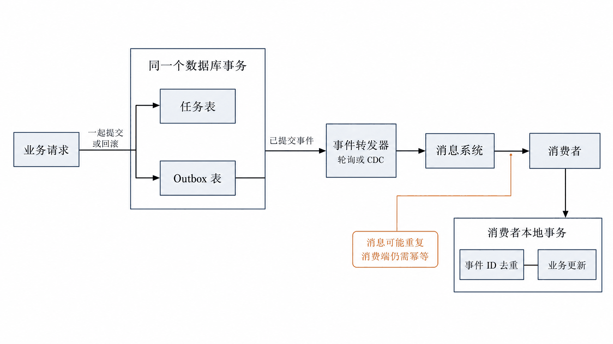

# 目录

[1.数据组织与访问路径](#q-001)
  - [面试问题：数据库、DBMS 和数据库系统有什么区别？](#q-002)
  - [面试问题：关系型数据库、Redis、向量索引和对象存储在 AI 系统中如何分工？](#q-003)
  - [面试问题：数据库范式、反范式和 SQL 优化如何取舍？](#q-012)
  - [面试问题：B+ 树、哈希索引和向量索引分别解决什么问题？](#q-005)

[2.事务、持久化与故障恢复](#q-101)
  - [面试问题：ACID、隔离级别和 MVCC 怎样保证并发任务的正确性？](#q-004)
  - [面试问题：WAL、redo、undo、binlog 和 checkpoint 如何支持恢复？](#q-013)
  - [面试问题：高可用、备份恢复与跨存储一致性该怎样设计？](#q-010)
  - [面试问题：事务性 Outbox 与 CDC 怎样解决“数据库写成功，消息却没发出去”？](#q-050)

[3.缓存、检索与任务状态](#q-102)
  - [面试问题：Redis 缓存、锁、限流和会话状态有哪些正确使用边界？](#q-006)
  - [面试问题：RAG 的向量存储如何处理过滤、版本和删除一致性？](#q-007)
  - [面试问题：Agent 的短期上下文、长期记忆与运行状态应怎样落库？](#q-008)
  - [面试问题：海量数据的 TopK、外排序和 bitmap 怎样选择？](#q-009)

[4.权限与分析负载](#q-103)
  - [面试问题：数据库权限与多租户隔离怎样约束 Agent 工具调用？](#q-011)
  - [面试问题：OLTP、OLAP 与列式存储为什么需要分工？](#q-051)

---

<h1 id="q-001">1.数据组织与访问路径</h1>

<h2 id="q-002">面试问题：数据库、DBMS 和数据库系统有什么区别？</h2>

<a id="1.数据库DBMS和数据库系统有什么区别？"></a>

**难度评分：⭐ (1/5)  |  考察频率：⭐⭐⭐⭐ (4/5)**

数据库是有组织、持久保存的数据；数据库管理系统（DBMS）是负责存储、查询、并发控制和恢复的软件；数据库系统则包括数据、DBMS、应用、权限、备份以及运维流程。三者对应的是**数据本身、管理数据的软件、围绕数据运行的完整系统**。

以一个生成图片的服务为例，用户表、任务表和计费记录构成业务数据库，PostgreSQL 可以充当 DBMS。连接池、访问账号、主备复制、定时备份、监控告警与恢复手册一起，才构成能交付的数据库系统。数据库文件仍在磁盘上，却因为连接数耗尽而无法接单，说明“数据还在”与“系统可用”是两回事。

DBMS 也不只等于关系型数据库。键值、文档、图和时序系统都在管理数据，只是数据模型、查询能力和一致性承诺不同。对象存储同样能保存数据，但通常不提供关系库那样的跨行事务和 SQL 查询，不能只因为“都能存文件或记录”就互相替代。

理解这道题以后，选型就有了落点：先确定数据有哪些约束、如何被访问、允许丢多少和停多久，再选软件。AI 服务更换一个模型并不难，任务、权限和账单失去一致性后却很难重建。因此，数据库基础首先是对状态负责的能力。

<h2 id="q-003">面试问题：关系型数据库、Redis、向量索引和对象存储在 AI 系统中如何分工？</h2>

<a id="2.关系型数据库Redis向量数据库对象存储在AIGC系统中如何分工？"></a>

**难度评分：⭐⭐ (2/5)  |  考察频率：⭐⭐⭐⭐⭐ (5/5)**

存储分工要围绕访问模式和事实来源设计。同一条数据可以有多个副本，但必须知道**哪一份记录具有最终解释权，哪些副本允许重建或暂时滞后**。

<div align="center">

| 数据与访问方式 | 常用存储 | 需要守住的边界 |
| --- | --- | --- |
| 用户、订单、任务状态，需要约束和事务 | 关系型数据库 | 唯一性、状态转移、并发更新 |
| 热点结果、短期计数、临时协调 | Redis | 过期、淘汰、故障切换与持久化配置 |
| 相似度召回，需要距离排序 | 向量索引或支持向量的数据库 | 召回率、过滤、更新可见性与版本 |
| 图片、视频、权重、原始文档 | 对象存储 | 对象键、校验值、版本和访问权限 |
| 大量日志、聚合统计 | 列式分析系统或数据湖 | 批次、数据新鲜度、扫描成本 |

</div>

例如，用户上传 PDF 后，原文件进入对象存储，文档 ID、租户、版本与解析状态进入关系库，切块产生的 embedding 进入向量索引。Redis 缓存一次检索结果时，缓存键还应包含租户、权限版本、文档版本和 embedding 版本；只用问题文本作为键，可能把别人的知识库结果返回给当前用户。

多种存储组合也带来一致性成本。文件上传成功、数据库写入失败时，需要清理孤儿文件；权限撤销后，需要让缓存和索引及时失效。向量索引应能从可信文档与版本元数据重建，缓存丢失也不应让已支付订单消失。

规模较小时，关系库加向量扩展和对象存储往往足够。只有当吞吐、隔离或检索能力形成真实瓶颈时，再拆出专门系统。每增加一种存储，都要多维护一份同步、备份、权限和故障恢复逻辑。

<h2 id="q-012">面试问题：数据库范式、反范式和 SQL 优化如何取舍？</h2>

<a id="11.数据库范式反范式和SQL优化在AI业务中如何取舍？"></a>

**难度评分：⭐⭐⭐ (3/5)  |  考察频率：⭐⭐⭐⭐⭐ (5/5)**

范式解决冗余导致的更新异常，反范式用可控冗余换取读取效率。判断好坏，要看一项事实被修改后，系统能否把所有副本同步到约定的状态。

第一范式要求关系中的属性值符合相应数据域，不能把多条业务记录塞成一个难以约束的列表。“原子”取决于建模需要，不能理解为字符串绝对不能再拆。第二范式要求非主属性完全依赖于每个候选键，排除对复合候选键一部分的依赖。第三范式常用“消除非主属性的传递依赖”帮助理解；严格定义是每个非平凡函数依赖 `X → A` 中，`X` 是超键或 `A` 是主属性。候选键不只限于最终选出的主键。

假设任务表存了 `model_id`、当前模型名称和模型维护者姓名，后两项可能由模型表中的事实决定。反复复制就容易出现更新一处、漏掉另一处的问题。但如果保存的是“任务运行当时的模型版本名称”，它属于历史快照，有独立业务含义，不能机械地删掉。

SQL 优化从执行计划和数据分布出发。对常见查询：

```sql
SELECT id, created_at
FROM tasks
WHERE tenant_id = 42 AND status = 'pending'
ORDER BY created_at, id
LIMIT 100;
```

可以评估 `(tenant_id, status, created_at, id)` 组合索引是否符合过滤与排序路径。索引也会增加写入、空间和维护成本，低选择性字段单独建索引未必有收益。`EXPLAIN ANALYZE` 会实际执行语句，对写操作必须格外留意；生产排查先看普通 `EXPLAIN`，再在可控环境测量。

深分页可改用 `(created_at, id)` 游标，但必须固定排序并处理并发新增或删除。任务事实适合保持清晰约束，报表宽表适合异步派生；异步能接受多大延迟，应写进接口和业务约定。

<h2 id="q-005">面试问题：B+ 树、哈希索引和向量索引分别解决什么问题？</h2>

<a id="4.数据库索引为什么常用B树哈希索引和向量索引有什么区别？"></a>

**难度评分：⭐⭐⭐ (3/5)  |  考察频率：⭐⭐⭐⭐⭐ (5/5)**

B+ 树通过有序、多路分支的结构减少查找需要访问的数据页。内部节点主要保存分隔键和子页指针，叶子层保存索引项并支持顺序遍历。每页容纳多个键，树通常较矮；范围查询定位起点后，可以沿叶子页继续扫描，而不必对每条记录重新从根查找。

“数据库索引都是 B+ 树”并不准确，不同引擎还有哈希、倒排、空间或日志结构索引。聚簇索引与二级索引的叶子内容也有区别：InnoDB 主键索引的叶子保存行，二级索引保存索引键及主键；PostgreSQL 常规 B-tree 索引指向堆表元组，不能照搬前一种存储解释。

<div align="center">

| 结构 | 擅长的访问 | 代价与限制 |
| --- | --- | --- |
| B+ 树类有序索引 | 等值、范围、排序 | 写入维护、页分裂、回表与缓存命中影响实际开销 |
| 哈希索引 | 等值查找 | 无天然顺序，需要处理冲突，不适合一般范围查询 |
| 倒排索引 | 词项到文档集合 | 分词、相关性排序及更新维护 |
| HNSW / IVF 等向量索引 | 高维相似度候选检索 | 召回率、延迟、内存和构建成本互相制约 |

</div>

HNSW 在分层近邻图中导航，IVF 先缩小到部分向量簇再搜索；PQ 是向量压缩与距离近似方法，可以和 IVF 等结构组合，不宜把三者当成完全同一层的分类。

对 `WHERE tenant_id = ... ORDER BY distance LIMIT k`，SQL 的逻辑条件顺序不等于执行器物理顺序。有的系统先取得 ANN 候选再过滤，过滤比例高时返回数量不足；也可能先用关系索引缩小集合后精确计算距离。应看执行计划，并以同一权限范围内的精确检索作为召回率基准。增加近似索引会改变返回结果，不能只测查询变快了多少。

<h1 id="q-101">2.事务、持久化与故障恢复</h1>

<h2 id="q-004">面试问题：ACID、隔离级别和 MVCC 怎样保证并发任务的正确性？</h2>

<a id="3.事务ACID隔离级别和MVCC在Agent任务系统中有什么价值？"></a>

**难度评分：⭐⭐⭐⭐ (4/5)  |  考察频率：⭐⭐⭐⭐⭐ (5/5)**

事务把一组数据库操作放进同一个提交边界。ACID 中，原子性保证事务操作整体提交或回滚；一致性要求约束在事务前后成立；隔离性规定并发执行可以观察到什么；持久性规定提交结果在相应故障模型与刷盘配置下如何保存。业务约束仍需要程序、唯一键、检查约束和锁共同表达，数据库不会自动理解“任务不能重复收费”。

MVCC 为数据保留多个版本，读者按可见性规则读取快照，减少普通读与写之间的阻塞。它不消除写写冲突，也不保证所有读都不加锁。旧版本必须回收，长期事务会拖住清理，造成膨胀。

<div align="center">

| 隔离级别 | 典型语义 | 仍需关注 |
| --- | --- | --- |
| 读未提交 | 标准允许脏读 | 有些产品映射到更强级别 |
| 读已提交 | 不读取其他事务未提交的数据 | 同一事务两次查询可能看到不同结果 |
| 可重复读 | 对重复读取提供更稳定的视图 | 实现不同，不能据名称推断幻读或写偏斜行为 |
| 可串行化 | 已提交结果等价于某种串行执行 | 可能等待或中止事务，应用要重试整个事务 |

</div>

PostgreSQL 的读已提交通常每条语句取得快照，可重复读使用事务级快照并防止幻读，但仍可能发生序列化异常。例如，两名值班者各自看到另一人仍在岗，分别把自己改为离岗，最后无人值守。这类跨行约束不能只靠“读到的是快照”保证。

领取一个已知任务可以用条件更新：

```sql
UPDATE tasks
SET status = 'running', worker_id = 'worker-1', version = version + 1
WHERE id = 1001 AND status = 'pending';
```

检查受影响行数，成功者才能继续。批量领取可在支持的数据库中使用事务加 `FOR UPDATE SKIP LOCKED`，但要理解跳过锁定行会改变可见任务集合。长时间 GPU 推理不应一直占着数据库事务：领取后提交，用租约、心跳和版本号控制后续状态写回。数据库中的一次领取成功，也不等于外部支付、发信等动作天然只执行一次。

<h2 id="q-013">面试问题：WAL、redo、undo、binlog 和 checkpoint 如何支持恢复？</h2>

<a id="12.WALbinlogcheckpoint和恢复机制为什么重要？"></a>

**难度评分：⭐⭐⭐⭐ (4/5)  |  考察频率：⭐⭐⭐⭐⭐ (5/5)**

WAL 的关键顺序是：**持久化的数据页不能领先于描述其变更的日志**。系统先保证相应日志到达所需的持久化位置，再允许脏页写回。这样，宕机后即使数据页未写完，也能根据日志恢复。它并不要求每次修改立刻把全部数据页写盘。

需要把通用原理与具体数据库实现分开：

<div align="center">

| 名称 | 作用 | 不能混淆的地方 |
| --- | --- | --- |
| WAL | 写前日志原则及相应日志体系 | PostgreSQL 用 WAL 做恢复、复制等 |
| redo log | 重做数据修改 | InnoDB 用它支持崩溃恢复 |
| undo log | 保留撤销或旧版本所需信息 | InnoDB 用于回滚和一致性读；PostgreSQL 不采用同一套 undo log 结构 |
| binlog | MySQL 服务层的变更日志 | 用于复制、时间点恢复等，不能直接代替引擎 redo |
| checkpoint | 确立恢复起点并推动脏页持久化 | 不是完整备份，也不是简单清空全部日志 |

</div>

例如，事务提交时相关日志已持久化，但数据页还在内存，宕机恢复可以重做日志中的修改；未提交版本如何处理，则取决于引擎的事务与可见性实现。MySQL 还要协调 binlog 与引擎提交状态，不能把两个独立日志文件都写了就认为一致。

提交延迟与可靠性有直接关系。同步刷盘增加等待，组提交让多个事务分摊一次持久化开销；弱化刷盘策略可能提升吞吐，也会扩大故障丢失窗口。必须区分进程崩溃、整机断电、磁盘损坏以及机房故障，单机日志无法覆盖所有故障。

在任务系统中，checkpoint、对象存储文件与数据库提交也不是同一个概念。模型检查点只保存训练状态，无法代替业务库备份；数据库 WAL 也不会自动恢复已经丢失的模型权重文件。

<h2 id="q-010">面试问题：高可用、备份恢复与跨存储一致性该怎样设计？</h2>

<a id="9.数据库高可用备份恢复和数据一致性在AI服务中如何理解？"></a>

**难度评分：⭐⭐⭐⭐ (4/5)  |  考察频率：⭐⭐⭐⭐⭐ (5/5)**

高可用降低服务中断时间，备份让数据回到可恢复的历史状态。主库误删数据时，复制会把错误同步给从库，因此**副本不能代替备份**。分库分表主要解决容量与扩展问题，也不自动提供高可用。

先定义两个目标：RPO 表示最多允许丢失多长时间的数据，RTO 表示最多允许中断多久。异步复制可能在主库故障切换时丢失尚未复制的提交；同步复制把部分等待放到正常写入路径，但也会受副本不可达和配置语义影响。自动切换还需隔离旧主，避免两个主库同时接受写入。

备份方案应包含基础备份、连续日志归档、保留策略、独立存储和恢复演练。时间点恢复通常先还原一个可用的基础备份，再重放连续日志到指定位置或时刻。日志缺段、密钥丢失、备份损坏都可能让“有备份文件”失去意义。演练应测实际恢复时长，并检查关键表、权限和业务不变量。

跨存储写入常见于生成任务：图像对象上传成功，任务记录却没有提交。可以先使用不可变对象键上传，校验完成后，在数据库事务中写入对象引用并把任务标为完成；后台定期清理超过保留窗口、没有业务引用的对象。反过来，不要先宣称任务成功，再期待文件稍后一定上传完成。

读副本也需要考虑读己之写。用户刚提交任务后立即查询，如果读到了复制滞后的副本，可能误以为任务没有创建。可在有限时间内路由主库，或利用日志位置、版本令牌等待副本追上。把延迟和恢复行为显式纳入接口，比笼统承诺“最终一致”更有用。

<h2 id="q-050">面试问题：事务性 Outbox 与 CDC 怎样解决“数据库写成功，消息却没发出去”？</h2>

**难度评分：⭐⭐⭐⭐ (4/5)  |  考察频率：⭐⭐⭐⭐ (4/5)**

任务写入数据库后要通知 GPU worker。如果先提交数据库再发消息，进程可能在两步之间崩溃；先发消息再提交，worker 又可能看到一个最终回滚的任务。普通数据库事务无法自动覆盖外部消息系统。

Outbox 把“要发送事件”变成数据库中的一条记录，与业务状态在**同一个本地事务**内提交：

```sql
BEGIN;
INSERT INTO tasks (id, status) VALUES (1001, 'pending');
INSERT INTO outbox (event_id, aggregate_id, event_type, payload)
VALUES ('event-1001-created', 1001, 'TaskCreated', '{"task_id":1001}');
COMMIT;
```

独立转发器轮询 outbox，或用 CDC（变更数据捕获）读取已提交日志，再向消息系统投递。这样，即使应用在提交后退出，待发送的事实仍在数据库里。Debezium 的 Outbox Event Router 就是这种机制的一种工程实现。

<div align="center">



</div>

图 1：业务状态与事件记录共同提交，转发器仍可能重复投递。消费者在自己的本地事务中协调去重记录与业务更新；跨系统副作用需要额外的幂等约定。

剩下的边界同样重要：转发器发出消息后、记录发送进度前崩溃，恢复时可能再次投递。因此通常按至少一次交付设计，消费者用 `event_id` 去重；去重记录与自己的业务更新也应处在同一事务里。需要顺序时，按同一业务实体的 `aggregate_id` 分区，并检查版本号，不能假设所有分区天然全局有序。

如果消费者调用外部支付接口，自己的数据库事务仍覆盖不了支付方。需要对方支持幂等键或状态查询，并保留结果未知的状态。不能因为用了 Outbox 就宣布实现了任意外部副作用的“恰好一次”。

监控应覆盖 outbox 积压、CDC 日志位点、重试次数、死信和事件延迟。CDC 长时间落后还可能导致数据库日志无法清理。这个方案的长期价值，是把容易丢失的操作意图变成可重放、可核对的持久事实。

<h1 id="q-102">3.缓存、检索与任务状态</h1>

<h2 id="q-006">面试问题：Redis 缓存、锁、限流和会话状态有哪些正确使用边界？</h2>

<a id="5.Redis缓存分布式锁限流和会话状态如何用于AIGC服务？"></a>

**难度评分：⭐⭐⭐⭐ (4/5)  |  考察频率：⭐⭐⭐⭐⭐ (5/5)**

Redis 的优势来自内存访问和丰富的数据结构，但可靠性取决于过期、淘汰、持久化与复制配置。把它当缓存时，故障后可以回源；把它当唯一任务记录时，就必须独立承担恢复责任，两种角色的要求差别很大。

缓存采用旁路模式时，读取未命中再访问数据库，写入通常先更新数据库再使缓存失效。并发读写仍可能把旧值重新填回，严格场景要结合版本号、事件失效和短 TTL；TTL 只限制最长陈旧时间，并不保证瞬时一致。热点失效可用请求合并、随机化 TTL 和限量回源缓解，缓存键必须包含影响结果的身份与版本。

单实例租约锁可用 `SET key token NX PX 30000`。`token` 应是每次获取生成的唯一值，释放时必须原子地比较 token 再删除，不能直接 `DEL`。但这仍没解决一个问题：旧持有者暂停超过 30 秒，锁过期后新持有者进入，旧进程恢复后仍可能继续写。对关键资源要用递增 fencing token 或业务版本条件，由最终写入方拒绝过期持有者；随机 token 只解决误删别人的锁，不能替代 fencing。

限流也要避免把 `INCR`、`EXPIRE` 当成彼此无关的两条命令。下面的 Lua 在首次计数时设置过期，作为简化的固定窗口示例：

```lua
local count = redis.call('INCR', KEYS[1])
if count == 1 then
  redis.call('EXPIRE', KEYS[1], tonumber(ARGV[1]))
end
return count
```

应用把返回值与额度比较；键包含用户和窗口标识。连续重设 60 秒 TTL 会把固定窗口变成另一种行为。固定窗口边界还可能允许瞬时双倍突发，平滑要求更高时评估滑动窗口或令牌桶。

Redis Streams 能保留消费者组与待确认消息，但仍需明确确认、重领、去重和落盘策略。会话过期、缓存淘汰与业务任务删除应分开处理，不能让一次内存淘汰抹掉用户已支付的生成请求。

<h2 id="q-007">面试问题：RAG 的向量存储如何处理过滤、版本和删除一致性？</h2>

<a id="6.向量数据库在RAG系统中如何设计？"></a>

**难度评分：⭐⭐⭐⭐ (4/5)  |  考察频率：⭐⭐⭐⭐⭐ (5/5)**

向量存储需要同时回答三个问题：找得准吗、用户有权看吗、内容还是当前版本吗。只保存 `text + embedding`，很难在文档更新和权限变更后保持这三点。

文档层保存 `document_id`、租户、来源、ACL 与版本；切块层保存 `chunk_id`、文档版本、页码、标题路径和文本哈希；向量层保存 embedding 模型版本、维度、距离度量与归一化约定。更换 embedding 模型后，即使维度相同，也不能默认新旧向量处于可比较的空间，应建立新索引、回填并评测后切换。

带过滤的 ANN 检索尤其容易误判。假设候选中只有 10% 属于当前租户，先取 40 个候选再过滤，可能只剩约 4 个，且数量并不固定。增加 TopK 只能缓解部分情况，还要考虑过滤选择性、候选搜索范围与超时预算。pgvector 从 0.8.0 起提供迭代扫描机制，可继续扩大索引扫描直到得到足够结果或达到限制；这说明“过滤”和“召回”需要一起设计，并非某个索引名就能保证。

实际可以比较三条路径：小的授权集合先过滤再精确排序；大集合采用过滤感知的近似搜索；按稳定租户或集合边界分区。无论物理执行顺序如何，未授权内容都不能进入给用户的结果、模型上下文或可见调试日志。重排提升相关性，不能代替权限检查。

文档更新时，先构建新版本切块与索引，通过版本指针一次切换可见集合；删除和撤权时，可先在可信元数据层禁止可见，再异步清理索引与缓存。需要记录清理进度和延迟，不能只从一个库删除便宣称完成。

评估至少区分授权集合内的 Recall@K、权限违规数量、更新可见延迟、P95 延迟与最终答案质量。关键词精确匹配、稀有实体和语义相似各有优势，可将词法与向量候选合并再重排；单纯扩大上下文不保证答案更可靠。

<h2 id="q-008">面试问题：Agent 的短期上下文、长期记忆与运行状态应怎样落库？</h2>

<a id="7.Agent系统中的长期记忆短期记忆和状态存储如何落库？"></a>

**难度评分：⭐⭐⭐ (3/5)  |  考察频率：⭐⭐⭐⭐⭐ (5/5)**

三类数据的区别在于用途和恢复承诺。短期上下文服务于当前会话，长期记忆帮助后续任务检索历史事实，运行状态记录一次任务究竟执行到了哪里。把三者都塞进一个向量库，会丢失状态机和一致性约束。

<div align="center">

| 类型 | 核心字段 | 关键约束 |
| --- | --- | --- |
| 会话上下文 | session_id、消息序号、角色、内容引用 | 顺序、访问控制、过期与截断策略 |
| 长期记忆 | owner、事实或摘要、来源、置信度、有效期 | 可撤销、可更新、避免把模型猜测当事实 |
| 运行状态 | run_id、step_id、status、version、lease_until | 合法状态迁移、并发领取和恢复 |
| 工具调用 | operation_id、参数哈希、幂等键、结果引用 | 副作用核对、重试与审计 |

</div>

运行状态最好用显式状态机，例如 `pending → running → succeeded/failed`，另外保留取消、超时和结果未知的状态。重试是新的 attempt，不宜随意覆盖历史失败记录。写回时使用 `WHERE version = ...` 之类的乐观并发条件，防止旧 worker 覆盖新进度。

恢复时要区分“计算可以重放”和“副作用需要核对”。文本解析失败可以重算；外部转账请求超时可能已经成功，应先用操作 ID 查询，不能直接再发一次。仅保存 `current_step = 3` 不足以判断第三步到底是否产生了外部效果。

长期记忆应保留来源、时间、适用范围与删除入口。用户纠正某项事实后，需要更新原始记录、向量索引和派生摘要。访问令牌、未经授权的个人信息或临时签名 URL 不应成为永久记忆。持久化的目标是让系统有证据地恢复和更新，而不是无限保存每一段对话。

<h2 id="q-009">面试问题：海量数据的 TopK、外排序和 bitmap 怎样选择？</h2>

<a id="8.海量日志文档TopK外排序和bitmap如何支撑RAG与评测？"></a>

**难度评分：⭐⭐⭐ (3/5)  |  考察频率：⭐⭐⭐⭐ (4/5)**

先明确数据是否能放入内存、键是否重复、需要精确结果还是允许近似。相同的“求 TopK”，对独立数值排序与对重复键统计频次，处理方式并不相同。

若每条记录已有确定分数，扫描 N 条数据并维护容量 K 的小根堆，时间约为 `O(N log K)`，额外空间约为 `O(K)`。求高频词则要先把同一个词的次数加起来。数据超出内存时，可按完整键哈希分区，让同一键的所有记录落入同一分区，分区内聚合后求 TopK，再汇总候选。

不能随意按时间把数据切块，各块只保留本地高频 TopK。一个词可能在每块都排第 K+1，却因持续出现成为全局第一；如果它从未进入局部候选，最后无法恢复。按键完整分区后，每个键的全局计数只出现在一个分区，才具备合并局部候选的相应前提。遇到严重倾斜，还要继续细分或专门处理热点键。

外排序把内存容纳的块分别排序落盘，再做多路归并。归并路数受内存缓冲区和文件描述符限制，目标是减少对全量数据的反复读写。日志按时间排序、重复文档按哈希聚集，都适合这类方法；仅看 CPU 比较次数会低估磁盘 I/O 成本。

bitmap 为整数域中的每个位置分配一位，支持快速存在性判断和集合交并。若最大 ID 为 U，普通 bitmap 需要约 U/8 字节；稀疏且上界极大的 ID 域可能浪费空间，可考虑压缩 bitmap 或哈希集合。Bloom filter 更省空间，但有假阳性，不能直接代替精确去重记录。

AI 数据治理中，以上方法对应高频错误统计、大规模评测结果合并和召回覆盖计算。先把准确性要求和内存预算说清楚，再讨论算法，答案才有工程意义。

<h1 id="q-103">4.权限与分析负载</h1>

<h2 id="q-011">面试问题：数据库权限与多租户隔离怎样约束 Agent 工具调用？</h2>

<a id="10.数据库安全权限和多租户隔离在Agent工具调用中为什么重要？"></a>

**难度评分：⭐⭐⭐⭐ (4/5)  |  考察频率：⭐⭐⭐⭐⭐ (5/5)**

模型生成 SQL 的能力与访问数据的权限是两件事。租户身份应来自可信认证上下文，并由服务端注入查询，不能由模型参数决定。用户在问题里写“切换到管理员”不能改变数据库会话的权限。

参数化查询能保护值的位置，但不能任意参数化表名、列名、排序表达式或整段 SQL。这些结构必须通过白名单映射生成。给 Agent 暴露“查询当前用户的任务”之类的受限工具，通常比给它一个通用 SQL 执行器更容易审计。

多租户防护可叠加应用过滤、数据库行级安全（RLS）、独立 schema 或独立实例。PostgreSQL 的 RLS 需要注意表所有者、超级用户及带 `BYPASSRLS` 的角色可能绕过策略；不能用管理员账号验证一次正常结果就认为隔离成立。连接池复用会话时，还必须正确设置与清理租户上下文，防止前一个请求的身份残留。

只读账号也不能解决所有风险。一个允许全表读取的只读账号仍能泄漏数据；复杂笛卡尔积、巨大向量扫描也能消耗资源。应限制可访问视图、字段、行数、执行时长与连接数，并审计拒绝事件。日志保存参数摘要或受控引用，避免把敏感全文复制到另一个低权限系统。

写操作采用业务接口定义合法状态转移，再根据风险决定确认或审批。幂等键、审计记录和事务约束必须在服务端落实。检索、数据库与对象下载链接也应遵守同一身份边界，避免“数据库过滤正确，签名 URL 却能读任意租户文件”的绕行路径。

<h2 id="q-051">面试问题：OLTP、OLAP 与列式存储为什么需要分工？</h2>

**难度评分：⭐⭐⭐ (3/5)  |  考察频率：⭐⭐⭐⭐ (4/5)**

在线事务处理（OLTP）关注短事务、点查和并发修改；在线分析处理（OLAP）关注大范围扫描、聚合与跨时间统计。二者可以服务同一业务，但资源需求和延迟目标不同。

假设任务表有一亿条记录，在线请求只需要更新某个任务状态，运营报表却要统计近三个月所有模型的 token 用量。前者依赖索引、锁和快速提交，后者主要受扫描字节数、聚合效率和 I/O 吞吐影响。把大型报表直接丢给在线主库，可能挤占缓存、连接和磁盘带宽，拖慢普通请求。

行式布局把一行的字段放得较近，适合取出或修改完整业务记录；列式布局把同列值集中存储，查询只读需要的列，并利用相似值压缩、分区裁剪和向量化执行。例如只统计 `model_id`、`tokens`、`created_at` 时，不必读取很大的提示词和输出字段。Parquet 是常见列式文件格式，DuckDB 一类嵌入式分析引擎可以直接查询这类文件，但它并不因此自动成为适合大量跨进程并发写入的在线主库。

分析数据可由批量导出或 CDC 形成，保留数据水位、schema 版本、事件时间与去重键。报表应说明数据更新到何时，回补历史数据时也要能重新计算。对象存储文件通常按日期等有限维度分区，分区过细会产生海量小文件和元数据开销。

HTAP 尝试在同一系统中兼顾事务与分析，仍要面对副本同步、资源隔离和新鲜度取舍。长期值得掌握的是按负载选择布局与执行方式；是否拆库，应由真实查询和资源竞争决定。

---

### 参考资料

- [PostgreSQL：事务隔离与实现差异](https://www.postgresql.org/docs/current/transaction-iso.html)
- [PostgreSQL：MVCC](https://www.postgresql.org/docs/current/mvcc-intro.html)、[WAL](https://www.postgresql.org/docs/current/wal-intro.html)、[时间点恢复](https://www.postgresql.org/docs/current/continuous-archiving.html)、[行级安全](https://www.postgresql.org/docs/current/ddl-rowsecurity.html)
- [Redis：分布式锁及 fencing 边界](https://redis.io/docs/latest/develop/clients/patterns/distributed-locks/)、[INCR 与限流示例](https://redis.io/docs/latest/commands/incr/)
- [pgvector：索引、过滤与迭代扫描](https://github.com/pgvector/pgvector#filtering)
- [Debezium：Outbox Event Router](https://debezium.io/documentation/reference/stable/transformations/outbox-event-router.html)
- [DuckDB 1.5 文档：并发模型](https://github.com/duckdb/duckdb-web/blob/main/docs/1.5/connect/concurrency.md)、[Apache Parquet：列式格式](https://parquet.apache.org/docs/overview/)

资料核验日期：2026-11-26。各数据库的事务与日志实现应分别理解，版本相关行为按实际部署核对。
